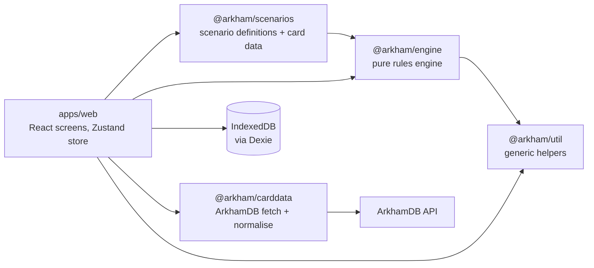
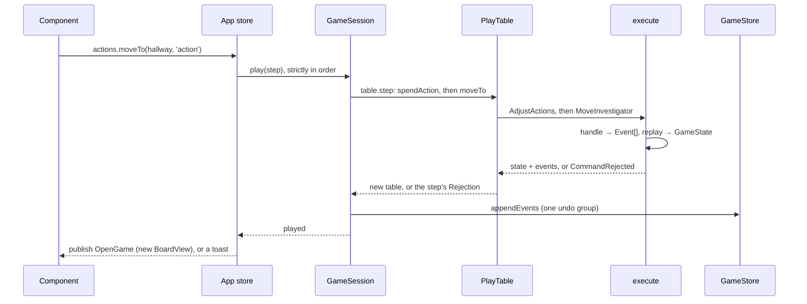
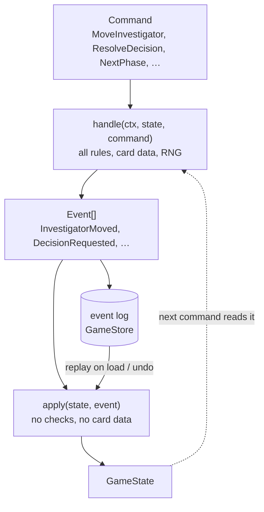
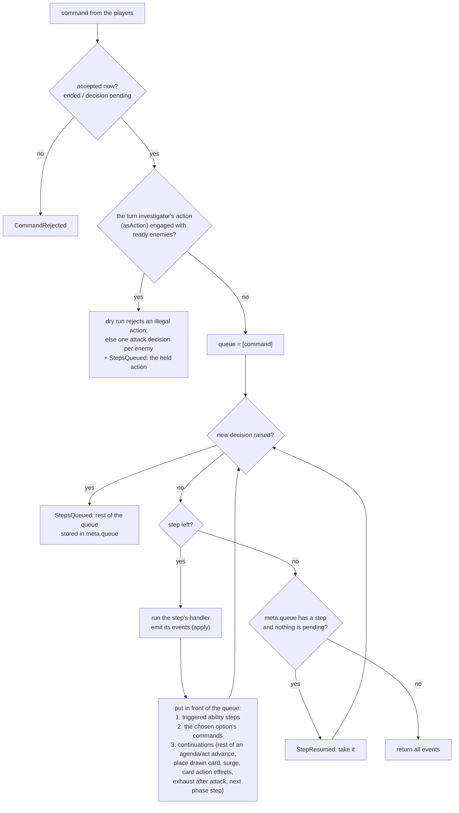
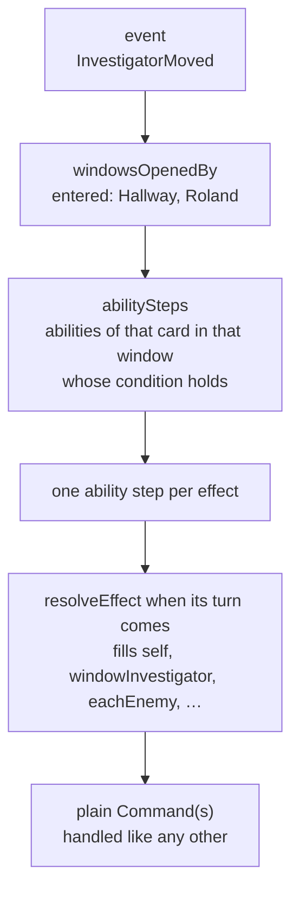
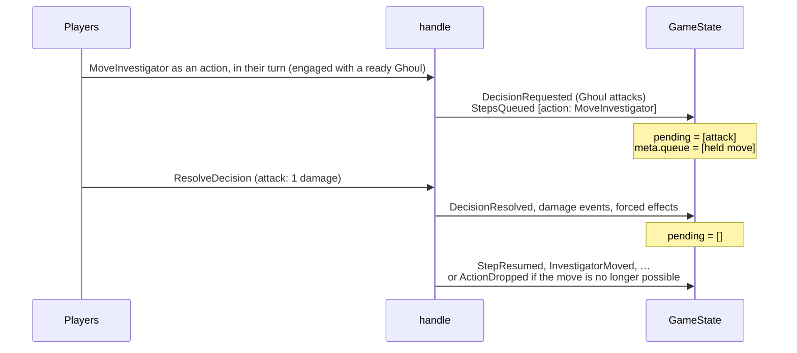

# Arkham Companion – Architecture

How the app is built today: the key pieces, their boundaries and the ideas behind them.
This page is the overview; each component has its own page in [`architecture/`](architecture/), linked below.
Requirements and plans are in [product.md](product.md).
Details live in the code's doc comments; these pages point at them.

**Keeping it current:**

- A PR that adds or changes a component updates that component's page, briefly: a new concept, boundary or extension point, not every new field or case.
- This overview changes only for a new package, dependency direction or key design decision, or when a component page is added.
- One page per component keeps parallel PRs out of each other's way; when a page grows long, split it by part (as the play screen is).
- Keep paragraphs short and enumerations as lists, one item per line ([coding guidelines](coding-guidelines.md) §8).
- Refer to components by name (architecture "Triggers and card effects").
- Link files, not lines.

## Overview

An offline PWA with no backend.
Players keep their own decks, skill tests and chaos bag; the app runs the scenario side: encounter deck, doom, agenda and act, the map, enemies and forced effects.

Arrows are package dependencies; [ESLint](../eslint.config.js) enforces the important ones.
The engine depends only on `@arkham/util`: no React, storage, network, clock or `Math.random`.
Only [`IndexedDbStore`](../apps/web/src/storage/IndexedDbStore.ts) imports Dexie.
[`packages/review_digest`](../packages/review_digest/src/) is CI tooling.

- [`packages/engine`](../packages/engine/src/): game state, commands, events, reducer, generic rules, the `GameStore` interface, and the test tools (`GameBuilder`, `PlayTable`, `BoardView`).
- [`packages/scenarios`](../packages/scenarios/src/): scenario and campaign definitions; special rules are card abilities.
- [`packages/carddata`](../packages/carddata/src/): ArkhamDB fetch, validation, normalisation; the investigator catalog.
- [`packages/util`](../packages/util/src/): generic string, array and object helpers.
- [`apps/web`](../apps/web/src/): the React PWA, its app store and the IndexedDB store.

### How one player action flows

1. A component calls an action on the app store's [`GameActions`](../apps/web/src/state/gameActions.ts) (`actions.moveTo(hallway)`).
2. The [`GameSession`](../apps/web/src/state/gameSession.ts) plays it as one step on its `PlayTable`, which sends `Command`s through [`execute`](../packages/engine/src/execute.ts).
3. [`handle`](../packages/engine/src/handle.ts) checks each command and returns every `Event` it causes, forced effects included, or throws `CommandRejected`.
4. [`replay`](../packages/engine/src/reducer.ts) folds the events into the new `GameState`.
5. The session writes the events with [`GameStore.appendEvents`](../packages/engine/src/store.ts) as one undo group; only then does the screen show the new state.

### Key design decisions

- **Pure, deterministic engine.** Same state and command, same events; randomness only from the seeded RNG in the state. Fast tests, reproducible games.
- **Event sourcing.** The event log is the game: undo, refresh recovery, export, bug reports and later sync all come from it.
- **Assistant, not referee.** Where the rules give the players a choice, the engine asks instead of guessing, and `ManualAdjust` can correct any state. A rules bug never blocks a game night.
- **Scenarios as data.** A scenario is setup data plus card data whose abilities carry its rules. What two scenarios need becomes an engine primitive.
- **Card data from ArkhamDB.** Fetched at build or run time; nothing copyrighted is committed or bundled.
- **Strong types.** All identifiers are branded strings ([`ids.ts`](../packages/engine/src/ids.ts)):
  - `CardCode` (printed data, shared by copies),
  - `InstanceId` (one card on the table),
  - `InvestigatorId` (a seat in one game),
  - `InvestigatorCode` (the investigator card),
  - `CardName` (readable, never an identity).

Stack:

- TypeScript strict, Vite + pnpm workspaces
- React 19 with hash routes (static GitHub Pages), Zustand
- i18next (English and German)
- Dexie
- zod for external input only
- vite-plugin-pwa
- Vitest and Playwright

## Engine overview

The core of the app's logic: how one command becomes events, how card abilities hook in, and how the engine waits for the players.
Details are on the component pages: [Command handling](architecture/command-handling.md), [Triggers and card effects](architecture/triggers-and-card-effects.md), [Decisions](architecture/decisions.md), [Rounds, phases and turns](architecture/rounds-phases-and-turns.md).

### Command → events → state

- `handle` is the only place that decides: it validates the command, reads card data and draws from the seeded RNG, and writes everything it worked out into the events.
- `apply` only folds events into state, so replaying a stored log gives the same state without card data.
- Every event of one step (`GameSession.play` → `PlayTable.step`, e.g. spending the action and the move) shares one `commandId`; undo drops the whole group.

### Inside `handle`: the step queue

One command resolves as a queue of steps, depth first: a step's own events, then the forced effects they trigger, then the options an answer chose, then the step's continuations.

- Triggered steps include a new lead after the lead left (`newLeadInvestigator`). A phase step runs its commands first, then the triggers of its events, then the next phase step.
- A rejected follow-up rejects the whole player command (`triggeredCommandRejected`), and so does a chain longer than `MAX_TRIGGERED_COMMANDS` (`triggerLoop`).
- Steps are plain data (`QueuedStep`): a command, an ability effect, a held action, the rest of an agenda or act advance, placing a drawn card, a surge draw, a new lead, an enemy exhausting after its attack.
  That is what lets the rest of a resolution wait in the state.

### Timing windows

Card abilities are data: a timing window, an optional condition and effects ([Triggers and card effects](architecture/triggers-and-card-effects.md)).
After a step emits its events, `triggeredSteps` asks which windows each event opens and which cards have abilities there.

- Windows open against the state right after each event, but abilities are checked against the state after all of the command's events, so every ability sees the complete outcome.
- Each effect resolves only when its step comes up, so it sees what the effects before it did, and its own triggers resolve before its next sibling (depth first).
- An effect on each investigator or enemy runs all its commands at once (`resolveAtOnce`, RR "Priority of Simultaneous Resolution"), and a "you must either" choice keeps only the options that can change the state (`withResolvableOptions`).

### Decisions and held actions

When the rules give the players a choice, or the engine needs a result it cannot know (a skill test), a step emits `DecisionRequested` and the queue stops.
The rest waits in the state until the answer:

Where this lives in `GameState` ([`state.ts`](../packages/engine/src/state.ts)):

- `pending: Decision[]`: the open questions. Each option carries the commands it runs, so the answer is data; only a basic action's skill test works out its consequences when the answer arrives (`testKind`, so corrections made meanwhile count). While one is pending, only `ResolveDecision` and `ManualAdjust` are accepted (`allowedWhilePending`).
- `meta.queue: QueuedStep[]`: the rest of a resolution waiting for those answers, next first. The command that clears the last decision resumes it after its own steps.
- A held action (`kind: 'action'`) is an action waiting for the attacks of opportunity it provoked. It runs once they are all answered, or is dropped (`ActionDropped`) if the investigator was defeated or the action became illegal meanwhile, so the answer stays valid.
- `meta.steps: PhaseStep[]`: the automated steps left in the current phase (doom, encounter draws, hunters, attacks, upkeep). They are not queued: the players go on with the next `NextPhase`.
- `meta.phase`, `meta.round`, `meta.turn` and `meta.turnsTaken`: where the round stands.

## Components

- [Game state](architecture/game-state.md): `GameState`, zones, maps and invariants.
- [Command handling](architecture/command-handling.md): `handle` and `apply`, the step queue, `COMMAND_SPECS`.
- [Triggers and card effects](architecture/triggers-and-card-effects.md): abilities, templated commands, card actions and modifiers.
  - [Card patterns](architecture/card-patterns.md): card text to card data, one example per pattern.
- [Decisions](architecture/decisions.md): questions for the players and skill tests.
- [Rounds, phases and turns](architecture/rounds-phases-and-turns.md): automated phase steps and turns.
- [Rule modules](architecture/rule-modules.md): generic rules per subject.
- [Scenarios](architecture/scenarios.md): `ScenarioDefinition`, setup to end, setup steps, hand-entered scenarios.
- [Campaign](architecture/campaign.md): the campaign log, its lifecycle and resolutions.
- [Card data](architecture/card-data.md): `CardDb` and the ArkhamDB pipeline.
- [Persistence](architecture/persistence.md): `GameStore` and `IndexedDbStore`.
- [Web app](architecture/web-app.md): routes, the investigator picker, `OpenGame`.
  - [Play screen](architecture/play-screen.md): layout, status row, symbols and styling.
    - [Encounter piles](architecture/play-screen-encounter.md)
    - [Map and locations](architecture/play-screen-map.md)
    - [Investigators and enemies](architecture/play-screen-investigators.md)
    - [Decisions](architecture/play-screen-decisions.md)
- [Tests and debugging](architecture/tests-and-debugging.md): `newGame()`, `PlayTable`, `BoardView`.
