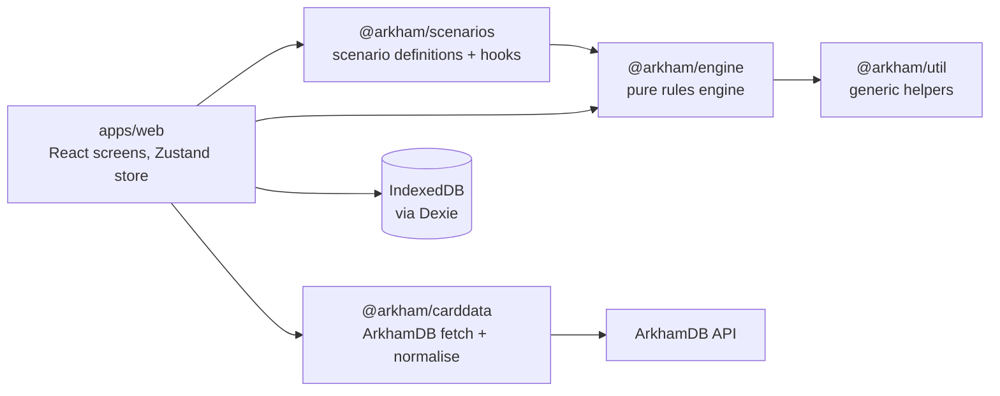

# Arkham Companion – Architecture

How the code is put together, as built. What the app is for, its scope, screens and roadmap are in [product.md](product.md).

The document has two levels. **Overview** is the whole system on one page. **Pieces** has one section per part that gets extended, each with the same headings: what it does, where it lives, how to extend it, what must stay true, and why it is built that way. **Not built yet** keeps the designs of planned pieces until they exist.

**Keeping it current:** a PR that adds or changes a piece (a new kind of command, trigger, decision, setup step, store method, package or dependency direction) updates that piece's section in the same PR, and a PR that builds a planned piece moves its design from "Not built yet" into "Pieces". The diff of this file is where a reviewer sees an architecture change. Refer to sections by name (architecture "Triggers and card effects"), not by number.

## Overview

The app is an offline PWA with no backend. Players run their own cards; the app runs the scenario side: the encounter deck, doom, agenda and act, the map, enemies and forced effects.

Arrows are package dependencies. The engine depends on nothing but `@arkham/util`; it never sees React, storage, the network, a clock or `Math.random`. `packages/review_digest` is CI tooling and no part of the app.

**How one player action flows:**

1. A screen calls the app store (`apps/web/src/state/appStore.ts`), which builds a `Command`.
2. `execute(ctx, state, command)` calls `handle`, which validates the command against the state and returns `Event`s, including the whole chain of forced effects it triggered. A refused command throws `CommandRejected` and changes nothing.
3. `apply` folds the events into a new `GameState`.
4. The store writes the events through `GameStore.appendEvents` before the screen updates. Loading a game replays its log from the last snapshot.

`ctx` (`EngineContext`, `packages/engine/src/cards.ts`) carries what is code or static data: the `CardDb`, the scenario's `hooks` and the card `effects`. Nothing in it is part of the saved state.

**Principles** (each buys the benefit after the dash):

1. **Assistant, not referee.** The app suggests, players confirm, and every state can be corrected with `ManualAdjust` – a rules bug or a house rule never blocks a game night.
2. **Pure, deterministic engine.** Same state plus same command gives the same events; randomness only through the seeded RNG in the state – rules are fast to test, and every game can be reproduced.
3. **Event sourcing.** Every change is an event in the log – undo, refresh recovery, export, bug reports and later sync all come from one mechanism.
4. **Data separate from rules.** Card data comes from ArkhamDB at build or run time – errata and translations need no code change, and nothing copyrighted is committed.
5. **Generic before specific.** What two scenarios need becomes an engine primitive – each new scenario gets cheaper.
6. **Seams before features.** Card effects, cloud sync and auto-layout have an interface before they have an implementation – something playable early, no rewrites later.

**Technology:** TypeScript (strict) in a pnpm workspace; Vite, React 19, React Router (hash routes for static hosting), Zustand, i18next, vite-plugin-pwa; Dexie for IndexedDB; zod for external input (ArkhamDB JSON, imported saves); Vitest and Playwright. ESLint (`eslint.config.js`) enforces the engine's purity and that only `IndexedDbStore` imports Dexie.

## Pieces

### Game state

**What:** the whole table as one serialisable value, `GameState`. Every physical card is one `CardInstance` with a unique ID, its card code and exactly one `Zone`; four copies of a card are four instances.

**Where:** `packages/engine/src/state.ts` (`GameState`, `CardInstance`, `Investigator`, `GameMeta`, `Decision`), `zone.ts`, `map.ts` (`GameMap`, `Edge`), `ids.ts` (branded IDs), `invariants.ts`.

**Extend it:** add a field to the type with a doc comment, give it a value in `emptyState()` and in the reducer case that creates it, and add its rule to `checkInvariants` if it can become inconsistent. A new kind of place for cards is a new `Zone` kind plus its key in `zoneKey` (`zone.ts`) and its reference check in `validateZone` (`placement.ts`).

**Must stay true** (`checkInvariants`, run after every command in the end-to-end test): each card is in one zone and listed once in `order` for that zone; no token count is negative; every connection joins two known cards once; pending decisions and turns are well formed.

**Why:** "where is this card?" always has one answer, so moving a card anywhere is the same operation and every rule can rely on it. Values printed per investigator (clues, health, thresholds) are a `ScaledValue` resolved with the player count, not stored. Connections are an explicit graph on `GameMap`, not derived from where tiles sit, because they change during play, can be one-way and can span several maps; an edge is stored on the map named when it was added and movement ignores which map owns it.

### Commands, events and the reducer

**What:** a `Command` is a request that may be refused and may need card data or randomness. An `Event` is a fact that is always applied the same way. `handle` turns commands into events, `apply` folds events into state.

**Where:** `packages/engine/src/commands.ts`, `events.ts`, `handle.ts` (dispatch and the trigger loop) with one `handle_<area>.ts` per area (board, encounter, enemy, investigator, scenario), `reducer.ts` (`apply`, `replay`), `execute.ts`, `rejection.ts` (`Rejection` codes), `rng.ts`, `undo.ts`.

**Extend it:** a new command is a type in `commands.ts` added to the `Command` union, a case in `handle.ts` that calls a handler in the matching `handle_<area>.ts`, and tests that call `handle` with it. Prefer reusing existing events; a new event is a type in `events.ts` with a reducer case. A new reason to refuse is a `RejectionCode` with its fields, so the UI can explain it.

**Must stay true:** all logic is in `handle`; `apply` never validates, generates IDs or draws random numbers, so replaying a log needs no card data and no RNG (`DeckShuffled` carries the new order). The RNG state lives in `GameMeta`, so redoing a command gives the same shuffle. One player command and its whole trigger chain is one undo group (`StoredEvent.commandId`).

**Why:** keeping all decisions in `handle` makes replay deterministic and cheap, and makes refused commands free: nothing is applied until the whole chain succeeded.

### Triggers and card effects

**What:** forced effects as code. A `TriggerHook` is `(ctx, state, event) => Command[]`. `ScenarioHooks` are the scenario's own (`afterDoomPlaced`, `onAgendaAdvance[code]`, `onActAdvance[code]`, `onRoundEnd`, `onCardEnters`); a `CardEffect` belongs to one card code (`onReveal`) and behaves the same in every scenario.

**Where:** `packages/engine/src/triggers.ts`; the loop that runs them is in `handle.ts`. Scenarios set `ScenarioDefinition.hooks`; card scripts go in an `EffectsRegistry`. Both reach the engine through `EngineContext`.

**Extend it:** a new trigger point is a field on `ScenarioHooks` or `CardEffect` and a case in `matchingTriggers` naming the event that fires it, with a test in `triggers.test.ts`. A new scripted card is an entry in the effects registry.

**Must stay true:** hooks are pure and return commands, never events, so their effect is validated and can use card data and the RNG like a player command. After a command, hooks are matched per event (scenario hooks before card effects) and evaluated against the state after all of that command's events; their commands are handled depth first and append to the same event list. A refused follow-up refuses the original command (`triggeredCommandRejected`); more than `MAX_TRIGGERED_COMMANDS` refuses it with `triggerLoop`. `ManualAdjust` and `StartScenario` fire no triggers.

**Why:** one bus for every forced effect means scenarios add rules without touching the engine, and the depth-first chain matches the order the rules resolve them in.

### Decisions

**What:** where the rules give the players a choice or the engine needs an answer (a hunter tie, a spawn location, "advance the agenda?", a skill test result), the engine puts a `Decision` into `GameState.pending` instead of guessing.

**Where:** `packages/engine/src/decisions.ts` (`RequestDecision`, `ResolveDecision`, `skillTestDecision`, `confirmOptions`), `describe_decision.ts` (debug text), `skill_tests.ts` (`Investigate`, `Fight`, `Evade`), `attacks_of_opportunity.ts`.

**Extend it:** raise one by returning a `RequestDecision` command (from a handler, hook or phase step) whose options each carry the commands they trigger. A new kind of question is a `DecisionKind` in `state.ts`; a new engine-raised prompt also gets its debug text in `describe_decision.ts`.

**Must stay true:** every option carries its commands, so the mapping from answer to consequence is data. `ResolveDecision` runs the chosen option's commands like trigger follow-ups, in the same undo group; if one is refused, the answer is refused and the decision stays. A pending decision blocks every player command except `ManualAdjust` and `ResolveDecision`. An action that provokes attacks of opportunity is held (`ActionHeld`) until their decisions are answered, then resumes or is dropped.

**Why:** one mechanism means one dialog in the UI, and any rule or scenario can ask without new plumbing.

### Rounds, phases and turns

**What:** the phase assistant. `NextPhase` runs the outstanding steps of the current phase (`GameMeta.steps`) or moves to the next phase and runs its steps; turns track who acts in the investigation phase.

**Where:** `packages/engine/src/phases.ts` (`PhaseStepId`, the steps of each phase), `turns.ts` (`StartTurn`, `EndTurn`, `AdjustActions`), `enemies.ts` (enemy phase attacks), `hunters.ts`.

**Extend it:** a new step is a `PhaseStepId` with its title in `PHASE_STEP_TITLES`, placed in the phase's step list in `phases.ts`, with the commands it runs.

**Must stay true:** each step removes itself first (`PhaseStepsChanged`) and then runs its commands through `handle`; the loop stops as soon as a decision is pending, so the next `NextPhase` resumes with the following step. The first round starts in the investigation phase.

**Why:** steps as data make the assistant resumable after any answer and let the UI show what is left in a phase.

### Rule modules

The rules themselves are spread over small modules, one per subject. Shared queries live with the subject they are about.

| Subject | Files |
| --- | --- |
| Board: connections, reveal, maps, placement | `board.ts`, `handle_board.ts`, `placement.ts`, `map.ts` |
| Doom, agenda and act | `doom.ts`, `handle_scenario.ts` |
| Encounter deck: draws, surge, peril, revelation tests | `handle_encounter.ts` |
| Enemies: spawn, engagement, prey, hunters, attacks | `spawn.ts`, `engagement.ts`, `hunters.ts`, `enemies.ts`, `handle_enemy.ts` |
| Investigators: health, sanity, defeat, movement | `investigators.ts`, `handle_investigator.ts` |
| Keywords the rules react to | `keywords.ts` (parsed by `@arkham/carddata`) |
| Card lookups by ID and name | `lookup.ts`, `cards.ts` |

The game rules each module implements are summarised in [rules.md](rules.md).

### Scenarios

**What:** a scenario is mostly data, `ScenarioDefinition`: agenda and act decks, chaos bag per difficulty, reference card, setup steps, and `hooks` for the rules that need code. `compileSetup` turns it into one `StartScenario` command.

**Where:** the types and the setup DSL are in `packages/engine/src/scenario.ts` and `setup.ts`; scenarios live in `packages/scenarios/src/<scenario>/` (today only the hand-entered test scenario `the_gathering/`). The app lists playable scenarios in `apps/web/src/scenarios/scenarioCatalog.ts`.

**Extend it:** a new scenario is a folder with its definition, its hooks and an end-to-end test, plus an entry in the app's catalog. A setup instruction that two scenarios need is a new `SetupStep` kind in `setup.ts`; a mid-scenario change of the board uses the same steps (`compileMapStep` turns an `addMap` step into an `AddMap` command).

**Must stay true:** hooks return commands that run through the normal `handle` path. Game commands such as `MoveCard` and `AddMap` exist for hooks: unlike `ManualAdjust` they fire further triggers.

**Why:** data is easy to validate, review and later generate from imports; code is kept for the few truly special rules.

### Card data

**What:** the engine reads card numbers through `CardDb` (`ctx.cards.get(code)` returns `CardStats`) and never loads card data itself. `@arkham/carddata` fetches ArkhamDB packs, validates the raw JSON with zod and normalises it to `CardDef`; it also builds the investigator catalog.

**Where:** `packages/engine/src/cards.ts` (`CardStats`, `CardDb`, `EngineContext`), `packages/carddata/src/` (`schema.ts`, `fetch.ts`, `catalog.ts`, `keywords.ts`, `packs.ts`), the app's loader in `apps/web/src/catalog/`.

**Extend it:** a new card field is read in `RawCardSchema`, normalised in `normaliseCard` and, only if a rule needs it, copied into `CardStats`.

**Must stay true:** fetched JSON and images are never committed; they go to `packages/carddata/.cache/` or IndexedDB. Tests use invented cards or hand-entered numbers. The app refreshes with `If-Modified-Since` and keeps working offline from its cache.

**Why:** ArkhamDB is the community reference with a public API, CORS and translations, so cards arrive accurate and in the players' language without copyrighted text in the repository.

### Persistence

**What:** `GameStore` is the only way to save or load a game. It stores the event log and snapshots, replays a game on load, groups undo by `commandId` and rejects a write whose `expectedSeq` doesn't match (optimistic concurrency for several tabs).

**Where:** the interface is `packages/engine/src/store.ts`; `apps/web/src/storage/IndexedDbStore.ts` implements it with Dexie (tables `games`, `events`, `snapshots`, `campaigns`, `cards`, `catalog`); `gameExport.ts` reads and writes the JSON export.

**Extend it:** a new operation is a method on `GameStore` with its doc comment as the contract, implemented and tested in `IndexedDbStore`. A schema change bumps the Dexie `version()` with an `upgrade`; a change of the state shape bumps `STATE_VERSION`.

**Must stay true:** only `IndexedDbStore` talks to IndexedDB (ESLint enforces it). Every command is written before the UI updates. Game IDs are UUIDs and never device-bound, so they survive a later cloud store. localStorage holds only per-device settings.

**Why:** a tablet at the table gets refreshed and runs out of battery; writing the log first means nothing is lost, and the log doubles as export format and basis for sync.

### Web app

**What:** the React PWA: routes and screens, the Zustand app store that wraps the engine and the `GameStore`, the new game wizard and investigator picker, translations and settings.

**Where:** `apps/web/src/` – `App.tsx` (routes), `screens/`, `state/appStore.ts`, `wizard/`, `picker/`, `i18n/`, `settings/`, `pwa/`, `styles/tokens.css`.

**Extend it:** a new screen is a route in `App.tsx` and a component in `screens/`; anything that changes a game goes through the app store, which sends engine commands and persists their events. Text goes into the i18n files in English and German, styles use the tokens, and UI changes extend an `@flow` E2E spec.

**Must stay true:** components never mutate game state or touch storage directly; the app store is a factory around a `GameStore` so tests can inject an in-memory one. Markup is structure only; presentation is in CSS.

**Why:** a thin UI over a proven engine keeps UI problems and rules problems apart.

### Tests and debugging

**What:** unit tests per engine module, table tests for invariants, and one end-to-end test per scenario that plays several rounds through a game-language driver.

**Where:** `packages/scenarios/src/the_gathering/end_to_end.test.ts` with its driver `test_table.ts` (`TestTable`); `formatBoard(ctx, state)` in `packages/engine/src/format_board.ts` renders the board as stable plain text for inline snapshots and failure messages; `checkInvariants` runs after every command there.

**Extend it:** every rule change adds a step to the end-to-end test where the rule shows at the table, so reviewers see it in context.

## Not built yet

Designs for pieces that have a task but no code. Each moves into "Pieces" with the PR that builds it.

### Campaign mode (M1C, M5)

- **Campaign log:** investigators, trauma, XP, killed or insane, story records, chaos bag. `GameState.campaign` is a stub until then.
- **Chaos bag:** standalone uses the scenario default per difficulty; a campaign uses the log, modified by resolutions. Scenarios that build on earlier ones read the log in `campaignSetup`.
- **Resolutions:** declarative steps (`record`, `addChaosToken`, `removeChaosToken`, `awardXp`, `addTrauma`), confirmed by the players. Deck upgrades stay with the players.

### Scenario data pipeline (M4)

No single source has everything, so each field comes from the first source that has it, with a manual override on top:

1. **ArkhamDB:** card stats and text, encounter sets and quantities, agenda and act order, doom and clue values, victory points, investigators. No connection symbols and no layout.
2. **ArkhamCards campaign data** ([zzorba/arkham-cards-data](https://github.com/zzorba/arkham-cards-data)): setup steps including `location_setup` grids (the book layout), chaos bags per difficulty, campaign log entries and resolutions. Imported at build time and not committed, since that repo carries no licence.
3. **Card images:** connection symbols are only printed on the cards. A dev-time extraction step (a Claude Code task or a vision-model script) writes them to `packages/scenarios/data/connections/<pack>.json`, card codes and symbol names only, reviewed once against a contact sheet.
4. **Manual:** the board's edit mode adds or removes connections and moves slots, saved as a scenario override file that can be committed.

The engine then builds edges from the revealed state. The setup DSL gains `randomLocations(pool, slots)` (seeded RNG) and `replaceLocation`.

### Board rendering (M3, M6)

The book layout is stored as slots (a grid or free positions); the map is SVG with pan and zoom, several maps as tabs or side by side; elkjs auto-layout for maps without a book layout; dnd-kit for dragging locations on a tablet.

### Cloud sync (M8)

A second `GameStore` (`CloudStore`) next to `IndexedDbStore`; sync through the append-only event log with optimistic concurrency (`expectedSeq`); login; backend to be decided (Supabase, Firebase or Cloudflare). Already prepared: UUID game IDs, timestamped events, no device-bound IDs.
