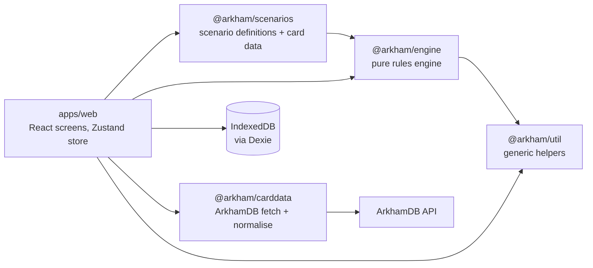

# Arkham Companion – Architecture

How the app is built today: the key pieces, their boundaries and the ideas behind them. Requirements and plans are in [product.md](product.md). Details live in the code's doc comments; this document points at them.

**Keeping it current:** a PR that adds or changes a component updates that component's section, briefly: a new concept, boundary or extension point, not every new field or case. Refer to sections by name (architecture "Triggers and card effects"). Link files, not lines.

## Overview

An offline PWA with no backend. Players keep their own decks, skill tests and chaos bag; the app runs the scenario side: encounter deck, doom, agenda and act, the map, enemies and forced effects.



Arrows are package dependencies; [ESLint](../eslint.config.js) enforces the important ones. The engine depends only on `@arkham/util`: no React, storage, network, clock or `Math.random`. Only [`IndexedDbStore`](../apps/web/src/storage/IndexedDbStore.ts) imports Dexie. [`packages/review_digest`](../packages/review_digest/src/) is CI tooling.

- [`packages/engine`](../packages/engine/src/): game state, commands, events, reducer, generic rules, the `GameStore` interface, and the test tools (`GameBuilder`, `PlayTable`, `BoardView`).
- [`packages/scenarios`](../packages/scenarios/src/): scenario and campaign definitions; special rules are card abilities.
- [`packages/carddata`](../packages/carddata/src/): ArkhamDB fetch, validation, normalisation; the investigator catalog.
- [`packages/util`](../packages/util/src/): generic string, array and object helpers.
- [`apps/web`](../apps/web/src/): the React PWA, its app store and the IndexedDB store.

### How one player action flows

1. A component calls an action on the app store's [`GameActions`](../apps/web/src/state/gameActions.ts) (`actions.moveTo(hallway)`).
2. The [`GameSession`](../apps/web/src/state/gameSession.ts) plays it as one step on its `PlayTable`, which sends `Command`s through [`execute`](../packages/engine/src/execute.ts).
3. [`handle`](../packages/engine/src/handle.ts) checks each command and returns every `Event` it causes, forced effects included, or throws `CommandRejected`.
4. [`replay`](../packages/engine/src/reducer.ts) folds the events into the new `GameState`.
5. The session writes the events with [`GameStore.appendEvents`](../packages/engine/src/store.ts) as one undo group; only then does the screen show the new state.

### Key design decisions

- **Pure, deterministic engine.** Same state and command, same events; randomness only from the seeded RNG in the state. Fast tests, reproducible games.
- **Event sourcing.** The event log is the game: undo, refresh recovery, export, bug reports and later sync all come from it.
- **Assistant, not referee.** Where the rules give the players a choice, the engine asks instead of guessing, and `ManualAdjust` can correct any state. A rules bug never blocks a game night.
- **Scenarios as data.** A scenario is setup data plus card data whose abilities carry its rules. What two scenarios need becomes an engine primitive.
- **Card data from ArkhamDB.** Fetched at build or run time; nothing copyrighted is committed or bundled.
- **Strong types.** All identifiers are branded strings ([`ids.ts`](../packages/engine/src/ids.ts)): `CardCode` (printed data, shared by copies), `InstanceId` (one card on the table), `InvestigatorId` (a seat in one game), `InvestigatorCode` (the investigator card), `CardName` (readable, never an identity).

Stack: TypeScript strict, Vite + pnpm workspaces, React 19 with hash routes (static GitHub Pages), Zustand, i18next (English and German), Dexie, zod for external input only, vite-plugin-pwa, Vitest and Playwright.

## Components

### Game state

The whole table is one serialisable value, [`GameState`](../packages/engine/src/state.ts). Every physical card is one `CardInstance` with a unique ID, its card code and exactly one [`Zone`](../packages/engine/src/zone.ts), so moving a card anywhere is the same operation. The state stores codes, not card data; rules look stats up in the `CardDb`. Investigators are not card instances but seats with their own record.

Location connections are an explicit graph on each [`GameMap`](../packages/engine/src/map.ts), since they change in play and can be one-way. Each map also keeps its book layout (`GameMap.layout`, cells on a grid three times finer than a card), which only the screen reads. [`checkInvariants`](../packages/engine/src/invariants.ts) states what must always hold; tests run it after every command.

```ts
interface GameState {
  meta: GameMeta;                        // scenario, round, phase, turn, lead, rng, queue, ended, …
  campaign?: CampaignLog;
  investigators: Investigator[];
  cards: Record<InstanceId, CardInstance>;
  order: Record<ZoneKey, InstanceId[]>;  // index 0 is the top of a deck
  board: Board;                          // maps with connections and layout
  chaosBag: ChaosToken[];
  agenda: { current?: InstanceId }; act: { current?: InstanceId };
  scenario: unknown;                     // per-scenario state
  pending: Decision[];                   // open questions for the players
}
```

**Extension points**

- **A new field:** add it in `state.ts`, give it a value in `emptyState()` and the reducer case that creates it, and an invariant if it can become inconsistent.
- **A new zone:** add a `Zone` kind with its `zoneKey` and its check in `validateZone` ([`placement.ts`](../packages/engine/src/placement.ts)); if cards there count as in play, add it to `isInPlay` ([`doom.ts`](../packages/engine/src/doom.ts)), which the compiler won't flag.
- **Moving cards or tokens:** use the shared event builders in `placement.ts` and [`investigators.ts`](../packages/engine/src/investigators.ts), not hand-built events.

### Command handling

[`handle`](../packages/engine/src/handle.ts) turns one command into the complete list of events it causes; [`apply`](../packages/engine/src/reducer.ts) folds an event into the state. All logic lives in `handle`: `apply` never validates, generates IDs or draws random numbers, so replaying a log needs neither card data nor the RNG.

```ts
function handle(ctx: EngineContext, state: GameState, command: Command): Event[];  // throws CommandRejected
function apply(state: GameState, event: Event): GameState;
interface EngineContext { cards: CardDb; scenario?: ScenarioDefinition; }  // code and lookup data, never saved
```

Inside one call a command resolves as a queue of steps, depth first: the command's own events, then the forced effects its events trigger (see "Triggers and card effects"), then its continuations (an agenda's reverse side before the next agenda; a drawn card's revelation before its placement; surge). A step that raises a decision stops the queue and stores the rest in `GameMeta.queue`; the answer resumes it. An action that provokes attacks of opportunity is held until those are answered. A refused follow-up refuses the whole command, and so does a trigger loop, so bad card data cannot hang the app or leave half an effect behind.

Every command type has one entry in [`COMMAND_SPECS`](../packages/engine/src/command_specs.ts): its handler (in a `handle_<area>.ts` file or a rule module) plus its policies (fires no triggers, allowed while a decision is pending or after the end, provokes, continues). Once the scenario has ended, only `ManualAdjust` is allowed. Handlers never import each other; shared queries live with their entity. All events of one player command share a `commandId`, so [undo](../packages/engine/src/undo.ts) removes a command with its whole chain.

**Extension points**

- **A new command:** add it to the `Command` union in [`commands.ts`](../packages/engine/src/commands.ts), its handler in a `handle_<area>.ts` and its `COMMAND_SPECS` entry. An action command extends `ActionCommand`, and its spec uses `provokes: asAction`.
- **A new event:** reuse one if you can; otherwise add it in [`events.ts`](../packages/engine/src/events.ts) with a non-validating case in `apply`.
- **A new refusal:** add a `RejectionCode` in [`rejection.ts`](../packages/engine/src/rejection.ts).

### Triggers and card effects

Forced effects are **abilities**: data on a card's `CardStats`, so card data holds no code and the same card behaves the same in every scenario. A scenario's own rules are abilities of its agendas and acts. An [`Ability`](../packages/engine/src/abilities.ts) is a timing window (`revealed`, `entered`, `turnBegins`, `turnEnds`, `eachTurnEnds` (any investigator's turn, for a card in play), `phaseEnds`, `roundEnds`, `advanced`, `enemyDefeated`, `tested` after a basic action's test, `engaged` either way round, `attacked` (attacks of opportunity included), `cluesDiscovered`, `defeated` for the enemy itself, naming where it was; setup opens none), an optional condition (the current act, what the window's investigator has: `ifYouHave('clues', { max: 0 }, …)`, or how many enemies of a trait are in play: `ifEnemiesInPlay(trait('Cultist'), { max: 0 }, …)`), an optional repeat once per matching enemy (`forEachEnemy({ trait, at }, …)`, counted with the condition as the window opens), and a list of effects. An effect that leaves an enemy unengaged next to an investigator ends with `engageReadyEnemies()` (`EngageReadyEnemies`), which runs the engagement rule for every enemy at a location, as setup does. "This card gains surge" (`GainSurge`) marks the resolving card (`CardInstance.gainedSurge`), and placing it queues the surge draw a printed surge would have queued. `windowsOpenedBy` maps an event to the windows it opens.

Effects are **templated commands**: a command card data may use (`AbilityCommand`) with every ID replaced by a reference relative to the ability (`self`, `windowInvestigator`, `lead`, `onlyCopy(code)`, `eachInvestigator`, `eachEnemy({ trait, withoutTrait, unengaged, engagedWith })`, `nearestEnemy(trait)`, `locationWith(trait)`, …); an `each…` reference repeats the command once per investigator or enemy. When its turn comes, `resolveEffect` fills in the IDs from the current state, so handlers and the log only see plain commands. A reference with candidates (`nearestEnemy`, `locationWith`) stands for the only one, or becomes a decision with one option per candidate and the effect filled in for it: equally near enemies are the lead investigator's `chooseCard`, a location to move to is the moving investigator's `chooseLocation`. A test's outcomes stay templated until the answer: each runs as a `ResolveEffect` command, which `handle` turns into an `ability` step, so it resolves in its own turn like any effect (a choice's options, by contrast, resolve when it is raised, so they can be dry-run). A reference that names nobody drops the command; a missing `onlyCopy` card records `AbilityEffectSkipped` and the players do it by hand. Factories write effects the way the card reads:

```ts
whenRevealed(takeHorror(1))
atEndOfTurn(skillTest('willpower', 3, { onPass: [discardSelf()] }))
afterTest('investigate', 'pass', discardSelf())   // Obscuring Fog
whenAdvanced(revealLocation(onlyCopy(codes.parlor)), …)
```

A card's test can cost the tester for each point it fails by (`skillTest(…, { perPointFailed })`: 1 damage, 1 horror, or 1 of their clues placed on their location by `PlaceClues`); the fail answer's `margin` is the count.

Constant abilities are data too (`CardStats.modifiers`); [`effectiveValue`](../packages/engine/src/card_values.ts) is the one place that answers "what is this value now".

**Extension points**

- **A card's ability or modifier:** list it in the card's data; no code.
- **A new window or condition:** a case in `TimingWindow` / `windowsOpenedBy` or `AbilityCondition` / `conditionHolds`.
- **A new kind of effect:** add its command to `AbilityCommand` (and a factory); a new reference is a case in `resolveRefs`.

### Decisions

Where the players must choose, or the engine needs an answer it cannot know (a skill test result, a spawn location, "advance the agenda?"), it puts a [`Decision`](../packages/engine/src/state.ts) into `pending`. Each option carries the commands it triggers, so outcomes are data; counts the players may adjust are written as `{ answer: 'damage' }` placeholders. Basic action tests name the action (`testKind`) and compute their consequences on the answer, so corrections made meanwhile count. `ResolveDecision` runs the chosen option; while a decision is pending, only answers and `ManualAdjust` are allowed. Card data asks with `leadDecides` ("the lead investigator must decide") or `youMustEither` (the investigator the window names), an `AbilityChoice` whose options run ability effects; a part that touches player cards ("draw 2 cards") is only in the option's label, for the players to do at the table. Before an ability asks, a dry run of each option's commands drops the ones the engine would reject (spending a clue nobody has), and a choice with no option left is not asked; a choice nested in a test's outcome is asked as it is. Skill tests ([`skill_tests.ts`](../packages/engine/src/skill_tests.ts)) carry a suggestion from the printed skill, one player-entered modifier and the chaos tokens, but the answer stays the players' pass or fail.

**Extension points**

- **Ask the players something:** return a `RequestDecision`; helpers for common shapes are in [`decisions.ts`](../packages/engine/src/decisions.ts).
- **A new kind of question:** a `DecisionKind`, plus its debug sentence in [`describe_decision.ts`](../packages/engine/src/describe_decision.ts). A new adjustable count is a name in `NAMED_AMOUNTS`.
- **A new skill-tested action:** a `SkillTestKind` and its resolver in `testedActionCommands`.
- **A board-dependent token value ("-X"):** a `tokenValues` entry in the scenario's `modifiers`.

### Rounds, phases and turns

`GameMeta.steps` lists the outstanding automated steps of the current phase ([`phases.ts`](../packages/engine/src/phases.ts)): mythos doom, threshold check and encounter draws; enemy hunters and attacks; upkeep resets and resources. `NextPhase` runs them in order and stops at a decision, so the assistant resumes after any answer. An enemy-phase attack exhausts its enemy as `ResolveEnemyAttack`'s continuation (`exhaustAfterAttack`), after the abilities the attack triggered. Turns ([`turns.ts`](../packages/engine/src/turns.ts)) record who acts and the actions left.

**Extension points**

- **A new automated step:** a `PhaseStepId` with its title in `PHASE_STEP_TITLES`, in its phase's list.

### Rule modules

Generic rules are small modules per subject, called by the handlers: board ([`board.ts`](../packages/engine/src/board.ts), [`placement.ts`](../packages/engine/src/placement.ts)), doom and agenda ([`doom.ts`](../packages/engine/src/doom.ts)), enemies ([`enemies.ts`](../packages/engine/src/enemies.ts), [`spawn.ts`](../packages/engine/src/spawn.ts), [`hunters.ts`](../packages/engine/src/hunters.ts), [`forced_attacks.ts`](../packages/engine/src/forced_attacks.ts)), investigators and elimination ([`investigators.ts`](../packages/engine/src/investigators.ts), [`elimination.ts`](../packages/engine/src/elimination.ts)), keywords ([`keywords.ts`](../packages/engine/src/keywords.ts)). The rules are summarised in [rules.md](rules.md).

**Extension points**

- **A new rule:** put it in its subject's module, call it from its command's handler, and show it in the end-to-end test.

### Scenarios

A scenario is a [`ScenarioDefinition`](../packages/engine/src/scenario.ts): agenda and act decks, chaos bags, reference card, setup steps and token modifiers. [`compileSetup`](../packages/engine/src/setup.ts) turns it plus the players' choices into one `StartScenario` command, reading investigator stats from the cards. Its `SetupOptions` are standalone (the players pick the difficulty) or a campaign's: then the log gives the difficulty and the chaos bag, each investigator starts with damage and horror for their trauma, and setup is refused unless it is the log's next scenario and the seats are exactly its living team. A `whenStory` setup step picks its `then` or `otherwise` steps by a `StoryCondition` on the log's story records (a flag, or at least n names on a list); a standalone game answers as an empty log. A `whenPlayers` step applies its steps only with at least that many investigators. A location with `versions` ("one of the two Downtowns at random") goes into play as one of them, picked with the setup's seed so `compileSetup` stays pure; other steps and connections name it by its first code. The branches and versions resolve before any step applies, so the encounter deck only leaves out the cards the chosen steps use. `shuffleIntoEncounterDeck` adds single cards from sets the scenario doesn't gather (the Ghoul Priest). The only scenario so far is the hand-entered test scenario [`the_gathering/`](../packages/scenarios/src/the_gathering/) (real codes and names, no card text); The Midnight Masks is entered the same way in [`the_midnight_masks/`](../packages/scenarios/src/the_midnight_masks/) (cards, setup and resolutions), with The Gathering's cards joined in for the sets they share. The Devourer Below's cards are in [`the_devourer_below/`](../packages/scenarios/src/the_devourer_below/) so far (its own set and the four Agents sets), its setup and resolutions follow. Hand-entered card data is built with the shared [`card_builders.ts`](../packages/scenarios/src/card_builders.ts) (`agenda`, `act`, `location`, `enemy`, `treachery`), one builder per card type that takes the printed values and the card's encounter set. The app lists playable scenarios in its [scenario catalog](../apps/web/src/scenarios/scenarioCatalog.ts).

**Extension points**

- **A new scenario:** a folder in `packages/scenarios/src/` with definition, cards (rules as abilities) and an end-to-end test, exported and added to the catalog.
- **A new setup step:** a `SetupStep` kind in `setup.ts`, only when two scenarios need it.

### Campaign

A campaign is its own event-sourced aggregate in [`campaign/`](../packages/engine/src/campaign/) with its own commands, events and reducer, so a game command can never change it. [`CampaignLog`](../packages/engine/src/campaign/campaign_log.ts) holds the team (keyed by `InvestigatorCode`) with trauma, XP and fate, story records, chaos bag and scenario order; a game keeps a copy in `GameState.campaign`. Reached through the `campaign` namespace (`campaign.handleCommand`). First definition: [Night of the Zealot](../packages/scenarios/src/night_of_the_zealot/campaign.ts).

A scenario's resolutions are data on `ScenarioDefinition.resolutions` ([`resolution.ts`](../packages/engine/src/campaign/resolution.ts)): per resolution id, plus "no resolution", a list of `ResolutionStep`s (record, chaos tokens, XP from a bonus and the [victory points](../packages/engine/src/victory.ts), trauma, killed/insane, or a step the players do by hand), plus steps that read the ended game: `when` picks its steps by a `GameCondition` (a card in play, set aside or in the victory display, the current agenda, or any of these) and `recordNames` writes the names of the cards whose condition holds as a list record. Steps name their target (`each`, `lead`, `notResigned`) instead of investigators, so `campaign.proposeResolution` reads the ended game and turns them into campaign commands, followed by the trauma of each defeat: 1 physical for damage, 1 mental for horror, and what a card effect names (`Investigator.defeat`, e.g. `defeatEachInvestigator({ trauma: 'physical' })`). It only proposes: the players confirm or edit the list, and `campaign.applyResolution` applies the confirmed commands in one step, all or none, followed by `AdvanceScenario`, which adds the scenario and its outcome to `CampaignLog.playedScenarios` and moves on. Story keys of a campaign live next to its definition ([`story.ts`](../packages/scenarios/src/night_of_the_zealot/story.ts)), so the scenario that writes a record and the one that reads it share the key.

**Extension points**

- **A new campaign:** a `CampaignDefinition` next to its scenarios.
- **A new command or record:** add it in `campaign/` with its events, reducer case and invariant.
- **A new correction:** a `CampaignAdjustment` case in `handle_campaign_adjustment.ts` that produces the regular event.
- **A new kind of resolution step:** a `ResolutionStep` case and its command in `proposeStep`; a new target is a `ResolutionTarget` case.
- **A new question about the ended game:** a `GameCondition` case in `gameHolds`, or a `CardPlace` case in `isAt`.

### Card data

The engine reads card stats only through a [`CardDb`](../packages/engine/src/cards.ts) in its context (`ctx.cards.get(code)` → `CardStats`), so tests pass a small fake. [`@arkham/carddata`](../packages/carddata/src/) fetches ArkhamDB packs, validates them with zod and normalises them to `CardDef`; it does not depend on the engine. Every pack carries its rules chapter (1 or 2). Fetched JSON and images go to `packages/carddata/.cache/` or IndexedDB, never into git. The app refreshes its copy with `If-Modified-Since` ([`loadCatalog.ts`](../apps/web/src/catalog/loadCatalog.ts)) and works offline.

**Extension points**

- **A new card field:** read it in `RawCardSchema`, normalise it in [`schema.ts`](../packages/carddata/src/schema.ts), and add it to `CardStats` only if a rule or view needs it.
- **A new language:** its ArkhamDB host in `fetch.ts` and `loadCatalog.ts`, and UI strings in [`i18n`](../apps/web/src/i18n/).

### Persistence

[`GameStore`](../packages/engine/src/store.ts) is the only way to save or load a game: each game's event log plus snapshots, undo by `commandId`, and an `expectedSeq` check so two tabs cannot overwrite each other. Every command is written before the UI updates, so a refresh or flat battery loses nothing. The log is also the export format. [`IndexedDbStore`](../apps/web/src/storage/IndexedDbStore.ts) implements it with Dexie; localStorage holds only device settings.

**Extension points**

- **A new store operation:** a method on `GameStore` with its contract as doc comment, implemented and tested in `IndexedDbStore`.
- **A schema change:** bump the Dexie `version()` with an `upgrade`; a state shape change bumps `STATE_VERSION`.

### Web app

The React PWA is a thin layer over the engine. [`App.tsx`](../apps/web/src/App.tsx) defines the hash routes; screens are in [`screens/`](../apps/web/src/screens/) (home, new game wizard, game screen, settings with the unofficial fan project notice). Components read the [app store](../apps/web/src/state/appStore.ts) and call its methods; they never change game state or touch storage.

The open game (`OpenGame`) is the play screen's single source of truth:

- **`GameActions`** ([`gameActions.ts`](../apps/web/src/state/gameActions.ts)) are the players' verbs (`moveTo`, `investigate`, `answer('pass')`). They act for the investigator whose turn it is and answer the first pending decision, so they take no ids; investigate, engage, and fight and evade unless `free`, also count off one of that investigator's actions, which the engine leaves to the players (the pawn's drag does not, as it also catches up with a move made at the table), and leave a skill test open for the decision dialog; buttons are disabled while `OpenGame.busy`.
- **`GameSession`** ([`gameSession.ts`](../apps/web/src/state/gameSession.ts)) holds a `PlayTable` resumed from the stored log, plays each action as one undo group, writes it, then publishes the state. A refused step stores nothing and shows its `Rejection` as a toast; a failed write reloads the stored game. Steps run strictly in order. While the players adjust the board (`startAdjusting`, `OpenGame.adjusting`), steps change the table in memory only; "Done" (`finishAdjusting`) plays them again from where the adjustment started as one stored step, so one undo takes the whole correction back, and "Cancel" resumes the table from that point. The screen shows the steppers and the tiles' edit buttons only while adjusting (`data-adjusting` on the board) and holds back the steps of play (turn controls, the act's advance, piece drags) meanwhile.
- **`BoardView`** (`OpenGame.board`) is what the screen reads: names, thresholds and derived values, never raw state.

The [game screen](../apps/web/src/screens/GameScreen.tsx) has a header with the encounter deck, agenda, act and scenario laid out as cards, centred, each under the playmat's label, with the agenda's doom and the act's clues on big round tokens ("2 of 7"), a [status row](../apps/web/src/screens/GameStatus.tsx) with the round, the phase track, Next and round icon buttons for adjust, undo and a ☰ menu (the play screen hides the app's title bar, so its links and the export sit in that menu), the [map](../apps/web/src/map/MapBoard.tsx) as an SVG of location tiles at their layout cells with pan, zoom and drag-to-play pieces (its tabs and small zoom icons float over its top corners, and its name is for screen readers only), and the [investigator bar](../apps/web/src/investigators/InvestigatorBar.tsx) with each investigator's card, drawn like the location tiles in parchment with a dark edge: their name on a plate in a dark band with where they are, the art window (the art area of the picture of its front, `--investigator-art-*` in tokens.css; setup copies the picture onto the investigator as `Investigator.imageSrc` since a resumed game has no investigator cards), their four skills as plates with the Arkham icons (each opening a [skill test](../apps/web/src/investigators/SkillTestDialog.tsx): the skill tested or two added together (`SkillTestInput.addedSkill`), difficulty, modifier and the chaos tokens drawn from the bag (a row of round tokens, a symbol token showing its game symbol over its name kept for screen readers), calculated by `BoardView.skillTest` over the engine's `skillTestSuggestion` without changing the game), their counters as round tokens along its foot, and the turn controls (start turn, actions left, investigate, resign, end) under the card, and their [threat area](../apps/web/src/investigators/ThreatArea.tsx): a row of small cards on the top edge of their card, treacheries and engaged enemies, the enemies with their health left (`EnemyView.health`, scaled by the player count through `enemyHealth`); a tap on an enemy card opens its [details](../apps/web/src/enemies/EnemyDetails.tsx): the enemy drawn as its [card](../apps/web/src/enemies/EnemyCard.tsx) (`BoardView.enemyStats`), our own SVG frame in the location tiles' style but laid out like the printed enemy card ([`enemyCardFrame.ts`](../apps/web/src/enemies/enemyCardFrame.ts): the name plate, fight, health left and evade on shields, traits, keywords and victory points in our own words as HTML in `foreignObject`s so they wrap, the attack as damage and horror icons on the type line, and the art cut from the picture, `ENEMY_ART`), and under it one row of buttons: fight and evade as an action (marked, like the turn row's actions left, with the game's action arrow, [`action.svg`](../apps/web/src/symbols/action.svg)) or, as some cards allow, without one on that investigator's turn, and the card effects deal 1 damage, disengage and defeat. It shows four cards (`THREAT_CARDS_SHOWN`); more scroll by whole cards with a swipe or its arrows (CSS scroll snap). The first open decision shows as a [dialog](../apps/web/src/screens/DecisionDialog.tsx) over the board: the translated question with the card it is about, who decides, the test of a skill test, and a button per option, answered by its readable name (`GameActions.answer` maps it to the option); `DecisionView.labels` gives the i18n key of each option whose name is not its own label (`does not provoke` is `decision.doesNotProvoke`). The game cannot go on without an answer, so Escape does not close it, Undo in it takes back the step that raised it, and its "Adjust board" lets the players correct the board first (the dialog steps aside meanwhile, since the modal makes the board inert). Location tiles are drawn like the printed location card, with our own SVG frame ([`cardOrnament.tsx`](../apps/web/src/map/cardOrnament.tsx)) over art cut from the same area of the scan, so the printed frame stays hidden under ours. Card pictures are fetched from ArkhamDB on the device and cached by the service worker, never bundled. The game's own symbols (skills, wild, action, free, reaction, per investigator, and the chaos tokens except the 2026 Core Set's blood, which the sheet lacks) are bundled as one-colour SVGs in [`symbols/`](../apps/web/src/symbols/), one file per symbol named after the engine's name in snake case where it has one (`willpower.svg`, `elder_sign.svg` for `elderSign`), each in a 100×100 box with the glyph centred; components draw them as a CSS `mask` filled with the text colour, so one file serves both themes. They were cut from the community sheet "Arkham Horror LCG Symbols – Main Sets – Core Game Set" (an Inkscape SVG that names no author or licence; its other pages hold the campaign and encounter set icons), which traces Fantasy Flight Games' printed icons, so they are © Fantasy Flight Games like the cards, which the settings' copyright notice says. Markup is structure only; the playmat look lives in CSS on [`tokens.css`](../apps/web/src/styles/tokens.css), with a dark and a light theme. The investigators stand in a column beside the map in landscape and below it in portrait (`orientation` media queries in [`game.css`](../apps/web/src/screens/game.css)), as in the prototype. Screens outside play, dialogs and the play screen's notices (at half the frame width) share one frame in the playmat's line style (brass rules, a quarter of its zodiac ring and a star in each corner, [`panel_frame.svg`](../apps/web/src/styles/panel_frame.svg) as a `border-image`, with a light-theme copy) and a small ring under each title ([`ornament_rule.svg`](../apps/web/src/styles/ornament_rule.svg)); their panels are the see-through night by night and parchment by day (`--panel-paper`). The investigator cards are parchment in both themes, like printed cards and the location tiles.

**Extension points**

- **A new game action:** add it to `GameActions` as one `PlayTable` verb (add the verb to `PlayTable` first). Only actions outside the open game get their own `AppState` method.
- **A new game symbol:** cut it from the symbol sheet into `symbols/<name>.svg` (one path, 100×100 box, no colour) and draw it with `mask: url(...)`.
- **A new screen:** a route in `App.tsx`, a component in `screens/`, an E2E flow tagged `@flow` or a screenshot tagged `@shot`, strings in English and German.
- **A new refusal or skippable effect:** its `rejections.<code>` or `skipped.effects.<type>` string in English and German.
- **A new decision prompt or option label:** its string under the engine's key (`decision.<key>`, or the scenario's `scenario.<scenario>.<card>.<key>`) in English and German.

### Tests and debugging

Engine modules have unit tests; invariants have table tests. Each scenario has an end-to-end test ([`end_to_end.test.ts`](../packages/scenarios/src/the_gathering/end_to_end.test.ts)) that plays rounds through a `PlayTable`, checking invariants after every command and replaying the log at the end. [`formatBoard`](../packages/engine/src/format_board.ts) renders the board as stable text for snapshots and errors. The three test tools live in the engine's source, so the app uses them too:

- **`newGame()`** ([`game_builder.ts`](../packages/engine/src/game_builder.ts)) builds a table from locations, maps, investigators and cards in zones, each placed with its [blank card](../packages/engine/src/blank_cards.ts) definition carrying only the stats the test is about, and starts it through `StartScenario`. Unit tests build their tables with it instead of file-local setup helpers, and every card and ID an assertion checks is named in the test ([coding guidelines](coding-guidelines.md) §3).
- **`PlayTable`** ([`play_table.ts`](../packages/engine/src/play_table.ts)) plays a table in game language (`nextPhase()`, `moveTo(byName('Roland Banks'), byName('Hallway'))`, `answer(…, 'fail')`). Each method is one atomic undo group; a refusal throws `TableRejected` with the board attached.
- **`BoardView`** ([`board_view.ts`](../packages/engine/src/board_view.ts)) reads the state back by card name, derived when read. Finders take matchers from [`card_matchers.ts`](../packages/engine/src/card_matchers.ts) (`byName`, `byId`, `byCode`) and throw when nothing or several cards match, so a test never acts on the wrong copy.

**Extension points**

- **A new table piece:** a `with*` method on `GameBuilder` that adds to the `StartScenario`; never set state directly.
- **A new player step or read-back:** a `PlayTable` method, or a field or view in `board_view.ts`.
- **A new way to find a card:** a `CardMatcher` variant with its cases in `matchingCards`, `matchingInvestigators` and `describeMatcher`.
- **A rule change:** a step in the end-to-end test where it shows at the table.
