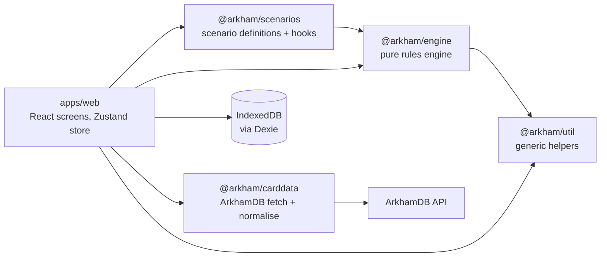
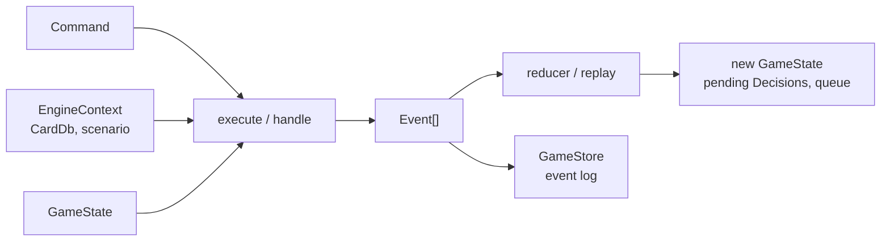

# Arkham Companion – Architecture

How the app is built today. What it is for, its requirements and the plan for what comes next are in [product.md](product.md); this document only describes code that exists.

It has two levels. **Overview** shows the whole system on one page. **Components** has one section per part of the code that gets extended. Each section explains how the part works and why, shows a reduced version of its important types, and lists its extension points: what to change, and where, to extend it.

**Keeping it current:** a PR that adds or changes a component updates that component's section in the same PR. That covers a new kind of command, trigger, decision, setup step or store method, a new package and a changed dependency direction. A PR that builds something planned in product.md adds it here. The diff of this file is where a reviewer sees an architecture change. Refer to sections by name (architecture "Triggers and card effects"), not by number. Code links point to files, not lines, so they don't go stale.

## Overview

The app is an offline PWA with no backend. Players keep their own decks, skill tests and chaos bag; the app runs the scenario side: the encounter deck, doom, agenda and act, the map, enemies and forced effects.



Arrows are package dependencies; [ESLint](../eslint.config.js) enforces the two that matter most. The engine depends on nothing but `@arkham/util`: no React, storage, network, clock or `Math.random`. Only [`IndexedDbStore`](../apps/web/src/storage/IndexedDbStore.ts) imports Dexie. [`packages/review_digest`](../packages/review_digest/src/) is CI tooling, not part of the app.

| Package | What it holds |
| --- | --- |
| [`packages/engine`](../packages/engine/src/) | Game state, commands, events, the reducer and all generic rules; the `GameStore` interface |
| [`packages/scenarios`](../packages/scenarios/src/) | Scenario definitions: setup data plus hooks for their special rules |
| [`packages/carddata`](../packages/carddata/src/) | ArkhamDB fetch, validation and normalisation; the investigator catalog |
| [`packages/util`](../packages/util/src/) | Generic string, array and object helpers |
| [`apps/web`](../apps/web/src/) | The React PWA: screens, the app store and the IndexedDB store |

### Main pieces and how they interact

Most of the engine is plain data plus pure functions; its few classes are errors (`CommandRejected`) and test tools, and the store class lives in the app. These are the pieces a reader meets first, in the order a command meets them. Each component section below has the details.



- **`GameState`** ([`state.ts`](../packages/engine/src/state.ts)): the whole table as one serialisable value, with the cards, investigators, maps, agenda and act, open `Decision`s and the stored `queue` of steps still to run (see "Game state").
- **`Command`** ([`commands.ts`](../packages/engine/src/commands.ts)): what a player or the phase assistant asks for (`MoveInvestigator`, `DrawEncounter`, `ResolveDecision`, `NextPhase`, …).
- **`execute` / `handle`** ([`execute.ts`](../packages/engine/src/execute.ts), [`handle.ts`](../packages/engine/src/handle.ts)): check a command against the state and return the `Event`s it causes, forced effects included, or throw `CommandRejected` (see "Command handling").
- **`EngineContext`** ([`cards.ts`](../packages/engine/src/cards.ts)): what `handle` reads besides the state. That is the `CardDb` with every card's printed stats, and the running `ScenarioDefinition` with its hooks. It is code and lookup data, so it is passed in rather than stored (see "Triggers and card effects", "Scenarios").
- **`Event` and the reducer** ([`events.ts`](../packages/engine/src/events.ts), [`reducer.ts`](../packages/engine/src/reducer.ts)): the facts a command produced. `replay` folds them into the next state; the log of events is the game.
- **`Decision`** ([`state.ts`](../packages/engine/src/state.ts)): a question to the players. A command that needs an answer raises one, holds the rest of its sequence in the queue, and `ResolveDecision` carries on (see "Decisions").
- **`GameStore`** ([`store.ts`](../packages/engine/src/store.ts)): the interface the app saves and loads event logs through; `IndexedDbStore` implements it (see "Persistence").
- **For tests and sandboxes:** `GameBuilder` (`newGame()`) describes a table and starts it, `PlayTable` plays it step by step in game language, and `BoardView` reads it back by card name (see "Tests and debugging").

### Cards, investigators and their identifiers

A card has two sides in the code: its printed data, shared by every copy, and the copies on the table. Investigators are kept apart from cards. All identifiers are branded strings defined in [`ids.ts`](../packages/engine/src/ids.ts) (`instanceId('hall')`), so one kind of ID can't be passed for another.

- **`CardCode`**: an ArkhamDB card code, the key of a card's printed data. Several copies share one code.
- **`CardStats`** ([`cards.ts`](../packages/engine/src/cards.ts)): that printed data, as the rules read it (name, type, traits, shroud, clues, enemy stats, doom threshold, keywords, …). The `CardDb` looks it up by code; tests build it with the `blank*` cards ([`blank_cards.ts`](../packages/engine/src/blank_cards.ts)).
- **`InstanceId`** and **`CardInstance`** ([`state.ts`](../packages/engine/src/state.ts) for the instance): one physical card on the table, with its code, its `Zone`, face, exhaustion and tokens. It holds the code only, so the state never copies card data.
- **`InvestigatorId`** and **`Investigator`**: one seat in one game, with its location, health, sanity, clues, resources, actions and status. The investigator card is not a `CardInstance`; cards engaged with or in the threat area of an investigator name the `InvestigatorId` in their zone.
- **`InvestigatorCode`**: the card code of an investigator card. It names the investigator, not the seat, so the campaign log keys its team by it; an `InvestigatorSeat` pairs the two for setup.
- **`CardName`**: a printed name. Views and matchers use it for readability (`byName('Hallway')`), but copies share a name, so it is never an identity.
- **Placing cards:** a scenario's setup names cards by code, and `compileSetup` generates readable instance IDs (`code#copy`). A `StartingCard` carries a code and may carry its own `id`. The test builder takes an instance ID and the card's `CardStats` (`withCard(id, card, zone)`), so the stats sit next to where the card is placed.

### How one player action flows

Every change to a game takes the same path. Take starting a scenario; every later action goes through the app store's `actions` and a `PlayTable` the same way, minus step 2.

1. The new game wizard collects the scenario, difficulty and investigators and calls [`startScenario`](../apps/web/src/state/appStore.ts) on the app store. The app store is a Zustand store that holds the saved game list (`GameSummary[]`) and the open game (`OpenGame`), and it is the only place in the app that sends commands or writes games.
2. The app store hands the setup to [`startGame`](../apps/web/src/state/gameSession.ts), which sets it up on a fresh `PlayTable` (`PlayTable.setUp`): [`scenario.compileSetup`](../packages/engine/src/setup.ts) turns the scenario definition into one `StartScenario` command. The `ScenarioContext` it passes (an `EngineContext` with its `scenario` set) holds the scenario definition and its card data, which the wizard took from the [scenario catalog](../apps/web/src/scenarios/scenarioCatalog.ts), with the chosen investigator cards added (`cardDbWith`). The wizard seats them by code ([`seating.ts`](../apps/web/src/wizard/seating.ts)), and `compileSetup` takes their printed stats from the context. The same context, with the scenario's hooks and reference card, is the one the game's later commands need.
3. [`execute(ctx, state, command)`](../packages/engine/src/execute.ts) calls [`handle`](../packages/engine/src/handle.ts). `handle` checks the command against the state and returns the `Event`s it causes, including every forced effect it triggered (see "Command handling"). A refused command throws `CommandRejected`, and nothing is stored.
4. [`replay`](../packages/engine/src/reducer.ts) folds the events into the new `GameState`.
5. `startGame` writes the events with [`GameStore.appendEvents`](../packages/engine/src/store.ts) as the game's first undo group, and the app store only then opens the game and shows its state. Opening a game later replays its log from the last snapshot.

### Key design decisions

- **Pure, deterministic engine.** The same state and command always give the same events, and randomness only comes from the seeded RNG kept in the state. Rules are fast to test, and every game can be reproduced from its log.
- **Event sourcing.** The event log is the game. Undo, refresh recovery, export, bug reports and later sync all come from this one mechanism.
- **Assistant, not referee.** Where the rules give the players a choice, the engine asks with a decision instead of guessing, and `ManualAdjust` can correct any state. A rules bug or a house rule never blocks a game night.
- **Scenarios as data.** A scenario is setup data plus a few hooks. What two scenarios need becomes an engine primitive, so each new scenario gets cheaper.
- **Card data from ArkhamDB.** Cards are fetched at build or run time, so errata and translations need no code change and nothing copyrighted is committed.
- **Seams before features.** Card effects, cloud sync and auto-layout get an interface before they get an implementation.

### Technology

| Area | Choice | Why |
| --- | --- | --- |
| Language | TypeScript (strict) | Discriminated unions model commands, events and zones |
| Build | Vite, pnpm workspaces | Fast; the packages enforce the boundaries above |
| UI | React 19, React Router (hash routes) | Existing experience; hash routes work on static GitHub Pages |
| UI state | Zustand | A thin store around the engine keeps the engine framework-free |
| i18n | i18next | UI strings in English and German; card text comes from ArkhamDB per language |
| Persistence | IndexedDB via Dexie behind `GameStore` | localStorage is small and synchronous; a cloud store can be a second implementation |
| Validation | zod | Only for external input: ArkhamDB JSON and imported saves |
| Offline | vite-plugin-pwa (Workbox) | App and card images cached for play without network |
| Tests | Vitest, Playwright | Engine unit and table tests; E2E on the production build |

## Components

### Game state

The whole table is one serialisable value, [`GameState`](../packages/engine/src/state.ts). Every physical card is one `CardInstance` with a unique ID, its card code and exactly one [`Zone`](../packages/engine/src/zone.ts); four copies of a card are four instances. So "where is this card?" always has one answer, moving a card anywhere is the same operation, and every rule can rely on that. Order within a zone (the top of the encounter deck, say) lives in `order`, keyed by [`zoneKey`](../packages/engine/src/zone.ts).

The state stores card codes, not card data: a rule that needs a card's health or shroud looks it up in the `CardDb` (see "Card data"). Numbers printed per investigator are `ScaledValue`s, resolved against `playerCount` when needed, never stored.

Connections between locations form an explicit graph on each [`GameMap`](../packages/engine/src/map.ts) rather than being derived from where tiles sit, because they change during play, can be one-way and can span several maps. An edge is stored on the map named when it was added; movement ignores which map owns it.

[`checkInvariants`](../packages/engine/src/invariants.ts) states what must always hold, and the end-to-end test runs it after every command. Each card is in exactly one zone and listed once in that zone's order, no token count is negative, every connection joins two known cards once, and pending decisions and turns are well formed.

```ts
interface GameState {
  meta: GameMeta;                        // scenario, difficulty, playerCount, seed, rngState, round, phase,
                                         // steps, turn, turnsTaken, leadInvestigator, queue,
                                         // ended, resolution
  campaign?: CampaignLog;                // the campaign this game belongs to (see Campaign)
  investigators: Investigator[];
  cards: Record<InstanceId, CardInstance>;
  order: Record<ZoneKey, InstanceId[]>;  // index 0 is the top of a deck
  board: Board;                          // maps (with their connections), slots, placement
  chaosBag: ChaosToken[];
  agenda: { current?: InstanceId };
  act: { current?: InstanceId };
  scenario: unknown;                     // per-scenario state
  pending: Decision[];                   // open questions for the players
}

interface CardInstance {
  id: InstanceId; code: CardCode; zone: Zone;
  faceUp: boolean; exhausted: boolean;
  tokens: Partial<Record<TokenKind, number>>;
  flags: Record<string, unknown>;
}

type Zone =
  | { kind: 'encounterDeck' | 'encounterDiscard' | 'setAside' | 'victoryDisplay' | 'outOfGame'
          | 'resolving' | 'agendaDeck' | 'actDeck' }
  | { kind: 'location'; mapId: MapId }
  | { kind: 'atLocation'; locationId: InstanceId }
  | { kind: 'engaged' | 'threatArea'; investigatorId: InvestigatorId }
  | { kind: 'attachedTo'; hostId: InstanceId };

interface Investigator {
  id: InvestigatorId; code: InvestigatorCode; name: string; seat: number;
  locationId?: InstanceId;
  health: { max: number; damage: number }; sanity: { max: number; horror: number };
  clues: number; resources: number; doomOnPlayerCards: number;
  actionsRemaining: number; status: 'active' | 'resigned' | 'defeated';
}
```

**Extension points**

- **A new field:** add it to the type in [`state.ts`](../packages/engine/src/state.ts) with a doc comment and give it a value in `emptyState()` and in the reducer case that creates it. If it can become inconsistent, add its rule to [`checkInvariants`](../packages/engine/src/invariants.ts).
- **A new kind of place for cards:** add a `Zone` kind in [`zone.ts`](../packages/engine/src/zone.ts) with its key in `zoneKey`, and its reference check in `validateZone` ([`placement.ts`](../packages/engine/src/placement.ts)). If cards there count as in play, add it to `isInPlay` ([`doom.ts`](../packages/engine/src/doom.ts)).
- **A rule that moves cards or tokens:** build its events with the shared builders instead of by hand, so every module moves things the same way: `cardMoved` for a move a command asks for (validated), `moveCardEvent` for one the engine decides, `discardEncounterCard` and `clearTokensEvents` in [`placement.ts`](../packages/engine/src/placement.ts); clues between an investigator and a location with `discoverCluesEvents` and `cluesToLocationEvents` in [`investigators.ts`](../packages/engine/src/investigators.ts).

### Command handling

This is the core of the engine: [`handle`](../packages/engine/src/handle.ts) turns one command into the complete list of events it causes, and [`apply`](../packages/engine/src/reducer.ts) folds an event into the state. A command is a request that may be refused and may need card data or randomness. An event is a fact that always applies the same way. So all logic lives in `handle`, and `apply` never checks anything, generates IDs or draws random numbers. Replaying a log therefore needs neither card data nor the RNG. `DeckShuffled`, for example, carries the new order rather than a seed.

```ts
function handle(ctx: EngineContext, state: GameState, command: Command): Event[];  // throws CommandRejected
function apply(state: GameState, event: Event): GameState;
function replay(events: readonly Event[], initial?: GameState): GameState;          // apply, folded over a log
function execute(ctx: EngineContext, state: GameState, command: Command): { state: GameState; events: Event[] };  // handle + replay
```

The commands are a union in [`commands.ts`](../packages/engine/src/commands.ts), the events one in [`events.ts`](../packages/engine/src/events.ts). The context holds code and static data, never part of the saved state:

```ts
type Command = StartScenario | ManualAdjust | MoveCard | AddMap | MoveInvestigator | PlaceDoom
  | AdvanceAgenda | DrawEncounter | SpawnEnemy | MoveHunters | RequestDecision | ResolveDecision
  | NextPhase | Investigate | Fight | Evade | …;      // ~40 kinds
type Event = ScenarioStarted | DeckShuffled | CardMoved | TokensChanged | CardFlipped
  | ConnectionChanged | InvestigatorChanged | DecisionRequested | AgendaAdvanced | PhaseChanged
  | StepsQueued | …;                                   // ~30 kinds

interface EngineContext {          // cards.ts
  cards: CardDb;
  scenario?: ScenarioDefinition;   // hooks, reference card and modifiers of the running scenario
}
type ScenarioContext = EngineContext & { readonly scenario: ScenarioDefinition };  // one game of one scenario
```

`handle` never changes the state. It works out what would happen in a `Resolution`: a working state plus the events so far, which exists only inside one call. The command resolves as a queue of steps (`run`): each step appends its events to the resolution (`emit`) and returns the steps that follow it, which go in front of the rest, so a chain resolves depth first. A queued action that turns out illegal takes its events back (`checkpoint`). The dry run of a provoking action runs in a resolution of its own that is thrown away. A step is plain data ([`QueuedStep`](../packages/engine/src/state.ts)): a command, a held action, or one of the continuations below. What follows a command's step:

1. **The command's own events.** Every command type has one entry in [`COMMAND_SPECS`](../packages/engine/src/command_specs.ts): its handler plus the policies `handle` applies to it (fires no triggers, allowed while a decision is pending or after the end, provokes attacks of opportunity, continues after its effects). The handler lives in one of the `handle_<area>.ts` files ([board](../packages/engine/src/handle_board.ts), [encounter](../packages/engine/src/handle_encounter.ts), [enemy](../packages/engine/src/handle_enemy.ts), [investigator](../packages/engine/src/handle_investigator.ts), [scenario](../packages/engine/src/handle_scenario.ts)) or a rule module. The handler checks the command against the state and returns its events, or throws `CommandRejected` with a [`Rejection`](../packages/engine/src/rejection.ts) code the UI can explain.
2. **Forced effects.** [`triggeredCommands`](../packages/engine/src/triggers.ts) steps through those events one at a time, applying each to a working copy of the state and asking the scenario hooks and card effects whether it triggers them. The matched hooks then run against the state after all of the command's events, so each one sees the command's complete outcome, and they return follow-up commands. Each follow-up becomes a step of its own. If the command answered a decision, the chosen option's commands follow the forced effects of the answer's own events, as "after you fail" abilities resolve before a skill test's results (ST.6 before ST.7; no hook reads an answer's events yet).

   This matches the rules as long as a command is one effect: every part of an effect resolves before its "after" triggers (rules.md, "Timing of forced effects"). A command that bundles several steps of a sequence must split them, as surge does (step 3). The cases still open are listed in [M1V.1](tasks/M1V-rules-verification.md).

   A refused follow-up refuses the original command (`triggeredCommandRejected`, naming the follow-up), and a chain of more than `MAX_TRIGGERED_COMMANDS` follow-ups refuses it with `triggerLoop`. A bad hook can therefore neither hang the app nor leave half its effect behind.
3. **Continuations.** A spec's `continueWith` returns the steps that run once the forced effects are done. Advancing an agenda or act happens in two parts: first the card flips and its reverse side (the hook) resolves while it is still current; only then does `finishAdvance` (`completeAdvance`) move it out and make the next card current. On the last card the reverse side names the resolution (`EndScenario`), or raises a decision whose options do. `DrawEncounter` draws one card into the `resolving` zone and turns it face up; its revelation (its `revealed` abilities) resolves, and only then does `placeDrawnCard` spawn, attach or discard it (without a drawer, only an enemy with its own spawn instruction still spawns; anything else is discarded). If it has surge, a `surge` step draws again after the placement's own forced effects. One command makes at most as many surge draws as the deck and discard hold, so a deck of only surge cards ends instead of looping. `NextPhase` goes on with the phase's outstanding steps, one `phaseStep` at a time (see "Rounds, phases and turns").
4. **Waiting for the players.** A step that raises a decision stops the queue. The remaining steps are stored in `GameMeta.queue` (`StepsQueued`), in front of whatever already waits, so the newest resolution finishes first. Decisions already pending when the command came in do not stop it: answering one of two attacks of opportunity resolves that attack at once. Once no decision is pending, the next command (usually the last answer) resolves the stored steps after its own, one `StepResumed` each, until one asks something again. So an agenda or act leaves play only after its reverse side's question is answered, and a drawn card is placed only after its revelation's question. Outstanding phase steps are not stored: the players go on with the next "Next".
5. **Held actions.** If the command is an action that provokes attacks of opportunity (a move, investigate or engage the players took as an action, marked `asAction`; the same command from a card effect leaves it out), `handle` first does a dry run to reject an illegal action. It then returns only one decision per attacking enemy and a `StepsQueued` event that stores the action. Once the last of those decisions is answered, the held action resumes (`StepResumed` and its chain, in a run of its own) or, when it has become illegal or its investigator was defeated, is dropped (`ActionDropped`) with everything it did rolled back.

`ManualAdjust` corrects almost anything, with two guards against an impossible state. It cannot move the current agenda or act (`currentStageCard`), because only advancing changes which card is current. Added doom fires no forced effects, but if it reaches the threshold the engine asks the group whether to advance the agenda (the same `advanceAgenda` decision as the mythos check) instead of staying silent or advancing on its own.

Once `ScenarioEnded` has set `GameMeta.ended`, `handle` refuses every command except `ManualAdjust` (`scenarioEnded`): the game is over, but the players may still correct the final board before the campaign reads it. Undo works on the log, outside `handle`, so it still takes back the command that ended the scenario.

The result is one list of events per player command. The store files them under one `commandId`, so undo ([`undo.ts`](../packages/engine/src/undo.ts)) always removes a whole command with its chain. The RNG state ([`rng.ts`](../packages/engine/src/rng.ts), xoshiro128\*\*) is part of `GameMeta`, so handling the same command again gives the same shuffle.

**Extension points**

- **A new command:** add its type to the `Command` union in [`commands.ts`](../packages/engine/src/commands.ts), its handler in the matching `handle_<area>.ts` and its entry in `COMMAND_SPECS` ([`command_specs.ts`](../packages/engine/src/command_specs.ts)), with tests that call `handle`. The compiler rejects a command without an entry. The entry's optional fields decide whether it fires triggers, may run while a decision is pending or after the end, provokes attacks of opportunity, or continues after its forced effects. A command that can be taken as an action extends `ActionCommand` and uses `provokes: asAction`, so it provokes only when an action was spent on it.
- **A new event:** reuse an existing one if you can. Otherwise add its type in [`events.ts`](../packages/engine/src/events.ts) and its case in `apply` ([`reducer.ts`](../packages/engine/src/reducer.ts)); the case must not validate anything.
- **A new reason to refuse:** add a `RejectionCode` with the fields the UI needs to explain it in [`rejection.ts`](../packages/engine/src/rejection.ts).

### Triggers and card effects

Forced effects react to events in two ways. A card's own forced effects are **abilities**: data on its `CardStats`, so the same encounter card behaves the same in every scenario and card data holds no code. A scenario's own effects are still code, its `ScenarioHooks`, until they move onto the abilities of its agendas and acts (architecture review P1). Both return commands rather than events, so `handle` checks their effect and they can use card data and the RNG like any player command. `ManualAdjust` and `StartScenario` fire nothing, because a correction or the setup is not a game event.

An [`Ability`](../packages/engine/src/abilities.ts) is a timing window plus a list of effects. `windowsOpenedBy` is the one matcher that turns an event into the windows it opens, each naming the card whose abilities fire and the investigator it concerns, if any. A card turned face up opens `revealed`: a location being revealed, or a drawn encounter card, for which it is the revelation (its drawer is the investigator; a location names nobody). `TurnEnded` opens `turnEnds` for each card in that investigator's threat area, naming them ("at the end of your turn"); `RoundEnded` (upkeep step 4.6) opens `roundEnds` for every card in play, naming nobody; an `onRoundEnd` hook runs first and still sees a card that the round's end discards. `turnEnds` covers threat-area cards only: a card elsewhere ("at the end of your turn, if you are at this location") needs its own window. `abilityCommands` turns the matching abilities' effects into commands, in the order they are listed. An effect is a command template: one of the commands card data may use (`AbilityCommand`), with every card or investigator ID replaced by a reference relative to the ability (`{ ref: 'self' }`, `{ ref: 'windowInvestigator' }`), because card data, shared by every copy, can't hold instance IDs. `abilityCommands` fills in the IDs and drops a command whose reference names nobody, so handlers, the queue and the log only ever see plain commands. Reusing the command types keeps one vocabulary: a new kind of effect is a command added to `AbilityCommand`. Lists inside a command are templated item by item, which is how a test's outcomes work: `TestSkill` raises a skill test about the card for an investigator, and its `onPass` and `onFail` are ability commands too (`AbilityTest`). Factories write the common ones the way the card text reads: `whenRevealed(takeHorror(1))`, `atEndOfTurn(skillTest('willpower', 3, { onPass: [discardSelf()] }))` (Frozen in Fear), `atEndOfRound(discardSelf())` (Dissonant Voices), `placeDoomOnAgenda`, `placeDoomOnSelf`, `moveSelf`. `discardSelf` is `DiscardCard`, which discards like a resolved encounter card (tokens off, attachments along, onto the top of the encounter discard), unlike a plain `MoveCard`. A drawn card waits in `resolving` until they have resolved and is placed afterwards. `triggeredCommands` collects both kinds per event, scenario hooks before card abilities, and evaluates them against the state after the whole command.

A [`TriggerHook`](../packages/engine/src/triggers.ts) gets the context, the state after the triggering command and the event, and returns commands. The engine reads `ScenarioHooks` from `EngineContext.scenario`: the context carries the whole definition, so its hooks, reference card and modifiers cannot be passed separately or forgotten. `matchingTriggers` decides which event fires which hook.

```ts
type TimingWindow = { kind: 'revealed' } | { kind: 'turnEnds' } | { kind: 'roundEnds' };  // grows with each migrated flag
type AbilityCommand =                                                    // grows per slice
  | Extract<Command, { type: 'AdjustInvestigator' | 'PlaceDoom' | 'MoveCard' | 'DiscardCard' }>
  | AbilityTest;                     // TestSkill whose onPass / onFail are AbilityCommands
type AbilityEffect = Templated<AbilityCommand>;   // IDs replaced by { ref: 'self' } / { ref: 'windowInvestigator' }
// "Revelation – Take 1 horror":
// { type: 'AdjustInvestigator', investigatorId: { ref: 'windowInvestigator' }, stat: 'horror', delta: 1 }
interface Ability { window: TimingWindow; effects: readonly AbilityEffect[]; }   // CardStats.abilities

type TriggerHook<E extends Event> = (ctx: EngineContext, state: GameState, event: E) => readonly Command[];

interface ScenarioHooks {
  afterDoomPlaced: TriggerHook<TokensChanged>;                         // doom placed on a card in play
  onAgendaAdvance: Readonly<Record<string, TriggerHook<AgendaAdvanced>>>;  // reverse side, by agenda code
  onActAdvance: Readonly<Record<string, TriggerHook<ActAdvanced>>>;        // reverse side, by act code
  onRoundEnd: TriggerHook<RoundEnded>;
  onTurnEnd: TriggerHook<TurnEnded>;                                   // an investigator's turn ends (EndTurn)
  onCardEnters: TriggerHook<CardMoved>;                                // a card enters play from outside play
  afterEnemyDefeated: TriggerHook<EnemyDefeated>;                      // e.g. "if the Ghoul Priest is defeated, advance"
}
```

Some forced effects are still card flags that one handler reads, waiting to become abilities (P1 slice 4): `entersThreatArea` and `locationAttachment`. A revelation test is an ability already: `whenRevealed(skillTest('willpower', 4))` raises the test while the drawn card waits in `resolving`, and the card is placed once it is answered. A treachery that attaches to a location is such card data: `CardStats.locationAttachment` makes `DrawEncounter` attach it to the drawer's location (discarded instead with no location, or when `onePerLocation` finds a copy already there), `locationShroud` (board.ts) adds its `shroud` to the location's printed shroud for `Investigate`, and `discardWhenInvestigated` makes a passed `Investigate` there discard it after the clues (Obscuring Fog).

Some events change nothing in the state and exist only to mark a moment for the log and for trigger points: `EncounterCardDrawn` (a card was revealed from the encounter deck), `CluesDiscovered` (after the clue tokens moved) and `SkillTestResolved` (a test's outcome, `pass` or `fail` with an optional `failedBy` margin, right after its answer and before the answer's commands apply the results). The reducer ignores them. They give a trigger point a named moment to match ("after you discover clues", "after you fail a test") instead of token deltas or option ids; no hook reads the last two yet. "If this test succeeds" effects are results and stay in the answer's commands. A hook on `SkillTestResolved` would today run after those commands, because `handle` queues an answer's commands before triggered ones, while the rules resolve "after you succeed / fail" abilities before the results; the timing windows will order them first.

**Extension points**

- **A new timing window:** add a case to `TimingWindow` in [`abilities.ts`](../packages/engine/src/abilities.ts) and to `windowsOpenedBy`, naming the event that opens it. Test it in [`triggers.test.ts`](../packages/engine/src/triggers.test.ts).
- **A new kind of effect:** add its command to `AbilityCommand`, and a factory when cards will use it often. A new relative target is a new reference (`RelativeCard`, `RelativeInvestigator`) and a case in `resolveRefs`.
- **A card with a forced ability:** list it in the card's `abilities`; no code.
- **A new scenario trigger point:** add a field to `ScenarioHooks` in [`triggers.ts`](../packages/engine/src/triggers.ts) and a case in `matchingTriggers`.

### Decisions

Where the rules give the players a choice, or the engine needs an answer it cannot know, the engine puts a [`Decision`](../packages/engine/src/state.ts) into `pending` instead of guessing. Examples are a hunter tie, a spawn location, "advance the agenda?" and the result of a skill test the players resolve with their own cards. Every option carries the commands it triggers, so the mapping from answer to consequence is data. Any handler, hook or phase step can therefore ask by returning a `RequestDecision` command, and the UI needs only one dialog for all of them.

`ResolveDecision` runs the chosen option's commands like trigger follow-ups, in the same undo group. Answering a skill test first records its outcome (`SkillTestResolved`). An answer may name who gives it (`answeredBy`, for one device per player); it is then refused unless the `decider` allows that investigator (`notTheDecider`). Without it, a shared device answers for anyone. If one is refused, the answer is refused and the decision stays. While a decision is pending, every player command except `ManualAdjust` and `ResolveDecision` is refused (`allowedWhilePending` in [`command_specs.ts`](../packages/engine/src/command_specs.ts)). Skill tests ([`skill_tests.ts`](../packages/engine/src/skill_tests.ts)) and the enemy attacks the rules force outside the enemy phase are built on this mechanism: attacks of opportunity ([`attacks_of_opportunity.ts`](../packages/engine/src/attacks_of_opportunity.ts)), retaliate after a failed fight and alert after a failed evade. All three ask the same `forcedAttackDecision` ([`forced_attacks.ts`](../packages/engine/src/forced_attacks.ts)): `attack` with the printed damage and horror, which the players may lower for soak, or `skip` for a card that prevents or cancels it. A retaliate or alert decision is the last fail command of its test, so it comes after the test's other results.

A skill test decision raised for one investigator also carries a suggestion ([`skillTestSuggestion`](../packages/engine/src/skill_modifiers.ts)): the printed skill, plus one modifier the players enter for everything the engine does not track (committed icons, cards, lasting effects), plus the revealed chaos tokens valued from the scenario reference card, against the printed difficulty, with a trace of each step for the UI. The engine deliberately models no card effects here: the players play their own cards, and one number is enough. Following the skill test timing, the players enter the modifier before drawing the token and may still change it until they answer, because abilities triggered by the reveal or the result can change the value. The answer stays pass or fail.

```ts
interface Decision {
  id: DecisionId;          // derived from kind and subject, so a repeated check doesn't ask twice
  kind: 'confirm' | 'chooseInvestigator' | 'chooseLocation' | 'chooseCard' | 'chooseOption' | 'skillTestResult';
  subject?: InstanceId;    // dropped when this card advances
  prompt: string;          // i18n key
  decider: Decider;        // lead, one investigator or the group
  skillTest?: SkillTest;
  options: DecisionOption[];
}
interface DecisionOption { id: string; label: string; target?: InstanceId | InvestigatorId; commands: Command[]; }
```

**Extension points**

- **Ask the players something:** return a `RequestDecision` whose options carry their commands. Use `confirmOptions` or `skillTestDecision` ([`decisions.ts`](../packages/engine/src/decisions.ts)) for the common shapes.
- **A symbol token whose value depends on the board** (a "-X"): add a `tokenValues` entry to the scenario's `modifiers` ([`scenario.ts`](../packages/engine/src/scenario.ts)); the printed reference card values need no code.
- **A new kind of question:** add a `DecisionKind` in [`state.ts`](../packages/engine/src/state.ts). A new engine-raised prompt also gets its debug sentence in [`describe_decision.ts`](../packages/engine/src/describe_decision.ts).

### Rounds, phases and turns

The phase assistant runs the parts of a round the app can do by itself. `GameMeta.steps` lists the outstanding steps of the current phase ([`phases.ts`](../packages/engine/src/phases.ts)). `NextPhase` runs them in order, or moves to the next phase and runs its steps:

- mythos places doom, checks the doom threshold and draws one encounter card per investigator;
- enemy moves hunters ([`hunters.ts`](../packages/engine/src/hunters.ts)) and then resolves the attacks of engaged enemies ([`enemies.ts`](../packages/engine/src/enemies.ts));
- upkeep resets actions, readies enemies, gives each investigator a resource and ends the round, discarding the cards that last until the end of the round.

Each step removes itself first (`PhaseStepsChanged`) and then runs its commands through `handle`. The loop stops as soon as a decision is pending, so the next `NextPhase` after the answer resumes with the following step. Steps as data make the assistant resumable after any answer, and let the UI show what is left in a phase. Turns in the investigation phase ([`turns.ts`](../packages/engine/src/turns.ts)) only record who is acting and how many actions they have left. The first round starts in the investigation phase.

```ts
type PhaseStepId = 'placeDoom' | 'checkDoomThreshold' | 'drawEncounterCard'   // mythos
  | 'huntersMove' | 'enemiesAttack'                                          // enemy
  | 'resetActions' | 'readyExhausted' | 'gainResources' | 'endRound';        // upkeep; titles in PHASE_STEP_TITLES
```

**Extension points**

- **A new automated step:** add a `PhaseStepId` with its title in `PHASE_STEP_TITLES`, put it into its phase's step list in [`phases.ts`](../packages/engine/src/phases.ts) and give it the commands it runs.

### Rule modules

The generic rules are small modules, one per subject, called by the handlers. Queries that several modules share live with the subject they are about. The rules each one implements are summarised in [rules.md](rules.md).

| Subject | Files |
| --- | --- |
| Board: connections, reveal, maps, placement | [`board.ts`](../packages/engine/src/board.ts), [`handle_board.ts`](../packages/engine/src/handle_board.ts), [`placement.ts`](../packages/engine/src/placement.ts), [`map.ts`](../packages/engine/src/map.ts) |
| Doom, agenda and act | [`doom.ts`](../packages/engine/src/doom.ts), [`handle_scenario.ts`](../packages/engine/src/handle_scenario.ts) |
| Encounter deck: draws, surge, peril, revelation tests | [`handle_encounter.ts`](../packages/engine/src/handle_encounter.ts) |
| Enemies: spawn, engagement, prey, hunters, attacks, retaliate and alert | [`spawn.ts`](../packages/engine/src/spawn.ts), [`engagement.ts`](../packages/engine/src/engagement.ts), [`hunters.ts`](../packages/engine/src/hunters.ts), [`enemies.ts`](../packages/engine/src/enemies.ts), [`forced_attacks.ts`](../packages/engine/src/forced_attacks.ts), [`handle_enemy.ts`](../packages/engine/src/handle_enemy.ts) |
| Investigators: health, sanity, defeat, movement | [`investigators.ts`](../packages/engine/src/investigators.ts), [`handle_investigator.ts`](../packages/engine/src/handle_investigator.ts) |
| Elimination: defeat and resign clean-up, freed enemies engaging whoever is left at the location, new lead, no investigator left | [`elimination.ts`](../packages/engine/src/elimination.ts) |
| Keywords the rules react to | [`keywords.ts`](../packages/engine/src/keywords.ts) (parsed from card text by `@arkham/carddata`) |
| Skill test suggestions: modifier, chaos tokens, trace | [`skill_modifiers.ts`](../packages/engine/src/skill_modifiers.ts) |
| Card lookups by ID and name | [`lookup.ts`](../packages/engine/src/lookup.ts), [`cards.ts`](../packages/engine/src/cards.ts) |

**Extension points**

- **A new rule:** put it in the module of its subject and call it from the handler of the command it belongs to. Add a step to the end-to-end test where it shows at the table (see "Tests and debugging").

### Scenarios

A scenario is mostly data, a [`ScenarioDefinition`](../packages/engine/src/scenario.ts): agenda and act decks, chaos bag per difficulty, reference card, setup steps, and hooks for the few rules that need code. Data is easy to check, review and later generate from imports. [`compileSetup`](../packages/engine/src/setup.ts) turns the definition plus the players' choices into one `StartScenario` command, resolving per-investigator values and building the encounter deck. The players' choices name each seat by an `InvestigatorSeat` (the game's `InvestigatorId` and the card's `InvestigatorCode`), and `compileSetup` fills in name, health, sanity and skills from the investigator cards in the context's `CardDb`, so the setup cannot disagree with the card. `StartScenario` itself still carries complete investigators, so its event replays without the context and tests can start from any board. Mid-scenario board changes reuse the same steps: `compileMapStep` turns an `addMap` step into an `AddMap` command. Callers reach the scenario functions through the `scenario` namespace export (`scenario.compileSetup`, `scenario.compileMapStep`, `scenario.pickReferenceSide`), like the campaign ones; the scenario types are exported flat. The game's own functions (`execute`, `replay`, `handle`) stay flat.

```ts
function compileSetup(ctx: ScenarioContext, options: SetupOptions): StartScenario;  // sets up ctx.scenario
function compileMapStep(state: GameState, step: AddMapStep): Command[];
```

Hooks return commands that go through the normal `handle` path. Game commands such as `MoveCard` and `AddMap` exist for hooks: unlike a `ManualAdjust` correction, they are game events and fire further triggers.

The only scenario so far is the hand-entered test scenario [`the_gathering/`](../packages/scenarios/src/the_gathering/). It has real card codes and names but no card text, and stands in for real scenario data. Its hooks cover the reverse sides of all three acts and of agendas 2 and 3, and act 3's objective; a reverse side that lets the lead investigator choose the resolution raises a decision whose options end the scenario. The app lists playable scenarios in its [scenario catalog](../apps/web/src/scenarios/scenarioCatalog.ts).

```ts
interface ScenarioDefinition {
  id: ScenarioId;
  chaosBag: Record<Difficulty, readonly ChaosToken[]>;
  reference: ScenarioReference;          // symbol token effects per reference card side
  agendaDeck: readonly CardCode[]; actDeck: readonly CardCode[];
  setup: readonly SetupStep[];
  hooks?: Partial<ScenarioHooks>;
  modifiers?: SkillModifierRegistry;     // token values computed from the board ("-X")
}
type SetupStep = AddMapStep | SetAsideStep | BuildEncounterDeckStep | PlaceTokensStep | SpawnStep | MoveInvestigatorsStep;

```

**Extension points**

- **A new scenario:** add a folder in [`packages/scenarios/src/`](../packages/scenarios/src/) with its definition, card list, hooks and an end-to-end test, export it from the package index, and add an entry to the app's [scenario catalog](../apps/web/src/scenarios/scenarioCatalog.ts).
- **A new setup instruction:** add a `SetupStep` kind and its compilation in [`setup.ts`](../packages/engine/src/setup.ts). Do this only when two scenarios need it; a one-off belongs in that scenario's hooks.

### Campaign

A campaign spans several games and outlives each of them, so it is its own aggregate in [`campaign/`](../packages/engine/src/campaign/), event-sourced like a game but with its own commands ([`handle_campaign.ts`](../packages/engine/src/campaign/handle_campaign.ts)), events and reducer ([`campaign_reducer.ts`](../packages/engine/src/campaign/campaign_reducer.ts)). The same reasons apply: undo, recovery after a crash and export come for free, and later scenarios read earlier outcomes from the log rather than from the players' memory. The two aggregates do not share a command union, so a game command can never change the campaign by accident. [`CampaignLog`](../packages/engine/src/campaign/campaign_log.ts) holds the team with trauma, XP and fate, keyed by `InvestigatorCode` (the investigator card's code, unique within a campaign; a game's `InvestigatorId` names one seat in one game instead), replaced investigators, typed story records, the chaos bag and the scenario order. [`campaign.checkInvariants`](../packages/engine/src/campaign/campaign_invariants.ts) states what must always hold (team of 1–4, no overspent XP, trauma consistent with fate). Commands name investigators by code only. The handlers look up their printed name, health and sanity in the `CampaignContext`'s `CardDb` ([`investigatorCard`](../packages/engine/src/investigator_cards.ts)), as game handlers look up cards in the `EngineContext`, so the caller cannot send stats that disagree with the card. The events still carry the full log entry, so a replay needs no context. A game's `GameState.campaign` holds a copy of the log at scenario start. Callers reach the campaign functions through the `campaign` namespace export (`campaign.handleCommand`, `campaign.compileStart`), so their names are verb + noun without repeating "campaign"; the campaign types are exported flat.

```ts
interface CampaignContext { cards: CardDb; }   // holds the investigator cards
function campaign.handleCommand(ctx: CampaignContext, log: CampaignLog, command: CampaignCommand): CampaignEvent[];  // throws CampaignCommandRejected
function campaign.applyEvent(log: CampaignLog, event: CampaignEvent): CampaignLog;
function campaign.executeCommand(ctx: CampaignContext, log: CampaignLog, command: CampaignCommand): { log: CampaignLog; events: CampaignEvent[] };
function campaign.compileStart(def: CampaignDefinition, options: CampaignOptions): StartCampaign;

type StoryValue = { kind: 'flag'; value: boolean } | { kind: 'count'; value: number }
  | { kind: 'list'; entries: string[] } | { kind: 'crossableList'; entries: CrossableEntry[] };
interface CampaignDefinition { id: CampaignDefinitionId; scenarios: readonly ScenarioId[]; chaosBag: Record<Difficulty, readonly ChaosToken[]>; }
```

The only campaign so far is Night of the Zealot ([`night_of_the_zealot/campaign.ts`](../packages/scenarios/src/night_of_the_zealot/campaign.ts)); its second and third scenarios are ids only until their data arrives.

**Extension points**

- **A new campaign:** add a `CampaignDefinition` next to its scenarios in [`packages/scenarios/src/`](../packages/scenarios/src/) and export it from the package index.
- **A new correction:** add a `CampaignAdjustment` kind and its case in [`handle_campaign_adjustment.ts`](../packages/engine/src/campaign/handle_campaign_adjustment.ts); it produces the regular event, and the result is checked against `campaign.checkInvariants`.
- **A new campaign command:** add it to [`campaign_commands.ts`](../packages/engine/src/campaign/campaign_commands.ts), handle it in `campaign.handleCommand` with a `CampaignRejection` for each way it can be refused, and produce existing events where they fit.
- **A new campaign record:** add its field to `CampaignLog`, the `CampaignEvent` that changes it in [`campaign_events.ts`](../packages/engine/src/campaign/campaign_events.ts) and its case in `campaign.applyEvent`. If it can become inconsistent, add the rule to `campaign.checkInvariants`.

### Card data

The engine reads card numbers only through a [`CardDb`](../packages/engine/src/cards.ts) in its context (`ctx.cards.get(code)` returns `CardStats`), so it never loads data itself and tests pass a small fake one. Inside the engine and the scenarios, card codes are a branded `CardCode` (card stats, card instances, setup steps, decks), so a code can't be mixed up with an instance ID or a name; an `InvestigatorCode` is a `CardCode` with one more tag. Encounter set codes (`EncounterSetCode`), scenario IDs (`ScenarioId`) and campaign definition IDs (`CampaignDefinitionId`) are branded the same way, as are the IDs the store and the caller create: `GameId` (a UUID from the store) and `CampaignId`. `@arkham/carddata` doesn't depend on the engine, so its `CardDef.code` stays a plain string until it is mapped to `CardStats`. [`@arkham/carddata`](../packages/carddata/src/) fetches ArkhamDB packs ([`fetch.ts`](../packages/carddata/src/fetch.ts)), validates the raw JSON with zod (`RawCardSchema`) and normalises it to `CardDef` ([`schema.ts`](../packages/carddata/src/schema.ts)). It also builds the investigator catalog ([`catalog.ts`](../packages/carddata/src/catalog.ts)). Investigator cards are in the same `CardDb`, so there is one place for all cards; [`investigatorCard(cards, code)`](../packages/engine/src/investigator_cards.ts) reads one as an `InvestigatorCard` (name, health, sanity, skills), and `investigatorCardStats` turns one back into `CardStats`. ArkhamDB is the community reference with a public API, CORS and translations, so cards arrive accurate and in the players' language. Fetched JSON and images are never committed: they go to `packages/carddata/.cache/` or IndexedDB. The app refreshes its copy with `If-Modified-Since` ([`loadCatalog.ts`](../apps/web/src/catalog/loadCatalog.ts)) and keeps working offline from it.

```ts
interface CardDb {
  get(code: CardCode): CardStats | undefined;
  encounterSet(encounterCode: EncounterSetCode): CardStats[];
}
interface CardStats {
  code: CardCode; name: string; typeCode: CardType; traits: readonly Trait[];
  shroud?: number; clues?: ScaledValue; fight?: number; evade?: number; health?: ScaledValue;
  damage?: number; horror?: number; doom?: ScaledValue; victory?: number;
  encounterCode?: EncounterSetCode; quantity?: number; keywords?: readonly Keyword[];
  entersThreatArea?: boolean; abilities?: readonly Ability[];
  locationAttachment?: { onePerLocation?: boolean; shroud?: number; discardWhenInvestigated?: boolean };
  sanity?: number; skills?: SkillValues;   // investigators
}
```

**Extension points**

- **A new card field:** read it in `RawCardSchema`, normalise it in `normaliseCard` ([`schema.ts`](../packages/carddata/src/schema.ts)) and, only if a rule needs it, add it to `CardStats` ([`cards.ts`](../packages/engine/src/cards.ts)).
- **A new language:** add its ArkhamDB host in [`fetch.ts`](../packages/carddata/src/fetch.ts) and [`loadCatalog.ts`](../apps/web/src/catalog/loadCatalog.ts), and its UI strings in [`i18n`](../apps/web/src/i18n/).

### Persistence

[`GameStore`](../packages/engine/src/store.ts) is the only way to save or load a game. It stores each game's event log and a snapshot, replays a game on load, groups undo by `commandId`, and rejects a write whose `expectedSeq` doesn't match, so two tabs can't overwrite each other. Every command is written before the UI updates: a tablet at the table gets refreshed and runs out of battery, and with the log written first nothing is lost. The log doubles as the export format ([`gameExport.ts`](../apps/web/src/storage/gameExport.ts)) and is the basis for later sync. That is also why game IDs are UUIDs and never tied to a device. [`IndexedDbStore`](../apps/web/src/storage/IndexedDbStore.ts) implements the interface with Dexie (tables `games`, `events`, `snapshots`, `campaigns`, `cards`, `catalog`). localStorage only holds per-device settings ([`settings.ts`](../apps/web/src/settings/settings.ts)).

```ts
interface GameStore {
  createGame(init?: NewGame): Promise<GameId>;
  appendEvents(gameId: GameId, events: readonly Event[], expectedSeq?: number, commandId?: string): Promise<StoredEvent[]>;
  undoLast(gameId: GameId, expectedSeq?: number): Promise<LoadedGame | undefined>;
  loadGame(gameId: GameId): Promise<LoadedGame | undefined>;   // last snapshot + replay
  listGames(): Promise<GameSummary[]>;
  loadEvents(gameId: GameId, afterSeq?: number): Promise<StoredEvent[]>;
  importGame(game: ImportedGame): Promise<GameId>;
  renameGame(…); duplicateGame(…); deleteGame(…);
}
interface StoredEvent { gameId: GameId; seq: number; timestamp: number; commandId: string; event: Event; }
```

**Extension points**

- **A new store operation:** add a method to `GameStore` in [`store.ts`](../packages/engine/src/store.ts), with its doc comment as the contract, and implement and test it in [`IndexedDbStore`](../apps/web/src/storage/IndexedDbStore.ts).
- **A schema change:** bump the Dexie `version()` with an `upgrade`. A change of the state shape bumps `STATE_VERSION`, so older exports can be migrated or refused.

### Web app

The React PWA is a thin layer over the engine, which keeps UI problems and rules problems apart. [`App.tsx`](../apps/web/src/App.tsx) defines the hash routes; the screens are in [`screens/`](../apps/web/src/screens/): home with the saved games, the new game wizard ([`wizard/`](../apps/web/src/wizard/)) with the investigator picker ([`picker/`](../apps/web/src/picker/)), the game screen and settings. Components read state from the [app store](../apps/web/src/state/appStore.ts) and call its methods; they never change game state or touch storage themselves. The app store is a factory around a `GameStore` and a scenario lookup, so tests inject an in-memory store and their own scenarios. Markup is structure only and all presentation is in CSS built on [`tokens.css`](../apps/web/src/styles/tokens.css). UI strings are in [`i18n`](../apps/web/src/i18n/).

The open game (`OpenGame`) is the play screen's single source of truth. Components change it through the store's [`GameActions`](../apps/web/src/state/gameActions.ts) (`actions.moveTo(hallway)`, `actions.investigate()`, `actions.answer('pass')`), in the players' words; they never see commands or the `PlayTable`. The actions mirror the table's verbs with the screen's defaults. An action is taken by the investigator whose turn it is, since the rules allow actions only during one's own turn (refused with `noTurnInProgress` between turns). The decision dialog shows the first pending decision, so `answer` picks an option of that one (`noPendingDecision` when none is open). A skill test is never assumed passed, so an action leaves it open, and the players answer it like any decision. Taking ids out of the actions means a stale tap (a second tap on "pass") would act on whatever is open next, so the screen disables its buttons while `OpenGame.busy` says a step is queued or running. The screen reads derived values (names, doom against the agenda's threshold, the act's clues) from `OpenGame.board`, a `BoardView` the session builds after every step, instead of from raw state. Each action hands one step to a [`GameSession`](../apps/web/src/state/gameSession.ts), the buffer between the pure engine and the screen. The session holds a `PlayTable` resumed from the game's stored log (`PlayTable.resume`), so the UI shares the verbs, the atomic multi-command steps and the invariant checks of the end-to-end tests. It plays the step as one `PlayTable.step` (a step of several verbs is one undo group, kept whole or not at all), writes the events it added with `appendEvents` under the step's undo group (passing the last `seq`, so a second tab cannot interleave), and only then does the app store show the new state. A refused step writes nothing and leaves its `Rejection` on the open game for the screen to explain. If a write fails (another tab wrote first), the session rolls the table back, reloads the stored game, and the step is lost rather than shown. Steps and undos run one after another in the order they were sent, so two quick taps never both build on the same state. `undo()` takes back the last step in the table and the store alike, never the scenario start. The table is mutable, so it lives in the store's closure and only its state is published. Opening a saved game rebuilds its `ScenarioContext` from the [scenario catalog](../apps/web/src/scenarios/scenarioCatalog.ts) entry for `meta.scenarioId`, so its hooks and reference card apply again; the investigator cards are not needed, since after setup the engine reads the investigators from the state. A game whose scenario the catalog lacks has no session and cannot be played (`playable: false`).

The [game screen](../apps/web/src/screens/GameScreen.tsx) lays the board out as product.md "UI concept" draws it. Its [header](../apps/web/src/screens/GameHeader.tsx) shows round and phase, "Next" (`nextPhase`), the current agenda with all doom in play against its threshold (`BoardView.doomInPlay`, the sum the threshold check compares) and steppers for the doom on the agenda (`placeDoom`, `removeDoom`), the current act with the clues the investigators hold (`BoardView.cluesHeld`) against the clues it needs, an export of the open game (home and settings are the app header's links), and undo, which `OpenGame.canUndo` turns off while only the scenario start is left; "Next", the doom steppers and undo are off while `busy` and for a game that is not `playable`, while the export stays on, since it reads the stored game and changes nothing. Home and the game header export through one helper (`downloadGameExport`), so a game gets the same file name from both. A refusal shows as a [toast](../apps/web/src/screens/RejectionToast.tsx) over the board until the players dismiss it or the next step succeeds. Its text comes from the `rejections.<code>` UI string, falling back to `toast.fallback` for codes a tap cannot cause, so a new engine rejection never shows a raw key.

```ts
interface AppState {
  games: GameSummary[];
  current?: OpenGame;
  startScenario(start: ScenarioStart): Promise<GameId>;
  openGame(gameId: GameId): Promise<void>;
  actions: GameActions;                    // play, store, then show; a refusal sets current.rejection
  dismissRejection(): void;
  refresh(); newGame(); renameGame(…); duplicateGame(…); deleteGame(…); exportGame(…); importGame(…);
}
interface OpenGame {
  gameId: GameId;
  state: GameState;              // always the replay of its stored log
  playable: boolean;             // the catalog has its scenario
  board?: BoardView;             // selectors: the state by card name, with thresholds; playable only
  busy: boolean;                 // an action or undo is queued or running
  canUndo: boolean;              // a step to take back; never the scenario start
  rejection?: Rejection;         // why the last step was refused
}
interface GameActions {         // gameActions.ts; one stored step each
  nextPhase(); startTurn(i);
  endTurn(); resign(); adjustActions(delta); moveTo(location);   // on the turn in progress
  investigate(); fight(enemy); evade(enemy); engage(enemy);
  answer(option, counts?);                                       // the first pending decision
  resolveEnemyAttacks(); advanceAct(spend); adjust(i, 'resources' | 'damage' | 'horror', delta);
  placeDoom(n); removeDoom(n); undo();
}
type PlayStep = (table: PlayTable) => void;   // internal to state/: only GameActions writes steps
function startGame(store: GameStore, title: string, ctx: ScenarioContext, options: SetupOptions): Promise<GameId>;
class GameSession {             // gameSession.ts
  static open(store: GameStore, gameId: GameId, ctx: ScenarioContext): Promise<GameSession>;
  readonly state: GameState;
  readonly canUndo: boolean;
  play(step: PlayStep): Promise<Rejection | undefined>;
  undo(): Promise<void>;
}
function createAppStore(gameStore: GameStore, scenarios?: ScenarioLookup): StoreApi<AppState>;
```

**Extension points**

- **A new screen:** add a route in [`App.tsx`](../apps/web/src/App.tsx) and a component in [`screens/`](../apps/web/src/screens/), add or extend the E2E flow that shows it ([`apps/web/e2e/`](../apps/web/e2e/)) and tag only that flow `@flow`, and add its strings in English and German.
- **A new refusal the players can cause:** add its text as `rejections.<code>` in English and German ([`i18n`](../apps/web/src/i18n/index.ts)); until then the toast shows the general text.
- **A new game action:** add it to `GameActions` ([`gameActions.ts`](../apps/web/src/state/gameActions.ts)) as one `PlayTable` verb with the screen's defaults; a verb the table lacks is added to `PlayTable` first (architecture "Tests and debugging"), so tests gain it too. Components call the action; they never build commands or touch the table or the `GameStore`. Only an action outside the open game (like `startScenario`) gets its own `AppState` method in [`appStore.ts`](../apps/web/src/state/appStore.ts).

### Tests and debugging

Each engine module has unit tests, and invariants are covered by table tests. On top of that, one end-to-end test per scenario ([`end_to_end.test.ts`](../packages/scenarios/src/the_gathering/end_to_end.test.ts)) plays several rounds through a [`PlayTable`](../packages/engine/src/play_table.ts), a driver that speaks the game's language (below). It runs `checkInvariants` after every command and replays the whole log at the end. [`formatBoard(ctx, state)`](../packages/engine/src/format_board.ts) renders the board as stable plain text, used in inline snapshots and failure messages.

Unit tests build their table with [`newGame()`](../packages/engine/src/game_builder.ts): an immutable builder that takes locations, maps and their connections, investigators and cards in their zones, each card with its definition, plus the start options (difficulty, seed, a shuffled encounter deck), and starts them through `StartScenario`, so the table is validated like any setup and the stats sit next to where the card is placed. `withHooks`, `withReferenceCard` and `withSkillModifiers` add a scenario with only the rules a test is about (the setup parts of a scenario don't apply, since the builder places the table). `withTurnOf` starts the table into round 1's investigation phase with one investigator's turn begun, through `NextPhase` and `StartTurn` after the `StartScenario`, for tests of what happens during a turn. The definitions are usually [blank cards](../packages/engine/src/blank_cards.ts) (`blankLocation`, `blankEnemy`, …: zeros, named after their code) with only the stats the test is about. Both live in the engine's source rather than in the test helpers, so a sandbox board or a scenario under construction can build a table the same way.

Tests read the board back through a [`BoardView`](../packages/engine/src/board_view.ts) (`boardView(ctx, state)`), and the play screen reads it as its selectors (`OpenGame.board`): structured views of the investigators, enemies, locations, agenda (with its doom threshold for the player count, compared with `doomInPlay`), act (with its clue requirement, compared with `cluesHeld`), open decisions and due enemy attacks, each derived from the state when read (getters, so a reader pays only for what it reads and nothing is copied that could fall out of date), with empty fields left out so an expectation lists only what is there (`expect(board.investigator(alice)).toMatchObject({ clues: 1 })`). Its read-backs `perInvestigator(field)` (one field of every investigator by id, in seat order: `{ roland: 1, daisy: 3 }`) and `locationsOn(map)` (location names on a map, in map order) let one `toEqual` check the whole table; `EnemyView` has no instance id so views compare whole. Its finders (`investigator`, `location`, `enemy`) take a matcher or the bare id (`CardRef` = `CardMatcher | InstanceId`, `InvestigatorRef` = `InvestigatorMatcher | InvestigatorId`; `cardMatcher` / `investigatorMatcher` normalise a bare id to `byId(id)`) from [`card_matchers.ts`](../packages/engine/src/card_matchers.ts) (`byName('Hallway')`, `byId(instanceId)`, `byCode(code)`, `byAny('hall')`: id, code or name, whole values only) and throw a `TableError` with the board (`formatBoard`) appended when nothing or several cards match, so a test never acts on the wrong copy of a card. The matching itself is the pure `matchingCards(ctx, cards, matcher)` (`matchingInvestigators` for seats), not part of `BoardView`, so command handlers can resolve a player's reference the same way; `describeMatcher` words a matcher for errors. Investigators are seats, not card instances: `byId` is overloaded so an `InvestigatorId` yields an `InvestigatorMatcher`, while name, code and any-identifier matchers serve both. Views show printed names as the branded `CardName` (`at`, `threatArea`, `cards`, `attachments`, `about`), never instance ids, which stay reachable through `location(...).id`. An enemy also takes `enemyMatching(card, { engagedWith, at })`, an `EnemyMatcher` that narrows by engaged investigator and location with the same refs, or its bare id (`EnemyRef` = `EnemyMatcher | InstanceId`, normalised by `enemyMatcher`). Only `BoardView.enemy` applies the narrowing, since it needs zones; `matchingCards` takes the plain `CardMatcher` variants.

A [`PlayTable`](../packages/engine/src/play_table.ts) plays a built table in game language: `PlayTable.start(newGame()…)` (which also begins the turn of `withTurnOf`; `PlayTable.from(ctx, startCommand)` for any start command, `PlayTable.setUp(ctx, { investigators, seed, difficulty? })` for a scenario's compiled setup) keeps the live state and the event log, so `replay(table.events)` equals `table.state`. Its methods are the players' steps (`nextPhase()`, `startTurn(alice)`, `moveTo(byName('Roland Banks'), byName('Hallway'))`, `investigate`, `fight`, `evade`, `answer(byName('Crypt Chill'), 'fail')`, `resolveTest`, `placeDoom` and `removeDoom`, the latter a `ManualAdjust` since no rule removes doom yet). Every investigator parameter takes an `InvestigatorRef`, every card a `CardRef` and every enemy an `EnemyRef` (a matcher or the bare id, e.g. `answer(instanceId('ghoul_b'), 'attack')`), resolved through `table.board`. `table.board` reads the result back as a fresh `BoardView`. The action methods pass their skill test by default; `result: 'fail'`, `{ failedBy: n }` or `'open'` (answered later with `resolveTest`) say otherwise. Each step is one undo group (all commands of `investigate` share one `commandId`), so `undo()` takes back the whole step (`canUndo` says whether more than the start is left); `step(() => …)` plays several verbs as one such step, and `PlayTable.resume(ctx, entries)` goes on from a stored log with its groups (`entries` exposes the log with the ids). Each step runs through `execute` and `checkInvariants`: a refused command is a `TableRejected` (the engine's `rejection`, plus the board in the message), a wrong name or decision a `TableError`, and a failed step leaves state and log as they were, even one of several commands (`investigate`, `fight`, `evade`, `resolveEnemyAttacks`), which run atomically. The scenario's end-to-end test is such a script: it starts with `PlayTable.setUp`, asserts each "Next" through the returned `PhaseStop`, and reads the rest from `table.board`, with `table.formatted()` snapshots only at setup and at the end of round 7.

**Extension points**

- **A new kind of table piece:** add a `with*` method to `GameBuilder` that turns it into starting cards, investigators or maps of the `StartScenario`; never set state directly.
- **A new way to find a card:** add a variant to `CardMatcher` in `card_matchers.ts` with its builder and its case in `matchingCards`, `matchingInvestigators` and `describeMatcher`; `BoardView` and the test table pick it up.
- **A rule change:** add a step to the end-to-end test where the rule shows at the table, so reviewers see it in context.
- **A new player step:** add a method to `PlayTable` that issues the command (or decision answer) for it, taking investigators as `InvestigatorRef`, cards as `CardRef` and enemies as `EnemyRef`.
- **A new kind of read-back:** add a field to the matching view in [`board_view.ts`](../packages/engine/src/board_view.ts), or a new view and finder, so tests read the board in game terms instead of from raw state.
