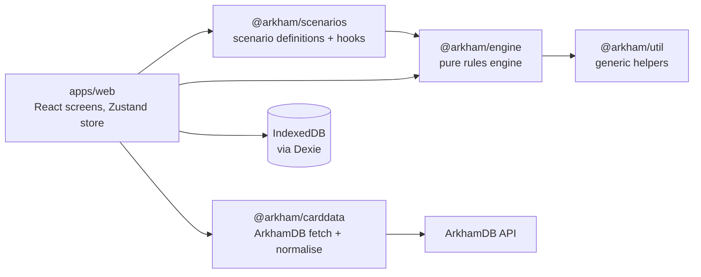

# Arkham Companion – Architecture

How the app is built today. What it is for, its requirements and the plan for what comes next are in [product.md](product.md); this document only describes code that exists.

It has two levels. **Overview** shows the whole system on one page. **Components** has one section per part of the code that gets extended. Each section explains how the part works and why, shows a reduced version of its important types, and lists its extension points: what to change, and where, to extend it.

**Keeping it current:** a PR that adds or changes a component updates that component's section in the same PR. That covers a new kind of command, trigger, decision, setup step or store method, a new package and a changed dependency direction. A PR that builds something planned in product.md adds it here. The diff of this file is where a reviewer sees an architecture change. Refer to sections by name (architecture "Triggers and card effects"), not by number. Code links point to files, not lines, so they don't go stale.

## Overview

The app is an offline PWA with no backend. Players keep their own decks, skill tests and chaos bag; the app runs the scenario side: the encounter deck, doom, agenda and act, the map, enemies and forced effects.



Arrows are package dependencies; [ESLint](../eslint.config.js) enforces the two that matter most. The engine depends on nothing but `@arkham/util`: no React, storage, network, clock or `Math.random`. Only [`IndexedDbStore`](../apps/web/src/storage/IndexedDbStore.ts) imports Dexie. [`packages/review_digest`](../packages/review_digest/src/) is CI tooling, not part of the app.

| Package | What it holds |
| --- | --- |
| [`packages/engine`](../packages/engine/src/) | Game state, commands, events, the reducer and all generic rules; the `GameStore` interface |
| [`packages/scenarios`](../packages/scenarios/src/) | Scenario definitions: setup data plus hooks for their special rules |
| [`packages/carddata`](../packages/carddata/src/) | ArkhamDB fetch, validation and normalisation; the investigator catalog |
| [`packages/util`](../packages/util/src/) | Generic string, array and object helpers |
| [`apps/web`](../apps/web/src/) | The React PWA: screens, the app store and the IndexedDB store |

### How one player action flows

Every change to a game takes the same path. Take starting a scenario, the one engine command the app sends today; the play screen will send its commands the same way.

1. The new game wizard collects the scenario, difficulty and investigators and calls [`startScenario`](../apps/web/src/state/appStore.ts) on the app store. The app store is a Zustand store that holds the saved game list (`GameSummary[]`) and the open game (`{ gameId, state }`), and it is the only place in the app that sends commands or writes games.
2. The app store builds the command: [`compileSetup`](../packages/engine/src/setup.ts) turns the scenario definition into one `StartScenario` command. The `EngineContext` it passes holds the scenario's card data, which the wizard took from the [scenario catalog](../apps/web/src/scenarios/scenarioCatalog.ts), with the chosen investigator cards added (`cardDbWith`). The wizard seats them by code ([`seating.ts`](../apps/web/src/wizard/seating.ts)), and `compileSetup` takes their printed stats from the context. The scenario's hooks aren't in it yet: `StartScenario` fires no triggers, and they join the context once the play screen sends commands.
3. [`execute(ctx, state, command)`](../packages/engine/src/execute.ts) calls [`handle`](../packages/engine/src/handle.ts). `handle` checks the command against the state and returns the `Event`s it causes, including every forced effect it triggered (see "Command handling"). A refused command throws `CommandRejected`, and nothing is stored.
4. [`replay`](../packages/engine/src/reducer.ts) folds the events into the new `GameState`.
5. The app store writes the events with [`GameStore.appendEvents`](../packages/engine/src/store.ts) and only then shows the new state. Opening a game later replays its log from the last snapshot.

### Key design decisions

- **Pure, deterministic engine.** The same state and command always give the same events, and randomness only comes from the seeded RNG kept in the state. Rules are fast to test, and every game can be reproduced from its log.
- **Event sourcing.** The event log is the game. Undo, refresh recovery, export, bug reports and later sync all come from this one mechanism.
- **Assistant, not referee.** Where the rules give the players a choice, the engine asks with a decision instead of guessing, and `ManualAdjust` can correct any state. A rules bug or a house rule never blocks a game night.
- **Scenarios as data.** A scenario is setup data plus a few hooks. What two scenarios need becomes an engine primitive, so each new scenario gets cheaper.
- **Card data from ArkhamDB.** Cards are fetched at build or run time, so errata and translations need no code change and nothing copyrighted is committed.
- **Seams before features.** Card effects, cloud sync and auto-layout get an interface before they get an implementation.

### Technology

| Area | Choice | Why |
| --- | --- | --- |
| Language | TypeScript (strict) | Discriminated unions model commands, events and zones |
| Build | Vite, pnpm workspaces | Fast; the packages enforce the boundaries above |
| UI | React 19, React Router (hash routes) | Existing experience; hash routes work on static GitHub Pages |
| UI state | Zustand | A thin store around the engine keeps the engine framework-free |
| i18n | i18next | UI strings in English and German; card text comes from ArkhamDB per language |
| Persistence | IndexedDB via Dexie behind `GameStore` | localStorage is small and synchronous; a cloud store can be a second implementation |
| Validation | zod | Only for external input: ArkhamDB JSON and imported saves |
| Offline | vite-plugin-pwa (Workbox) | App and card images cached for play without network |
| Tests | Vitest, Playwright | Engine unit and table tests; E2E on the production build |

## Components

### Game state

The whole table is one serialisable value, [`GameState`](../packages/engine/src/state.ts). Every physical card is one `CardInstance` with a unique ID, its card code and exactly one [`Zone`](../packages/engine/src/zone.ts); four copies of a card are four instances. So "where is this card?" always has one answer, moving a card anywhere is the same operation, and every rule can rely on that. Order within a zone (the top of the encounter deck, say) lives in `order`, keyed by [`zoneKey`](../packages/engine/src/zone.ts).

The state stores card codes, not card data: a rule that needs a card's health or shroud looks it up in the `CardDb` (see "Card data"). Numbers printed per investigator are `ScaledValue`s, resolved against `playerCount` when needed, never stored.

Connections between locations form an explicit graph on each [`GameMap`](../packages/engine/src/map.ts) rather than being derived from where tiles sit, because they change during play, can be one-way and can span several maps. An edge is stored on the map named when it was added; movement ignores which map owns it.

[`checkInvariants`](../packages/engine/src/invariants.ts) states what must always hold, and the end-to-end test runs it after every command. Each card is in exactly one zone and listed once in that zone's order, no token count is negative, every connection joins two known cards once, and pending decisions and turns are well formed.

```ts
interface GameState {
  meta: GameMeta;                        // scenario, difficulty, playerCount, seed, rngState, round, phase,
                                         // steps, turn, turnsTaken, leadInvestigator, heldAction,
                                         // ended, resolution
  campaign?: CampaignLog;                // the campaign this game belongs to (see Campaign)
  investigators: Investigator[];
  cards: Record<InstanceId, CardInstance>;
  order: Record<ZoneKey, InstanceId[]>;  // index 0 is the top of a deck
  board: Board;                          // maps (with their connections), slots, placement
  chaosBag: ChaosToken[];
  agenda: { current?: InstanceId };
  act: { current?: InstanceId };
  scenario: unknown;                     // per-scenario state
  pending: Decision[];                   // open questions for the players
}

interface CardInstance {
  id: InstanceId; code: CardCode; zone: Zone;
  faceUp: boolean; exhausted: boolean;
  tokens: Partial<Record<TokenKind, number>>;
  flags: Record<string, unknown>;
}

type Zone =
  | { kind: 'encounterDeck' | 'encounterDiscard' | 'setAside' | 'victoryDisplay' | 'outOfGame'
          | 'resolving' | 'agendaDeck' | 'actDeck' }
  | { kind: 'location'; mapId: MapId }
  | { kind: 'atLocation'; locationId: InstanceId }
  | { kind: 'engaged' | 'threatArea'; investigatorId: InvestigatorId }
  | { kind: 'attachedTo'; hostId: InstanceId };

interface Investigator {
  id: InvestigatorId; code: InvestigatorCode; name: string; seat: number;
  locationId?: InstanceId;
  health: { max: number; damage: number }; sanity: { max: number; horror: number };
  clues: number; resources: number; doomOnPlayerCards: number;
  actionsRemaining: number; status: 'active' | 'resigned' | 'defeated';
}
```

**Extension points**

- **A new field:** add it to the type in [`state.ts`](../packages/engine/src/state.ts) with a doc comment and give it a value in `emptyState()` and in the reducer case that creates it. If it can become inconsistent, add its rule to [`checkInvariants`](../packages/engine/src/invariants.ts).
- **A new kind of place for cards:** add a `Zone` kind in [`zone.ts`](../packages/engine/src/zone.ts) with its key in `zoneKey`, and its reference check in `validateZone` ([`placement.ts`](../packages/engine/src/placement.ts)). If cards there count as in play, add it to `isInPlay` ([`doom.ts`](../packages/engine/src/doom.ts)).
- **A rule that moves cards or tokens:** build its events with the shared builders instead of by hand, so every module moves things the same way: `cardMoved` for a move a command asks for (validated), `moveCardEvent` for one the engine decides, `discardEncounterCard` and `clearTokensEvents` in [`placement.ts`](../packages/engine/src/placement.ts); clues between an investigator and a location with `discoverCluesEvents` and `cluesToLocationEvents` in [`investigators.ts`](../packages/engine/src/investigators.ts).

### Command handling

This is the core of the engine: [`handle`](../packages/engine/src/handle.ts) turns one command into the complete list of events it causes, and [`apply`](../packages/engine/src/reducer.ts) folds an event into the state. A command is a request that may be refused and may need card data or randomness. An event is a fact that always applies the same way. So all logic lives in `handle`, and `apply` never checks anything, generates IDs or draws random numbers. Replaying a log therefore needs neither card data nor the RNG. `DeckShuffled`, for example, carries the new order rather than a seed.

```ts
function handle(ctx: EngineContext, state: GameState, command: Command): Event[];  // throws CommandRejected
function apply(state: GameState, event: Event): GameState;
function replay(events: readonly Event[], initial?: GameState): GameState;          // apply, folded over a log
function execute(ctx: EngineContext, state: GameState, command: Command): { state: GameState; events: Event[] };  // handle + replay
```

The commands are a union in [`commands.ts`](../packages/engine/src/commands.ts), the events one in [`events.ts`](../packages/engine/src/events.ts). The context holds code and static data, never part of the saved state:

```ts
type Command = StartScenario | ManualAdjust | MoveCard | AddMap | MoveInvestigator | PlaceDoom
  | AdvanceAgenda | DrawEncounter | SpawnEnemy | MoveHunters | RequestDecision | ResolveDecision
  | NextPhase | Investigate | Fight | Evade | …;      // ~40 kinds
type Event = ScenarioStarted | DeckShuffled | CardMoved | TokensChanged | CardFlipped
  | ConnectionChanged | InvestigatorChanged | DecisionRequested | AgendaAdvanced | PhaseChanged
  | ActionHeld | …;                                   // ~30 kinds

interface EngineContext {          // cards.ts
  cards: CardDb;
  hooks?: Partial<ScenarioHooks>;
  effects?: EffectsRegistry;
}
```

`handle` never changes the state. It works out what would happen by replaying its own events onto a copy as it goes:

1. **The command's own events.** `handleCommand` dispatches on `command.type` to a handler in one of the `handle_<area>.ts` files ([board](../packages/engine/src/handle_board.ts), [encounter](../packages/engine/src/handle_encounter.ts), [enemy](../packages/engine/src/handle_enemy.ts), [investigator](../packages/engine/src/handle_investigator.ts), [scenario](../packages/engine/src/handle_scenario.ts)) or a rule module. The handler checks the command against the state and returns its events, or throws `CommandRejected` with a [`Rejection`](../packages/engine/src/rejection.ts) code the UI can explain.
2. **Forced effects.** [`triggeredCommands`](../packages/engine/src/triggers.ts) steps through those events one at a time, applying each to a working copy of the state and asking the scenario hooks and card effects whether it triggers them. The matched hooks then run against the state after all of the command's events, so each one sees the command's complete outcome, and they return follow-up commands. If the command answered a decision, the chosen option's commands come first.

   > **To verify** ([M1V.1](tasks/M1V-rules-verification.md)): hooks are evaluated only after all of the command's events, not the moment their event happens. Some forced effects may have to resolve immediately, between two events of one command. Check this against the Rules Reference and cover the edge cases with tests.
3. **Follow-ups, depth first.** `withFollowUps` handles each follow-up command exactly like a player command, against the working copy as it stands after the previous follow-up, so its own forced effects resolve before the next sibling's. Its events append to the same list. A refused follow-up refuses the original command (`triggeredCommandRejected`), and a chain of more than `MAX_TRIGGERED_COMMANDS` follow-ups refuses it with `triggerLoop`. A bad hook can therefore neither hang the app nor leave half its effect behind.
4. **Commands that continue after their effects.** Advancing an agenda or act happens in two parts. First the card flips and its reverse side (the hook) resolves while it is still current. Only then does `completeCommand` move it out and make the next card current, with that part's own forced effects. On the last card the reverse side names the resolution (`EndScenario`), or raises a decision whose options do, when the investigators choose it. `NextPhase` likewise goes on with the phase's outstanding steps (see "Rounds, phases and turns").
5. **Held actions.** If the command is an action that provokes attacks of opportunity, `handle` first does a dry run to reject an illegal action. It then returns only one decision per attacking enemy and an `ActionHeld` event. Once the last of those decisions is answered, the held action resumes (`ActionResumed` and its events) or is dropped (`ActionDropped`).

`ManualAdjust` corrects almost anything, with two guards against an impossible state. It cannot move the current agenda or act (`currentStageCard`), because only advancing changes which card is current. Added doom fires no forced effects, but if it reaches the threshold the engine asks the group whether to advance the agenda (the same `advanceAgenda` decision as the mythos check) instead of staying silent or advancing on its own.

Once `ScenarioEnded` has set `GameMeta.ended`, `handle` refuses every command except `ManualAdjust` (`scenarioEnded`): the game is over, but the players may still correct the final board before the campaign reads it. Undo works on the log, outside `handle`, so it still takes back the command that ended the scenario.

The result is one list of events per player command. The store files them under one `commandId`, so undo ([`undo.ts`](../packages/engine/src/undo.ts)) always removes a whole command with its chain. The RNG state ([`rng.ts`](../packages/engine/src/rng.ts), xoshiro128\*\*) is part of `GameMeta`, so handling the same command again gives the same shuffle.

**Extension points**

- **A new command:** add its type to the `Command` union in [`commands.ts`](../packages/engine/src/commands.ts), a case in `handleCommand` ([`handle.ts`](../packages/engine/src/handle.ts)) and its handler in the matching `handle_<area>.ts`, with tests that call `handle`. Decide whether it fires triggers (`firesTriggers`) and whether it may run while a decision is pending ([`decisions.ts`](../packages/engine/src/decisions.ts)).
- **A new event:** reuse an existing one if you can. Otherwise add its type in [`events.ts`](../packages/engine/src/events.ts) and its case in `apply` ([`reducer.ts`](../packages/engine/src/reducer.ts)); the case must not validate anything.
- **A new reason to refuse:** add a `RejectionCode` with the fields the UI needs to explain it in [`rejection.ts`](../packages/engine/src/rejection.ts).

### Triggers and card effects

Forced effects are code that reacts to events. A [`TriggerHook`](../packages/engine/src/triggers.ts) gets the context, the state after the triggering command and the event, and returns commands. Hooks return commands rather than events so their effect is checked by `handle` and can use card data and the RNG like any player command. A scenario's own effects are its `ScenarioHooks`. A [`CardEffect`](../packages/engine/src/triggers.ts) belongs to one card code instead, so the same encounter card behaves the same in every scenario. `matchingTriggers` decides which event fires which hook: per event, scenario hooks before card effects. `ManualAdjust` and `StartScenario` fire nothing, because a correction or the setup is not a game event.

```ts
type TriggerHook<E extends Event> = (ctx: EngineContext, state: GameState, event: E) => readonly Command[];

interface ScenarioHooks {
  afterDoomPlaced: TriggerHook<TokensChanged>;                         // doom placed on a card in play
  onAgendaAdvance: Readonly<Record<string, TriggerHook<AgendaAdvanced>>>;  // reverse side, by agenda code
  onActAdvance: Readonly<Record<string, TriggerHook<ActAdvanced>>>;        // reverse side, by act code
  onRoundEnd: TriggerHook<RoundEnded>;
  onTurnEnd: TriggerHook<TurnEnded>;                                   // an investigator's turn ends (EndTurn)
  onCardEnters: TriggerHook<CardMoved>;                                // a card enters play from outside play
  afterEnemyDefeated: TriggerHook<EnemyDefeated>;                      // e.g. "if the Ghoul Priest is defeated, advance"
}
interface CardEffect { onReveal?: TriggerHook<CardFlipped>; }
type EffectsRegistry = Readonly<Record<string, CardEffect>>;           // by card code
```

Forced effects an encounter card repeats on a fixed timing are card data rather than code, like a revelation test: `CardStats.turnEndTest` makes `EndTurn` raise the test of each card in the investigator's threat area that has one (Frozen in Fear: a pass discards it), and `CardStats.discardAtRoundEnd` makes upkeep step 4.6 discard the card wherever it is in play (Dissonant Voices). A treachery that attaches to a location is card data too: `CardStats.locationAttachment` makes `DrawEncounter` attach it to the drawer's location (discarded instead with no location, or when `onePerLocation` finds a copy already there), `locationShroud` (board.ts) adds its `shroud` to the location's printed shroud for `Investigate`, and `discardWhenInvestigated` makes a passed `Investigate` there discard it after the clues (Obscuring Fog).

**Extension points**

- **A new trigger point:** add a field to `ScenarioHooks` or `CardEffect` in [`triggers.ts`](../packages/engine/src/triggers.ts), and a case in `matchingTriggers` that names the event firing it. Test it in [`triggers.test.ts`](../packages/engine/src/triggers.test.ts).
- **A new scripted card:** add an entry to the effects registry that is passed as `EngineContext.effects`.

### Decisions

Where the rules give the players a choice, or the engine needs an answer it cannot know, the engine puts a [`Decision`](../packages/engine/src/state.ts) into `pending` instead of guessing. Examples are a hunter tie, a spawn location, "advance the agenda?" and the result of a skill test the players resolve with their own cards. Every option carries the commands it triggers, so the mapping from answer to consequence is data. Any handler, hook or phase step can therefore ask by returning a `RequestDecision` command, and the UI needs only one dialog for all of them.

`ResolveDecision` runs the chosen option's commands like trigger follow-ups, in the same undo group. An answer may name who gives it (`answeredBy`, for one device per player); it is then refused unless the `decider` allows that investigator (`notTheDecider`). Without it, a shared device answers for anyone. If one is refused, the answer is refused and the decision stays. While a decision is pending, every player command except `ManualAdjust` and `ResolveDecision` is refused ([`decisions.ts`](../packages/engine/src/decisions.ts)). Skill tests ([`skill_tests.ts`](../packages/engine/src/skill_tests.ts)) and the enemy attacks the rules force outside the enemy phase are built on this mechanism: attacks of opportunity ([`attacks_of_opportunity.ts`](../packages/engine/src/attacks_of_opportunity.ts)), retaliate after a failed fight and alert after a failed evade. All three ask the same `forcedAttackDecision` ([`forced_attacks.ts`](../packages/engine/src/forced_attacks.ts)): `attack` with the printed damage and horror, which the players may lower for soak, or `skip` for a card that prevents or cancels it. A retaliate or alert decision is the last fail command of its test, so it comes after the test's other results.

A skill test decision raised for one investigator also carries a suggestion ([`skillTestSuggestion`](../packages/engine/src/skill_modifiers.ts)): the printed skill, plus one modifier the players enter for everything the engine does not track (committed icons, cards, lasting effects), plus the revealed chaos tokens valued from the scenario reference card, against the printed difficulty, with a trace of each step for the UI. The engine deliberately models no card effects here: the players play their own cards, and one number is enough. Following the skill test timing, the players enter the modifier before drawing the token and may still change it until they answer, because abilities triggered by the reveal or the result can change the value. The answer stays pass or fail.

```ts
interface Decision {
  id: DecisionId;          // derived from kind and subject, so a repeated check doesn't ask twice
  kind: 'confirm' | 'chooseInvestigator' | 'chooseLocation' | 'chooseCard' | 'chooseOption' | 'skillTestResult';
  subject?: InstanceId;    // dropped when this card advances
  prompt: string;          // i18n key
  decider: Decider;        // lead, one investigator or the group
  skillTest?: SkillTest;
  options: DecisionOption[];
}
interface DecisionOption { id: string; label: string; target?: InstanceId | InvestigatorId; commands: Command[]; }
```

**Extension points**

- **Ask the players something:** return a `RequestDecision` whose options carry their commands. Use `confirmOptions` or `skillTestDecision` ([`decisions.ts`](../packages/engine/src/decisions.ts)) for the common shapes.
- **A symbol token whose value depends on the board** (a "-X"): add a `tokenValues` entry to the scenario's `modifiers` ([`scenario.ts`](../packages/engine/src/scenario.ts)); the printed reference card values need no code.
- **A new kind of question:** add a `DecisionKind` in [`state.ts`](../packages/engine/src/state.ts). A new engine-raised prompt also gets its debug sentence in [`describe_decision.ts`](../packages/engine/src/describe_decision.ts).

### Rounds, phases and turns

The phase assistant runs the parts of a round the app can do by itself. `GameMeta.steps` lists the outstanding steps of the current phase ([`phases.ts`](../packages/engine/src/phases.ts)). `NextPhase` runs them in order, or moves to the next phase and runs its steps:

- mythos places doom, checks the doom threshold and draws one encounter card per investigator;
- enemy moves hunters ([`hunters.ts`](../packages/engine/src/hunters.ts)) and then resolves the attacks of engaged enemies ([`enemies.ts`](../packages/engine/src/enemies.ts));
- upkeep resets actions, readies enemies, gives each investigator a resource and ends the round, discarding the cards that last until the end of the round.

Each step removes itself first (`PhaseStepsChanged`) and then runs its commands through `handle`. The loop stops as soon as a decision is pending, so the next `NextPhase` after the answer resumes with the following step. Steps as data make the assistant resumable after any answer, and let the UI show what is left in a phase. Turns in the investigation phase ([`turns.ts`](../packages/engine/src/turns.ts)) only record who is acting and how many actions they have left. The first round starts in the investigation phase.

```ts
type PhaseStepId = 'placeDoom' | 'checkDoomThreshold' | 'drawEncounterCard'   // mythos
  | 'huntersMove' | 'enemiesAttack'                                          // enemy
  | 'resetActions' | 'readyExhausted' | 'gainResources' | 'endRound';        // upkeep; titles in PHASE_STEP_TITLES
```

**Extension points**

- **A new automated step:** add a `PhaseStepId` with its title in `PHASE_STEP_TITLES`, put it into its phase's step list in [`phases.ts`](../packages/engine/src/phases.ts) and give it the commands it runs.

### Rule modules

The generic rules are small modules, one per subject, called by the handlers. Queries that several modules share live with the subject they are about. The rules each one implements are summarised in [rules.md](rules.md).

| Subject | Files |
| --- | --- |
| Board: connections, reveal, maps, placement | [`board.ts`](../packages/engine/src/board.ts), [`handle_board.ts`](../packages/engine/src/handle_board.ts), [`placement.ts`](../packages/engine/src/placement.ts), [`map.ts`](../packages/engine/src/map.ts) |
| Doom, agenda and act | [`doom.ts`](../packages/engine/src/doom.ts), [`handle_scenario.ts`](../packages/engine/src/handle_scenario.ts) |
| Encounter deck: draws, surge, peril, revelation tests | [`handle_encounter.ts`](../packages/engine/src/handle_encounter.ts) |
| Enemies: spawn, engagement, prey, hunters, attacks, retaliate and alert | [`spawn.ts`](../packages/engine/src/spawn.ts), [`engagement.ts`](../packages/engine/src/engagement.ts), [`hunters.ts`](../packages/engine/src/hunters.ts), [`enemies.ts`](../packages/engine/src/enemies.ts), [`forced_attacks.ts`](../packages/engine/src/forced_attacks.ts), [`handle_enemy.ts`](../packages/engine/src/handle_enemy.ts) |
| Investigators: health, sanity, defeat, movement | [`investigators.ts`](../packages/engine/src/investigators.ts), [`handle_investigator.ts`](../packages/engine/src/handle_investigator.ts) |
| Elimination: defeat and resign clean-up, new lead, no investigator left | [`elimination.ts`](../packages/engine/src/elimination.ts) |
| Keywords the rules react to | [`keywords.ts`](../packages/engine/src/keywords.ts) (parsed from card text by `@arkham/carddata`) |
| Skill test suggestions: modifier, chaos tokens, trace | [`skill_modifiers.ts`](../packages/engine/src/skill_modifiers.ts) |
| Card lookups by ID and name | [`lookup.ts`](../packages/engine/src/lookup.ts), [`cards.ts`](../packages/engine/src/cards.ts) |

**Extension points**

- **A new rule:** put it in the module of its subject and call it from the handler of the command it belongs to. Add a step to the end-to-end test where it shows at the table (see "Tests and debugging").

### Scenarios

A scenario is mostly data, a [`ScenarioDefinition`](../packages/engine/src/scenario.ts): agenda and act decks, chaos bag per difficulty, reference card, setup steps, and hooks for the few rules that need code. Data is easy to check, review and later generate from imports. [`compileSetup`](../packages/engine/src/setup.ts) turns the definition plus the players' choices into one `StartScenario` command, resolving per-investigator values and building the encounter deck. The players' choices name each seat by an `InvestigatorSeat` (the game's `InvestigatorId` and the card's `InvestigatorCode`), and `compileSetup` fills in name, health, sanity and skills from the investigator cards in the context's `CardDb`, so the setup cannot disagree with the card. `StartScenario` itself still carries complete investigators, so its event replays without the context and tests can start from any board. Mid-scenario board changes reuse the same steps: `compileMapStep` turns an `addMap` step into an `AddMap` command.

```ts
function compileSetup(ctx: EngineContext, def: ScenarioDefinition, options: SetupOptions): StartScenario;
function compileMapStep(state: GameState, step: AddMapStep): Command[];
```

Hooks return commands that go through the normal `handle` path. Game commands such as `MoveCard` and `AddMap` exist for hooks: unlike a `ManualAdjust` correction, they are game events and fire further triggers.

The only scenario so far is the hand-entered test scenario [`the_gathering/`](../packages/scenarios/src/the_gathering/). It has real card codes and names but no card text, and stands in for real scenario data. Its hooks cover the reverse sides of all three acts and of agendas 2 and 3, and act 3's objective; a reverse side that lets the lead investigator choose the resolution raises a decision whose options end the scenario. The app lists playable scenarios in its [scenario catalog](../apps/web/src/scenarios/scenarioCatalog.ts).

```ts
interface ScenarioDefinition {
  id: ScenarioId;
  chaosBag: Record<Difficulty, readonly ChaosToken[]>;
  reference: ScenarioReference;          // symbol token effects per reference card side
  agendaDeck: readonly CardCode[]; actDeck: readonly CardCode[];
  setup: readonly SetupStep[];
  hooks?: Partial<ScenarioHooks>;
  modifiers?: SkillModifierRegistry;     // token values computed from the board ("-X")
}
type SetupStep = AddMapStep | SetAsideStep | BuildEncounterDeckStep | PlaceTokensStep | SpawnStep | MoveInvestigatorsStep;

```

**Extension points**

- **A new scenario:** add a folder in [`packages/scenarios/src/`](../packages/scenarios/src/) with its definition, card list, hooks and an end-to-end test, export it from the package index, and add an entry to the app's [scenario catalog](../apps/web/src/scenarios/scenarioCatalog.ts).
- **A new setup instruction:** add a `SetupStep` kind and its compilation in [`setup.ts`](../packages/engine/src/setup.ts). Do this only when two scenarios need it; a one-off belongs in that scenario's hooks.

### Campaign

A campaign spans several games and outlives each of them, so it is its own aggregate in [`campaign/`](../packages/engine/src/campaign/), event-sourced like a game but with its own commands ([`handle_campaign.ts`](../packages/engine/src/campaign/handle_campaign.ts)), events and reducer ([`campaign_reducer.ts`](../packages/engine/src/campaign/campaign_reducer.ts)). The same reasons apply: undo, recovery after a crash and export come for free, and later scenarios read earlier outcomes from the log rather than from the players' memory. The two aggregates do not share a command union, so a game command can never change the campaign by accident. [`CampaignLog`](../packages/engine/src/campaign/campaign_log.ts) holds the team with trauma, XP and fate, keyed by `InvestigatorCode` (the investigator card's code, unique within a campaign; a game's `InvestigatorId` names one seat in one game instead), replaced investigators, typed story records, the chaos bag and the scenario order. [`campaign.checkInvariants`](../packages/engine/src/campaign/campaign_invariants.ts) states what must always hold (team of 1–4, no overspent XP, trauma consistent with fate). Commands name investigators by code only. The handlers look up their printed name, health and sanity in the `CampaignContext`'s `CardDb` ([`investigatorCard`](../packages/engine/src/investigator_cards.ts)), as game handlers look up cards in the `EngineContext`, so the caller cannot send stats that disagree with the card. The events still carry the full log entry, so a replay needs no context. A game's `GameState.campaign` holds a copy of the log at scenario start. Callers reach the campaign functions through the `campaign` namespace export (`campaign.handleCommand`, `campaign.compileStart`), so their names are verb + noun without repeating "campaign"; the campaign types are exported flat.

```ts
interface CampaignContext { cards: CardDb; }   // holds the investigator cards
function campaign.handleCommand(ctx: CampaignContext, log: CampaignLog, command: CampaignCommand): CampaignEvent[];  // throws CampaignCommandRejected
function campaign.applyEvent(log: CampaignLog, event: CampaignEvent): CampaignLog;
function campaign.executeCommand(ctx: CampaignContext, log: CampaignLog, command: CampaignCommand): { log: CampaignLog; events: CampaignEvent[] };
function campaign.compileStart(def: CampaignDefinition, options: CampaignOptions): StartCampaign;

type StoryValue = { kind: 'flag'; value: boolean } | { kind: 'count'; value: number }
  | { kind: 'list'; entries: string[] } | { kind: 'crossableList'; entries: CrossableEntry[] };
interface CampaignDefinition { id: CampaignDefinitionId; scenarios: readonly ScenarioId[]; chaosBag: Record<Difficulty, readonly ChaosToken[]>; }
```

The only campaign so far is Night of the Zealot ([`night_of_the_zealot/campaign.ts`](../packages/scenarios/src/night_of_the_zealot/campaign.ts)); its second and third scenarios are ids only until their data arrives.

**Extension points**

- **A new campaign:** add a `CampaignDefinition` next to its scenarios in [`packages/scenarios/src/`](../packages/scenarios/src/) and export it from the package index.
- **A new correction:** add a `CampaignAdjustment` kind and its case in [`handle_campaign_adjustment.ts`](../packages/engine/src/campaign/handle_campaign_adjustment.ts); it produces the regular event, and the result is checked against `campaign.checkInvariants`.
- **A new campaign command:** add it to [`campaign_commands.ts`](../packages/engine/src/campaign/campaign_commands.ts), handle it in `campaign.handleCommand` with a `CampaignRejection` for each way it can be refused, and produce existing events where they fit.
- **A new campaign record:** add its field to `CampaignLog`, the `CampaignEvent` that changes it in [`campaign_events.ts`](../packages/engine/src/campaign/campaign_events.ts) and its case in `campaign.applyEvent`. If it can become inconsistent, add the rule to `campaign.checkInvariants`.

### Card data

The engine reads card numbers only through a [`CardDb`](../packages/engine/src/cards.ts) in its context (`ctx.cards.get(code)` returns `CardStats`), so it never loads data itself and tests pass a small fake one. Inside the engine and the scenarios, card codes are a branded `CardCode` (card stats, card instances, setup steps, decks), so a code can't be mixed up with an instance ID or a name; an `InvestigatorCode` is a `CardCode` with one more tag. Encounter set codes (`EncounterSetCode`), scenario IDs (`ScenarioId`) and campaign definition IDs (`CampaignDefinitionId`) are branded the same way, as are the IDs the store and the caller create: `GameId` (a UUID from the store) and `CampaignId`. `@arkham/carddata` doesn't depend on the engine, so its `CardDef.code` stays a plain string until it is mapped to `CardStats`. [`@arkham/carddata`](../packages/carddata/src/) fetches ArkhamDB packs ([`fetch.ts`](../packages/carddata/src/fetch.ts)), validates the raw JSON with zod (`RawCardSchema`) and normalises it to `CardDef` ([`schema.ts`](../packages/carddata/src/schema.ts)). It also builds the investigator catalog ([`catalog.ts`](../packages/carddata/src/catalog.ts)). Investigator cards are in the same `CardDb`, so there is one place for all cards; [`investigatorCard(cards, code)`](../packages/engine/src/investigator_cards.ts) reads one as an `InvestigatorCard` (name, health, sanity, skills), and `investigatorCardStats` turns one back into `CardStats`. ArkhamDB is the community reference with a public API, CORS and translations, so cards arrive accurate and in the players' language. Fetched JSON and images are never committed: they go to `packages/carddata/.cache/` or IndexedDB. The app refreshes its copy with `If-Modified-Since` ([`loadCatalog.ts`](../apps/web/src/catalog/loadCatalog.ts)) and keeps working offline from it.

```ts
interface CardDb {
  get(code: CardCode): CardStats | undefined;
  encounterSet(encounterCode: EncounterSetCode): CardStats[];
}
interface CardStats {
  code: CardCode; name: string; typeCode: CardType; traits: readonly Trait[];
  shroud?: number; clues?: ScaledValue; fight?: number; evade?: number; health?: ScaledValue;
  damage?: number; horror?: number; doom?: ScaledValue; victory?: number;
  encounterCode?: EncounterSetCode; quantity?: number; keywords?: readonly Keyword[];
  entersThreatArea?: boolean; revelationTest?: SkillTest;
  turnEndTest?: SkillTest; discardAtRoundEnd?: boolean;
  locationAttachment?: { onePerLocation?: boolean; shroud?: number; discardWhenInvestigated?: boolean };
  sanity?: number; skills?: SkillValues;   // investigators
}
```

**Extension points**

- **A new card field:** read it in `RawCardSchema`, normalise it in `normaliseCard` ([`schema.ts`](../packages/carddata/src/schema.ts)) and, only if a rule needs it, add it to `CardStats` ([`cards.ts`](../packages/engine/src/cards.ts)).
- **A new language:** add its ArkhamDB host in [`fetch.ts`](../packages/carddata/src/fetch.ts) and [`loadCatalog.ts`](../apps/web/src/catalog/loadCatalog.ts), and its UI strings in [`i18n`](../apps/web/src/i18n/).

### Persistence

[`GameStore`](../packages/engine/src/store.ts) is the only way to save or load a game. It stores each game's event log and a snapshot, replays a game on load, groups undo by `commandId`, and rejects a write whose `expectedSeq` doesn't match, so two tabs can't overwrite each other. Every command is written before the UI updates: a tablet at the table gets refreshed and runs out of battery, and with the log written first nothing is lost. The log doubles as the export format ([`gameExport.ts`](../apps/web/src/storage/gameExport.ts)) and is the basis for later sync. That is also why game IDs are UUIDs and never tied to a device. [`IndexedDbStore`](../apps/web/src/storage/IndexedDbStore.ts) implements the interface with Dexie (tables `games`, `events`, `snapshots`, `campaigns`, `cards`, `catalog`). localStorage only holds per-device settings ([`settings.ts`](../apps/web/src/settings/settings.ts)).

```ts
interface GameStore {
  createGame(init?: NewGame): Promise<GameId>;
  appendEvents(gameId: GameId, events: readonly Event[], expectedSeq?: number, commandId?: string): Promise<StoredEvent[]>;
  undoLast(gameId: GameId, expectedSeq?: number): Promise<LoadedGame | undefined>;
  loadGame(gameId: GameId): Promise<LoadedGame | undefined>;   // last snapshot + replay
  listGames(): Promise<GameSummary[]>;
  loadEvents(gameId: GameId, afterSeq?: number): Promise<StoredEvent[]>;
  importGame(game: ImportedGame): Promise<GameId>;
  renameGame(…); duplicateGame(…); deleteGame(…);
}
interface StoredEvent { gameId: GameId; seq: number; timestamp: number; commandId: string; event: Event; }
```

**Extension points**

- **A new store operation:** add a method to `GameStore` in [`store.ts`](../packages/engine/src/store.ts), with its doc comment as the contract, and implement and test it in [`IndexedDbStore`](../apps/web/src/storage/IndexedDbStore.ts).
- **A schema change:** bump the Dexie `version()` with an `upgrade`. A change of the state shape bumps `STATE_VERSION`, so older exports can be migrated or refused.

### Web app

The React PWA is a thin layer over the engine, which keeps UI problems and rules problems apart. [`App.tsx`](../apps/web/src/App.tsx) defines the hash routes; the screens are in [`screens/`](../apps/web/src/screens/): home with the saved games, the new game wizard ([`wizard/`](../apps/web/src/wizard/)) with the investigator picker ([`picker/`](../apps/web/src/picker/)), the game screen and settings. Components read state from the [app store](../apps/web/src/state/appStore.ts) and call its methods; they never change game state or touch storage themselves. The app store is a factory around a `GameStore`, so tests inject an in-memory one. Markup is structure only and all presentation is in CSS built on [`tokens.css`](../apps/web/src/styles/tokens.css). UI strings are in [`i18n`](../apps/web/src/i18n/).

```ts
interface AppState {
  games: GameSummary[];
  current?: { gameId: GameId; state: GameState };   // always the replay of its event log
  startScenario(start: ScenarioStart): Promise<GameId>;
  openGame(gameId: GameId): Promise<void>;
  refresh(); newGame(); renameGame(…); duplicateGame(…); deleteGame(…); exportGame(…); importGame(…);
}
function createAppStore(gameStore: GameStore): StoreApi<AppState>;
```

**Extension points**

- **A new screen:** add a route in [`App.tsx`](../apps/web/src/App.tsx) and a component in [`screens/`](../apps/web/src/screens/), extend an `@flow` E2E spec ([`apps/web/e2e/`](../apps/web/e2e/)), and add its strings in English and German.
- **A new game action:** add a method to `AppState` ([`appStore.ts`](../apps/web/src/state/appStore.ts)) that runs `execute` and `appendEvents`. Components call it and never call the engine directly.

### Tests and debugging

Each engine module has unit tests, and invariants are covered by table tests. On top of that, one end-to-end test per scenario ([`end_to_end.test.ts`](../packages/scenarios/src/the_gathering/end_to_end.test.ts)) plays several rounds through a driver that speaks the game's language ([`TestTable`](../packages/scenarios/src/the_gathering/test_table.ts)). It runs `checkInvariants` after every command and replays the whole log at the end. [`formatBoard(ctx, state)`](../packages/engine/src/format_board.ts) renders the board as stable plain text, used in inline snapshots and failure messages.

**Extension points**

- **A rule change:** add a step to the end-to-end test where the rule shows at the table, so reviewers see it in context.
- **A new kind of table check:** add it to `TestTable` ([`test_table.ts`](../packages/scenarios/src/the_gathering/test_table.ts)) so tests read like the table, not like the state.
