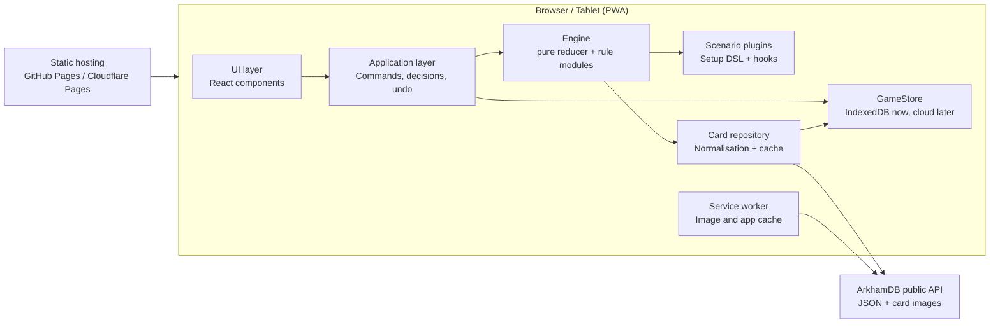
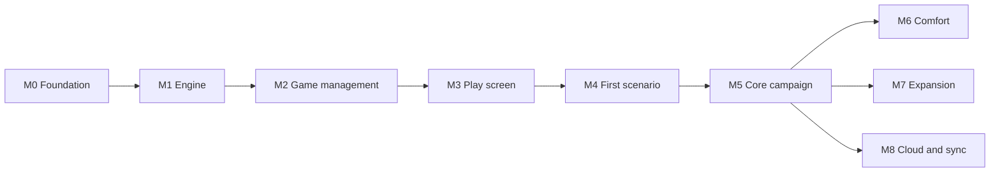

# Arkham Companion – System and Application Architecture

Draft v0.3 · 2026-10-14 · Living version: https://claude.ai/code/artifact/12ad5370-637f-4943-a562-74dbc1768fec

## At a glance

- **The problem:** in Arkham Horror LCG the players also run the "game master" side: building and shuffling the encounter deck, counting doom, laying out and connecting locations, moving hunter enemies, remembering forced effects and keeping the campaign log. This bookkeeping is slow and error-prone, and mistakes change the outcome of a scenario.
- **The app:** a tablet companion that takes over exactly this scenario side, while players keep their own decks, skill tests and (optionally) the chaos bag in hand – the tactile, fun part stays physical.
- **Key bets:** a pure, event-sourced rules engine (gives undo, refresh safety, export and later sync from one mechanism); scenarios as data with small code hooks (new content is cheap); card data from ArkhamDB instead of hand-typed (accurate, bilingual, nothing copyrighted in git); offline-first PWA with no backend (free hosting, works at any table).
- **How it gets built:** in milestones M0–M8 (§14), each a sequence of small tasks done in one Claude Code session per task. Every section below starts with a short *Why* so a reviewer can judge a decision without reading the details.

## 1. Goal and scope

*Why:* a tight scope keeps v1 shippable. The scenario side is where the bookkeeping pain is; player cards would mean modelling thousands of individual card effects for little gain at the table.

The app takes over the **scenario side** of Arkham Horror LCG: setup, agenda/act/doom, encounter deck, map with locations and enemies, threat areas and special mechanics. Players keep their own decks, skill tests and (optionally) the chaos bag in hand.

**In scope v1**

- Agenda, act and doom management incl. threshold checks and reverse-side effects
- Encounter deck: building from encounter sets, drawing, discard, reshuffle, surge/peril, set-aside cards
- Map: location graph with explicit connections, multiple maps/regions, locations added or replaced mid-scenario, scenario-book layout plus optional auto-layout, randomised location placement
- Enemies: spawn, hunter movement, engagement, exhaustion, damage; investigator positions
- Investigator tracking: health, horror, clues, resources, threat area, engaged enemies
- Campaign mode: campaign log across the three intro scenarios, chaos bag carried forward
- Mid-scenario setup changes (replace locations, set-aside cards into play, cards into discard)
- Scenario-specific mechanics via scripts
- Card language configurable (English, German and the other languages ArkhamDB offers)
- Local persistence, refresh-proof, undo

**Not in scope v1:** player card logic, skill test resolution, deck building, multi-device sync and cloud storage (both planned, see sections 10 and 15).

**First content:** Chapter Two starts with the Core Set (2026), ArkhamDB pack code `core_2026`, with an introductory campaign of three scenarios. The first scenario is *Spreading Flames* (encounter code `spreading_flames`).

## 2. Guiding principles

*Why:* these rules decide most design questions up front, so individual tasks don't re-argue them. Each one names the benefit it buys.

1. **Assistant, not referee.** The app suggests the next step; players confirm. Every state can be corrected manually. *Benefit:* a rules bug or a house rule never blocks a game night.
2. **Pure, deterministic engine.** Game logic is a pure reducer with no UI or I/O dependency. Randomness only via a seeded RNG in the state. *Benefit:* rules are fast to test exhaustively, and the same inputs always give the same game.
3. **Event sourcing.** Every change is an event in the log. This gives undo, refresh recovery, export, reproducible bugs – and later, sync. *Benefit:* five features from one mechanism instead of five separate implementations.
4. **Data separate from rules.** Card data comes from ArkhamDB; rules and scenario flow come from our own scenario definitions. *Benefit:* card errata and translations arrive without code changes; nothing copyrighted is committed.
5. **Offline-first.** After the first load everything runs without network – important at the table. *Benefit:* bad Wi-Fi never interrupts a game.
6. **Generic before specific.** What several scenarios need (e.g. taking the topmost copy of X from the discard pile) becomes an engine primitive; only true one-offs become scenario code. *Benefit:* each new scenario gets cheaper to add.
7. **Start simple, design for growth.** v1 automates little, but every extension point (card effects, sync, auto-layout) has a seam from day one. *Benefit:* something playable early, without rewrites later.

## 3. System context

*Why no backend in v1:* a static site is free to host, needs no accounts and works offline. The one thing a backend adds – sharing a game across devices – is planned for M8 behind an interface that already exists.

There is **no backend of our own in v1**. The app is a static single-page app (PWA) that runs in the browser.



The ArkhamDB public API sends `Access-Control-Allow-Origin: *`, so it can be queried directly from the browser. ArkhamDB asks clients to respect HTTP caching (max-age, last-modified), which fits our offline approach.

## 4. Technology stack

*Why these choices:* mainstream, well-documented tools (good for both the human maintainer and Claude Code sessions), all running in the browser with no server. The rationale per choice is in the table.

| Area | Choice | Rationale |
| --- | --- | --- |
| Language | TypeScript (strict) | Complex domain model, discriminated unions for events/commands |
| Build | Vite + pnpm workspaces | Fast, monorepo-ready |
| UI | React 19 | Existing experience, largest ecosystem |
| UI state | Zustand (thin wrapper around the engine) | Engine stays framework-free |
| Map rendering | SVG + react-zoom-pan-pinch | Crisp at any zoom, easy hit-testing |
| Auto-layout | elkjs (optional) | Graph layout for locations without a book layout |
| Drag and drop | dnd-kit | Touch-friendly for tablet |
| i18n | i18next | UI strings; card text comes from ArkhamDB per language |
| Persistence | IndexedDB via Dexie behind a `GameStore` interface | localStorage is limited to ~5 MB and synchronous; cloud storage comes later as a second adapter |
| Validation | zod | Check scenario definitions and imported saves |
| Offline | vite-plugin-pwa (Workbox) | Cache-first for card images |
| Tests | Vitest, Playwright | Engine unit and table tests, E2E |
| Repo / CI | GitHub + GitHub Actions | Tests on every push, deploy to Pages |

**Repository structure**

```
arkham-companion/
  packages/
    engine/       # pure TS core: state, commands, events, rule modules
    carddata/     # ArkhamDB adapter, normalisation, fetch script
    scenarios/    # scenario definitions, one folder per campaign
      core-2026/
        campaign.ts
        spreading-flames/
  apps/
    web/          # React PWA
```

## 5. Domain model

*Why:* modelling every physical card as one instance with exactly one zone means "where is this card?" always has a single answer. Every rule, every UI panel and every invariant test relies on that; moving a card anywhere is the same operation.

Core idea: **every physical card on the table is a `CardInstance`** with a unique ID, card code and current zone. Multiple copies (e.g. 4× *Fire!*) are separate instances.

```ts
type Zone =
  | { kind: 'encounterDeck' } | { kind: 'encounterDiscard' }
  | { kind: 'setAside' } | { kind: 'victoryDisplay' } | { kind: 'outOfGame' }
  | { kind: 'agendaDeck' } | { kind: 'actDeck' }
  | { kind: 'location'; mapId: MapId }                    // location card on a map
  | { kind: 'atLocation'; locationId: InstanceId }         // unengaged enemy at a location
  | { kind: 'engaged'; investigatorId: string }
  | { kind: 'threatArea'; investigatorId: string }
  | { kind: 'attachedTo'; hostId: InstanceId };           // attachment to location/enemy/agenda

interface CardInstance {
  id: InstanceId; code: string;        // ArkhamDB code, e.g. '12106'
  zone: Zone; faceUp: boolean;          // unrevealed/revealed or front/back
  exhausted: boolean;
  tokens: Partial<Record<'doom'|'clue'|'damage'|'horror'|'resource', number>>;
  flags: Record<string, unknown>;       // scenario-specific markers
}

interface Investigator {
  id: string; code: string; name: string; seat: number;
  locationId?: InstanceId;
  health: { max: number; damage: number };
  sanity: { max: number; horror: number };
  clues: number; resources: number;
  doomOnPlayerCards: number;   // doom on player cards the app does not model
  status: 'active' | 'resigned' | 'defeated';
}

interface Board {
  maps: Record<MapId, GameMap>;  // e.g. two parallel maps
  slots: Record<SlotId, { mapId: MapId; x: number; y: number }>;
  placement: Record<InstanceId, SlotId | { x: number; y: number }>;
  layoutMode: 'book' | 'auto';
}

interface GameMap {             // one map = its locations + their connections (map.ts)
  name: string; visible: boolean;
  connections: Edge[];          // explicit graph, incl. one-way edges
}

interface GameState {
  meta: { scenarioId; difficulty; playerCount; seed; rngState; round; phase; leadInvestigator };
  campaign?: CampaignLog;               // absent in standalone play
  investigators: Investigator[];
  cards: Record<InstanceId, CardInstance>;
  order: Record<ZoneKey, InstanceId[]>; // order in decks/discards
  board: Board;
  chaosBag: ChaosToken[];
  agenda: { current: InstanceId };  act: { current: InstanceId };
  scenario: unknown;                    // typed per scenario (zod schema)
  pending: Decision[];                  // open decisions for the players
}
```

Per-investigator values (clues on locations, enemy health, act thresholds) are computed at runtime from `playerCount`, not stored. Investigator stats (health, sanity) come from ArkhamDB and can be edited manually.

**Map model**

*Why an explicit graph:* movement and hunter pathing depend on connections, which change during play and can be one-way or span several maps – none of that can be derived from where tiles sit on screen.

- **Connections are an explicit graph**, not derived from positions. ArkhamDB does not expose connection symbols in structured form, so they come from the scenario data pipeline below; the engine builds edges from the revealed/unrevealed state. Card effects can add or remove edges at runtime (`AddConnection`, `RemoveConnection`), including one-way edges. An edge is stored on exactly one map (the one named when it is added); its ends may be on other maps, and movement ignores which map owns it.
- **Multiple maps:** a scenario can define several maps (parallel areas, a second board added mid-scenario). The UI shows them as tabs or side by side.
- **Layout:** the scenario book layout is stored as slots (often a grid, sometimes free positions). Optionally, auto-layout arranges the graph with elkjs. Players can always drag locations manually.
- **Randomised locations:** the setup DSL has `randomLocations(pool, slots)` using the seeded RNG, so it stays reproducible.

**Where scenario data comes from**

*Why a layered pipeline:* no single source has everything. Taking each field from the best available source, with a manual override on top, avoids typing data by hand while still allowing every mistake to be fixed.

Per field, the first source that has it wins; every value can be overridden by hand.

1. **ArkhamDB:** card stats and text, encounter sets and quantities, agenda/act order (`stage`), doom and clue values, victory points, investigators. ArkhamDB has no connection symbols and no layout.
2. **ArkhamCards campaign data** ([zzorba/arkham-cards-data](https://github.com/zzorba/arkham-cards-data)): scenario setup steps including `location_setup` grids (the book layout as rows of location codes, with arrows and annotations), chaos bags per difficulty, campaign log entries and resolutions. Imported at build time like the ArkhamDB data and not committed, since that repo carries no licence.
3. **Card images:** connection symbols (a location's own symbol and the symbols it connects to) are only printed on the cards. A dev-time extraction step – a Claude Code task that reads the location images, or a script calling a vision model – writes them as JSON to `packages/scenarios/data/connections/<pack>.json`. It holds only card codes and symbol names, no card text, so it can be committed. Each extraction is reviewed once against a generated contact sheet before merging.
4. **Manual:** the board's edit mode lets you add or remove connections, fix symbols and move slots. Edits are saved as a scenario override file, which can be exported and committed to the repo.

## 6. Engine: commands, events, decisions

*Why commands and events are separate:* a command is a request that may be rejected and may need card data or randomness; an event is a plain fact that is always applied the same way. Keeping all logic in command handling makes replay deterministic and cheap. *Why decisions:* where the rules give players a choice, the engine asks instead of guessing (principle 1), through one mechanism the UI shows as one dialog.

**Flow:** the UI sends a `Command` → the engine validates it against the current state → produces a list of `Event`s → events are applied and persisted.

- **Commands** (intent): `StartScenario`, `NextPhase`, `PlaceDoom`, `AdvanceAgenda`, `AdvanceAct`, `DrawEncounter(investigator)`, `SpawnEnemy`, `MoveEnemy`, `EngageEnemy`, `DefeatEnemy`, `MoveInvestigator`, `DiscoverClues`, `AdjustInvestigator`, `Attach`, `Discard`, `Shuffle`, `AddToVictory`, `ResolveDecision`, `ManualAdjust`.
- **Events** (facts): fine-grained, e.g. `CardMoved`, `TokensChanged`, `CardFlipped`, `ConnectionChanged`, `InvestigatorChanged`, `DeckShuffled(seedStep)`, `PhaseChanged`, `DecisionRequested`.
- **Decisions:** where the engine cannot continue without an answer from the players – a rules choice (hunter tie, spawn location, effect target, "an investigator of your choice"), a confirmation (advance agenda?) or the result of a skill test – it creates a `Decision` instead of guessing; the answer returns as `ResolveDecision`. Kinds: `confirm`, `chooseInvestigator`, `chooseLocation`, `chooseCard`, `chooseOption`, `skillTestResult`. What players do on their own initiative (move, investigate, adjust tokens) are commands, not decisions.
- **Skill tests** are resolved by the players with their own cards and chaos bag (§1). The engine states the test (skill and difficulty, e.g. the location's shroud) and asks for pass/fail via a `skillTestResult` decision, then applies the consequence (clue discovered, enemy damaged or evaded, a card's fail effect). Each such decision carries a suggestion (`skillTestSuggestion`, `skill_modifiers.ts`): the investigator's printed skill and the test's difficulty run through one modifier pipeline (committed icons, chaos tokens with the scenario reference card side, lasting effects, cards in play via `CardEffect.skillModifiers`, scenario rules via `ScenarioDefinition.modifiers`) with an explanation trace for the UI. It is only a suggestion; the players still answer pass or fail.
- **Undo:** discard the last command and its events, replay from the last snapshot.
- **Randomness:** seeded PRNG (e.g. xoshiro128) in the state; every shuffle is reproducible.

**Engine rule modules**

| Module | Responsibility |
| --- | --- |
| Doom | Sum doom (agenda + cards in play + each investigator's player-card doom counter) against threshold, suggest advancing |
| Act | Per-investigator clue thresholds, trigger reverse side |
| Mythos | Place doom, draw in player order, surge, peril, reshuffle empty deck |
| Enemy | Spawn, hunter path (shortest path over the graph, tie → decision), aloof, massive, retaliate/alert reminders, exhaust/ready |
| Board | Connection graph, multiple maps, reveal, place clues, attachments, random placement |
| Investigator | Health/horror/clues/resources, defeat check, prey criteria |
| Keywords | Parser for keywords in card text (surge, peril, hunter, aloof, elite, victory X, spawn, prey, patrol …) |
| Triggers | Event bus for forced effects: `afterDoomPlaced`, `onRoundEnd`, `onAgendaAdvance` |
| Effects | Registry of card scripts keyed by card code; in v1 only board-changing cards |

**Phase assistant:** guides through mythos → investigation → enemy → upkeep, automating the mythos phase, offering quick actions in investigation (investigate, fight, evade – each a skill test hand-off), computing hunter movement and due attacks in the enemy phase.

## 7. Scenario plugins and setup changes

*Why mostly declarative:* most of a scenario is setup data (which cards, where, how many). Data is easy to validate, review and generate from imports; code is reserved for the few truly special rules. *Benefit:* new scenarios are cheap, and the same setup steps handle mid-scenario changes.

A scenario is **mostly declarative** (data) with **TypeScript hooks** for special mechanics.

```ts
interface ScenarioDefinition {
  id: 'core2026-spreading-flames';
  packCode: 'core_2026';
  encounterSets: string[];                 // ArkhamDB encounter_codes
  chaosBag: Record<Difficulty, Token[]>;   // standalone default
  agendaDeck: string[]; actDeck: string[];
  maps: MapDefinition[];                   // slots (grid or free), book layout
  connections: Record<LocationCode, ConnectionSpec>;
  setup: SetupStep[];
  campaignSetup?: (log: CampaignLog) => SetupStep[];
  resolutions?: Record<string, ResolutionStep[]>;
  hooks?: Partial<ScenarioHooks>;
  actions?: ScenarioAction[];
  stateSchema?: ZodSchema;
}
```

**Setup DSL** – same steps for initial setup and mid-scenario changes:

- `putIntoPlay(location, slot?, faceUp?)`, `replaceLocation(old, new)`, `removeLocation`, `randomLocations(pool, slots)`
- `addMap(mapId, locations, connections)` (a map is declared as one unit; mid-scenario, `compileMapStep` turns it into an `AddMap` command that takes the locations from outside play), `addConnection(a, b, oneWay?)`/`removeConnection(a, b)` for mid-scenario changes
- `setAside(codes)`, `fromSetAside(codes, to: Zone)`
- `buildEncounterDeck(sets, exclude)`, `shuffleInto(codes, 'encounterDeck')`
- `placeTokens(target, type, n | perInvestigator(n))`
- `spawn(enemy, at)`, `moveInvestigators(to)`, `removeFromGame(codes)`

**Spreading Flames primitives:** skull token depends on act number (chaos module reads state); `DrawEncounter` with `from: 'discard'` and a `name` match for *Fire!*; parley `ScenarioAction` on agendas; `fromSetAside` when advancing to agenda 2; `afterDoomPlaced` trigger on agenda 3.

**Hooks** return commands, which run through the normal `handle` path (validated, with access to card data and the RNG), never raw events. Game commands such as `MoveCard` and `AddMap` exist for them: unlike a `ManualAdjust` correction they are game events, so they fire further triggers (e.g. `onCardEnters`).

**Card effects – start simple:** encounter cards are displayed, keywords and spawn evaluated; board-changing cards get a script in the effects registry. More cards can be automated one by one later.

## 8. Campaign mode

*Why:* the Core Set is a campaign – outcomes of one scenario change the next one's setup and the chaos bag. The paper campaign log is easy to lose or fill in wrongly; the app keeps it and applies it automatically.

- **Campaign log:** investigators, trauma, XP, killed/insane, story records, chaos bag.
- **Chaos bag:** standalone = scenario default per difficulty; campaign = from the log, modified by resolutions. Scenarios building on earlier ones read the log in `campaignSetup`.
- **Resolutions:** declarative steps (`record`, `addChaosToken`, `removeChaosToken`, `awardXp`, `addTrauma`), confirmed by players.
- Deck upgrades stay with the players.

## 9. Card data from ArkhamDB

*Why ArkhamDB:* it is the community's reference database, has a free public API with CORS, includes encounter cards and has a German edition. Fetching at build/run time instead of committing keeps copyrighted text and images out of the repository.

- `GET /api/public/packs/`, `GET /api/public/cards/{pack_code}.json?encounter=1`, `GET /api/public/card/{code}`; images: `https://arkhamdb.com` + `imagesrc`/`backimagesrc`.
- A script in `packages/carddata` fetches and normalises into `CardDef`. **Fetched JSON is generated in CI/build, not committed** (repo may become public).
- Runtime refresh via `If-Modified-Since`, stored in IndexedDB. Images loaded at runtime, cached by the service worker; text-card fallback.
- **Language configurable:** any language ArkhamDB offers via `<lang>.arkhamdb.com/api/` (e.g. `de`), per-card fallback to English. UI strings start with EN/DE; more can be added as translation files.
- Card texts/images © Fantasy Flight Games.

## 10. Persistence and recovery

*Why:* a tablet at the table gets refreshed, goes to sleep and runs out of battery. Writing every command before the screen updates means nothing is ever lost; the event log doubles as backup format and as the basis for later sync.

IndexedDB tables: `campaigns`, `games`, `events`, `snapshots` (every ~50 events), `cards`.

- Refresh = last snapshot + replay. Every command written before the UI updates.
- `stateVersion` + migrations. JSON export/import. `BroadcastChannel` for multiple tabs. localStorage only for UI settings.

**Later: cloud and multi-device sync** – `GameStore` interface from day one (`IndexedDbStore` now, `CloudStore` later); sync via the append-only event log with optimistic concurrency; login; backend TBD (Supabase / Firebase / Cloudflare). v1 prep: UUID `gameId`, timestamped events, no device-bound IDs.

## 11. UI concept

*Why tablet landscape first:* the typical setup is one shared device in the middle of the table, replacing the physical scenario area. Large touch targets and drag-and-drop matter more than dense information.

Tablet landscape first. Header (round, phase, agenda/act, undo), map centre (pan/zoom, map tabs), investigator bar (steppers), encounter panel, decision dialog, card zoom, event log, campaign screen.

**Game management**

- **Home screen:** saved games and campaigns, newest first, each with scenario, investigators, round/phase and last played. Actions: resume, rename, duplicate, delete, export.
- **Two ways to start:** *New campaign* (campaign and difficulty → investigators → summary; plays the scenarios in order with a campaign log) and *Quick game* (any single scenario and difficulty → investigators → summary; standalone chaos bag, no log). Investigators are 1–4 in player order. Confirming runs the setup and opens the board.
- **Resume** restores the exact state (snapshot + replay). **Load** imports a JSON export as a new saved game.
- **Auto-save** on every command; there is no manual save.

**Investigator picker** (inspired by the Mansions of Madness app)

- Catalog of all investigators from ArkhamDB (`type_code = investigator`, all packs), deduplicated across true reprints (`duplicate_of_code`), parallel versions grouped with the original. Investigators revised for Chapter Two are **not** merged with their Chapter One version: both are listed, each with a chapter badge, and can be filtered by chapter.
- Grid of portraits; filter by class, cycle/pack and "my collection" (owned packs, set once in settings); search by name.
- Tap shows front and back with health, sanity, skills and ability; select assigns the next seat, drag reorders seats, remove frees one.
- In campaign play investigators come from the campaign log; the picker only opens to replace killed or insane ones.
- The catalog is fetched with the card data and cached in IndexedDB, so it works offline.

## 12. Quality assurance

*Why this mix:* a rules bug discovered at the table costs a game night. The deterministic engine makes property tests and golden replays (full recorded games) cheap, and they catch whole classes of bugs that example tests miss.

Engine unit tests, setup tests per scenario, property tests (no negative tokens, one zone per card, replay determinism), golden replays, Playwright E2E for refresh, GitHub Actions CI.

A scenario end-to-end test (`packages/scenarios/src/the_gathering/end_to_end.test.ts`) plays The Gathering for a few rounds through a game-language test driver (`TestTable`), checking invariants after every command and replaying the event log at the end; each engine feature extends it, so reviewers see the feature in context. For debugging, `formatBoard(ctx, state)` (engine, `format_board.ts`) renders the board as stable plain text – agenda/act, maps and locations with investigators, enemies and connections, investigators, encounter piles, victory display and pending decisions, by card name. It is pure (returns a string, never prints), so tests use it in inline snapshots and failure messages.

## 13. Repository and publishing

Private GitHub repo, possibly public later. Before going public: no card text/images committed, MIT licence (`LICENSE`), an unofficial-fan-project notice. Hosting via GitHub Pages or Cloudflare Pages.

## 14. Roadmap

Each milestone has a task plan under `docs/tasks/`, one task per Claude Code session. Every milestone file opens with *Why this milestone* (problem, gain, timing) and every task has a *Why* and a *Benefit* line.

**Ordering logic:** foundations → rules → screens → real content → polish → cloud. Rules come before screens because the screens only display engine state and send commands. Screens are built against a fake sandbox scenario so UI problems and real-data problems never have to be debugged at the same time. Comfort features and the cloud come last because none of them blocks playing.



| Milestone | Content | Why at this point | What players get at the end |
| --- | --- | --- | --- |
| M0 Foundation | Monorepo, CI, card import, domain model, `GameStore`, app shell | Everything builds on it; these are the expensive decisions to change later | An installable app that keeps a (still empty) game across refreshes |
| M1 Generic engine | Agenda/act/doom, encounter deck, map graph, enemies, investigators, threat area, undo, phase assistant; sandbox scenario; no UI | The UI is defined by the engine's commands and state | Nothing visible yet – a rules core that plays a whole fake scenario in tests |
| M2 Game management UI | Investigator catalog, home screen with saved games, new-game wizard with investigator picker, resume, export/import | Needs only engine setup, and gives M3 real saved games to work with | Pick investigators, start, leave and resume games on a tablet; back them up |
| M3 Play screen UI | Header, map with pan/zoom, investigator bar, encounter panel, decision dialog, card zoom, event log; sandbox scenario playable on a tablet | Built on the proven engine with fake data, so only UI issues remain | A full game loop on a tablet (with the sandbox scenario) |
| M4 Scenario data + first scenario | ArkhamCards layout import, connection symbol extraction, manual connection editor; *Spreading Flames* complete | Engine and UI are proven; now only data and scenario rules can break | The first real scenario, playable at the table; a recipe for every later one |
| M5 Core campaign | Scenarios 2 and 3, campaign log, chaos bag carry-over, resolutions, campaign screen | Reuses the M4 recipe | The complete Core Set campaign, no paper log needed |
| M6 Comfort | Chaos bag module, card and UI languages, auto-layout, offline preload, polish | Nice to have, nothing blocks play | Cards in the group's language, reliable offline play, tidier maps, smoother app |
| M7 Expansion | More Chapter Two products; more automated card effects | Driven by new releases and playtest findings | New content soon after release, less manual work per round |
| M8 Cloud and sync | Login, games in the cloud, sync across devices at the table | Adds cost and operations; one tablet covers the core use case | Games backed up online, several devices showing the same live game |

## 15. Decisions and open questions

**Decided** (with the main reason)

- One device in v1, sync in M8 – a backend adds cost and accounts; one shared tablet covers the main use case.
- Investigator tracking (health, horror, clues, resources) – removes most physical tokens, and enemy rules (prey) need these values.
- Encounter automation starts with display + keywords – keywords are generic and cover most rules; individual card scripts are added where playtests show they pay off.
- Card language configurable – groups want screen text that matches their cards; ArkhamDB offers several languages.
- Campaign mode in v1 – the Core Set is a campaign; standalone-only would miss its point.
- React – existing experience and the largest ecosystem.
- GitHub, possibly public – free CI and hosting; nothing copyrighted is committed, so going public stays possible.
- Connection data from ArkhamDB → ArkhamCards layouts + image extraction → manual editor – no single source has connections, and hand-typing does not scale.
- MIT licence – simple and permissive for a fan project.
- Game management (M2) and play screen (M3) before the first real scenario – UI problems and real-data problems are then never debugged at the same time.

**Open**

1. Network for cloud sessions: allow `arkhamdb.com`, `de.arkhamdb.com` and `raw.githubusercontent.com` in the Claude Code environment so sessions can fetch card data and images (needed from M2 on).
2. Import investigators from an ArkhamDB deck link in the new-game wizard?
