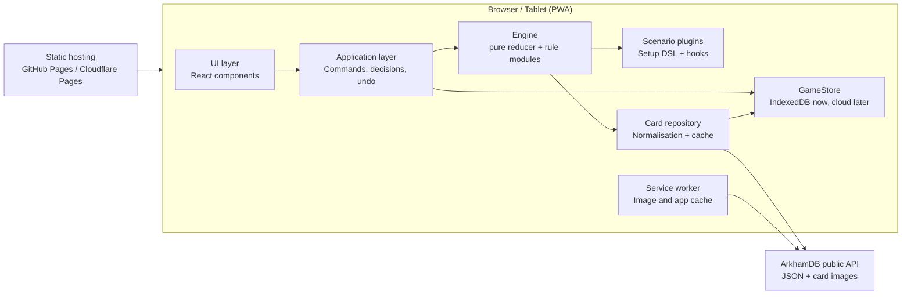

# Arkham Companion – System and Application Architecture

Draft v0.2 · 2026-10-13 · Living version: https://claude.ai/code/artifact/12ad5370-637f-4943-a562-74dbc1768fec

## 1. Goal and scope

The app takes over the **scenario side** of Arkham Horror LCG: setup, agenda/act/doom, encounter deck, map with locations and enemies, threat areas and special mechanics. Players keep their own decks, skill tests and (optionally) the chaos bag in hand.

**In scope v1**

- Agenda, act and doom management incl. threshold checks and reverse-side effects
- Encounter deck: building from encounter sets, drawing, discard, reshuffle, surge/peril, set-aside cards
- Map: location graph with explicit connections, multiple maps/regions, locations added or replaced mid-scenario, scenario-book layout plus optional auto-layout, randomised location placement
- Enemies: spawn, hunter movement, engagement, exhaustion, damage; investigator positions
- Investigator tracking: health, horror, clues, resources, threat area, engaged enemies
- Campaign mode: campaign log across the three intro scenarios, chaos bag carried forward
- Mid-scenario setup changes (replace locations, set-aside cards into play, cards into discard)
- Scenario-specific mechanics via scripts
- Card language configurable (English/German)
- Local persistence, refresh-proof, undo

**Not in scope v1:** player card logic, skill test resolution, deck building, multi-device sync and cloud storage (both planned, see sections 10 and 15).

**First content:** Chapter Two starts with the Core Set (2026), ArkhamDB pack code `core_2026`, with an introductory campaign of three scenarios. The first scenario is *Spreading Flames* (encounter code `spreading_flames`).

## 2. Guiding principles

1. **Assistant, not referee.** The app suggests the next step; players confirm. Every state can be corrected manually.
2. **Pure, deterministic engine.** Game logic is a pure reducer with no UI or I/O dependency. Randomness only via a seeded RNG in the state.
3. **Event sourcing.** Every change is an event in the log. This gives undo, refresh recovery, export, reproducible bugs – and later, sync.
4. **Data separate from rules.** Card data comes from ArkhamDB; rules and scenario flow come from our own scenario definitions.
5. **Offline-first.** After the first load everything runs without network – important at the table.
6. **Generic before specific.** What several scenarios need (e.g. taking the topmost copy of X from the discard pile) becomes an engine primitive; only true one-offs become scenario code.
7. **Start simple, design for growth.** v1 automates little, but every extension point (card effects, sync, auto-layout) has a seam from day one.

## 3. System context

There is **no backend of our own in v1**. The app is a static single-page app (PWA) that runs in the browser.



The ArkhamDB public API sends `Access-Control-Allow-Origin: *`, so it can be queried directly from the browser. ArkhamDB asks clients to respect HTTP caching (max-age, last-modified), which fits our offline approach.

## 4. Technology stack

| Area | Choice | Rationale |
| --- | --- | --- |
| Language | TypeScript (strict) | Complex domain model, discriminated unions for events/commands |
| Build | Vite + pnpm workspaces | Fast, monorepo-ready |
| UI | React 19 | Existing experience, largest ecosystem |
| UI state | Zustand (thin wrapper around the engine) | Engine stays framework-free |
| Map rendering | SVG + react-zoom-pan-pinch | Crisp at any zoom, easy hit-testing |
| Auto-layout | elkjs (optional) | Graph layout for locations without a book layout |
| Drag and drop | dnd-kit | Touch-friendly for tablet |
| i18n | i18next | UI strings; card text comes from ArkhamDB per language |
| Persistence | IndexedDB via Dexie behind a `GameStore` interface | localStorage is limited to ~5 MB and synchronous; cloud storage comes later as a second adapter |
| Validation | zod | Check scenario definitions and imported saves |
| Offline | vite-plugin-pwa (Workbox) | Cache-first for card images |
| Tests | Vitest, fast-check, Playwright | Engine unit tests, property tests, E2E |
| Repo / CI | GitHub + GitHub Actions | Tests on every push, deploy to Pages |

**Repository structure**

```
arkham-companion/
  packages/
    engine/       # pure TS core: state, commands, events, rule modules
    carddata/     # ArkhamDB adapter, normalisation, fetch script
    scenarios/    # scenario definitions, one folder per campaign
      core-2026/
        campaign.ts
        spreading-flames/
  apps/
    web/          # React PWA
```

## 5. Domain model

Core idea: **every physical card on the table is a `CardInstance`** with a unique ID, card code and current zone. Multiple copies (e.g. 4× *Fire!*) are separate instances.

```ts
type Zone =
  | { kind: 'encounterDeck' } | { kind: 'encounterDiscard' }
  | { kind: 'setAside' } | { kind: 'victoryDisplay' } | { kind: 'outOfGame' }
  | { kind: 'agendaDeck' } | { kind: 'actDeck' }
  | { kind: 'location'; mapId: MapId }                    // location card on a map
  | { kind: 'atLocation'; locationId: InstanceId }         // unengaged enemy at a location
  | { kind: 'engaged'; investigatorId: string }
  | { kind: 'threatArea'; investigatorId: string }
  | { kind: 'attachedTo'; hostId: InstanceId };           // attachment to location/enemy/agenda

interface CardInstance {
  id: InstanceId; code: string;        // ArkhamDB code, e.g. '12106'
  zone: Zone; faceUp: boolean;          // unrevealed/revealed or front/back
  exhausted: boolean;
  tokens: Partial<Record<'doom'|'clue'|'damage'|'horror'|'resource', number>>;
  flags: Record<string, unknown>;       // scenario-specific markers
}

interface Investigator {
  id: string; code: string; name: string; seat: number;
  locationId?: InstanceId;
  health: { max: number; damage: number };
  sanity: { max: number; horror: number };
  clues: number; resources: number;
  status: 'active' | 'resigned' | 'defeated';
}

interface Board {
  maps: Record<MapId, { name: string; visible: boolean }>;   // e.g. two parallel maps
  slots: Record<SlotId, { mapId: MapId; x: number; y: number }>;
  placement: Record<InstanceId, SlotId | { x: number; y: number }>;
  connections: Edge[];          // explicit graph, incl. one-way edges
  layoutMode: 'book' | 'auto';
}

interface GameState {
  meta: { scenarioId; difficulty; playerCount; seed; rngState; round; phase; leadInvestigator };
  campaign?: CampaignLog;               // absent in standalone play
  investigators: Investigator[];
  cards: Record<InstanceId, CardInstance>;
  order: Record<ZoneKey, InstanceId[]>; // order in decks/discards
  board: Board;
  chaosBag: ChaosToken[];
  agenda: { current: InstanceId };  act: { current: InstanceId };
  scenario: unknown;                    // typed per scenario (zod schema)
  pending: Decision[];                  // open decisions for the players
}
```

Per-investigator values (clues on locations, enemy health, act thresholds) are computed at runtime from `playerCount`, not stored. Investigator stats (health, sanity) come from ArkhamDB and can be edited manually.

**Map model**

- **Connections are an explicit graph**, not derived from positions. ArkhamDB does not expose connection symbols in structured form, so they come from the scenario data pipeline below; the engine builds edges from the revealed/unrevealed state. Card effects can add or remove edges at runtime (`addConnection`, `removeConnection`), including one-way edges.
- **Multiple maps:** a scenario can define several maps (parallel areas, a second board added mid-scenario). The UI shows them as tabs or side by side.
- **Layout:** the scenario book layout is stored as slots (often a grid, sometimes free positions). Optionally, auto-layout arranges the graph with elkjs. Players can always drag locations manually.
- **Randomised locations:** the setup DSL has `randomLocations(pool, slots)` using the seeded RNG, so it stays reproducible.

**Where scenario data comes from**

Per field, the first source that has it wins; every value can be overridden by hand.

1. **ArkhamDB:** card stats and text, encounter sets and quantities, agenda/act order (`stage`), doom and clue values, victory points, investigators. ArkhamDB has no connection symbols and no layout.
2. **ArkhamCards campaign data** ([zzorba/arkham-cards-data](https://github.com/zzorba/arkham-cards-data)): scenario setup steps including `location_setup` grids (the book layout as rows of location codes, with arrows and annotations), chaos bags per difficulty, campaign log entries and resolutions. Imported at build time like the ArkhamDB data and not committed, since that repo carries no licence.
3. **Card images:** connection symbols (a location's own symbol and the symbols it connects to) are only printed on the cards. A dev-time extraction step – a Claude Code task that reads the location images, or a script calling a vision model – writes them as JSON to `packages/scenarios/data/connections/<pack>.json`. It holds only card codes and symbol names, no card text, so it can be committed. Each extraction is reviewed once against a generated contact sheet before merging.
4. **Manual:** the board's edit mode lets you add or remove connections, fix symbols and move slots. Edits are saved as a scenario override file, which can be exported and committed to the repo.

## 6. Engine: commands, events, decisions

**Flow:** the UI sends a `Command` → the engine validates it against the current state → produces a list of `Event`s → events are applied and persisted.

- **Commands** (intent): `StartScenario`, `NextPhase`, `PlaceDoom`, `AdvanceAgenda`, `AdvanceAct`, `DrawEncounter(investigator)`, `SpawnEnemy`, `MoveEnemy`, `EngageEnemy`, `DefeatEnemy`, `MoveInvestigator`, `DiscoverClues`, `AdjustInvestigator`, `Attach`, `Discard`, `Shuffle`, `AddToVictory`, `ResolveDecision`, `ManualAdjust`.
- **Events** (facts): fine-grained, e.g. `CardMoved`, `TokensChanged`, `CardFlipped`, `ConnectionChanged`, `InvestigatorChanged`, `DeckShuffled(seedStep)`, `PhaseChanged`, `DecisionRequested`.
- **Decisions:** where the rules leave a choice (hunter tie, spawn location, effect target), the engine creates a `Decision` instead of guessing; the answer returns as `ResolveDecision`.
- **Undo:** discard the last command and its events, replay from the last snapshot.
- **Randomness:** seeded PRNG (e.g. xoshiro128) in the state; every shuffle is reproducible.

**Engine rule modules**

| Module | Responsibility |
| --- | --- |
| Doom | Sum doom (agenda + cards in play) against threshold, suggest advancing |
| Act | Per-investigator clue thresholds, trigger reverse side |
| Mythos | Place doom, draw in player order, surge, peril, reshuffle empty deck |
| Enemy | Spawn, hunter path (shortest path over the graph, tie → decision), aloof, massive, retaliate/alert reminders, exhaust/ready |
| Board | Connection graph, multiple maps, reveal, place clues, attachments, random placement |
| Investigator | Health/horror/clues/resources, defeat check, prey criteria |
| Keywords | Parser for keywords in card text (surge, peril, hunter, aloof, elite, victory X, spawn, prey, patrol …) |
| Triggers | Event bus for forced effects: `afterDoomPlaced`, `onRoundEnd`, `onAgendaAdvance` |
| Effects | Registry of card scripts keyed by card code; in v1 only board-changing cards |

**Phase assistant:** guides through mythos → investigation → enemy → upkeep, automating the mythos phase, offering quick actions in investigation, computing hunter movement and due attacks in the enemy phase.

## 7. Scenario plugins and setup changes

A scenario is **mostly declarative** (data) with **TypeScript hooks** for special mechanics.

```ts
interface ScenarioDefinition {
  id: 'core2026-spreading-flames';
  packCode: 'core_2026';
  encounterSets: string[];                 // ArkhamDB encounter_codes
  chaosBag: Record<Difficulty, Token[]>;   // standalone default
  agendaDeck: string[]; actDeck: string[];
  maps: MapDefinition[];                   // slots (grid or free), book layout
  connections: Record<LocationCode, ConnectionSpec>;
  setup: SetupStep[];
  campaignSetup?: (log: CampaignLog) => SetupStep[];
  resolutions?: Record<string, ResolutionStep[]>;
  hooks?: Partial<ScenarioHooks>;
  actions?: ScenarioAction[];
  stateSchema?: ZodSchema;
}
```

**Setup DSL** – same steps for initial setup and mid-scenario changes:

- `putIntoPlay(location, slot?, faceUp?)`, `replaceLocation(old, new)`, `removeLocation`, `randomLocations(pool, slots)`
- `addMap(mapId)`, `addConnection(a, b, oneWay?)`, `removeConnection(a, b)`
- `setAside(codes)`, `fromSetAside(codes, to: Zone)`
- `buildEncounterDeck(sets, exclude)`, `shuffleInto(codes, 'encounterDeck')`
- `placeTokens(target, type, n | perInvestigator(n))`
- `spawn(enemy, at)`, `moveInvestigators(to)`, `removeFromGame(codes)`

**Spreading Flames primitives:** skull token depends on act number (chaos module reads state); `drawTopmostFromDiscard(name)` for *Fire!*; parley `ScenarioAction` on agendas; `fromSetAside` when advancing to agenda 2; `afterDoomPlaced` trigger on agenda 3.

**Card effects – start simple:** encounter cards are displayed, keywords and spawn evaluated; board-changing cards get a script in the effects registry. More cards can be automated one by one later.

## 8. Campaign mode

- **Campaign log:** investigators, trauma, XP, killed/insane, story records, chaos bag.
- **Chaos bag:** standalone = scenario default per difficulty; campaign = from the log, modified by resolutions. Scenarios building on earlier ones read the log in `campaignSetup`.
- **Resolutions:** declarative steps (`record`, `addChaosToken`, `removeChaosToken`, `awardXp`, `addTrauma`), confirmed by players.
- Deck upgrades stay with the players.

## 9. Card data from ArkhamDB

- `GET /api/public/packs/`, `GET /api/public/cards/{pack_code}.json?encounter=1`, `GET /api/public/card/{code}`; images: `https://arkhamdb.com` + `imagesrc`/`backimagesrc`.
- A script in `packages/carddata` fetches and normalises into `CardDef`. **Fetched JSON is generated in CI/build, not committed** (repo may become public).
- Runtime refresh via `If-Modified-Since`, stored in IndexedDB. Images loaded at runtime, cached by the service worker; text-card fallback.
- **Language configurable:** EN/DE via `de.arkhamdb.com/api/`, per-card fallback to English.
- Card texts/images © Fantasy Flight Games.

## 10. Persistence and recovery

IndexedDB tables: `campaigns`, `games`, `events`, `snapshots` (every ~50 events), `cards`.

- Refresh = last snapshot + replay. Every command written before the UI updates.
- `stateVersion` + migrations. JSON export/import. `BroadcastChannel` for multiple tabs. localStorage only for UI settings.

**Later: cloud and multi-device sync** – `GameStore` interface from day one (`IndexedDbStore` now, `CloudStore` later); sync via the append-only event log with optimistic concurrency; login; backend TBD (Supabase / Firebase / Cloudflare). v1 prep: UUID `gameId`, timestamped events, no device-bound IDs.

## 11. UI concept

Tablet landscape first. Header (round, phase, agenda/act, undo), map centre (pan/zoom, map tabs), investigator bar (steppers), encounter panel, decision dialog, card zoom, event log, campaign screen.

**Game management**

- **Home screen:** saved games and campaigns, newest first, each with scenario, investigators, round/phase and last played. Actions: resume, rename, duplicate, delete, export.
- **New game wizard:** 1) campaign or standalone scenario, 2) scenario and difficulty, 3) investigators (1–4) in player order, 4) summary. Confirming runs the setup and opens the board.
- **Resume** restores the exact state (snapshot + replay). **Load** imports a JSON export as a new saved game.
- **Auto-save** on every command; there is no manual save.

**Investigator picker** (inspired by the Mansions of Madness app)

- Catalog of all investigators from ArkhamDB (`type_code = investigator`, all packs), deduplicated across reprints (`duplicate_of_code`), parallel versions grouped with the original.
- Grid of portraits; filter by class, cycle/pack and "my collection" (owned packs, set once in settings); search by name.
- Tap shows front and back with health, sanity, skills and ability; select assigns the next seat, drag reorders seats, remove frees one.
- In campaign play investigators come from the campaign log; the picker only opens to replace killed or insane ones.
- The catalog is fetched with the card data and cached in IndexedDB, so it works offline.

## 12. Quality assurance

Engine unit tests, setup tests per scenario, property tests (no negative tokens, one zone per card, replay determinism), golden replays, Playwright E2E for refresh, GitHub Actions CI.

## 13. Repository and publishing

Private GitHub repo, possibly public later. Before going public: no card text/images committed, MIT licence (`LICENSE`), an unofficial-fan-project notice. Hosting via GitHub Pages or Cloudflare Pages.

## 14. Roadmap

Each milestone has a task plan under `docs/tasks/`, one task per Claude Code session.

| Milestone | Content |
| --- | --- |
| M0 Foundation | Monorepo, CI, card import, domain model, `GameStore`, app shell |
| M1 Generic engine | Agenda/act/doom, encounter deck, map graph, enemies, investigators, threat area, undo, phase assistant; sandbox scenario; no UI |
| M2 Game management UI | Investigator catalog, home screen with saved games, new-game wizard with investigator picker, resume, export/import |
| M3 Play screen UI | Header, map with pan/zoom, investigator bar, encounter panel, decision dialog, card zoom, event log; sandbox scenario playable on a tablet |
| M4 Scenario data + first scenario | ArkhamCards layout import, connection symbol extraction, manual connection editor; *Spreading Flames* complete |
| M5 Core campaign | Scenarios 2 and 3, campaign log, chaos bag carry-over, resolutions, campaign screen |
| M6 Comfort | Chaos bag module, EN/DE switch, auto-layout, offline preload, polish |
| M7 Expansion | More Chapter Two products; more automated card effects |
| M8 Cloud and sync | Login, games in the cloud, sync across devices at the table |

## 15. Decisions and open questions

**Decided:** one device in v1, sync in M8; investigator tracking (health, horror, clues, resources); encounter automation starts with display + keywords; card language configurable; campaign mode in v1; React; GitHub, possibly public; connection data from ArkhamDB → ArkhamCards layouts + image extraction → manual editor; MIT licence; game management (M2) and play screen (M3) before the first real scenario.

**Open**

1. Network for cloud sessions: allow `arkhamdb.com`, `de.arkhamdb.com` and `raw.githubusercontent.com` in the Claude Code environment so sessions can fetch card data and images (needed from M2 on).
2. Import investigators from an ArkhamDB deck link in the new-game wizard?
