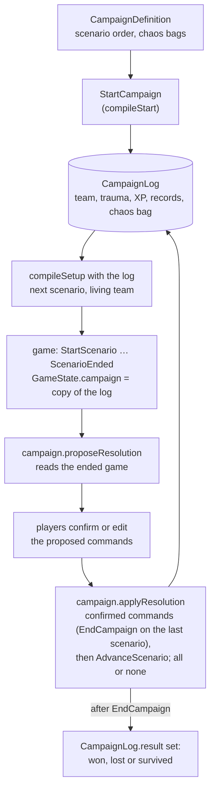

# Campaign

A campaign is its own event-sourced aggregate in [`campaign/`](../../packages/engine/src/campaign/) with its own commands, events and reducer, so a game command can never change it.

[`CampaignLog`](../../packages/engine/src/campaign/campaign_log.ts) holds:

- the team (keyed by `InvestigatorCode`) with trauma, XP, fate and the story cards each earned (`earnedCards`, `EarnCard`: Lita Chantler, which a later game trusts that investigator to hold),
- story records,
- chaos bag,
- and scenario order.

A game keeps a copy in `GameState.campaign`.
Reached through the `campaign` namespace (`campaign.handleCommand`).
First definition: [Night of the Zealot](../../packages/scenarios/src/night_of_the_zealot/campaign.ts).

## Lifecycle

A campaign log and each game are separate event logs; the game reads a copy of the log, and only a confirmed resolution writes back.

## Resolutions

A scenario's resolutions are data on `ScenarioDefinition.resolutions` ([`resolution.ts`](../../packages/engine/src/campaign/resolution.ts)): per resolution id, plus "no resolution", a list of `ResolutionStep`s:

- record,
- chaos tokens,
- XP from a bonus and the [victory points](../../packages/engine/src/victory.ts),
- trauma,
- killed/insane,
- a story card earned (`earnCard`, by each target or, with `choose`, a `choice` of one of them),
- the end of the campaign,
- or a step the players do by hand.

Steps that read the ended game:

- `when` picks its steps by a `GameCondition` (a card in play, set aside, in a scenario deck or in the victory display, the current agenda, or any of these)
- and `recordNames` writes the names of the cards whose condition holds as a list record.

Steps name their target (`each`, `lead`, `notResigned`, `resigned`) instead of investigators, so `campaign.proposeResolution` reads the ended game and turns them into campaign commands. In a campaign game they are followed by an `AddChaosToken` or `RemoveChaosToken` for each chaos bag change a card made "permanently" during the scenario (the game's `ChangeChaosBag` with `lasts: 'campaign'`, kept in `GameState.chaosBagChanges`; a change for the scenario only stays out of the log), then by the trauma of each defeat:

- 1 physical for damage,
- 1 mental for horror,
- a `choice` between them for both at once (`damageAndHorror`),
- and what a card effect names (`Investigator.defeat`, e.g. `defeatEachInvestigator({ trauma: 'physical' })`).

An investigator the proposal kills, drives insane, or gives trauma up to their health or sanity on the log gets no change after that one, since the campaign rejects commands for them.

`campaign.proposeResolution` only proposes: the players confirm or edit the list, and `campaign.applyResolution` applies the confirmed commands in one step, all or none (`campaign.executeCommands`), followed by `AdvanceScenario`, which adds the scenario and its outcome to `CampaignLog.playedScenarios` and moves on.

Both read the resolution the game ended with (`gameOutcome`) unless the players pass another `ScenarioOutcome`, for a table that played the ending differently (`sameOutcome` compares two); the defeat trauma still comes from the game.

Each campaign event has a cause beside it (`CampaignExecuteResult.causes`, M1C.2), the counterpart of the game's `ChangeCause`: the resolution (`{ kind: 'resolution', scenarioId, outcome }`) for everything `applyResolution` writes, the defeats' trauma included, and the players for every other command. [`campaignNotices`](../../packages/engine/src/campaign/campaign_notices.ts) groups the resolution's entries by `CampaignNoticeKind` (chaos bag, XP, trauma, fate, story, cards, team, scenario) for the screens.

The last scenario's `endCampaign` step proposes `EndCampaign`, which sets `CampaignLog.result` (`won`, `lost`, or `survived` for an ending that is neither); a log without a result is still running.
A killed, insane or devoured member (`InvestigatorFate`; devoured is the 2026 Core Set's, `MarkDevoured`) keeps their seat until `ReplaceInvestigator` puts a newcomer in it, before the next scenario; when no investigator is left to choose, the players end the campaign as lost with `EndCampaign`.

Between scenarios a player may leave and another join (Rules Reference, "Joining or Leaving a Campaign"). `LeaveCampaign` moves a team member to `formerInvestigators` with their trauma, XP and story cards (the last one may not leave). `JoinCampaign` seats an investigator last: one the campaign hasn't had starts fresh, and a former one who left alive returns with their entry; a full team, a current member and an eliminated former one are refused.

## Interludes

An interlude is story read between two scenarios that writes to the log (MC1.6e). `CampaignDefinition.interludes` lists them ([`interlude.ts`](../../packages/engine/src/campaign/interlude.ts)), each after the scenario it follows (`afterScenario`); `campaign.findDueInterlude` names the one due before the next scenario: after the last played scenario, not yet in `CampaignLog.playedInterludes`, and the campaign not over.

Its `InterludeStep`s are a resolution's steps that need no ended game (record, chaos tokens, the end of the campaign, by hand), plus:

- XP, trauma and a story card for `each` living investigator or one the players pick (`chosen`, a `choice` like a resolution's);
- `whenStory`, which picks its steps by a `StoryCondition` on the log;
- `decide`, the guide's "the investigators must decide": the steps of the option the players pick.

`campaign.proposeInterlude(log, interlude, answers)` reads the steps in order with the players' answers to the `decide` steps so far. It asks the first one without an answer (`InterludeProposal` `question`), since a later question can hang on an earlier answer, and else proposes the changes, filtered like a resolution's (`withoutChangesForEliminated`). `campaign.applyInterlude` writes the confirmed commands and `CompleteInterlude` in one step, all or none, each with the cause `{ kind: 'interlude', interludeId }`.

Story keys of a campaign live next to its definition ([`story.ts`](../../packages/scenarios/src/night_of_the_zealot/story.ts)), so the scenario that writes a record and the one that reads it share the key.

`CampaignDefinition.log` (`CampaignLogLayout`) says how the log page shows those records: which flags are campaign notes, in the guide's order, and the campaign's own sheets (`LogSheet`, only `nameList` so far). Every campaign's log is the same five shared sheets plus sheets of a few kinds, so a campaign adds data, not a page; a record that no note or sheet names stays hidden.

## Extension points

- **A new campaign:** a `CampaignDefinition` next to its scenarios, with its `log` layout.
- **A new kind of log sheet** (tally, checklist, roster, track; see docs/product.md "Campaign screen"): a `LogSheet` case and its drawing in the web app's `CampaignSheets.tsx`.
- **A new command or record:** add it in `campaign/` with its events, reducer case and invariant.
- **A new correction:** a `CampaignAdjustment` case in `handle_campaign_adjustment.ts` that produces the regular event.
- **A new kind of interlude step:** an `InterludeStep` case and its command in `interlude.ts`'s `proposeStep`.
- **A new kind of resolution step:** a `ResolutionStep` case and its command in `proposeStep`; a new target is a `ResolutionTarget` case.
- **A new question about the ended game:** a `GameCondition` case in `gameHolds`, or a `CardPlace` case in `isAt`.
