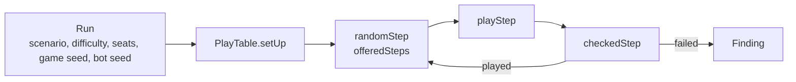

# Play tester

Bots play the real scenarios and judge every step, so rule bugs, crashes and broken states show up without a scripted test ([product.md, "Continuous play tester"](../product.md#continuous-play-tester-m1v4)).
It is a package of its own, [`packages/play_tester`](../../packages/play_tester/src/), so it may use Node; it plays only through `PlayTable`, reads the board through `BoardView`, and checks with the engine's own `replay` and error types.
Random games never run in `pnpm test`: the package's unit tests check the tester's own parts with named cards, plus one short smoke test (40 steps of The Gathering) that a run plays and plays the same twice.

## How a game is played

- A [`Run`](../../packages/play_tester/src/run.ts) is one game: scenario, difficulty, investigators by name in seat order, a game seed and a bot seed. `runsFrom(seed, games)` draws a night's runs; the same run always plays the same game.
- A [`Step`](../../packages/play_tester/src/steps.ts) is one `PlayTable` call with its arguments: investigators and locations by name, enemies and other cards by instance id. `playStep` plays it; a list of steps replays a game on a fresh table.
- The _random_ bot ([`random_bot.ts`](../../packages/play_tester/src/random_bot.ts)) picks any verb the board offers (`offeredSteps`), then any of its steps. While a decision is open it offers only its options and undo. Tests are left open; a test of one investigator is answered first by a chaos token drawn from the bag and valued by `suggestSkillTest` ([`test_answers.ts`](../../packages/play_tester/src/test_answers.ts), a random modifier for a token the engine can't value), any other like any decision; rare steps (corrections, encounter draws a card effect asks for, undo) are one step in a hundred.
- [`playRun`](../../packages/play_tester/src/play_run.ts) plays until a resolution, every investigator out, a finding, or the step cap.

## How a step is judged

`checkedStep` plays one step and sorts what happened:

- a refusal by [`refusalKind`](../../packages/play_tester/src/refusals.ts): `expected` ones are counted, a `never` one is a `refusal` finding;
- `InvariantBroken` (the `PlayTable` error for a state `checkInvariants` rejects) is an `invariants` finding;
- any other `TableError` is the bot naming something the table can't pick, and is counted as a misuse;
- any other error is a `crash`;
- after a played step, `replay` of the whole log must equal the live state (`replay`);
- an offered answer (`answer`, `resolveTest`) that is refused, or a "Next" that is accepted but changes nothing, is a `liveness` finding.

`checkRun` plays a run twice; another event log the second time is a `determinism` finding.
A game still going past `ROUND_CAP` (30 rounds) is a `liveness` finding too.

## Records and replay

- Only failing games are recorded: [`recordOf`](../../packages/play_tester/src/record.ts) makes a `RunRecord` (`*.arkham-run.json`) of the run, the finding with its boards, the steps before it and the event log, with the tester's version and commit.
- `replaySteps` plays a record's steps on a fresh table with today's engine, judging each, and stops at the first finding; `reproduced` says whether it is the recorded one. `loggedBoard` shows what the record's own log replays to.
- [`cli.ts`](../../packages/play_tester/src/cli.ts) is `pnpm playtest --games 500 --seed 7` (prints the [summary](../../packages/play_tester/src/summary.ts), writes records to the gitignored `packages/play_tester/.runs/`, exits 1 on a finding) and `pnpm playtest --replay <record>`.

## Extension points

- **A new scenario:** an entry in `SCENARIOS` (`run.ts`) with its card data.
- **A new rejection code:** its kind in `REFUSAL_KINDS`; typecheck fails until it is marked.
- **A new verb:** a `Step` variant, its case in `playStep`, and where the bot offers it.
- **A new check:** a `CheckId` and where `checkedStep` or `checkRun` finds it; `replaySteps` must find it again.
- **A new record field:** raise `RECORD_VERSION`, so an old record is refused instead of misread.
