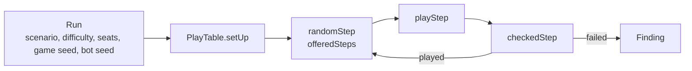

# Play tester

Bots play the real scenarios and judge every step, so rule bugs, crashes and broken states show up without a scripted test ([product.md, "Continuous play tester"](../product.md#continuous-play-tester-m1v4)).
It is a package of its own, [`packages/play_tester`](../../packages/play_tester/src/), so it may use Node; it plays only through `PlayTable`, reads the board through `BoardView`, and checks with the engine's own `replay` and error types.
Random games never run in `pnpm test`: the package's unit tests check the tester's own parts with named cards, plus one short smoke test (40 steps of The Gathering) that a run plays and plays the same twice.

## How a game is played

- A [`Run`](../../packages/play_tester/src/run.ts) is one game: scenario, difficulty, investigators by name in seat order, the blank investigators among them with their stats, a game seed, the bot and its seed. `runsFrom(seed, games, bots)` draws a night's runs: one to four seats, each a real investigator or, as often, a blank one with random stats (`blankInvestigator`: health and sanity add up to 14 or 15 and the skills to 12, as on a real investigator card, split at random down to sanity 1 or a skill of 0), so defeat and elimination happen often; `scenarioContext` adds the blank ones to the card data. The same run always plays the same game.
- A [`Step`](../../packages/play_tester/src/steps.ts) is one `PlayTable` call with its arguments: investigators and locations by name, enemies and other cards by instance id. `playStep` plays it; a list of steps replays a game on a fresh table. An action first counts off what it costs (`actionCostOf`), as the app's action buttons do, since the engine leaves counting actions to the players; both are one undo group.
- The board offers the steps players at the table could take (`offeredSteps` in [`random_bot.ts`](../../packages/play_tester/src/random_bot.ts)): while a decision is open only its options and undo, in a turn only the actions the investigator has actions left for. A bot ([`bots.ts`](../../packages/play_tester/src/bots.ts), `botStep`) is a weighting of these steps:
  - _random_: any verb, then any of its steps; rare steps (corrections, encounter draws a card effect asks for, undo) are one step in a hundred (`rareShareWeights`).
  - _goal_ ([`goal_bot.ts`](../../packages/play_tester/src/goal_bot.ts)): fifty times rather a step that moves the game on: investigate where there are clues, else move towards the nearest clues or unrevealed location, advance the act, fight what is engaged, resolve the attacks due, end the turn with no actions left, "Next" once all turns are taken. Never a rare step.
  - _chaos_: like random, but rare steps are a quarter of the picks, and resigning weighs as much.
- Tests are left open; a test of one investigator is answered first, by every bot, by chaos tokens drawn from the bag as the players draw them (the engine's `drawTokens`, also behind the app's "Draw a token": another while a bless, curse, frost or blood says so) and valued by `suggestSkillTest` ([`test_answers.ts`](../../packages/play_tester/src/test_answers.ts), a random modifier for a token the engine can't value), any other like any decision.
- [`playRun`](../../packages/play_tester/src/play_run.ts) plays until a resolution, every investigator out, a finding, or the step cap.

## How a step is judged

`checkedStep` plays one step and sorts what happened:

- a refusal by [`refusalKind`](../../packages/play_tester/src/refusals.ts): `expected` ones are counted, a `never` one is a `refusal` finding;
- `InvariantBroken` (the `PlayTable` error for a state `checkInvariants` rejects) is an `invariants` finding;
- any other `TableError` is the bot naming something the table can't pick, and is counted as a misuse;
- any other error is a `crash`;
- after a played step, each rule oracle compares the board before and after it (`brokenRule` in [`oracles.ts`](../../packages/play_tester/src/oracles.ts)) and a broken rule is a `rules` finding naming the oracle and its `docs/rules/` page. The oracles read only `BoardView` and never run the engine's phase or advance logic, so a bug there does not pass its own check; they trust the values the board shows (a threshold, doom in play, a clue requirement). Undo is not judged:
  - `phaseOrder`: phases only move on, the round grows by at most 1, round 1 has no mythos phase;
  - `upkeep`: once the upkeep is through, every active investigator has 3 actions and 1 resource more, and no enemy is exhausted, each checked only when its upkeep step ran in the step judged (a "Next" can start partway, after a question and a correction);
  - `mythosDoom`, `doomThreshold`: a new round's mythos phase puts doom on the agenda, and with doom in play at its threshold the agenda advances or the players are asked to confirm it;
  - `agendaOnlyAtCheck`: doom placed by hand never advances the agenda;
  - `actAdvance`: spending clues takes exactly the act's requirement and advances the act, unless its back side is still asking the players something;
  - `hunterMove`: in the step that runs enemy step 1, each ready, unengaged hunter with no investigator at its location moves one connection closer to a nearest investigator, and one with no way to any stays. Prey and the lead's picks don't show on the board, so any such step is accepted; while a hunter question is open, nothing is judged, and the answer's later step isn't either. Blocked moves aren't modelled for hunters yet, so the oracle walks the open connections (`connectedTo`);
- after a played step, `replay` of the whole log must equal the live state (`replay`);
- after a played step that logged something, undo on a copy of the table (`PlayTable.resume` from the log) must give back exactly the state before it (`undo`); an undo step is not undone again;
- an offered answer (`answer`, `resolveTest`) that is refused, or a "Next" that is accepted but changes nothing, is a `liveness` finding.

`checkRun` plays a run twice; another event log the second time is a `determinism` finding. It then replays the steps up to one the run's seeds pick, resumes a new table from that log (`resumeDifference`, as the app resumes a saved game) and plays the rest there; another log is a `resume` finding. Group ids are compared by their place in the log, since a resumed table numbers its groups on from the log while the straight play also counted the groups an undo took back. One resume point per run keeps a run's cost linear.
A game still going past `ROUND_CAP` (30 rounds) is a `liveness` finding too.

## Records and replay

- Only failing games are recorded: [`recordOf`](../../packages/play_tester/src/record.ts) makes a `RunRecord` (`*.arkham-run.json`) of the run, the finding with its boards, the steps before it and the event log, with the tester's version and commit.
- `replaySteps` plays a record's steps on a fresh table with today's engine, judging each, and stops at the first finding; `reproduced` says whether it is the recorded one. `loggedBoard` shows what the record's own log replays to.
- [`cli.ts`](../../packages/play_tester/src/cli.ts) is `pnpm playtest --games 500 --seed 7` (`--bot goal` for one bot; prints the [summary](../../packages/play_tester/src/summary.ts) with the ends by bot, writes records to the gitignored `packages/play_tester/.runs/`, exits 1 on a finding) and `pnpm playtest --replay <record>`.

## Web replay

The app's own path is checked in the app, since a package must not depend on it: [`webReplayDifference`](../../apps/web/src/playtest/webReplay.ts) starts a saved game like the run's table (`startGame` with `setupOptions`, on `IndexedDbStore` over fake-indexeddb), plays the steps through `GameSession.play` and `GameSession.undo` as the screen does, and compares the log with the table's, by events and the place of their undo groups (`numberedGroups`). It then compares the game opened again from storage and the game after `serialiseGameExport` and `parseGameExport`. [`cli.ts`](../../apps/web/src/playtest/cli.ts) is `pnpm --filter @arkham/web playtest --games 5 --seed 7`, which also replays every record in `packages/play_tester/findings/` (`--records <dir>` for another directory); it is not part of `pnpm test`, the nightly run calls it on a few runs. The play tester exports what it needs from [`index.ts`](../../packages/play_tester/src/index.ts).

## Extension points

- **A new scenario:** an entry in `SCENARIOS` (`run.ts`) with its card data.
- **A new real investigator:** an entry in `INVESTIGATORS` (`run.ts`), in every scenario's card data.
- **A new rejection code:** its kind in `REFUSAL_KINDS`; typecheck fails until it is marked.
- **A new verb:** a `Step` variant, its case in `playVerb` (and its basic action in `BASIC_ACTION_OF` when it is one), and where `offeredSteps` offers it.
- **A new bot:** a `BOT_KINDS` entry and its weights in `bots.ts`.
- **A new rule oracle:** an `Oracle` in `ORACLES` with its `docs/rules/` page; ask `rules-checker` to check it.
- **A new check:** a `CheckId` and where `checkedStep` or `checkRun` finds it; `replaySteps` must find it again.
- **A new record field:** raise `RECORD_VERSION`, so an old record is refused instead of misread.
