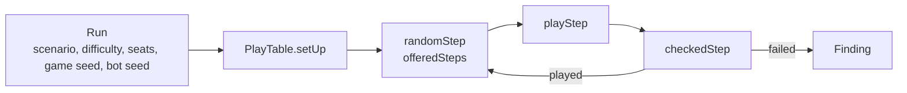

# Play tester

Bots play the real scenarios and judge every step, so rule bugs, crashes and broken states show up without a scripted test ([product.md, "Continuous play tester"](../product.md#continuous-play-tester-m1v4)).
It is a package of its own, [`packages/play_tester`](../../packages/play_tester/src/), so it may use Node; it reaches the engine only through `PlayTable` and `BoardView`.
Random play never runs in `pnpm test`: the package's unit tests check the tester's own parts, each with named cards.

## How a game is played

- A [`Run`](../../packages/play_tester/src/run.ts) is one game: scenario, difficulty, investigators by name in seat order, a game seed and a bot seed. `runsFrom(seed, games)` draws a night's runs; the same run always plays the same game.
- A [`Step`](../../packages/play_tester/src/steps.ts) is one `PlayTable` call with its arguments: investigators and locations by name, enemies and other cards by instance id. `playStep` plays it; a list of steps replays a game on a fresh table.
- The _random_ bot ([`random_bot.ts`](../../packages/play_tester/src/random_bot.ts)) picks any verb the board offers (`offeredSteps`), then any of its steps. While a decision is open it offers only its options and undo; tests are left open and answered like any decision; corrections are one step in ten.
- [`playRun`](../../packages/play_tester/src/play_run.ts) plays until a resolution, every investigator out, a finding, or the step cap.

## How a step is judged

`checkedStep` plays one step and sorts what happened:

- a refusal by [`refusalKind`](../../packages/play_tester/src/refusals.ts): `expected` ones are counted, a `never` one is a `refusal` finding;
- `InvariantBroken` (the `PlayTable` error for a state `checkInvariants` rejects) is an `invariants` finding;
- any other `TableError` is the bot naming something the table can't pick, and is counted as a misuse;
- any other error is a `crash`;
- after a played step, `replay` of the whole log must equal the live state (`replay`).

`checkRun` plays a run twice; another event log the second time is a `determinism` finding.

## Extension points

- **A new scenario:** an entry in `SCENARIOS` (`run.ts`) with its card data.
- **A new rejection code:** its kind in `REFUSAL_KINDS`; typecheck fails until it is marked.
- **A new verb:** a `Step` variant, its case in `playStep`, and where the bot offers it.
- **A new check:** a `CheckId` and where `checkedStep` or `checkRun` finds it.
