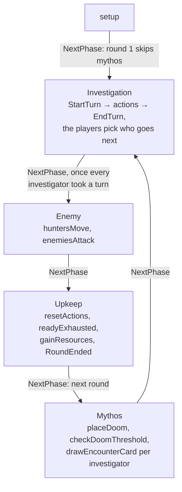

# Rounds, phases and turns

`GameMeta.steps` lists the outstanding automated steps of the current phase ([`phases.ts`](../../packages/engine/src/phases.ts)):

- mythos doom, threshold check and encounter draws;
- enemy hunters and attacks;
- upkeep resets and resources.

`NextPhase` runs them in order and stops at a decision, so the assistant resumes after any answer.
An enemy-phase attack exhausts its enemy as `ResolveEnemyAttack`'s continuation (`exhaustAfterAttack`), after the abilities the attack triggered.
Turns ([`turns.ts`](../../packages/engine/src/turns.ts)) record who acts and the actions left.

## Extension points

- **A new automated step:** a `PhaseStepId` with its title in `PHASE_STEP_TITLES`, in its phase's list.
