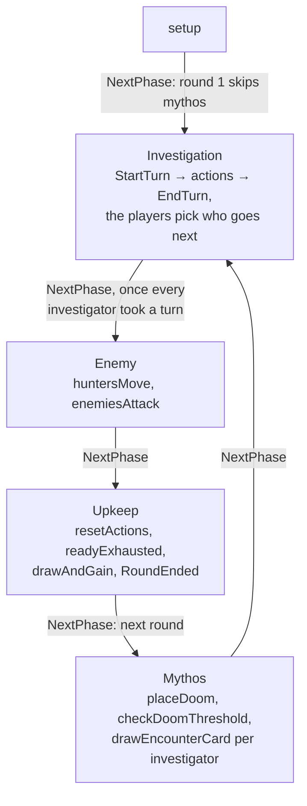

# Rounds, phases and turns

`GameMeta.steps` lists the outstanding automated steps of the current phase ([`phases.ts`](../../packages/engine/src/phases.ts)):

- mythos doom, threshold check and encounter draws;
- enemy hunters and attacks;
- upkeep resets, the card draw (deferred to the players) and resources.

`NextPhase` runs them in order and stops at a decision, so the assistant resumes after any answer.
Step 3.3 lists the due attacks and asks about each one at once, like an attack of opportunity ([`enemyPhaseAttackDecision`](../../packages/engine/src/forced_attacks.ts), `enemyAttack:<enemy>:<investigator>`): its `attack` option resolves it at the printed damage and horror, lowered as assets soak part of it, and `skip` resolves a cancelled one with nothing dealt. Both run `ResolveEnemyAttack`, which exhausts the enemy as its continuation (`exhaustAfterAttack`), after the abilities the attack triggered. An investigator who leaves the game takes the questions still asked of them along (the reducer drops every decision they decide), and an attack no longer due when its answer comes (its enemy left) only leaves the list.
Turns ([`turns.ts`](../../packages/engine/src/turns.ts)) record who acts and the actions left.

## Extension points

- **A new automated step:** a `PhaseStepId` with its title in `PHASE_STEP_TITLES`, in its phase's list.
