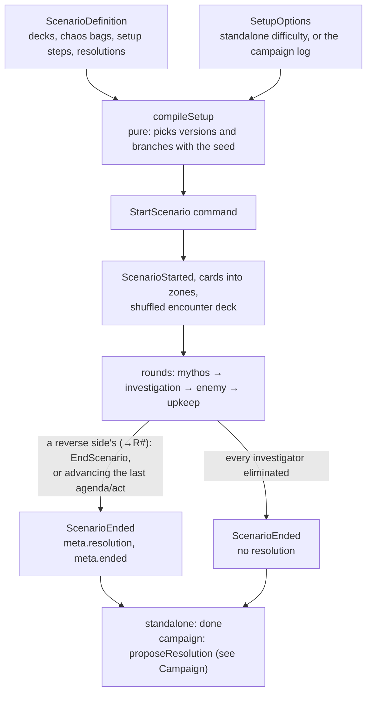

# Scenarios

A scenario is a [`ScenarioDefinition`](../../packages/engine/src/scenario.ts): agenda and act decks, chaos bags, reference card, setup steps and token modifiers.
[`compileSetup`](../../packages/engine/src/setup.ts) turns it plus the players' choices into one `StartScenario` command, reading investigator stats from the cards.

Its `SetupOptions` are standalone (the players pick the difficulty) or a campaign's. In a campaign:

- the log gives the difficulty and the chaos bag,
- each investigator starts with damage and horror for their trauma,
- and setup is refused unless it is the log's next scenario and the seats are exactly its living team.

## From setup to the end

Once the scenario has ended, only `ManualAdjust` is accepted ([Command handling](command-handling.md)).

## Setup steps

- A `whenStory` setup step picks its `then` or `otherwise` steps by a `StoryCondition` on the log's story records (a flag, at least n names on a list, or one name on it); a standalone game answers as an empty log.
- A `whenPlayers` step applies its steps only with at least that many investigators.
- `storyReadsOfSetup` lists the `whenStory` steps a campaign's setup would read, each with its answer and the steps that answer applies, so the app can preview what the log changes before setup.
- A location with `versions` ("one of the two Downtowns at random") goes into play as one of them, picked with the setup's seed so `compileSetup` stays pure; other steps and connections name it by its first code.
- A map's `atRandom` locations ("choose 4 of the 6 Arkham Woods at random") fill its given cells with that many of the group, picked with the seed too; declared connections to the ones left out are dropped, so a scenario declares them once.
- A `oneAtRandom` step applies the steps of one of its options, picked with the seed (one of four Agents sets), and `addChaosTokens` adds tokens to the bag the scenario starts with.
- The branches and versions resolve before any step applies, so the encounter deck only leaves out the cards the chosen steps use.
- `shuffleIntoEncounterDeck` adds single cards from sets the scenario doesn't gather (the Ghoul Priest).
- A `scenarioDeck` step builds a deck of the scenario's own (The Midnight Masks' Cultist deck, a `scenarioDeck` zone), and a `shuffle` step shuffles the cards earlier steps put into any zone, with a seeded stream of its own so the game's RNG stays untouched; `DrawFromScenarioDeck` spawns its top card like a drawn enemy.

## Hand-entered scenarios

- The only scenario so far is the hand-entered test scenario [`the_gathering/`](../../packages/scenarios/src/the_gathering/) (real codes and names, no card text).
- The Midnight Masks is entered the same way in [`the_midnight_masks/`](../../packages/scenarios/src/the_midnight_masks/) (cards, setup and resolutions), with The Gathering's cards joined in for the sets they share.
- The Devourer Below is in [`the_devourer_below/`](../../packages/scenarios/src/the_devourer_below/) (cards, setup and resolutions; each of its resolutions ends the campaign).
  - It plays with The Gathering's and The Midnight Masks' cards joined in.
  - Its setup sets aside each enemy The Midnight Masks recorded as got away, by name, and act 1's reverse side puts the Ritual Site onto the Woods map (`PutLocationIntoPlay`) and spawns them at the Main Path.
  - Agenda 3 (Vengeance Awaits) spawns Umôrdhoth at the Ritual Site as it advances, putting the site into play at act 1 and clearing its enemies at act 2 or 3 (`duringAct`), then turns into The Devourer Below, act and agenda at once (`becomeActAndAgenda`), whose objective ends in R2 when Umôrdhoth is defeated.
- Spreading Flames, the first scenario of Brethren of Ash (Core Set (2026)), has its cards in [`spreading_flames/cards.ts`](../../packages/scenarios/src/spreading_flames/cards.ts) its setup in [`spreading_flames/scenario.ts`](../../packages/scenarios/src/spreading_flames/scenario.ts), and its resolutions in [`spreading_flames/resolutions.ts`](../../packages/scenarios/src/spreading_flames/resolutions.ts), with the campaign's story keys in [`brethren_of_ash/story.ts`](../../packages/scenarios/src/brethren_of_ash/story.ts). It is a quick-game scenario in the web catalog until the campaign's second scenario arrives. Resolution 1 always leads on to 2 or 3, so Blaze of Glory's reverse side asks "stay or go" and ends the game with R2 or R3, each starting with R1's steps. The campus is one map that the acts grow and shrink (`CAMPUS_CELLS`, our own layout), and the skull's "-X" reads the current act's number. Each scenario follows the order chosen for the campaign: cards first, with the rules the engine lacks left to the players and listed in the file's doc comment.
- Smoke and Mirrors, its second scenario, has its cards in [`smoke_and_mirrors/cards.ts`](../../packages/scenarios/src/smoke_and_mirrors/cards.ts). The two Downtowns, Uptowns and Miskatonic Universities are separate cards with the same name (setup puts one of each into play), and their connections are read from the revealed sides, which print the same symbol as the unrevealed ones.

Hand-entered card data is built with the shared [`card_builders.ts`](../../packages/scenarios/src/card_builders.ts) (`agenda`, `act`, `location`, `enemy`, `treachery`), one builder per card type that takes the printed values and the card's encounter set, plus the file type of its ArkhamDB pictures (`pictures`: the Core Set's are PNGs, the Core Set (2026)'s JPEGs). A location's connection symbol (`CardStats.symbol`, a `LocationSymbol`) and the connection symbols printed at its foot (`connectsTo`, plus `unrevealedSymbol` and `unrevealedConnectsTo` where the unrevealed side differs) are entered there too, read once from the card pictures, since ArkhamDB's card data has no field for them. The other printed stats (name, traits, set, quantity, uniqueness, shroud, clues, fight, evade, health, damage, horror, victory, doom, stage) are held to ArkhamDB's by [`arkhamdb_check.test.ts`](../../packages/scenarios/src/arkhamdb_check.test.ts), which needs the cards `pnpm carddata:fetch` caches and so runs in the Carddata check workflow and is skipped in the unit tests. The engine connects locations by these symbols ([Game state](game-state.md)), so a map declares only the connections no card prints, as the Main Path's text that connects it to each other Woods. Each scenario's `CardDb` holds every card its setup uses, those it borrows from earlier scenarios included (`theMidnightMasksCards` joins The Gathering's, `theDevourerBelowCards` The Midnight Masks'), so the scenario catalog can start a standalone game with it alone; [`scenarioCatalog.test.ts`](../../apps/web/src/scenarios/scenarioCatalog.test.ts) sets up every catalog scenario that way.
The app lists playable scenarios in its [scenario catalog](../../apps/web/src/scenarios/scenarioCatalog.ts).

## Extension points

- **A new scenario:** a folder in `packages/scenarios/src/` with definition (its `referenceCode` names the reference card whose texts the screen shows, see [Card data](card-data.md)), cards (rules as abilities) and an end-to-end test, exported and added to the catalog.
- **A new setup step:** a `SetupStep` kind in `setup.ts`, only when two scenarios need it.
