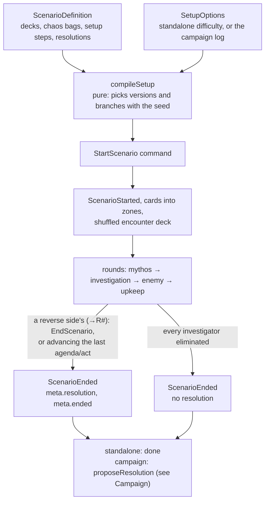

# Scenarios

A scenario is a [`ScenarioDefinition`](../../packages/engine/src/scenario.ts): agenda and act decks, chaos bags, reference card, setup steps and token modifiers.
[`compileSetup`](../../packages/engine/src/setup.ts) turns it plus the players' choices into one `StartScenario` command, reading investigator stats from the cards.

Its `SetupOptions` are standalone (the players pick the difficulty) or a campaign's. In a campaign:

- the log gives the difficulty and the chaos bag,
- each investigator starts with damage and horror for their trauma,
- and setup is refused unless it is the log's next scenario and the seats are exactly its living team.

## From setup to the end

Once the scenario has ended, only `ManualAdjust` is accepted ([Command handling](command-handling.md)).

## Setup steps

- A `whenStory` setup step picks its `then` or `otherwise` steps by a `StoryCondition` on the log's story records (a flag, at least n names on a list, or one name on it); a standalone game answers as an empty log.
- A `whenPlayers` step applies its steps only with at least that many investigators.
- A location with `versions` ("one of the two Downtowns at random") goes into play as one of them, picked with the setup's seed so `compileSetup` stays pure; other steps and connections name it by its first code.
- A map's `atRandom` locations ("choose 4 of the 6 Arkham Woods at random") fill its given cells with that many of the group, picked with the seed too; connections to the ones left out are dropped, so a scenario declares the printed connections once.
- A `oneAtRandom` step applies the steps of one of its options, picked with the seed (one of four Agents sets), and `addChaosTokens` adds tokens to the bag the scenario starts with.
- The branches and versions resolve before any step applies, so the encounter deck only leaves out the cards the chosen steps use.
- `shuffleIntoEncounterDeck` adds single cards from sets the scenario doesn't gather (the Ghoul Priest).
- A `scenarioDeck` step builds a deck of the scenario's own (The Midnight Masks' Cultist deck, a `scenarioDeck` zone), and a `shuffle` step shuffles the cards earlier steps put into any zone, with a seeded stream of its own so the game's RNG stays untouched; `DrawFromScenarioDeck` spawns its top card like a drawn enemy.

## Hand-entered scenarios

- The only scenario so far is the hand-entered test scenario [`the_gathering/`](../../packages/scenarios/src/the_gathering/) (real codes and names, no card text).
- The Midnight Masks is entered the same way in [`the_midnight_masks/`](../../packages/scenarios/src/the_midnight_masks/) (cards, setup and resolutions), with The Gathering's cards joined in for the sets they share.
- The Devourer Below is in [`the_devourer_below/`](../../packages/scenarios/src/the_devourer_below/) (cards, setup and resolutions; each of its resolutions ends the campaign).
  - It plays with The Gathering's and The Midnight Masks' cards joined in.
  - Its setup sets aside each enemy The Midnight Masks recorded as got away, by name, and act 1's reverse side puts the Ritual Site onto the Woods map (`PutLocationIntoPlay`) and spawns them at the Main Path.
  - Agenda 3 (Vengeance Awaits) spawns Umôrdhoth at the Ritual Site as it advances, putting the site into play at act 1 and clearing its enemies at act 2 or 3 (`duringAct`), then turns into The Devourer Below, act and agenda at once (`becomeActAndAgenda`), whose objective ends in R2 when Umôrdhoth is defeated.

Hand-entered card data is built with the shared [`card_builders.ts`](../../packages/scenarios/src/card_builders.ts) (`agenda`, `act`, `location`, `enemy`, `treachery`), one builder per card type that takes the printed values and the card's encounter set. A location's connection symbol (`CardStats.symbol`, a `LocationSymbol`) is entered there too, since ArkhamDB's card data has no field for it.
The app lists playable scenarios in its [scenario catalog](../../apps/web/src/scenarios/scenarioCatalog.ts).

## Extension points

- **A new scenario:** a folder in `packages/scenarios/src/` with definition (its `referenceCode` names the reference card whose texts the screen shows, see [Card data](card-data.md)), cards (rules as abilities) and an end-to-end test, exported and added to the catalog.
- **A new setup step:** a `SetupStep` kind in `setup.ts`, only when two scenarios need it.
