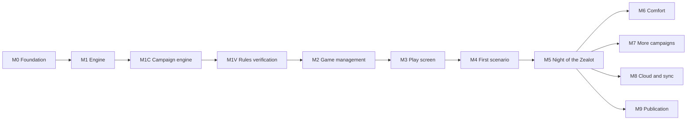

# Arkham Companion – Product

What the app is for, its requirements and the full plan: the screens, the milestones and the designs for what isn't built yet. Each milestone links to its task file with the concrete steps. How the code works today is in [architecture.md](architecture.md); comparing the two shows what is still to do.

## At a glance

- **The problem:** in Arkham Horror LCG the players also run the "game master" side: building and shuffling the encounter deck, counting doom, laying out and connecting locations, moving hunter enemies, remembering forced effects and keeping the campaign log. This bookkeeping is slow and error-prone, and mistakes change the outcome of a scenario.
- **The app:** a tablet companion that takes over exactly this scenario side, while players keep their own decks, skill tests and (optionally) the chaos bag in hand – the tactile, fun part stays physical.
- **How it gets built:** in milestones M0–M8 ("Plan" below), each a sequence of small tasks done in one Claude Code session per task.

## Requirements

*Why:* a tight scope keeps v1 shippable. The scenario side is where the bookkeeping pain is; player cards would mean modelling thousands of individual card effects for little gain at the table.

The app takes over the **scenario side** of Arkham Horror LCG: setup, agenda/act/doom, encounter deck, map with locations and enemies, threat areas and special mechanics. Players keep their own decks, skill tests and (optionally) the chaos bag in hand.

**In scope v1**

- Agenda, act and doom management incl. threshold checks and reverse-side effects
- Encounter deck: building from encounter sets, drawing, discard, reshuffle, surge/peril, set-aside cards
- Map: location graph with explicit connections, multiple maps/regions, locations added or replaced mid-scenario, scenario-book layout plus optional auto-layout, randomised location placement
- Enemies: spawn, hunter movement, engagement, exhaustion, damage; investigator positions
- Investigator tracking: health, horror, clues, resources, threat area, engaged enemies
- Campaign mode: campaign log across a campaign's scenarios, chaos bag carried forward
- Mid-scenario setup changes (replace locations, set-aside cards into play, cards into discard)
- Scenario-specific mechanics via scripts
- Card language configurable (English, German and the other languages ArkhamDB offers)
- Local persistence, refresh-proof, undo

**Not in scope v1:** player card logic, skill test resolution, deck building, multi-device sync and cloud storage (both planned, see "Cloud sync" below).

**Content order:** full campaigns, one after another: *Night of the Zealot* (the original Core Set, pack `core`; first scenario *The Gathering*), then the Chapter Two campaigns (Core Set (2026), pack `core_2026`, first scenario *Spreading Flames*; Children of Blood, `cob`), *The Dunwich Legacy*, *The Path to Carcosa*, *The Forgotten Age*, *The Innsmouth Conspiracy*, and the rest in release order. *Night of the Zealot* comes first because the engine already plays *The Gathering* in tests and its cards need most of the generic rules ([encounter-card-analysis.md](encounter-card-analysis.md#implementation-plan)).

## UI concept

*Why tablet landscape first:* the typical setup is one shared device in the middle of the table, replacing the physical scenario area. Large touch targets and drag-and-drop matter more than dense information.

Tablet landscape first. Header (round, phase, agenda/act, undo), map centre (pan/zoom, map tabs), investigator bar (steppers), encounter panel, decision dialog, card zoom, event log, campaign screen.

**Game management**

- **Home screen:** saved games and campaigns, newest first, each with scenario, investigators, round/phase and last played. Actions: resume, rename, duplicate, delete, export.
- **Two ways to start:** *New campaign* (campaign and difficulty → investigators → summary; plays the scenarios in order with a campaign log) and *Quick game* (any single scenario and difficulty → investigators → summary; standalone chaos bag, no log). Investigators are 1–4 in player order. Confirming runs the setup and opens the board.
- **Resume** restores the exact state (snapshot + replay). **Load** imports a JSON export as a new saved game.
- **Auto-save** on every command; there is no manual save.

**Investigator picker** (inspired by the Mansions of Madness app)

- Catalog of all investigators from ArkhamDB (`type_code = investigator`, all packs), deduplicated across true reprints (`duplicate_of_code`), parallel versions grouped with the original. Investigators revised for Chapter Two are **not** merged with their Chapter One version: both are listed, each with a chapter badge, and can be filtered by chapter.
- Grid of portraits; a search box and one round filter button (like the play screen's menu) whose menu filters by class, cycle/pack, chapter and "my collection" (owned packs, set once in settings).
- Tap shows front and back with health, sanity, skills and ability; select assigns the next seat, drag reorders seats, remove frees one.
- In campaign play investigators come from the campaign log; the picker only opens to replace killed or insane ones.
- The catalog is fetched with the card data and cached in IndexedDB, so it works offline.

## Repository and publishing

Private GitHub repo, possibly public later. Before going public: no card text/images committed, MIT licence (`LICENSE`), an unofficial-fan-project notice, and the copyright checks of [M9](https://github.com/macandy13/arkham-companion/issues/372) (the bundled game symbols are traced from Fantasy Flight Games' icons). Hosting via GitHub Pages or Cloudflare Pages.

## Plan

Each milestone is a parent issue on GitHub with its tasks as sub-issues, one task per Claude Code session (`docs/tasks/README.md`). Every milestone issue opens with *Why this milestone* (problem, gain, timing) and every task has a *Why* and a *Benefit* line.

**Ordering logic:** foundations → rules → screens → real content → polish → cloud. Rules come before screens because the screens only display engine state and send commands. Screens are built against a fake sandbox scenario so UI problems and real-data problems never have to be debugged at the same time. Comfort features and the cloud come last because none of them blocks playing.

| Milestone | Content | Why at this point | What players get at the end |
| --- | --- | --- | --- |
| [M0 Foundation](tasks/done/M0-foundation.md) | Monorepo, CI, card import, domain model, `GameStore`, app shell | Everything builds on it; these are the expensive decisions to change later | An installable app that keeps a (still empty) game across refreshes |
| [M1 Generic engine](https://github.com/macandy13/arkham-companion/issues/261) | Agenda/act/doom, encounter deck, map graph, enemies, investigators, threat area, undo, phase assistant; sandbox scenario; no UI | The UI is defined by the engine's commands and state | Nothing visible yet – a rules core that plays a whole fake scenario in tests |
| [M1C Campaign engine](https://github.com/macandy13/arkham-companion/issues/262) | Campaign log aggregate, change notices, chaos bag, resolutions, scenario start from the log, campaign storage; tested with *Night of the Zealot*; no UI | The screens (M2 wizard, M3 board, M5 campaign screen) display campaign state, so it must exist first | Nothing visible yet – The Gathering into The Midnight Masks runs in tests |
| [M1V Rules verification](https://github.com/macandy13/arkham-companion/issues/263) | Check the engine's timing choices (when forced effects resolve) against the Rules Reference; edge case tests for rule interactions | The screens and real scenarios build on the resolution order, so it is cheapest to fix now | Nothing visible yet – fewer subtle rule bugs at the table later |
| [M2 Game management UI](https://github.com/macandy13/arkham-companion/issues/264) | Investigator catalog, home screen with saved games, new-game wizard with investigator picker, resume, export/import | Needs only engine setup, and gives M3 real saved games to work with | Pick investigators, start, leave and resume games on a tablet; back them up |
| [M3 Play screen UI](https://github.com/macandy13/arkham-companion/issues/265) | Header, map with pan/zoom, investigator bar, encounter panel, decision dialog, card zoom, event log; sandbox scenario playable on a tablet | Built on the proven engine with fake data, so only UI issues remain | A full game loop on a tablet (with the sandbox scenario) |
| [M4 Scenario data + first scenario](https://github.com/macandy13/arkham-companion/issues/266) | ArkhamCards layout import, connection symbol extraction, manual connection editor; the generic rules *Night of the Zealot* needs; *The Gathering* complete | Engine and UI are proven; now only data and scenario rules can break | The first real scenario, playable at the table; a recipe for every later one |
| [M5 Night of the Zealot](https://github.com/macandy13/arkham-companion/issues/267) | *The Midnight Masks* and *The Devourer Below*, campaign screen and resolution confirmation (on the M1C engine) | Reuses the M4 recipe | The first complete campaign, no paper log needed |
| [M6 Comfort](https://github.com/macandy13/arkham-companion/issues/268) | Chaos bag module, card and UI languages, auto-layout, offline preload, polish | Nice to have, nothing blocks play | Cards in the group's language, reliable offline play, tidier maps, smoother app |
| [M7 More campaigns](https://github.com/macandy13/arkham-companion/issues/270) | Chapter Two campaigns, then Dunwich, Carcosa, The Forgotten Age, Innsmouth and the rest in release order; new Chapter Two products; more automated card effects | Each campaign reuses the recipe and the generic rules; playtests show what to automate | One more full campaign at a time, less manual work per round |
| [M8 Cloud and sync](https://github.com/macandy13/arkham-companion/issues/271) | Login, games in the cloud, sync across devices at the table | Adds cost and operations; one tablet covers the core use case | Games backed up online, several devices showing the same live game |
| [M9 Publication](https://github.com/macandy13/arkham-companion/issues/372) | Copyright and licence checks of everything bundled or committed (game symbols, fonts, icons), then hosting and a public repo | The app bundles the game's symbols and the fan policy rules out apps, so it stays private until this is cleared | An app and repo that can be shared publicly |

## Versions

*Why:* a version number should tell players what they can do with the app, not how many features were merged. Release Please would bump the version on every `feat` commit, so it only bumps the patch number (setup in [automation.md](automation.md)); every step below is set by hand.

- **0.1.x – Engine and first screens (now):** start, save, resume and export games; the sandbox scenario's map with draggable investigators and enemies, agenda/act and doom on a tablet. Every merged release PR is a new 0.1.x.
- **0.2 – Sandbox game loop:** a whole sandbox game played on a tablet without paper: investigator bar, encounter panel, decision dialog, card zoom and event log ([M3](https://github.com/macandy13/arkham-companion/issues/265) done).
- **0.3 – First real scenario:** *The Gathering* from real card data, playable at the table from setup to resolution ([M4](https://github.com/macandy13/arkham-companion/issues/266)).
- **0.4 – First campaign:** *Night of the Zealot* end to end with the campaign screen and campaign log, no paper log needed ([M5](https://github.com/macandy13/arkham-companion/issues/267)).
- **1.0 – Ready for the table:** decided by hand once *Night of the Zealot* has been playtested and works reliably; expected to include offline play and the group's card language from [M6](https://github.com/macandy13/arkham-companion/issues/268).

After 1.0, a new major version marks a change in what the app can do at the table, and saved games from the previous major version may no longer load:

- **2.0 – Several devices:** games in the cloud and several devices showing the same live game ([M8](https://github.com/macandy13/arkham-companion/issues/271)).

New campaigns ([M7](https://github.com/macandy13/arkham-companion/issues/270)) and comfort features are minor versions (1.1, 1.2 …); fixes are patch versions.

## Planned designs

Designs for parts that have a milestone but no code yet. The PR that builds one describes it in [architecture.md](architecture.md) and removes it here.

### Campaign mode ([M1C](https://github.com/macandy13/arkham-companion/issues/262), [M5](https://github.com/macandy13/arkham-companion/issues/267))

- **Campaign log:** investigators, trauma, XP, killed or insane, story records, chaos bag. `GameState.campaign` is a stub until then.
- **Chaos bag:** standalone uses the scenario default per difficulty; a campaign uses the log, modified by resolutions. Scenarios that build on earlier ones read the log in their setup (`whenStory` steps).
- **Resolutions:** declarative steps (`record`, `addChaosToken`, `removeChaosToken`, `awardXp`, `addTrauma`), confirmed by the players. Deck upgrades stay with the players.

### Continuous play tester ([M1V.4](https://github.com/macandy13/arkham-companion/issues/281))

*Why:* unit tests and the scripted end-to-end games check the paths we thought of. Bots playing thousands of games of the real scenarios find the paths we didn't: rare token draws, unusual orders of play, rule interactions. Every failing game is recorded, so the bug can be replayed step by step.

**What it plays**

- A **run** is one game: scenario, difficulty, 1–4 investigators in seat order, a game seed (the engine's shuffles) and a bot seed (the bot's choices and chaos tokens). The same run always plays the same game.
- **Scenarios:** only the real ones, every scenario the scenarios package exports (The Gathering today, each new one as it lands). No made-up boards: a finding then always happens in a game someone could play.
- **Investigators:** the real ones, plus blank investigators with random stats (down to sanity 1 and agility 0), so defeat and elimination happen often.
- **Bots** drive a `PlayTable` through its game-language verbs (`nextPhase`, `moveTo`, `investigate`, `fight`, `answer`/`answerOnly`, `spendCluesToAdvanceAct`, `resign`, `undo`), like players at the table; corrections go through its `adjust*`/`placeDoom` verbs or `play(ManualAdjust)`. Each bot is a weighting of these verbs: *random* (any verb), *goal* (go for clues, advance the act, fight what is engaged) and *chaos* (undo, corrections, resign early).
- **Chaos tokens:** the bot keeps its own bag (the scenario's or campaign's bag for the difficulty), draws a token, computes the result with `suggestSkillTest(ctx, state, decision, { tokens })` and answers pass, fail or `failedBy` from that. Tokens the engine can't value (elder sign) get a random modifier; a test decided by the lead or the group has no suggestion, so the bot answers it at random. Once the chaos bag module exists ([M6.1](https://github.com/macandy13/arkham-companion/issues/302)), the bot draws through it instead.
- A game ends at a resolution, when every investigator is out, or at a round cap (a "stuck" finding, see below).

**How it judges a game** (the main part). Each check has an id and, where it is a rule, the `docs/rules.md` section it comes from. A failed check is a *finding*.

1. **Crash:** any error other than `CommandRejected` and `TableError` (a `TypeError`, a broken reducer case). `PlayTable` also throws `TableError` when the bot misuses it (undo at the start, a name that matches nothing); the bot only offers steps the board allows, and an invariant break is told apart by its own error type (check 3), which slice 1 adds.
2. **Refusals:** each rejection code is marked *expected* (the bot tried a move that isn't connected) or *never* (`unknownCard`, `invalidDecisionOptions`, a decision whose offered option is refused). A *never* refusal is a finding; the share of expected ones is only reported. The table is an exhaustive `switch` over the `Rejection` codes, so a new code fails typecheck until it is marked.
3. **Invariants after every command:** `checkInvariants` (already run by `PlayTable`), plus new ones that hold in every state, added to `checkInvariants` itself so unit tests and the app get them too: cards are conserved (only setup and set-aside cards add any), an engaged enemy is at its investigator's location, the current agenda and act are in play (stricter than "a known card" today).
4. **Rule oracles per step:** small checks that compare the board before and after one step against a rule, written from `docs/rules.md` and read only through `BoardView`, never through the engine's rule helpers (otherwise a bug passes its own check). Examples:
   - Round structure: phases go mythos, investigation, enemy, upkeep; round 1 has no mythos; the round number only grows by 1.
   - Mythos: 1 doom on the agenda, the threshold check, then one encounter draw per active investigator (plus surges).
   - Agenda: it advances at the threshold check exactly when doom in play (on the agenda and every other card) is at or above its threshold, flat or per investigator, and the agenda has no "Objective –".
   - Upkeep: actions back to 3, each active investigator gets 1 resource, enemies and investigators ready.
   - Hunter: a ready, unengaged hunter with no investigator at its location moves 1 step along a shortest path towards the nearest investigator (prey, then the lead, picks between equally near ones), and stays when that step is blocked; a hunter that should have moved and didn't is a finding too.
   - Act: a clue advance takes the requirement minus the clues already on the act from the investigators; an objective advance takes none; either clears the act's tokens.
   - Defeat is already an invariant (`investigatorErrors`), so it needs no oracle.
5. **Replay and undo (differential checks):**
   - `replay(events)` equals the live state (the end-to-end test checks this once at the end; the tester checks it after every step).
   - Running the same run twice gives the same events (`commandId` and event; the clock's timestamps are left out).
   - Undo right after a step gives back exactly the state before it.
   - `PlayTable.resume` from the log at any step, then playing on, gives the same game as playing straight through.
   - The same steps through the web app's `GameSession` (on `IndexedDbStore` over fake-indexeddb, as the web tests do) give the same events and undo groups as through `PlayTable`, and the log survives the export and import round trip (`serialiseGameExport`, `parseGameExport`). These live in `apps/web`, and a package must not depend on the app, so this check is a script in `apps/web` (`pnpm --filter @arkham/web playtest`) that the nightly run calls on a few of the night's runs and the `findings/` records. It is not part of `pnpm test`.
6. **Liveness:** there is always a next step (an answer or "Next"), every offered option of a pending decision is accepted, "Next" never leaves the board unchanged, and the game ends before the round cap.
7. **Statistics (reported, never a failure):** wins per scenario and difficulty, rounds per game, how often each encounter card is drawn compared with its share of the deck (a shuffle bias shows here), and which card abilities and decisions never fired (untested paths).

**Recording and replay**

- Only **failing games are recorded.** A passing game needs no file: its run (scenario, difficulty, seats, both seeds, bot) plays it again, and every run's report lists its runs.
- A **record** (`*.arkham-run.json`) holds the tester version and git commit, the run, the failed check with its step and `formatBoard` before and after, the steps as `PlayTable` calls with arguments by name (`moveTo('Daisy Walker', 'Attic')`), and the event log in the export format.
- **Replay** a record two ways: the steps through a fresh `PlayTable` (works on a newer engine, shows what it does now), or the event log through `replay` (shows what happened then). Comparing the two shows how the engine's behaviour changed.
- The event log is the app's export format, so a record **opens in the app** with "Import game" and can be clicked through on the board.
- **Shrinking:** before saving, the tester cuts the game down (drop steps, drop investigators, end earlier) while the same check still fails, so the record is the shortest game that breaks.
- **From finding to test:** the fix PR adds the shrunk game as an example-based test (in `timing.test.ts` or a scenario's end-to-end test) with named cards. Random play stays in the tester and never runs in `pnpm test`, so the rule "no property-based testing" in unit tests still holds.

**Who runs it and where it writes**

The tester is a Node script in a new package, `packages/play_tester` (CI tooling like `review_digest`; it may use the clock and the file system, the engine stays pure). It never runs on PRs, only in two ways:

- **A developer or a Claude session**, on their machine: `pnpm playtest --games 500 --seed 7`. It prints a summary (games, wins, findings per check) and writes failing records to `packages/play_tester/.runs/` (gitignored). `pnpm playtest --replay <record>` replays one and stops at its failing step.
- **A nightly GitHub Action** (`play_tester.yml`, scheduled, ~15 minutes, about 450 of the 2,000 free minutes a month): fresh seeds from the date, so each night plays new games. It also replays every record in `packages/play_tester/findings/` (the committed shrunk records of fixed bugs, steps and card codes only, never card text), so a fixed bug that comes back is found the next night. It writes:
  - the summary to the job summary page,
  - the failing records as a workflow artifact (kept 90 days),
  - one GitHub issue per new finding signature (check id plus step kind), labelled `play-tester`, opened with the workflow's `GITHUB_TOKEN` (`issues: write`). The issue names the check, its `docs/rules.md` section, the run, the shrunk steps and the replay command, and links the artifact. A signature that already has an open issue gets a comment with the night's count instead, so the same bug is not reported twice.

A session fixing an issue downloads the record, replays it, adds the test, and commits the record to `findings/` so the nightly run keeps checking it.

### Scenario data pipeline ([M4](https://github.com/macandy13/arkham-companion/issues/266))

No single source has everything, so each field comes from the first source that has it, with a manual override on top:

1. **ArkhamDB:** card stats and text, encounter sets and quantities, agenda and act order, doom and clue values, victory points, investigators. No connection symbols and no layout.
2. **ArkhamCards campaign data** ([zzorba/arkham-cards-data](https://github.com/zzorba/arkham-cards-data)): setup steps including `location_setup` grids (the book layout), chaos bags per difficulty, campaign log entries and resolutions. Imported at build time and not committed, since that repo carries no licence.
3. **Card images:** connection symbols are only printed on the cards. A dev-time extraction step (a Claude Code task or a vision-model script) writes them to `packages/scenarios/data/connections/<pack>.json`, card codes and symbol names only, reviewed once against a contact sheet.
4. **Manual:** the board's edit mode adds or removes connections and moves slots, saved as a scenario override file that can be committed.

The engine then builds edges from the revealed state. The setup DSL gains `randomLocations(pool, slots)` (seeded RNG) and `replaceLocation`.

### Encounter card special cases ([M4](https://github.com/macandy13/arkham-companion/issues/266), [M5](https://github.com/macandy13/arkham-companion/issues/267), [M7](https://github.com/macandy13/arkham-companion/issues/270))

[encounter-card-analysis.md](encounter-card-analysis.md) lists what the encounter cards need beyond the generic rules (new keywords, location modifiers, scenario actions, skill test margins, timing windows, blood tokens), sorted into auto, assist and display. Its coverage table counts every encounter card per rule as covered or planned. Its implementation plan orders the primitives by campaign: steps 1–12 for Night of the Zealot (M4, M5), the rest per campaign in M7.

### Board rendering ([M3](https://github.com/macandy13/arkham-companion/issues/265), [M6](https://github.com/macandy13/arkham-companion/issues/268))

The book layout is stored as slots (a grid or free positions); the map is SVG with pan and zoom, several maps as tabs or side by side; elkjs auto-layout for maps without a book layout; dnd-kit for dragging locations on a tablet.

### Cloud sync ([M8](https://github.com/macandy13/arkham-companion/issues/271))

A second `GameStore` (`CloudStore`) next to `IndexedDbStore`; sync through the append-only event log with optimistic concurrency (`expectedSeq`); login; backend to be decided (Supabase, Firebase or Cloudflare). Already prepared: UUID game IDs, timestamped events, no device-bound IDs.

## Decisions and open questions

**Decided** (with the main reason)

- One device in v1, sync in M8 – a backend adds cost and accounts; one shared tablet covers the main use case.
- Investigator tracking (health, horror, clues, resources) – removes most physical tokens, and enemy rules (prey) need these values.
- Encounter automation starts with display + keywords – keywords are generic and cover most rules; individual card scripts are added where playtests show they pay off.
- Card language configurable – groups want screen text that matches their cards; ArkhamDB offers several languages.
- Campaign mode in v1 – the game is played in campaigns; standalone-only would miss its point.
- Night of the Zealot first, then Chapter Two, Dunwich, Carcosa, The Forgotten Age, Innsmouth and the rest in release order – the first campaign's cards need most of the generic rules, so every later campaign mostly adds data.
- GitHub, possibly public – free CI and hosting; nothing copyrighted is committed, so going public stays possible.
- Connection data from ArkhamDB → ArkhamCards layouts + image extraction → manual editor – no single source has connections, and hand-typing does not scale.
- MIT licence – simple and permissive for a fan project.
- Game management (M2) and play screen (M3) before the first real scenario – UI problems and real-data problems are then never debugged at the same time.

**Open**

1. Network for cloud sessions: allow `arkhamdb.com`, `de.arkhamdb.com` and `raw.githubusercontent.com` in the Claude Code environment so sessions can fetch card data and images (needed from M2 on).
2. Import investigators from an ArkhamDB deck link in the new-game wizard?
