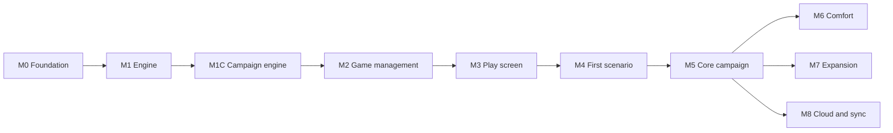

# Arkham Companion – Product

What the app is for, what it covers, how its screens work and the order it gets built in. How the code is put together is in [architecture.md](architecture.md).

## At a glance

- **The problem:** in Arkham Horror LCG the players also run the "game master" side: building and shuffling the encounter deck, counting doom, laying out and connecting locations, moving hunter enemies, remembering forced effects and keeping the campaign log. This bookkeeping is slow and error-prone, and mistakes change the outcome of a scenario.
- **The app:** a tablet companion that takes over exactly this scenario side, while players keep their own decks, skill tests and (optionally) the chaos bag in hand – the tactile, fun part stays physical.
- **Key bets:** a pure, event-sourced rules engine (gives undo, refresh safety, export and later sync from one mechanism); scenarios as data with small code hooks (new content is cheap); card data from ArkhamDB instead of hand-typed (accurate, bilingual, nothing copyrighted in git); offline-first PWA with no backend (free hosting, works at any table).
- **How it gets built:** in milestones M0–M8 ("Roadmap" below), each a sequence of small tasks done in one Claude Code session per task.

## Goal and scope

*Why:* a tight scope keeps v1 shippable. The scenario side is where the bookkeeping pain is; player cards would mean modelling thousands of individual card effects for little gain at the table.

The app takes over the **scenario side** of Arkham Horror LCG: setup, agenda/act/doom, encounter deck, map with locations and enemies, threat areas and special mechanics. Players keep their own decks, skill tests and (optionally) the chaos bag in hand.

**In scope v1**

- Agenda, act and doom management incl. threshold checks and reverse-side effects
- Encounter deck: building from encounter sets, drawing, discard, reshuffle, surge/peril, set-aside cards
- Map: location graph with explicit connections, multiple maps/regions, locations added or replaced mid-scenario, scenario-book layout plus optional auto-layout, randomised location placement
- Enemies: spawn, hunter movement, engagement, exhaustion, damage; investigator positions
- Investigator tracking: health, horror, clues, resources, threat area, engaged enemies
- Campaign mode: campaign log across the three intro scenarios, chaos bag carried forward
- Mid-scenario setup changes (replace locations, set-aside cards into play, cards into discard)
- Scenario-specific mechanics via scripts
- Card language configurable (English, German and the other languages ArkhamDB offers)
- Local persistence, refresh-proof, undo

**Not in scope v1:** player card logic, skill test resolution, deck building, multi-device sync and cloud storage (both planned, see "Cloud sync" in architecture.md).

**First content:** Chapter Two starts with the Core Set (2026), ArkhamDB pack code `core_2026`, with an introductory campaign of three scenarios. The first scenario is *Spreading Flames* (encounter code `spreading_flames`).

## UI concept

*Why tablet landscape first:* the typical setup is one shared device in the middle of the table, replacing the physical scenario area. Large touch targets and drag-and-drop matter more than dense information.

Tablet landscape first. Header (round, phase, agenda/act, undo), map centre (pan/zoom, map tabs), investigator bar (steppers), encounter panel, decision dialog, card zoom, event log, campaign screen.

**Game management**

- **Home screen:** saved games and campaigns, newest first, each with scenario, investigators, round/phase and last played. Actions: resume, rename, duplicate, delete, export.
- **Two ways to start:** *New campaign* (campaign and difficulty → investigators → summary; plays the scenarios in order with a campaign log) and *Quick game* (any single scenario and difficulty → investigators → summary; standalone chaos bag, no log). Investigators are 1–4 in player order. Confirming runs the setup and opens the board.
- **Resume** restores the exact state (snapshot + replay). **Load** imports a JSON export as a new saved game.
- **Auto-save** on every command; there is no manual save.

**Investigator picker** (inspired by the Mansions of Madness app)

- Catalog of all investigators from ArkhamDB (`type_code = investigator`, all packs), deduplicated across true reprints (`duplicate_of_code`), parallel versions grouped with the original. Investigators revised for Chapter Two are **not** merged with their Chapter One version: both are listed, each with a chapter badge, and can be filtered by chapter.
- Grid of portraits; filter by class, cycle/pack and "my collection" (owned packs, set once in settings); search by name.
- Tap shows front and back with health, sanity, skills and ability; select assigns the next seat, drag reorders seats, remove frees one.
- In campaign play investigators come from the campaign log; the picker only opens to replace killed or insane ones.
- The catalog is fetched with the card data and cached in IndexedDB, so it works offline.

## Repository and publishing

Private GitHub repo, possibly public later. Before going public: no card text/images committed, MIT licence (`LICENSE`), an unofficial-fan-project notice. Hosting via GitHub Pages or Cloudflare Pages.

## Roadmap

Each milestone has a task plan under `docs/tasks/`, one task per Claude Code session. Every milestone file opens with *Why this milestone* (problem, gain, timing) and every task has a *Why* and a *Benefit* line.

**Ordering logic:** foundations → rules → screens → real content → polish → cloud. Rules come before screens because the screens only display engine state and send commands. Screens are built against a fake sandbox scenario so UI problems and real-data problems never have to be debugged at the same time. Comfort features and the cloud come last because none of them blocks playing.

| Milestone | Content | Why at this point | What players get at the end |
| --- | --- | --- | --- |
| M0 Foundation | Monorepo, CI, card import, domain model, `GameStore`, app shell | Everything builds on it; these are the expensive decisions to change later | An installable app that keeps a (still empty) game across refreshes |
| M1 Generic engine | Agenda/act/doom, encounter deck, map graph, enemies, investigators, threat area, undo, phase assistant; sandbox scenario; no UI | The UI is defined by the engine's commands and state | Nothing visible yet – a rules core that plays a whole fake scenario in tests |
| M1C Campaign engine | Campaign log aggregate, change notices, chaos bag, resolutions, scenario start from the log, campaign storage; tested with *Night of the Zealot*; no UI | The screens (M2 wizard, M3 board, M5 campaign screen) display campaign state, so it must exist first | Nothing visible yet – The Gathering into The Midnight Masks runs in tests |
| M2 Game management UI | Investigator catalog, home screen with saved games, new-game wizard with investigator picker, resume, export/import | Needs only engine setup, and gives M3 real saved games to work with | Pick investigators, start, leave and resume games on a tablet; back them up |
| M3 Play screen UI | Header, map with pan/zoom, investigator bar, encounter panel, decision dialog, card zoom, event log; sandbox scenario playable on a tablet | Built on the proven engine with fake data, so only UI issues remain | A full game loop on a tablet (with the sandbox scenario) |
| M4 Scenario data + first scenario | ArkhamCards layout import, connection symbol extraction, manual connection editor; *Spreading Flames* complete | Engine and UI are proven; now only data and scenario rules can break | The first real scenario, playable at the table; a recipe for every later one |
| M5 Core campaign | Scenarios 2 and 3, campaign screen and resolution confirmation (on the M1C engine) | Reuses the M4 recipe | The complete Core Set campaign, no paper log needed |
| M6 Comfort | Chaos bag module, card and UI languages, auto-layout, offline preload, polish | Nice to have, nothing blocks play | Cards in the group's language, reliable offline play, tidier maps, smoother app |
| M7 Expansion | More Chapter Two products; more automated card effects | Driven by new releases and playtest findings | New content soon after release, less manual work per round |
| M8 Cloud and sync | Login, games in the cloud, sync across devices at the table | Adds cost and operations; one tablet covers the core use case | Games backed up online, several devices showing the same live game |

## Decisions and open questions

**Decided** (with the main reason)

- One device in v1, sync in M8 – a backend adds cost and accounts; one shared tablet covers the main use case.
- Investigator tracking (health, horror, clues, resources) – removes most physical tokens, and enemy rules (prey) need these values.
- Encounter automation starts with display + keywords – keywords are generic and cover most rules; individual card scripts are added where playtests show they pay off.
- Card language configurable – groups want screen text that matches their cards; ArkhamDB offers several languages.
- Campaign mode in v1 – the Core Set is a campaign; standalone-only would miss its point.
- React – existing experience and the largest ecosystem.
- GitHub, possibly public – free CI and hosting; nothing copyrighted is committed, so going public stays possible.
- Connection data from ArkhamDB → ArkhamCards layouts + image extraction → manual editor – no single source has connections, and hand-typing does not scale.
- MIT licence – simple and permissive for a fan project.
- Game management (M2) and play screen (M3) before the first real scenario – UI problems and real-data problems are then never debugged at the same time.

**Open**

1. Network for cloud sessions: allow `arkhamdb.com`, `de.arkhamdb.com` and `raw.githubusercontent.com` in the Claude Code environment so sessions can fetch card data and images (needed from M2 on).
2. Import investigators from an ArkhamDB deck link in the new-game wizard?
