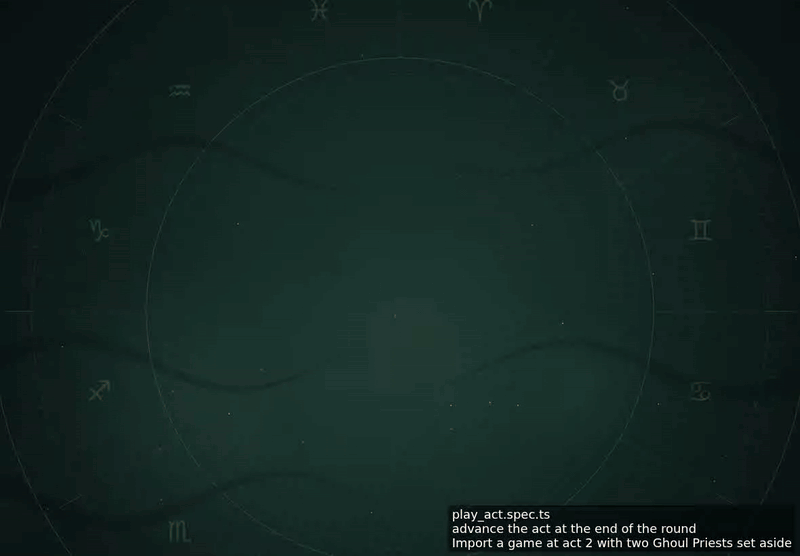
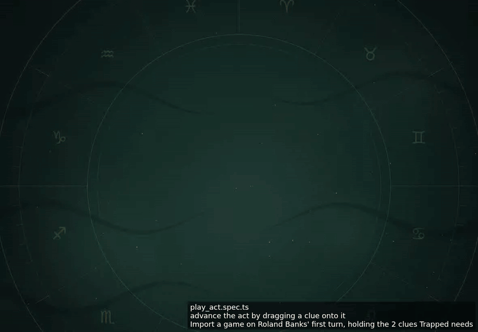

<!-- screencasts:start -->

_Recorded from fd5ac16 by the PR preview workflow; updated on every push that changes `apps/web`._

## Screencasts

### advance the act at the end of the round

[Play with pause and speed controls](https://macandy13.github.io/arkham-companion/pr-preview/pr-1005/screencasts/player.html?flow=advance-the-act-at-the-end-of-the-round&v=fd5ac16&speed=0.25)

### advance the act by dragging a clue onto it

[Play with pause and speed controls](https://macandy13.github.io/arkham-companion/pr-preview/pr-1005/screencasts/player.html?flow=advance-the-act-by-dragging-a-clue-onto-it&v=fd5ac16&speed=0.25)

<!-- screencasts:end -->