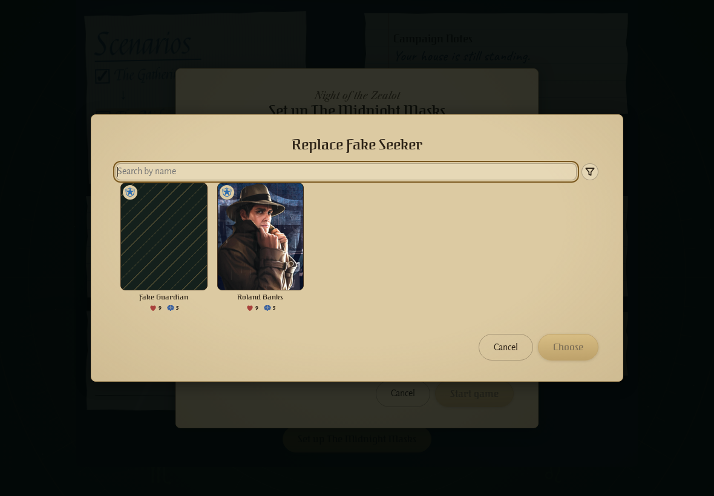
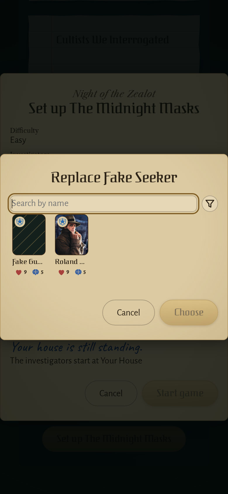
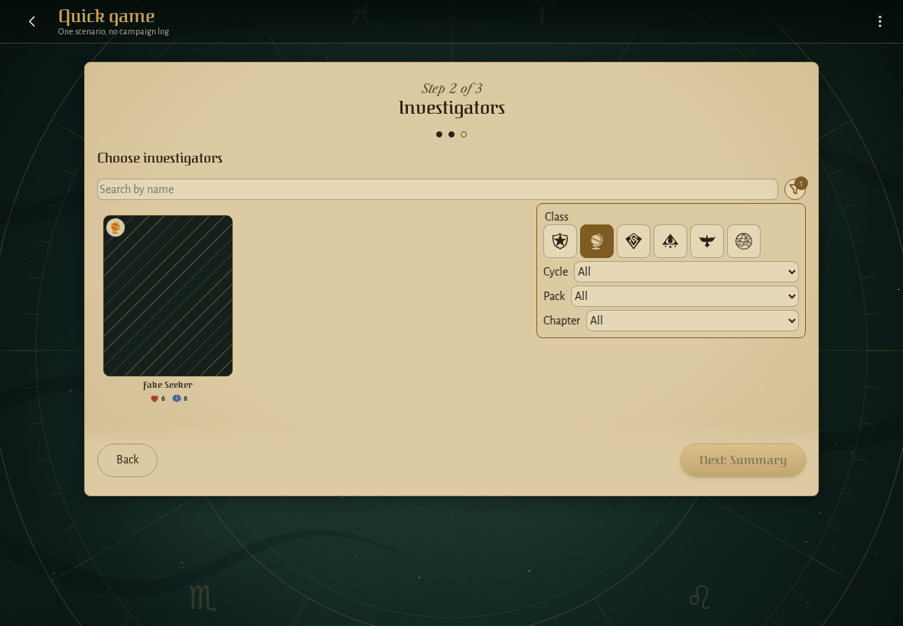
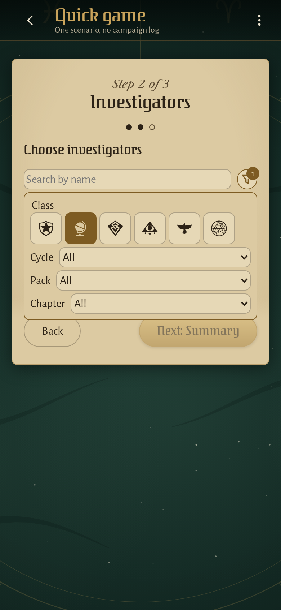
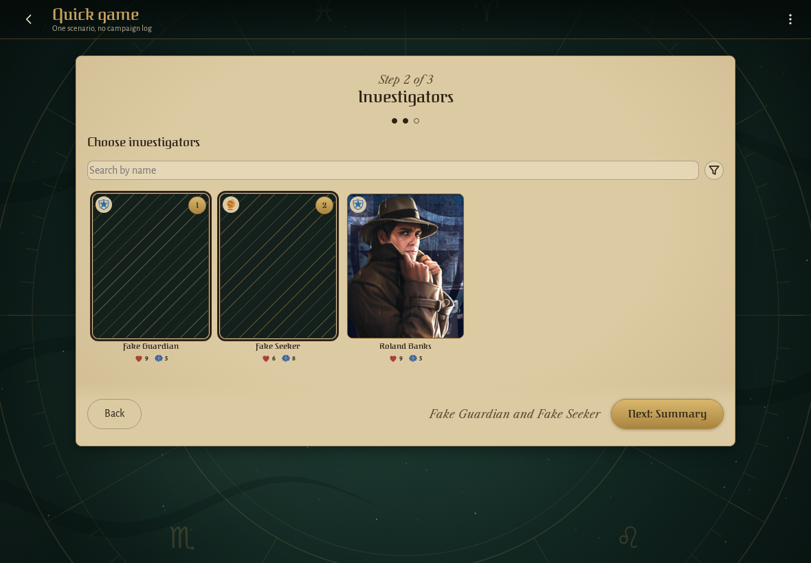
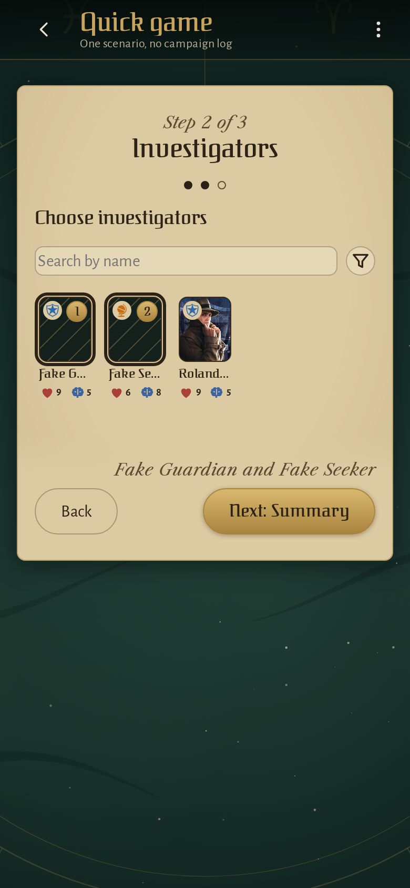
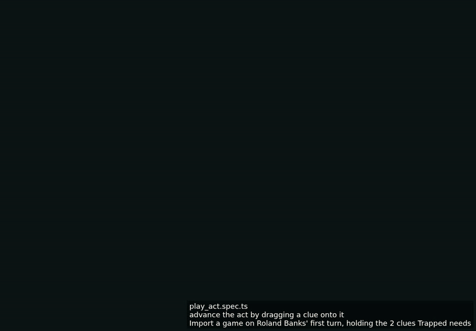

<!-- screencasts:start -->

_Recorded from 4821dc0 by the PR preview workflow; updated on every push that changes `apps/web`._

## Screenshots

### the replacement picker for the killed Fake Seeker

<table>
<tr><th>Desktop</th><th>Phone</th></tr>
<tr><td></td><td></td></tr>
</table>

### the investigator picker with its filter menu open

<table>
<tr><th>Desktop</th><th>Phone</th></tr>
<tr><td></td><td></td></tr>
</table>

### the investigators step with two picked, their names pinned beside the next step

<table>
<tr><th>Desktop</th><th>Phone</th></tr>
<tr><td></td><td></td></tr>
</table>

## Screencasts

### start a new game

[Play with pause and speed controls](https://macandy13.github.io/arkham-companion/pr-preview/pr-1010/screencasts/player.html?flow=start-a-new-game&v=4821dc0&speed=0.25)

### start a campaign and resume it from its log

[Play with pause and speed controls](https://macandy13.github.io/arkham-companion/pr-preview/pr-1010/screencasts/player.html?flow=start-a-campaign-and-resume-it-from-its-log&v=4821dc0&speed=0.25)

### advance the act by dragging a clue onto it

[Play with pause and speed controls](https://macandy13.github.io/arkham-companion/pr-preview/pr-1010/screencasts/player.html?flow=advance-the-act-by-dragging-a-clue-onto-it&v=4821dc0&speed=0.25)

<!-- screencasts:end -->