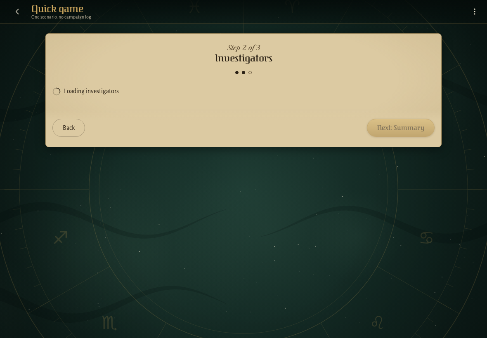

<!-- screencasts:start -->

_Recorded from 518fb96 by the PR preview workflow; updated on every push that changes `apps/web`._

## Screenshots

### the loading screen with the games loaded and the card data on its way

<table>
<tr><th>Desktop</th><th>Phone</th></tr>
<tr><td></td><td></td></tr>
</table>

### the spinner on paper while the wizard refreshes the investigators

<table>
<tr><th>Desktop</th><th>Phone</th></tr>
<tr><td></td><td></td></tr>
</table>

<!-- screencasts:end -->