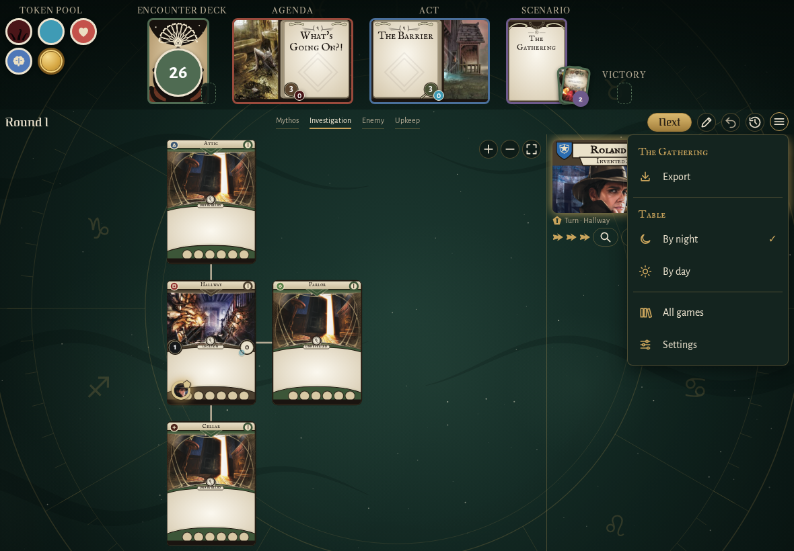
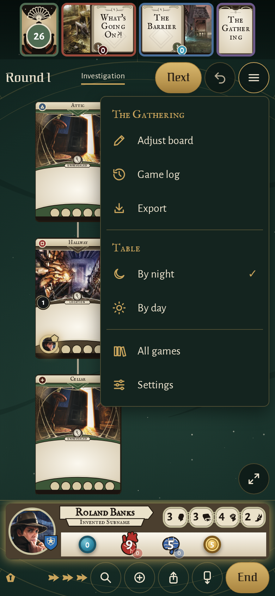
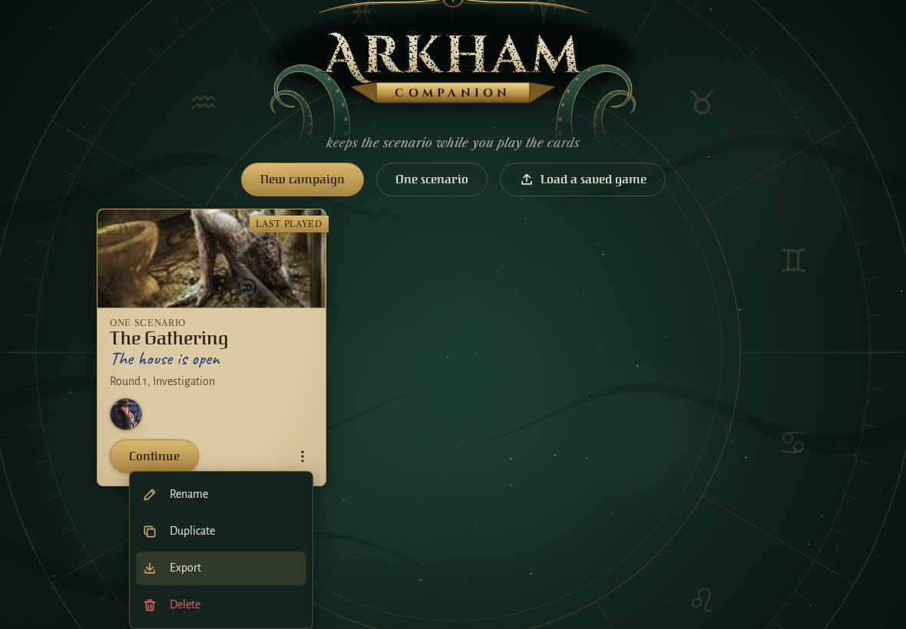
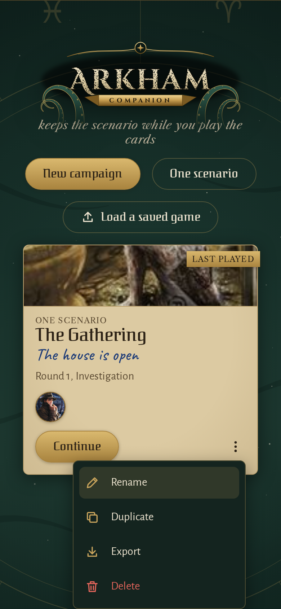
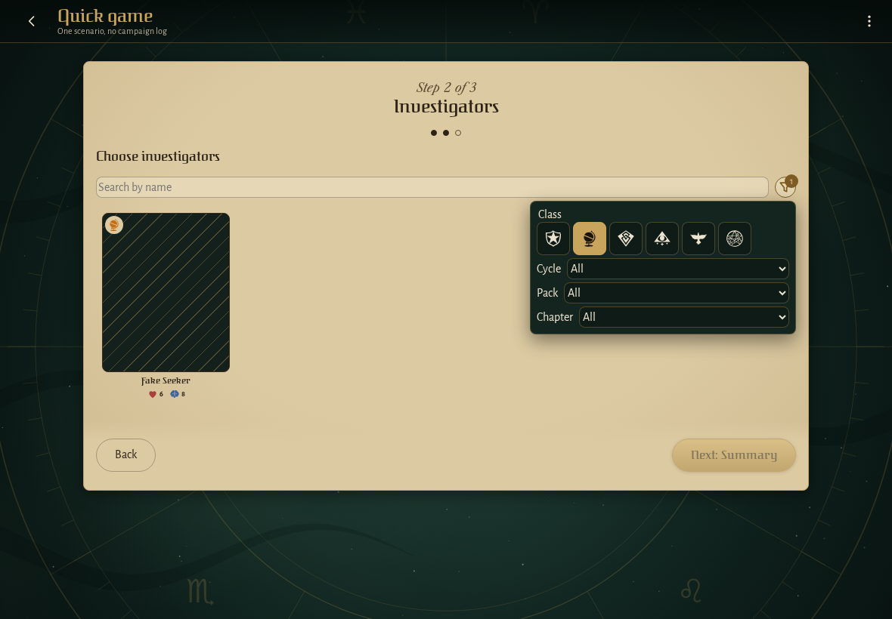
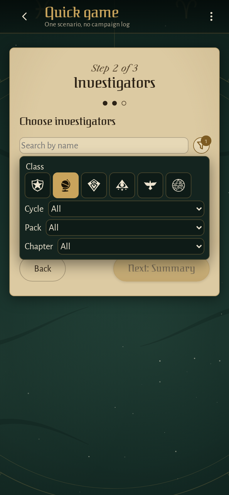
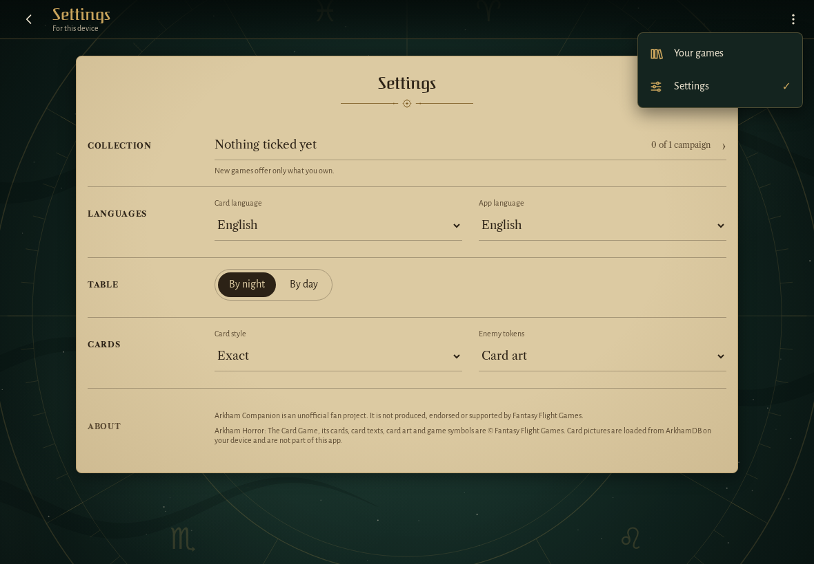
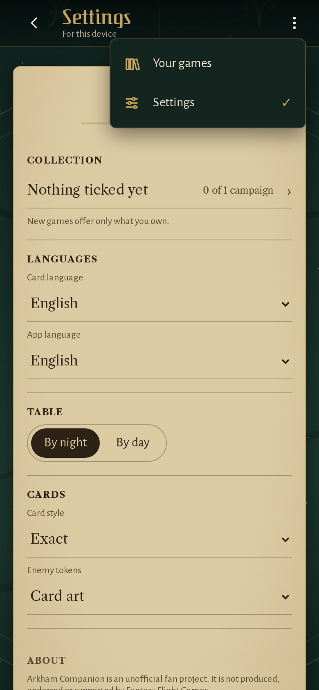

<!-- screencasts:start -->

_Recorded from 376b12f by the PR preview workflow; updated on every push that changes `apps/web`._

## Screenshots

### the menu open, holding "Adjust board" and the game log on a phone

<table>
<tr><th>Desktop</th><th>Phone</th></tr>
<tr><td></td><td></td></tr>
</table>

### a game’s menu open on its cover

<table>
<tr><th>Desktop</th><th>Phone</th></tr>
<tr><td></td><td></td></tr>
</table>

### the investigator picker with its filter menu open

<table>
<tr><th>Desktop</th><th>Phone</th></tr>
<tr><td></td><td></td></tr>
</table>

### the app bar’s menu open over the settings

<table>
<tr><th>Desktop</th><th>Phone</th></tr>
<tr><td></td><td></td></tr>
</table>

<!-- screencasts:end -->