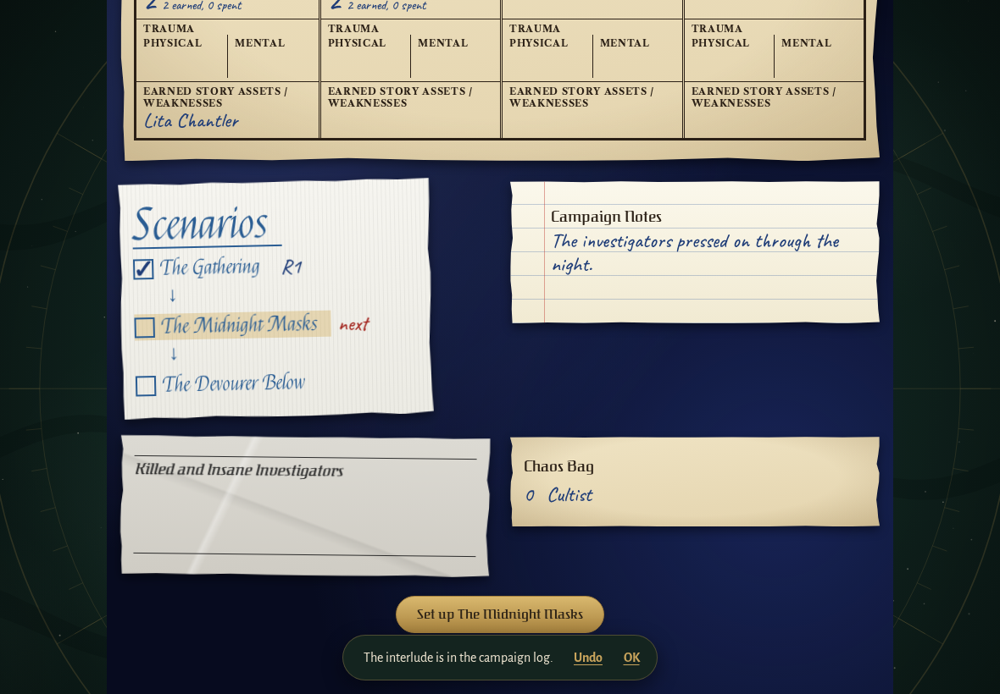
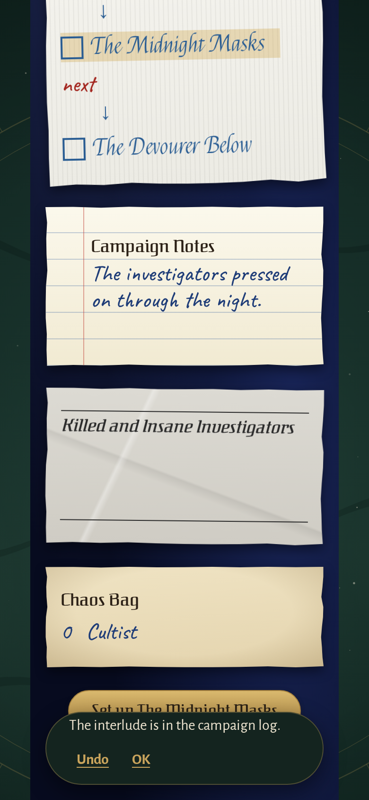
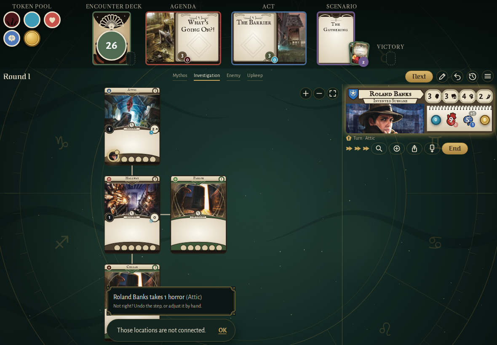
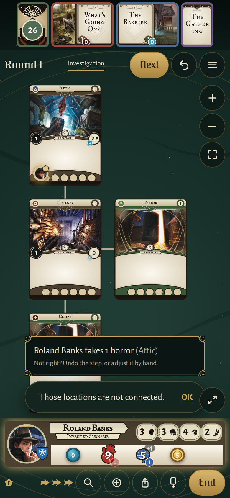

<!-- screencasts:start -->

_Recorded from 126c8ef by the PR preview workflow; updated on every push that changes `apps/web`._

## Screenshots

### the log after an interlude was written

<table>
<tr><th>Desktop</th><th>Phone</th></tr>
<tr><td></td><td></td></tr>
</table>

### the log right after that resolution was written

<table>
<tr><th>Desktop</th><th>Phone</th></tr>
<tr><td></td><td>Not taken: the spec failed, see the E2E check.</td></tr>
</table>

### the refusal toast after Roland Banks is dragged from the Attic to the Cellar, which it does not connect to

<table>
<tr><th>Desktop</th><th>Phone</th></tr>
<tr><td></td><td></td></tr>
</table>

<!-- screencasts:end -->