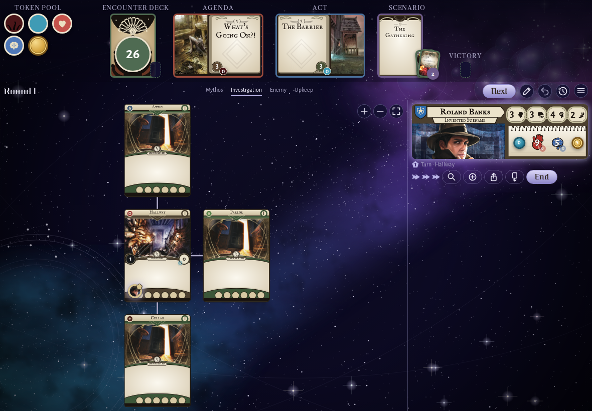
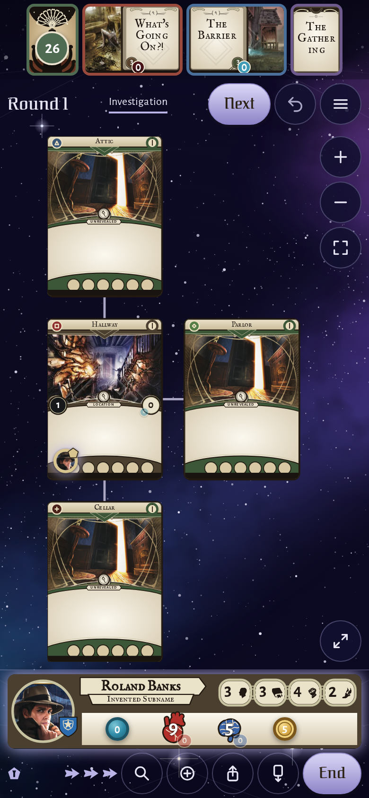
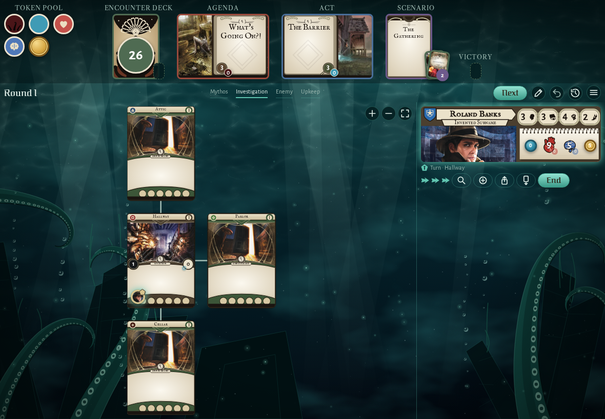
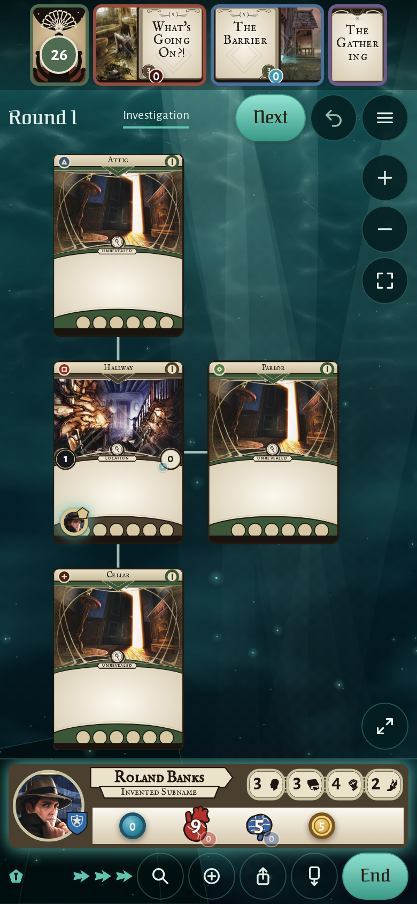
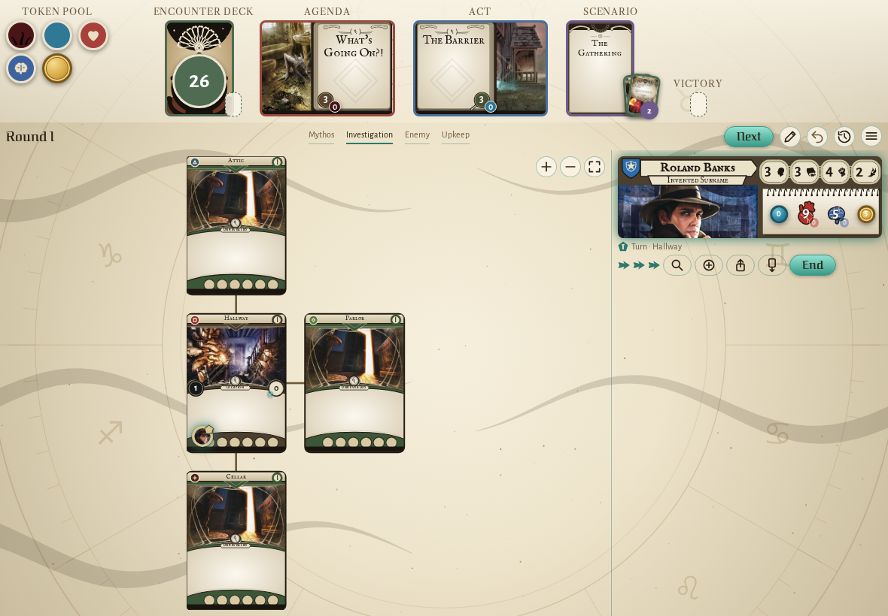
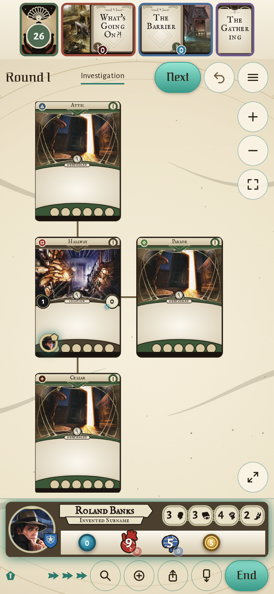
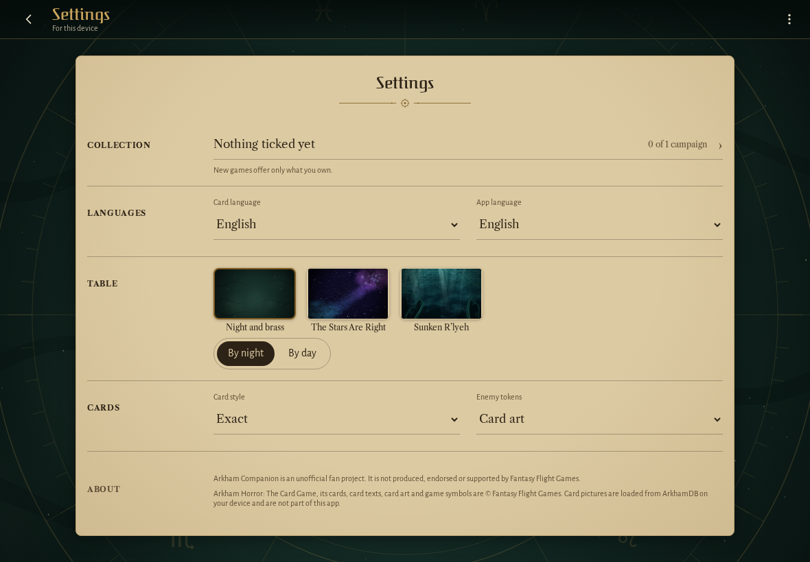
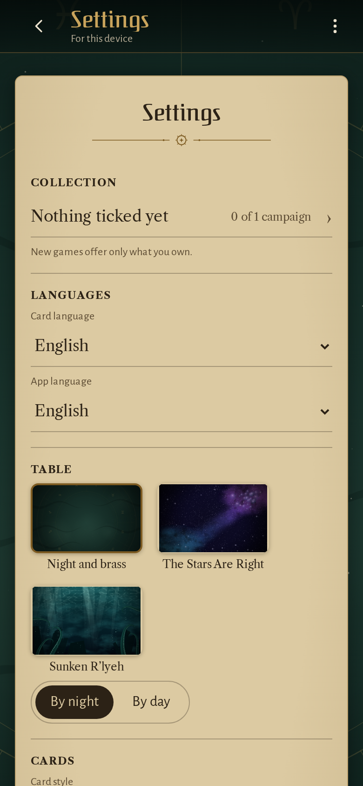
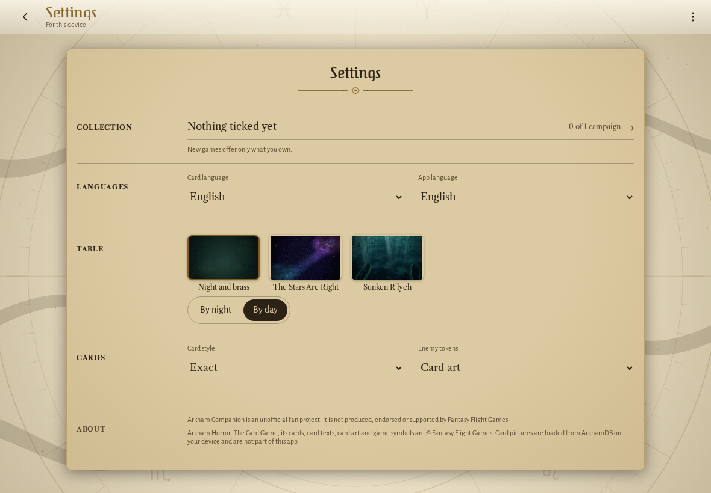
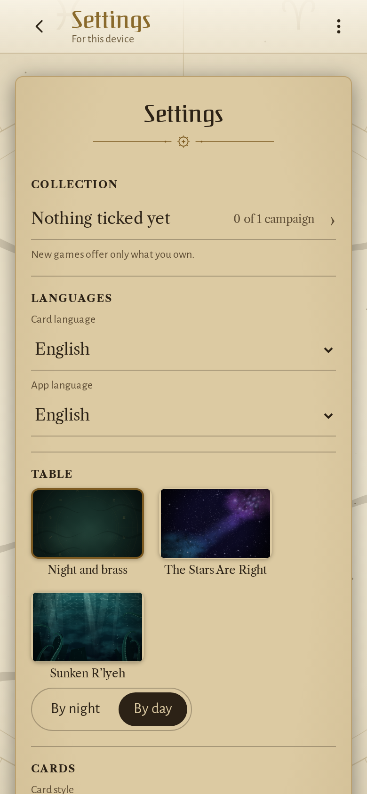

<!-- screencasts:start -->

_Recorded from 6425c89 by the PR preview workflow; updated on every push that changes `apps/web`._

## Screenshots

### the house map on the The Stars Are Right table by night

<table>
<tr><th>Desktop</th><th>Phone</th></tr>
<tr><td></td><td></td></tr>
</table>

### the house map on the Sunken R’lyeh table by night

<table>
<tr><th>Desktop</th><th>Phone</th></tr>
<tr><td></td><td></td></tr>
</table>

### the house map on the Sunken R’lyeh table by day

<table>
<tr><th>Desktop</th><th>Phone</th></tr>
<tr><td></td><td></td></tr>
</table>

### the settings with the unofficial fan project notice

<table>
<tr><th>Desktop</th><th>Phone</th></tr>
<tr><td></td><td></td></tr>
</table>

### the settings by day, on parchment

<table>
<tr><th>Desktop</th><th>Phone</th></tr>
<tr><td></td><td></td></tr>
</table>

<!-- screencasts:end -->