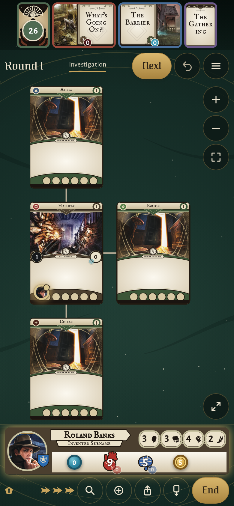
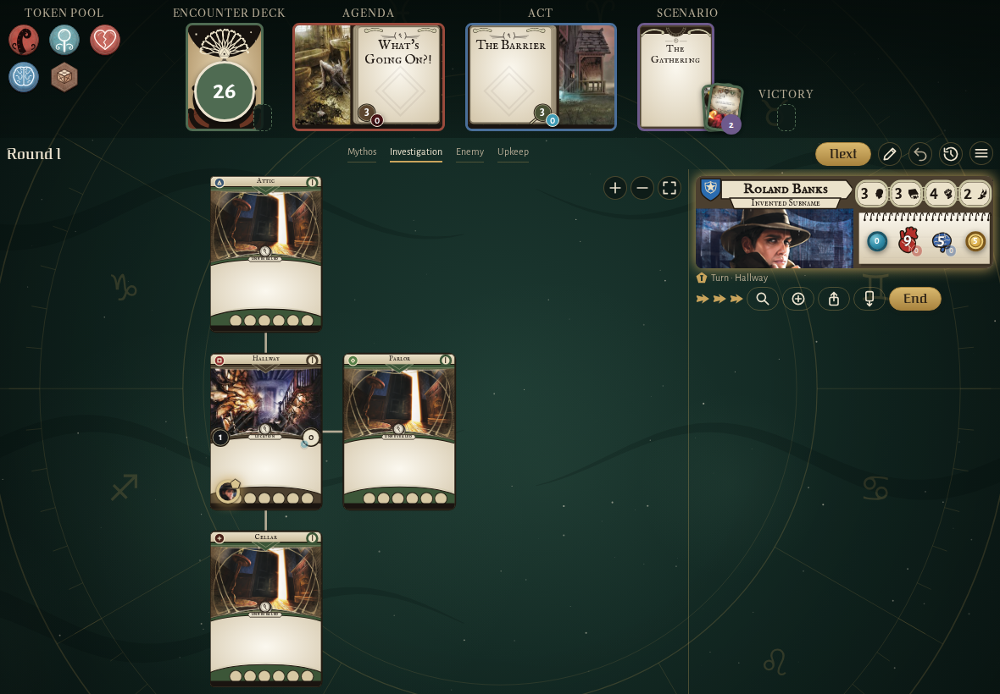
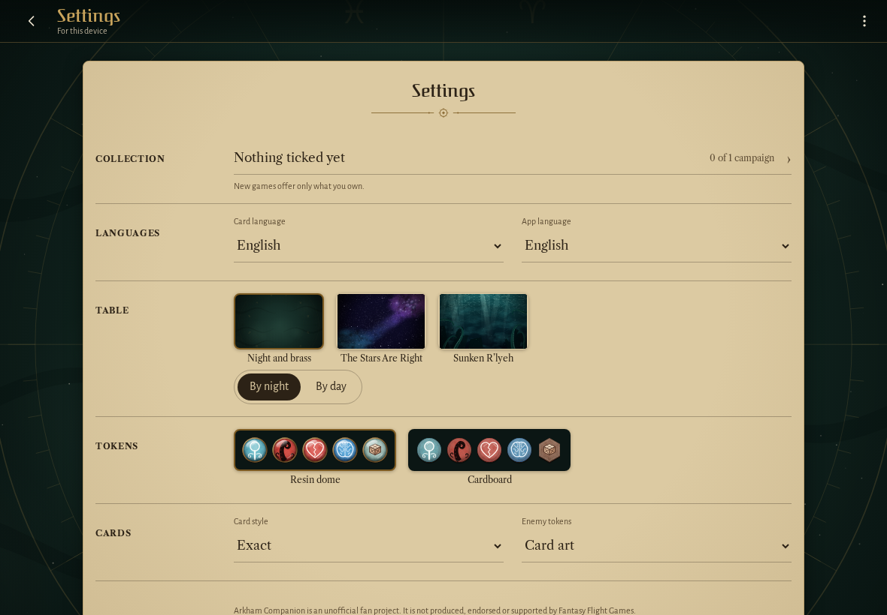
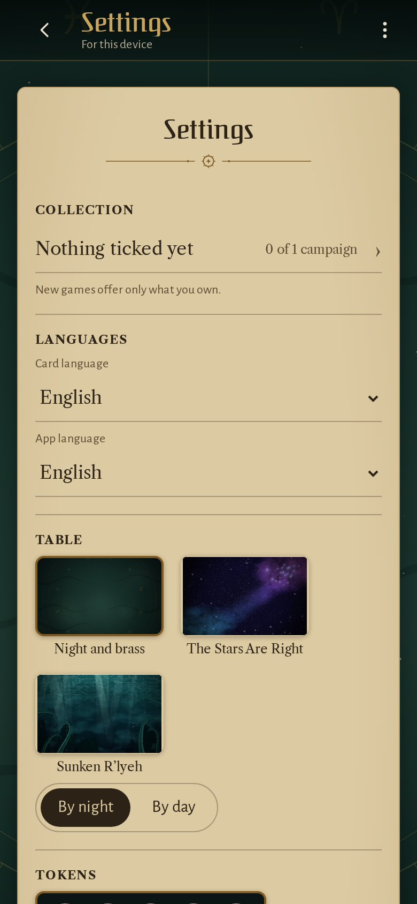
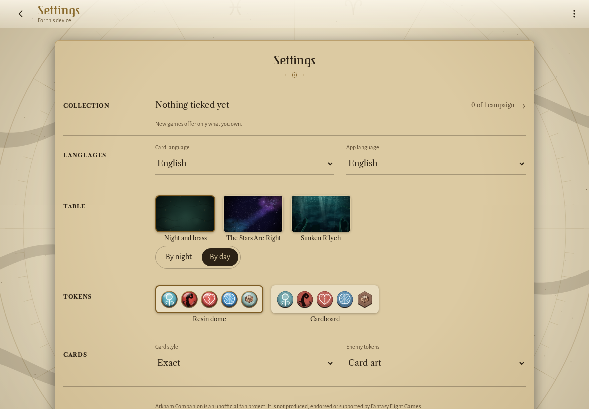
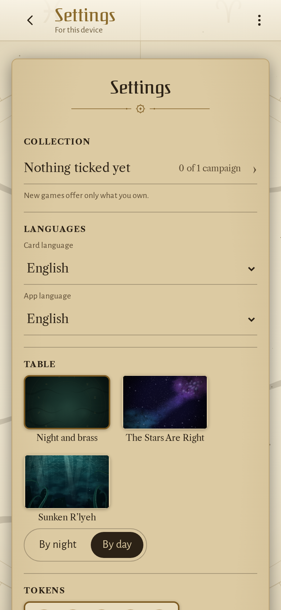

<!-- screencasts:start -->

_Recorded from 22b6b97 by the PR preview workflow; updated on every push that changes `apps/web`._

## Screenshots

### the house map with Roland Banks in the Hallway

<table>
<tr><th>Desktop</th><th>Phone</th></tr>
<tr><td></td><td></td></tr>
</table>

### the token pool in the cardboard token set

<table>
<tr><th>Desktop</th><th>Phone</th></tr>
<tr><td></td><td>Not taken: the spec failed, see the E2E check.</td></tr>
</table>

### the settings with the unofficial fan project notice

<table>
<tr><th>Desktop</th><th>Phone</th></tr>
<tr><td></td><td></td></tr>
</table>

### the settings by day, on parchment

<table>
<tr><th>Desktop</th><th>Phone</th></tr>
<tr><td></td><td></td></tr>
</table>

<!-- screencasts:end -->