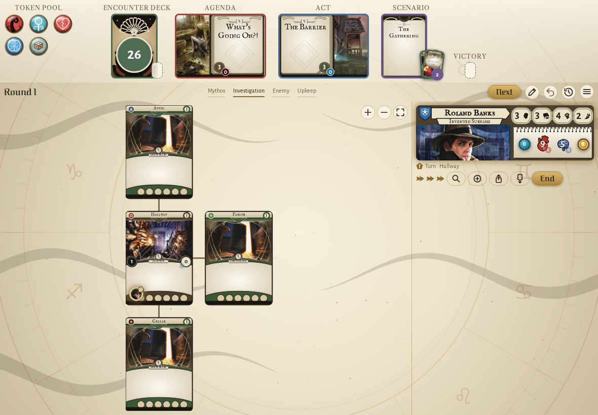
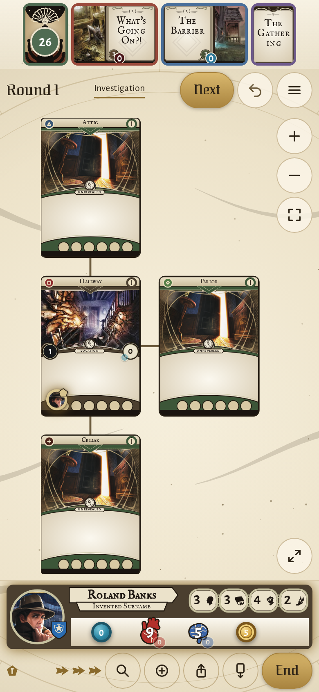
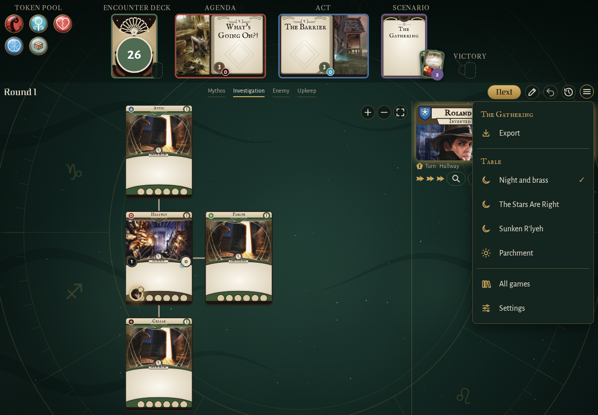
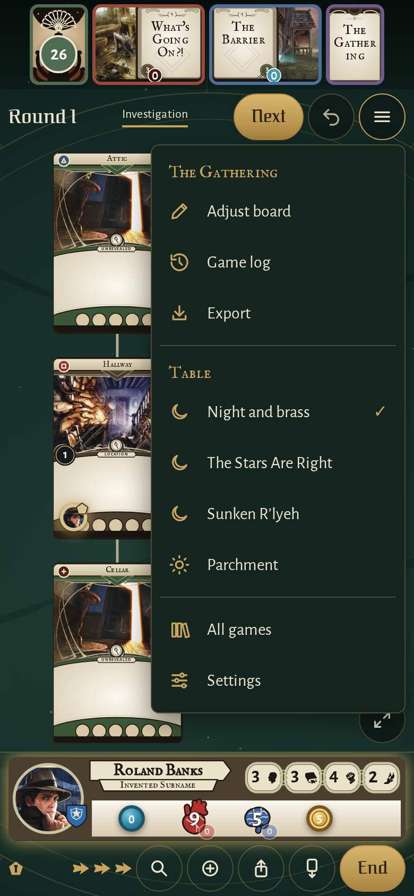
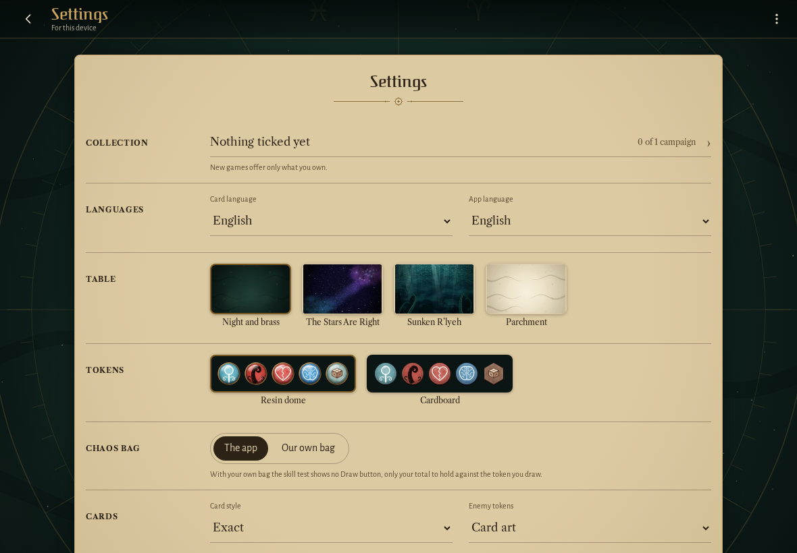
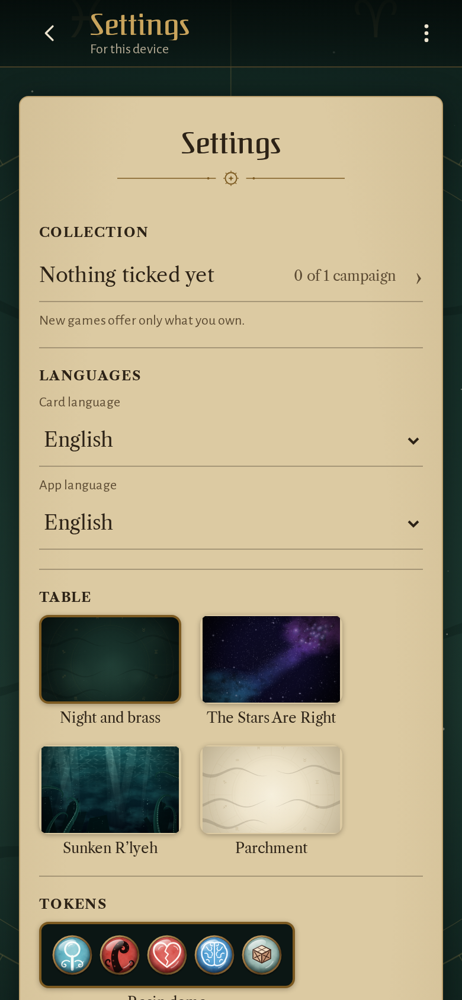
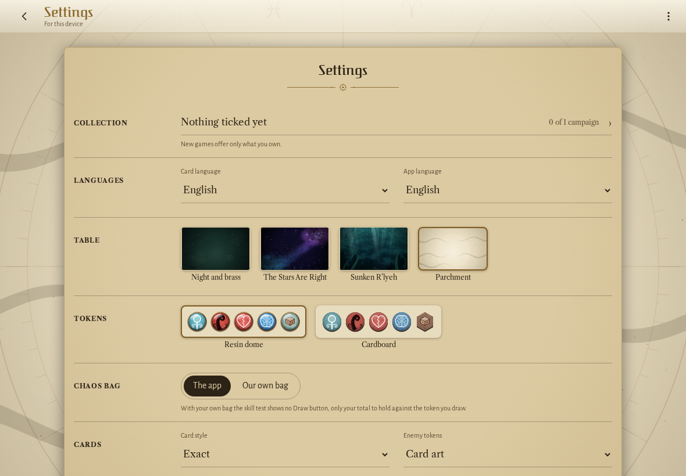
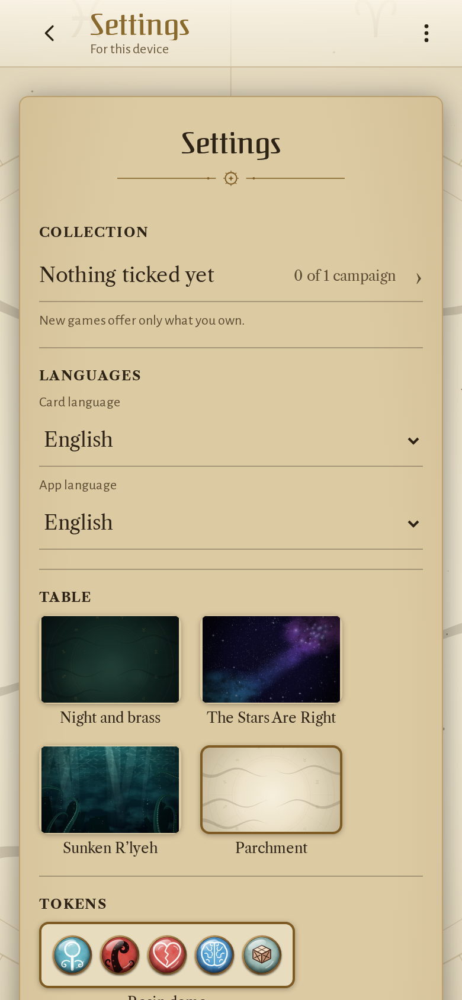

<!-- screencasts:start -->

_Recorded from b99f7d7 by the PR preview workflow; updated on every push that changes `apps/web`._

## Screenshots

### the house map on the parchment table

<table>
<tr><th>Desktop</th><th>Phone</th></tr>
<tr><td></td><td></td></tr>
</table>

### the menu open, holding "Adjust board" and the game log on a phone

<table>
<tr><th>Desktop</th><th>Phone</th></tr>
<tr><td></td><td></td></tr>
</table>

### the settings with the unofficial fan project notice

<table>
<tr><th>Desktop</th><th>Phone</th></tr>
<tr><td></td><td></td></tr>
</table>

### the settings on the parchment table

<table>
<tr><th>Desktop</th><th>Phone</th></tr>
<tr><td></td><td></td></tr>
</table>

## Screencasts

### change the settings

[Play with pause and speed controls](https://macandy13.github.io/arkham-companion/pr-preview/pr-1065/screencasts/player.html?flow=change-the-settings&v=b99f7d7&speed=0.25)

<!-- screencasts:end -->