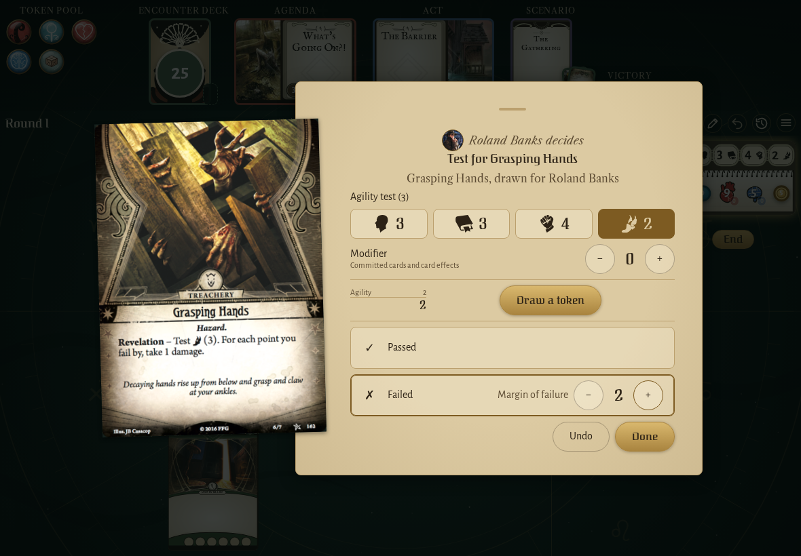
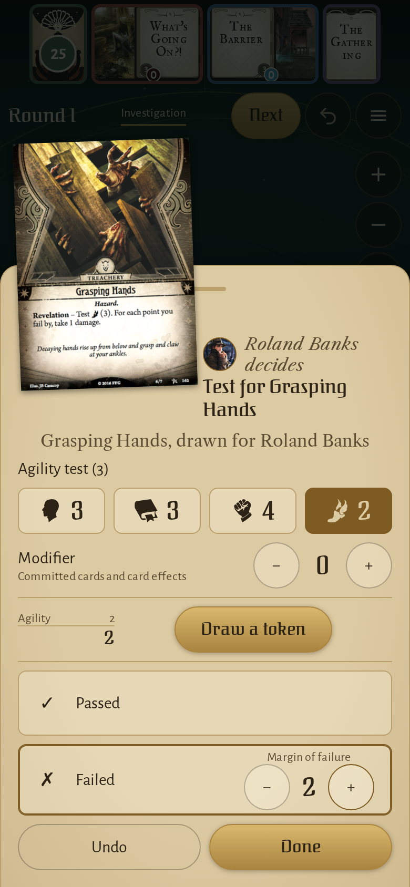

<!-- screencasts:start -->

_Recorded from 227c2ef by the PR preview workflow; updated on every push that changes `apps/web`._

## Screenshots

### Grasping Hands failed by 2 with no token drawn in the app, its margin of failure on the Failed row

<table>
<tr><th>Desktop</th><th>Phone</th></tr>
<tr><td></td><td></td></tr>
</table>

<!-- screencasts:end -->