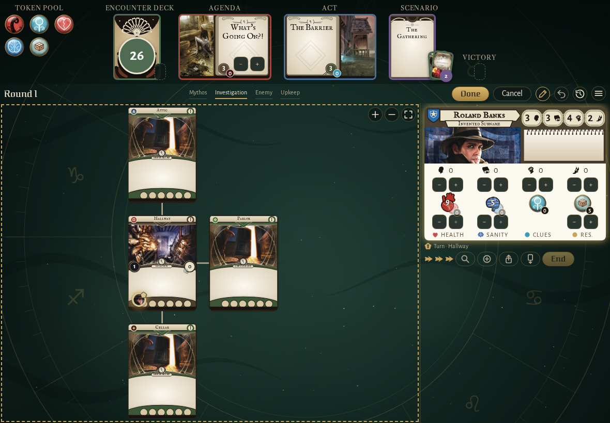
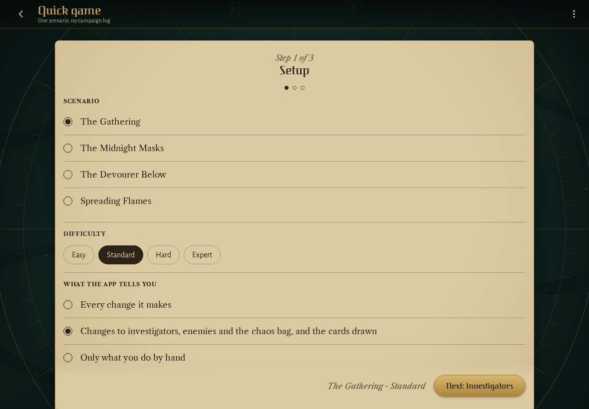
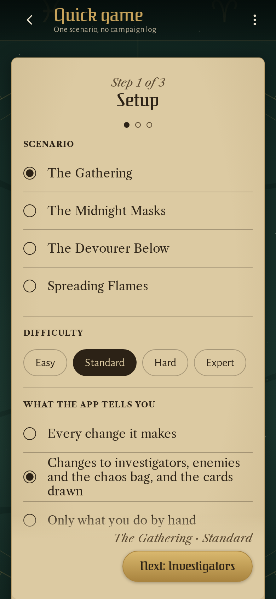

<!-- screencasts:start -->

_Recorded from 253e7dd by the PR preview workflow; updated on every push that changes `apps/web`._

## Screenshots

### Roland Banks’ card while the players adjust the board, its steppers out

<table>
<tr><th>Desktop</th><th>Phone</th></tr>
<tr><td></td><td>Not taken: the spec failed, see the E2E check.</td></tr>
</table>

### a quick game's setup step: the scenario, the difficulty and what the app tells the players

<table>
<tr><th>Desktop</th><th>Phone</th></tr>
<tr><td></td><td></td></tr>
</table>

<!-- screencasts:end -->