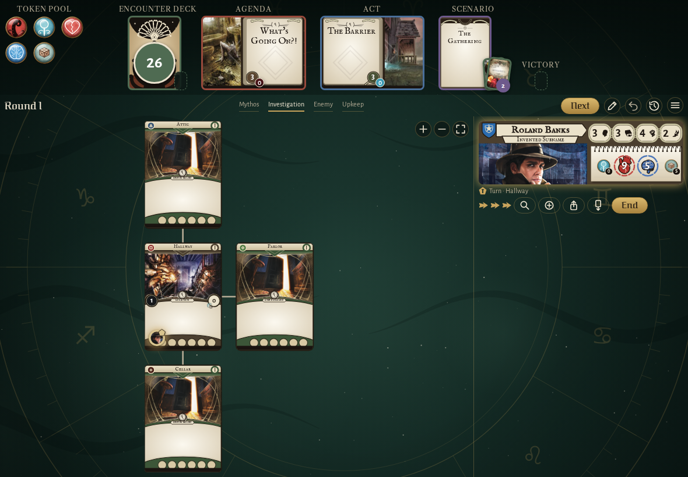
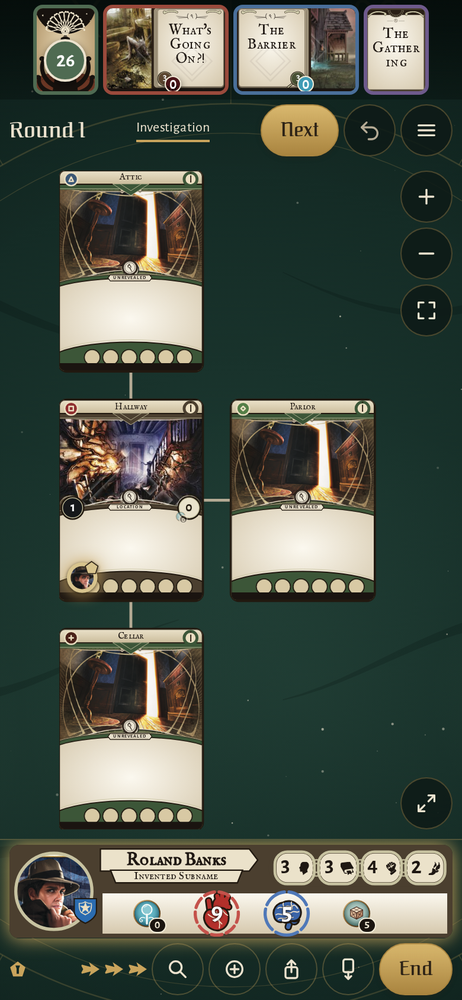
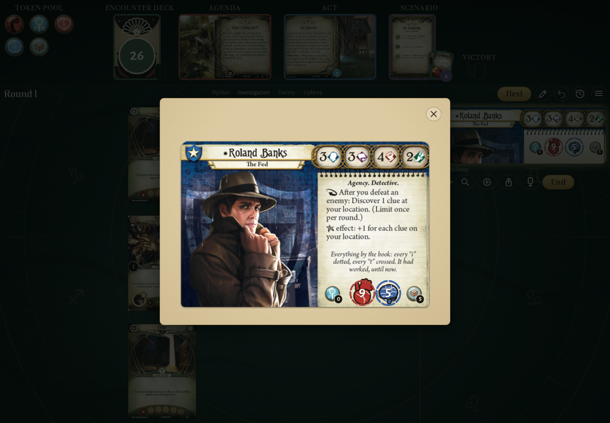
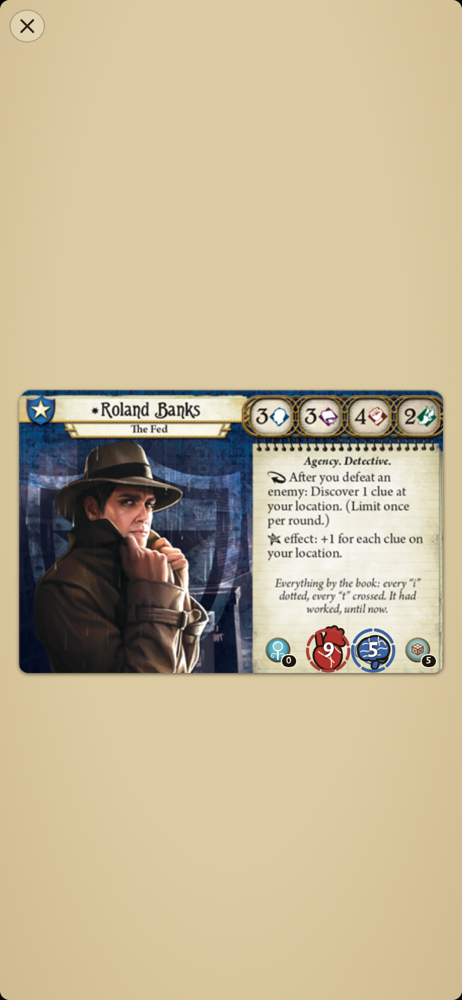
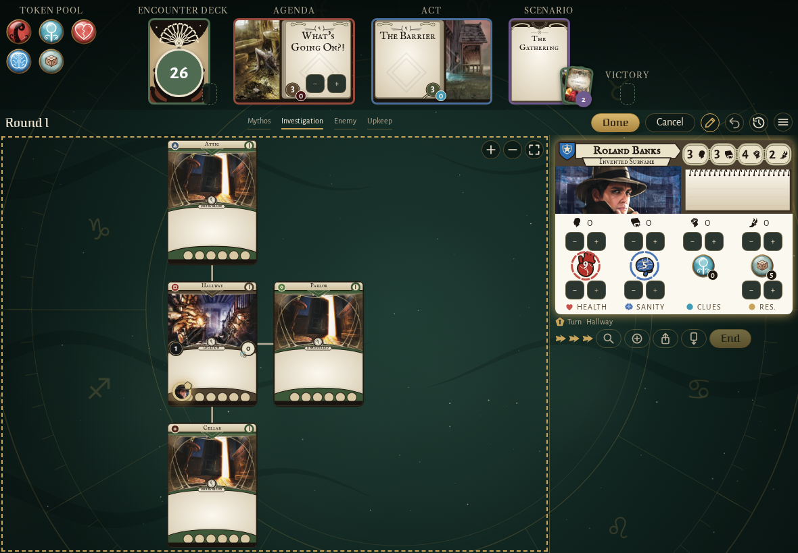

<!-- screencasts:start -->

_Recorded from fd0154a by the PR preview workflow; updated on every push that changes `apps/web`._

## Screenshots

### the house map with Roland Banks in the Hallway

<table>
<tr><th>Desktop</th><th>Phone</th></tr>
<tr><td></td><td></td></tr>
</table>

### Roland Banks with 3 damage and 1 horror: 6 health and 4 sanity left, the pips taken greyed

<table>
<tr><th>Desktop</th><th>Phone</th></tr>
<tr><td></td><td></td></tr>
</table>

### Roland Banks’ whole card in the card pictures style, his counters live on the printed card

<table>
<tr><th>Desktop</th><th>Phone</th></tr>
<tr><td></td><td></td></tr>
</table>

### Roland Banks’ card while the players adjust the board, its steppers out

<table>
<tr><th>Desktop</th><th>Phone</th></tr>
<tr><td></td><td>Not taken: the spec failed, see the E2E check.</td></tr>
</table>

<!-- screencasts:end -->