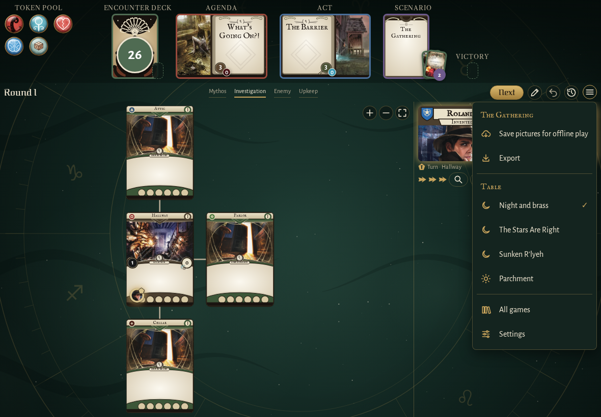
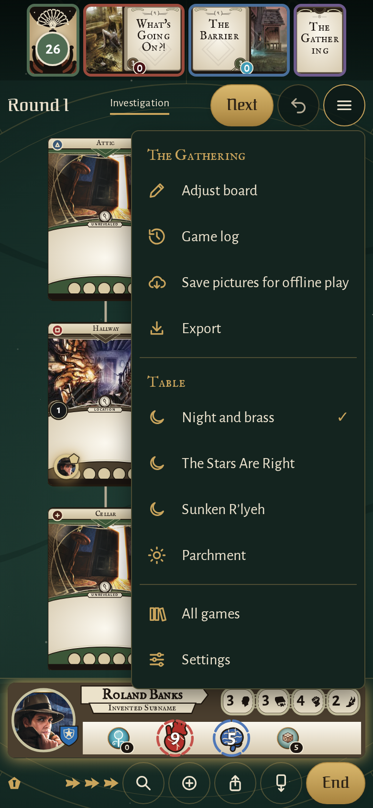
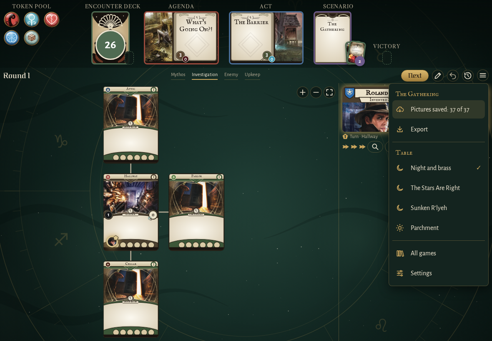
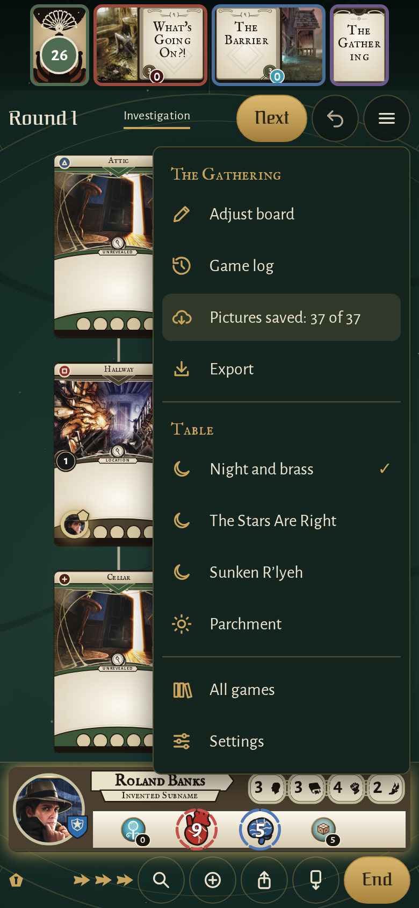

<!-- screencasts:start -->

_Recorded from d6476c7 by the PR preview workflow; updated on every push that changes `apps/web`._

## Screenshots

### the menu open, holding "Adjust board" and the game log on a phone

<table>
<tr><th>Desktop</th><th>Phone</th></tr>
<tr><td></td><td></td></tr>
</table>

### the menu after saving the pictures of the game for offline play

<table>
<tr><th>Desktop</th><th>Phone</th></tr>
<tr><td></td><td></td></tr>
</table>

<!-- screencasts:end -->