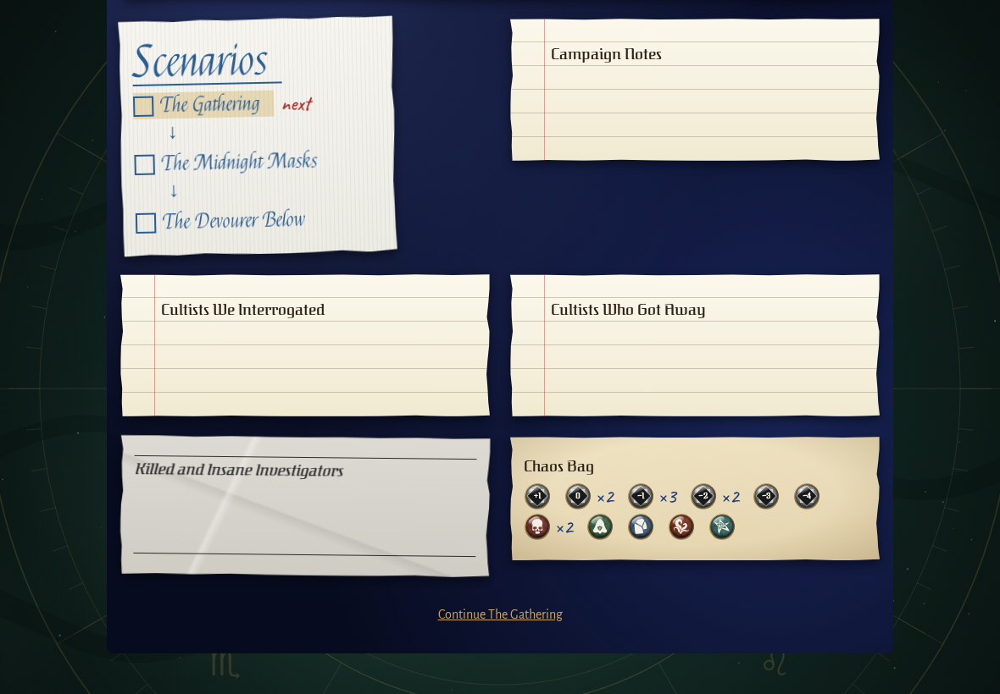
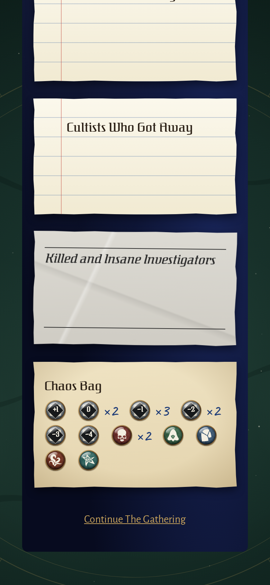
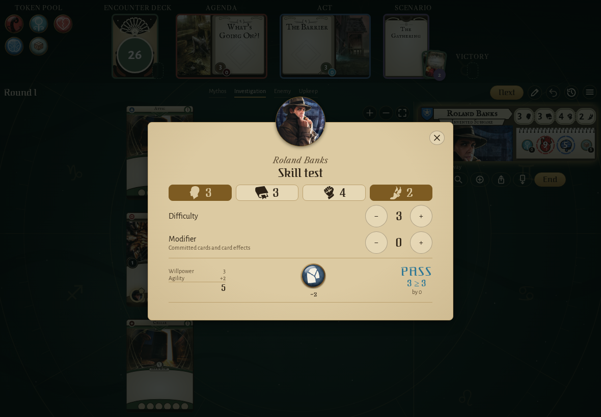
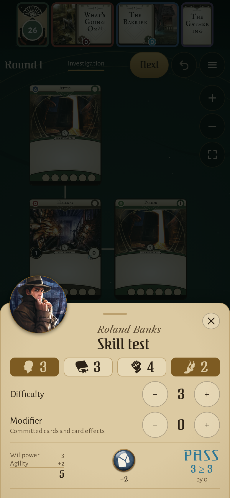
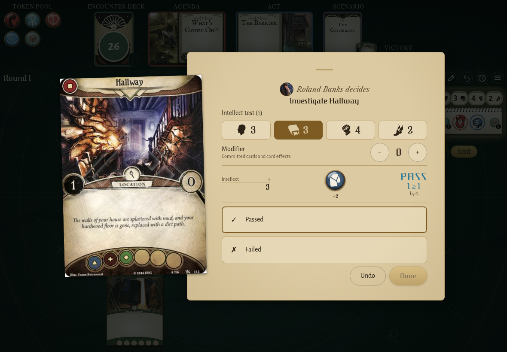
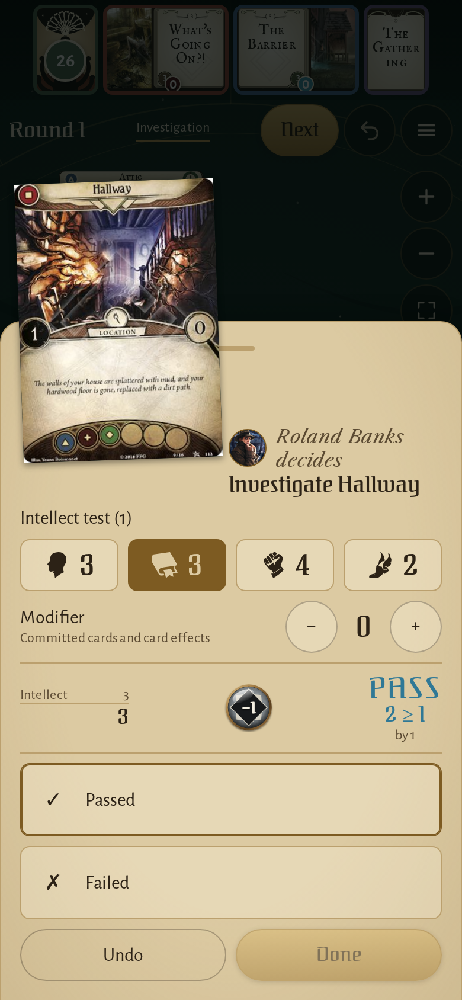
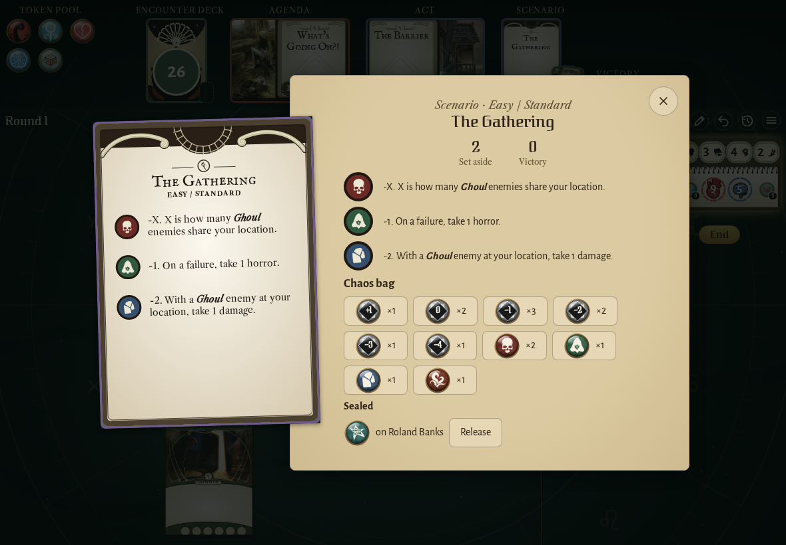
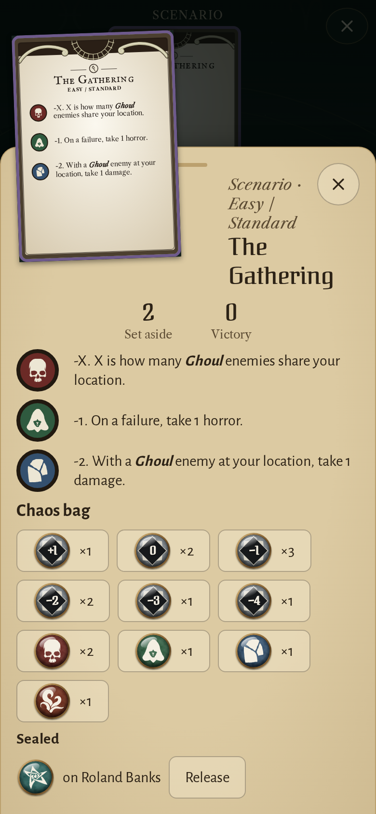
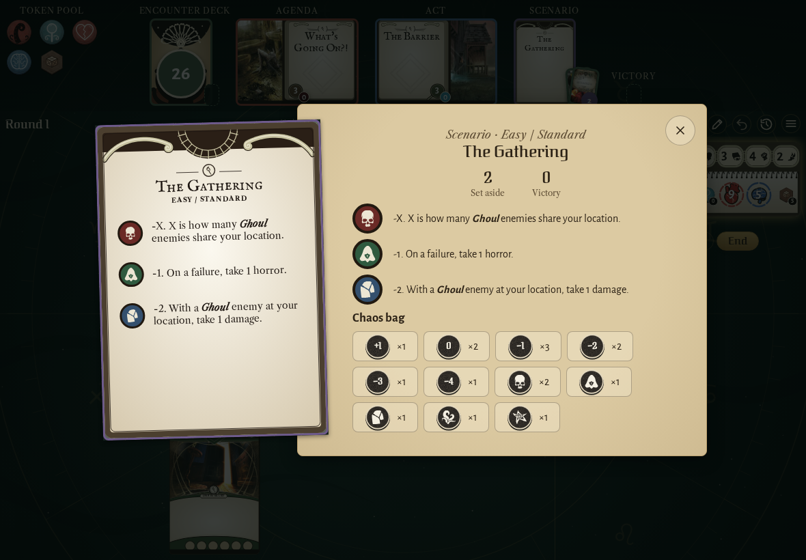
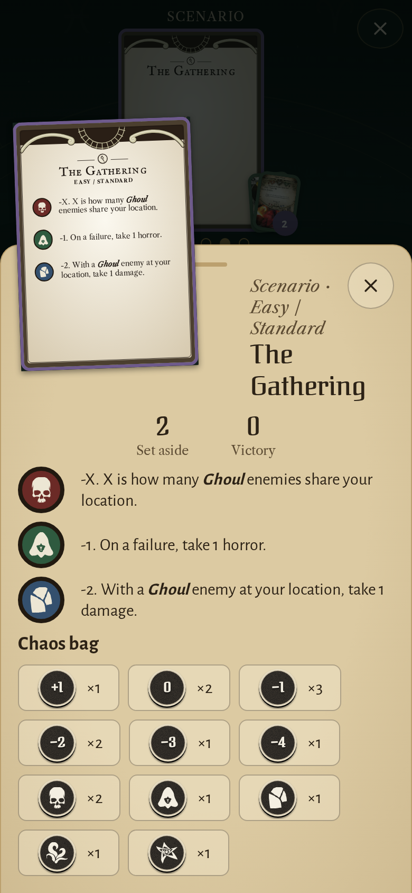

<!-- screencasts:start -->

_Recorded from 560ccf2 by the PR preview workflow; updated on every push that changes `apps/web`._

## Screenshots

### the chaos bag on the log of a campaign just started, its tokens drawn

<table>
<tr><th>Desktop</th><th>Phone</th></tr>
<tr><td></td><td></td></tr>
</table>

### Roland Banks’ willpower and agility test, the tablet drawn with its −2 under it

<table>
<tr><th>Desktop</th><th>Phone</th></tr>
<tr><td></td><td></td></tr>
</table>

### the decision dialog asking for the result of an investigation, a token drawn

<table>
<tr><th>Desktop</th><th>Phone</th></tr>
<tr><td></td><td></td></tr>
</table>

### the chaos bag on the reference card’s page, the elder sign sealed on Roland Banks

<table>
<tr><th>Desktop</th><th>Phone</th></tr>
<tr><td></td><td></td></tr>
</table>

### the chaos bag in the cardboard token set

<table>
<tr><th>Desktop</th><th>Phone</th></tr>
<tr><td></td><td></td></tr>
</table>

<!-- screencasts:end -->