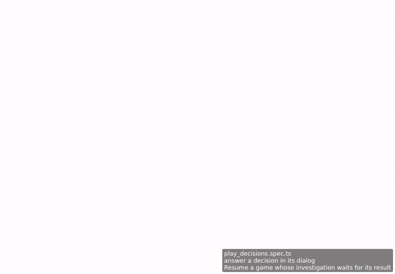
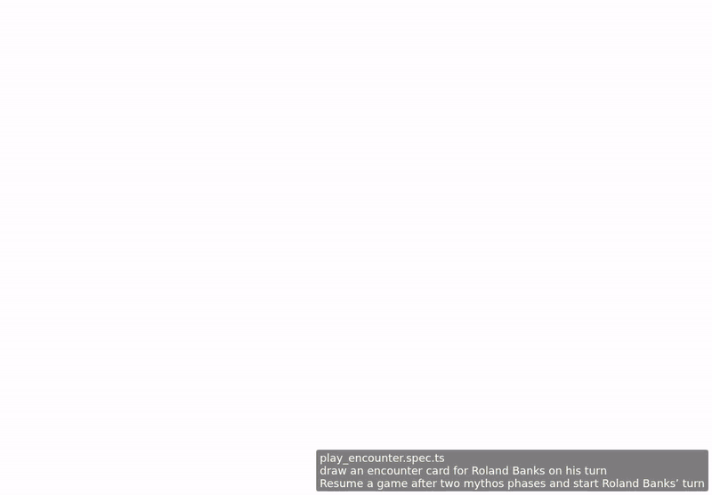

<!-- screencasts:start -->

_Recorded from aad10f0 by the PR preview workflow; updated on every push that changes `apps/web`._

## Screencasts

### answer a decision in its dialog

[Play with pause and speed controls](https://macandy13.github.io/arkham-companion/pr-preview/pr-1114/screencasts/player.html?flow=answer-a-decision-in-its-dialog&v=aad10f0&speed=0.25)

### draw an encounter card for Roland Banks on his turn

[Play with pause and speed controls](https://macandy13.github.io/arkham-companion/pr-preview/pr-1114/screencasts/player.html?flow=draw-an-encounter-card-for-roland-banks-on-his-turn&v=aad10f0&speed=0.25)

<!-- screencasts:end -->