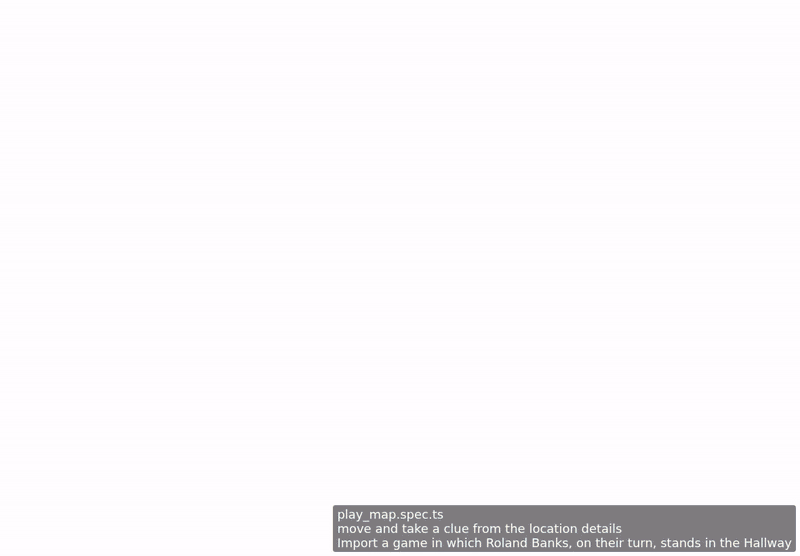

<!-- screencasts:start -->

_Recorded from 8a3bc19 by the PR preview workflow; updated on every push that changes `apps/web`._

## Screencasts

### move on the map

[Play with pause and speed controls](https://macandy13.github.io/arkham-companion/pr-preview/pr-1121/screencasts/player.html?flow=move-on-the-map&v=8a3bc19&speed=0.25)

### move an enemy on the map

_Not recorded: the flow failed, see the E2E check._

### move and take a clue from the location details

[Play with pause and speed controls](https://macandy13.github.io/arkham-companion/pr-preview/pr-1121/screencasts/player.html?flow=move-and-take-a-clue-from-the-location-details&v=8a3bc19&speed=0.25)

<!-- screencasts:end -->