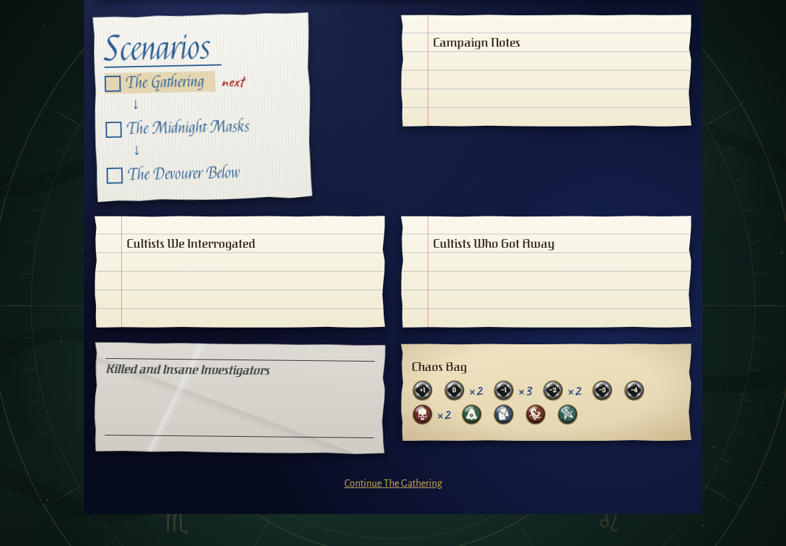
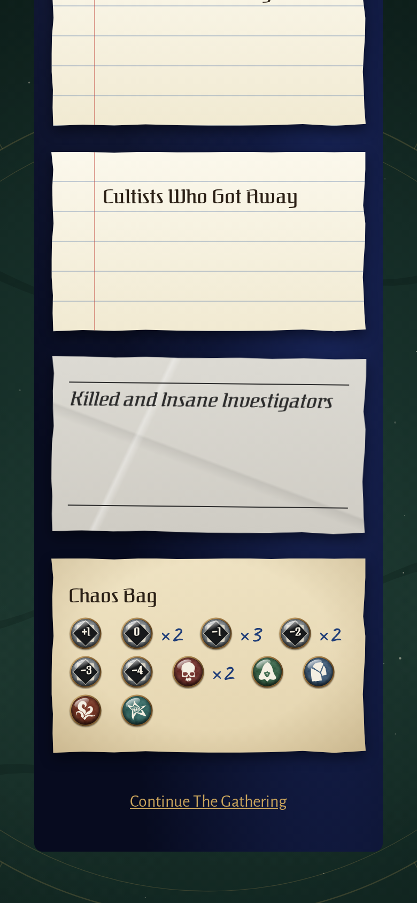
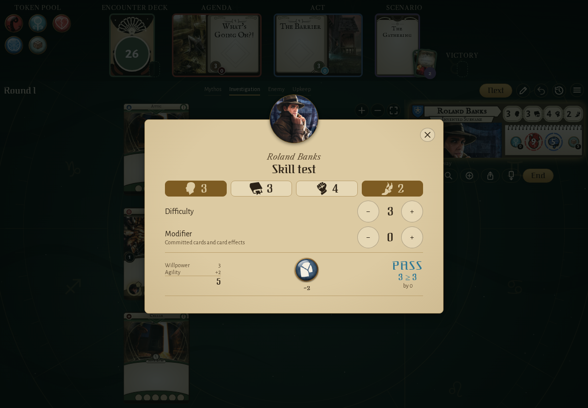
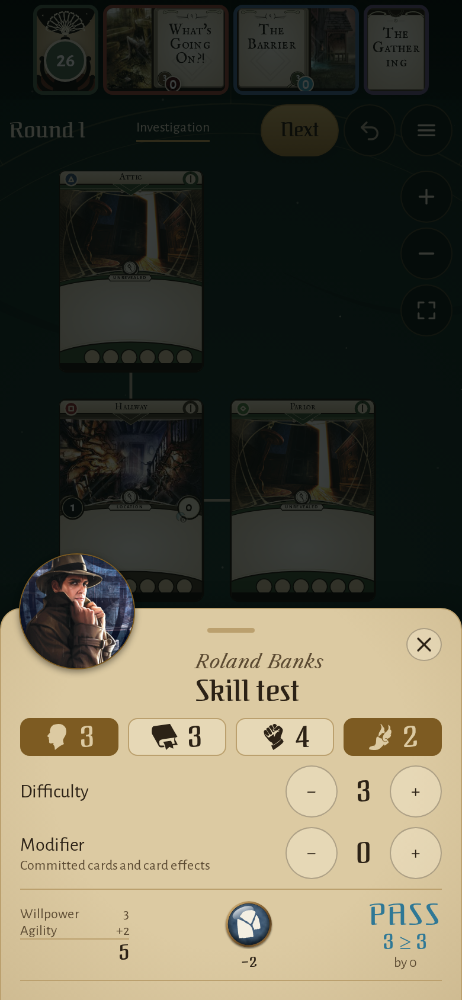
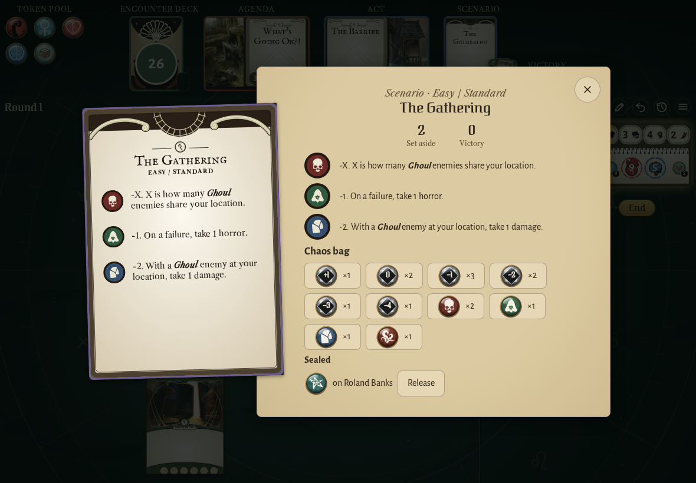
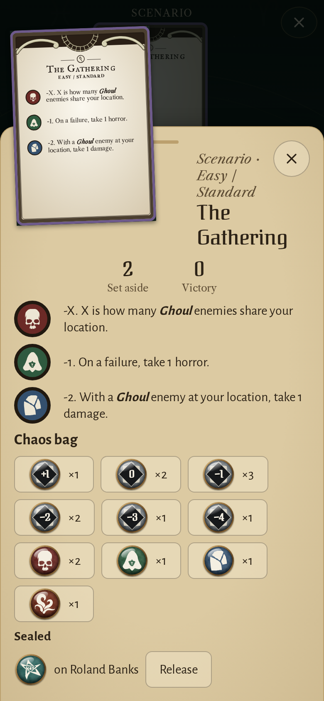
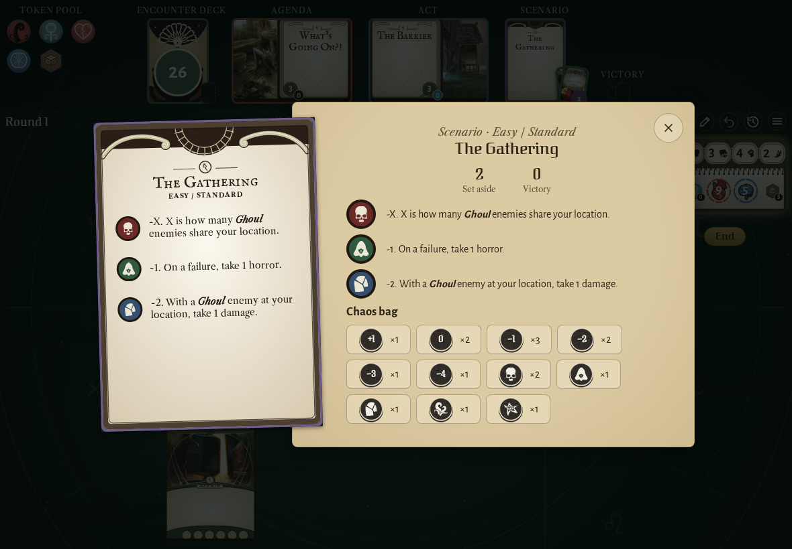
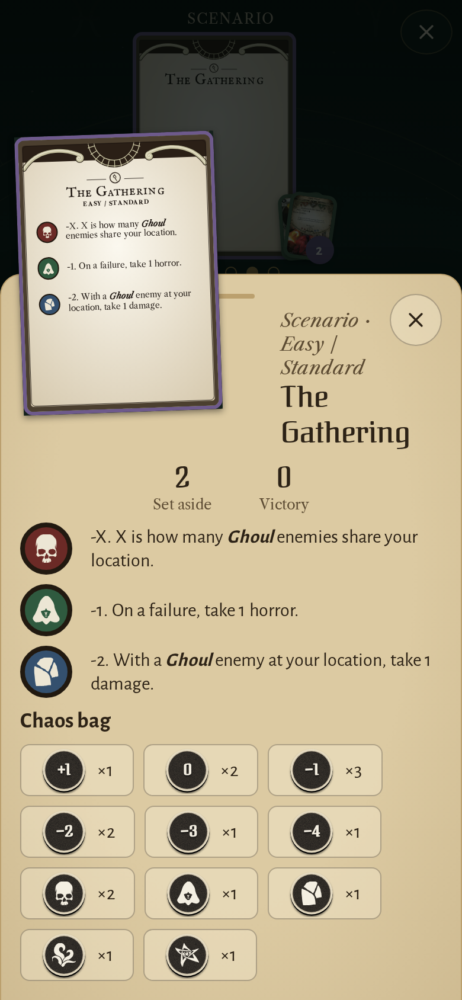
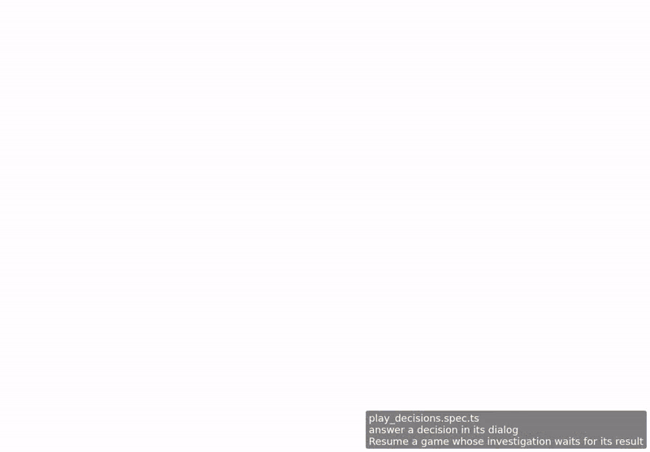

<!-- screencasts:start -->

_Recorded from ddff293 by the PR preview workflow; updated on every push that changes `apps/web`._

## Screenshots

### the chaos bag on the log of a campaign just started, its tokens drawn

<table>
<tr><th>Desktop</th><th>Phone</th></tr>
<tr><td></td><td></td></tr>
</table>

### Roland Banks’ willpower and agility test, the tablet drawn with its −2 under it

<table>
<tr><th>Desktop</th><th>Phone</th></tr>
<tr><td></td><td></td></tr>
</table>

### the decision dialog asking for the result of an investigation, a token drawn

<table>
<tr><th>Desktop</th><th>Phone</th></tr>
<tr><td></td><td></td></tr>
</table>

### the chaos bag on the reference card’s page, the elder sign sealed on Roland Banks

<table>
<tr><th>Desktop</th><th>Phone</th></tr>
<tr><td></td><td></td></tr>
</table>

### the chaos bag in the cardboard token set

<table>
<tr><th>Desktop</th><th>Phone</th></tr>
<tr><td></td><td></td></tr>
</table>

## Screencasts

### answer a decision in its dialog

[Play with pause and speed controls](https://macandy13.github.io/arkham-companion/pr-preview/pr-1123/screencasts/player.html?flow=answer-a-decision-in-its-dialog&v=ddff293&speed=0.25)

### draw an encounter card for Roland Banks on his turn

[Play with pause and speed controls](https://macandy13.github.io/arkham-companion/pr-preview/pr-1123/screencasts/player.html?flow=draw-an-encounter-card-for-roland-banks-on-his-turn&v=ddff293&speed=0.25)

<!-- screencasts:end -->