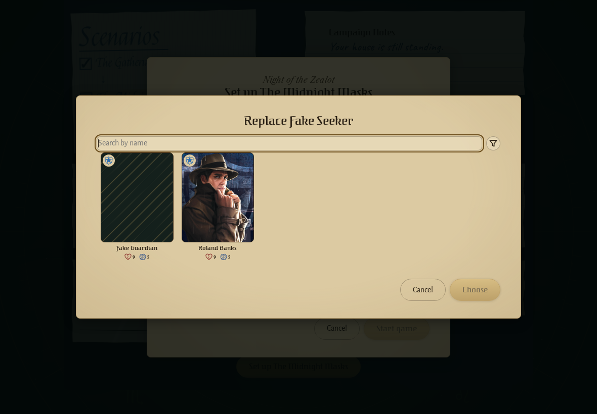
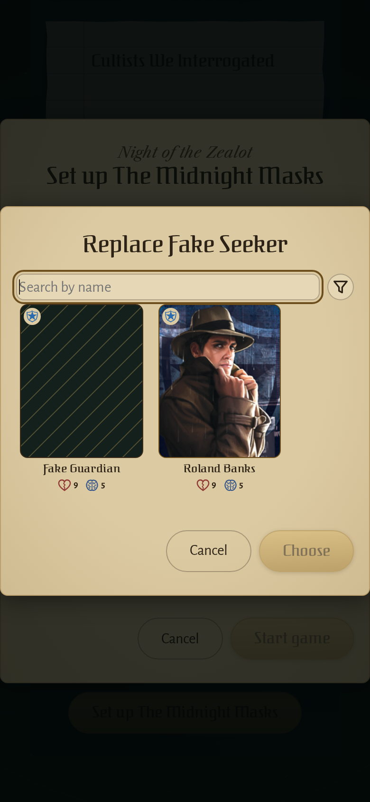
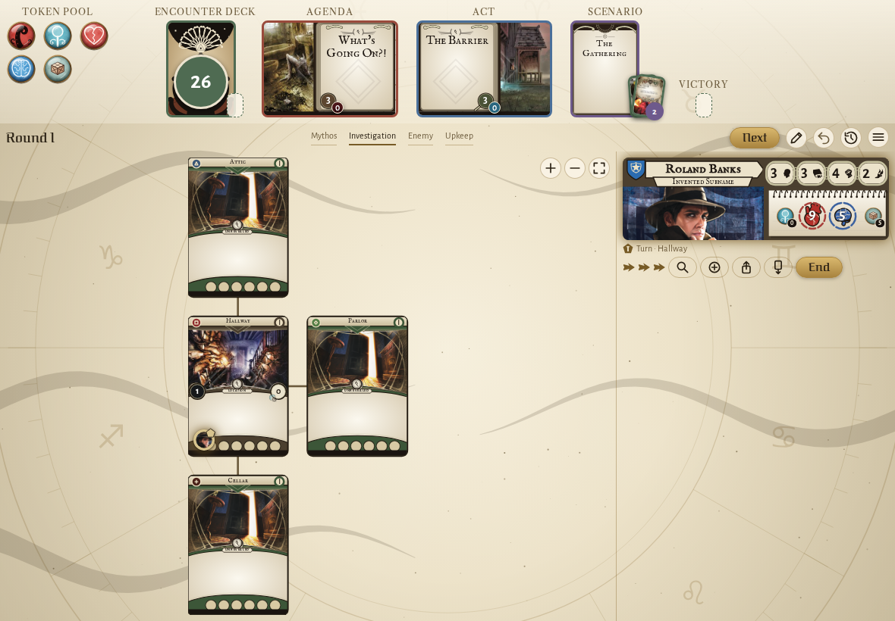
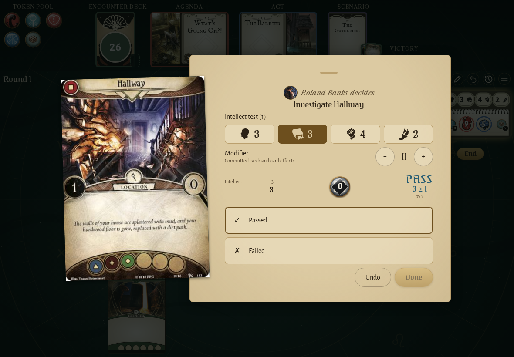
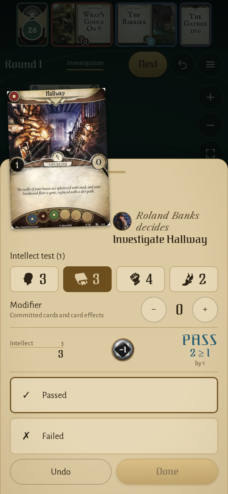
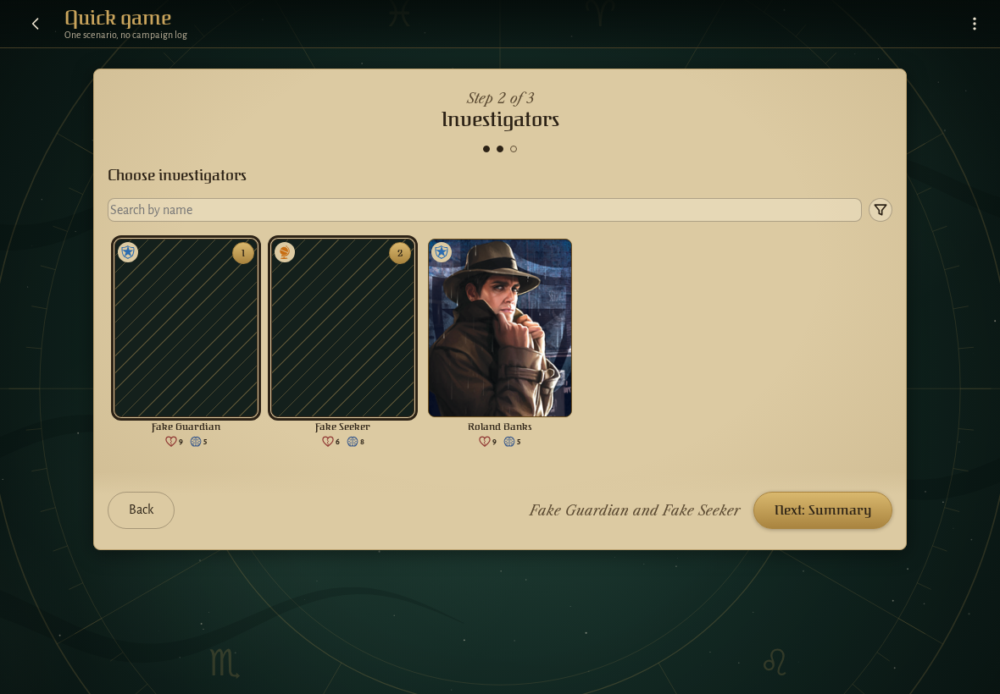
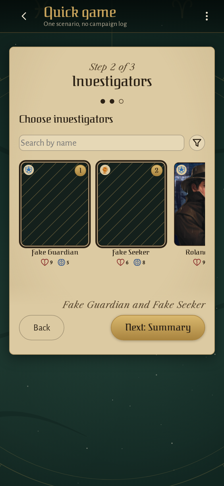
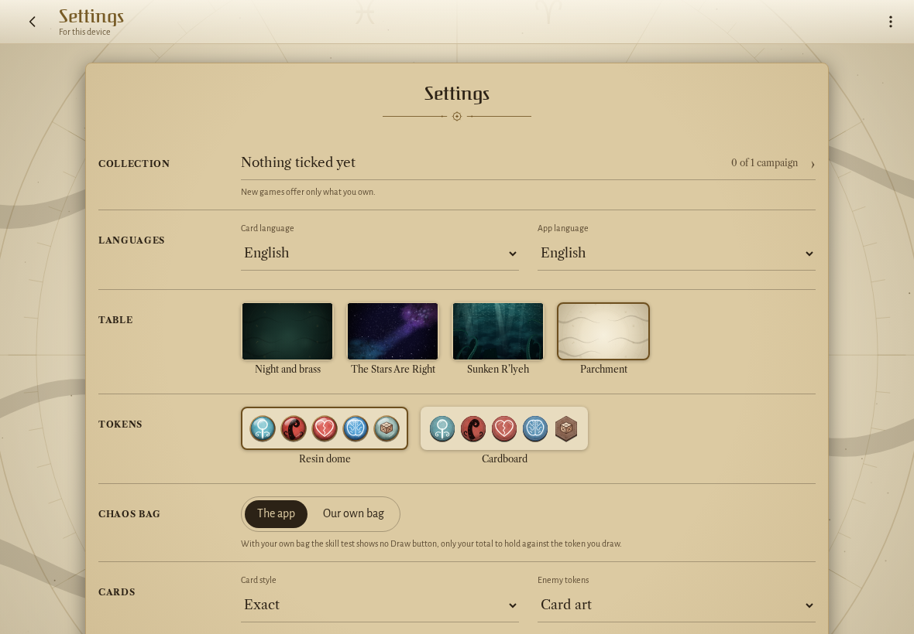
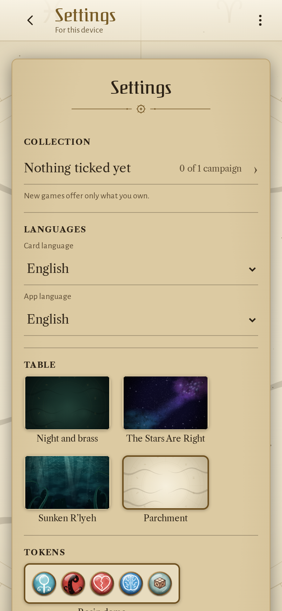

<!-- screencasts:start -->

_Recorded from c24ccb6 by the PR preview workflow; updated on every push that changes `apps/web`._

## Screenshots

### the replacement picker for the killed Fake Seeker

<table>
<tr><th>Desktop</th><th>Phone</th></tr>
<tr><td></td><td></td></tr>
</table>

### the house map on the parchment table

<table>
<tr><th>Desktop</th><th>Phone</th></tr>
<tr><td></td><td></td></tr>
</table>

### the decision dialog asking for the result of an investigation, a token drawn

<table>
<tr><th>Desktop</th><th>Phone</th></tr>
<tr><td></td><td></td></tr>
</table>

### the investigators step with two picked, their names pinned beside the next step

<table>
<tr><th>Desktop</th><th>Phone</th></tr>
<tr><td></td><td></td></tr>
</table>

### the settings on the parchment table

<table>
<tr><th>Desktop</th><th>Phone</th></tr>
<tr><td></td><td></td></tr>
</table>

## Screencasts

### start a new game

[Play with pause and speed controls](https://macandy13.github.io/arkham-companion/pr-preview/pr-1123/screencasts/player.html?flow=start-a-new-game&v=c24ccb6&speed=0.25)

<!-- screencasts:end -->