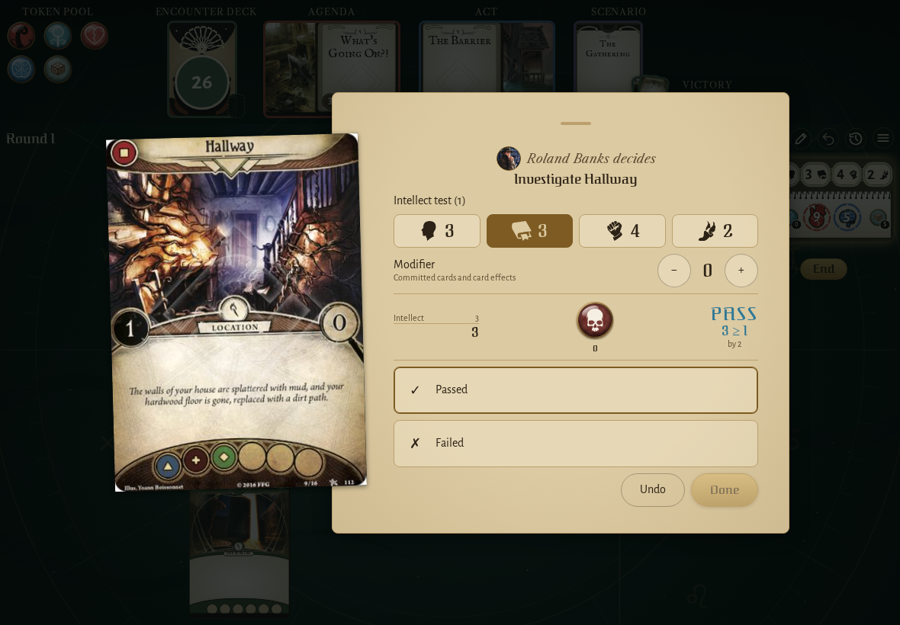
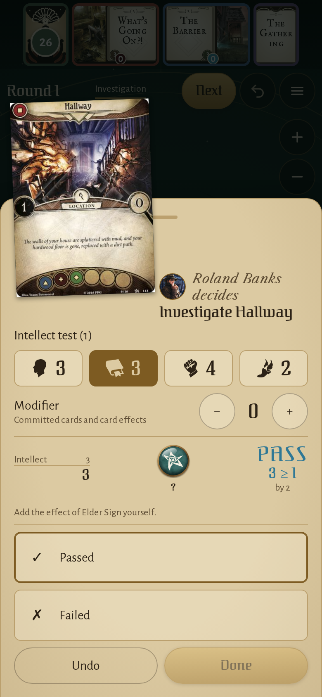
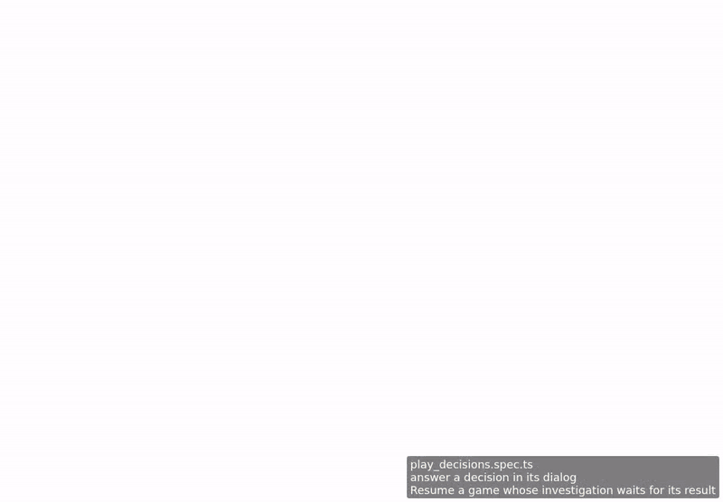

<!-- screencasts:start -->

_Recorded from 9b2b786 by the PR preview workflow; updated on every push that changes `apps/web`._

## Screenshots

### the decision dialog asking for the result of an investigation, a token drawn

<table>
<tr><th>Desktop</th><th>Phone</th></tr>
<tr><td></td><td></td></tr>
</table>

## Screencasts

### answer a decision in its dialog

[Play with pause and speed controls](https://macandy13.github.io/arkham-companion/pr-preview/pr-1124/screencasts/player.html?flow=answer-a-decision-in-its-dialog&v=9b2b786&speed=0.25)

<!-- screencasts:end -->