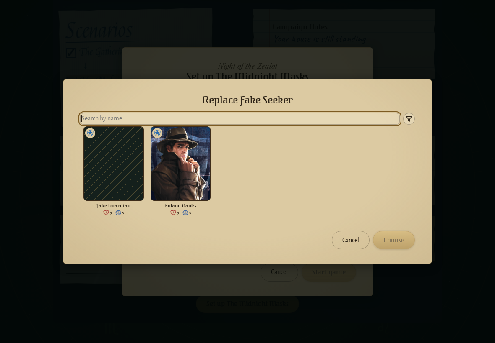
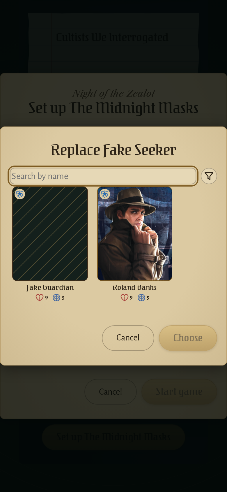
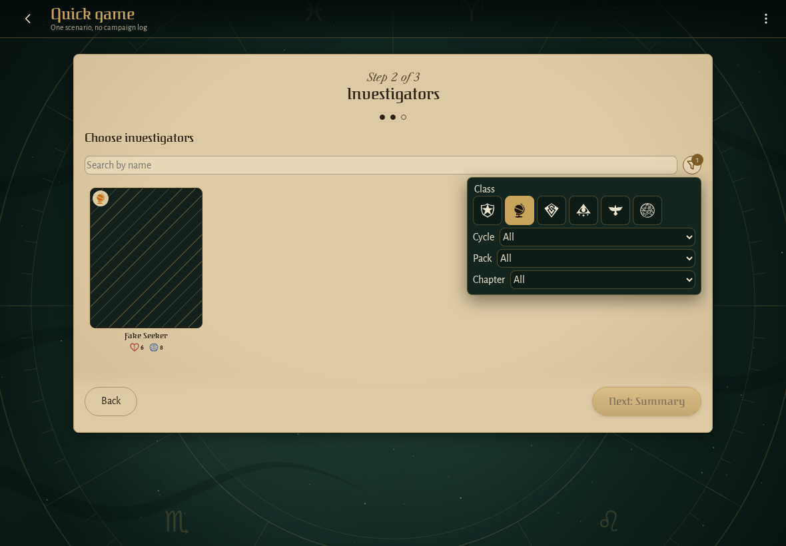
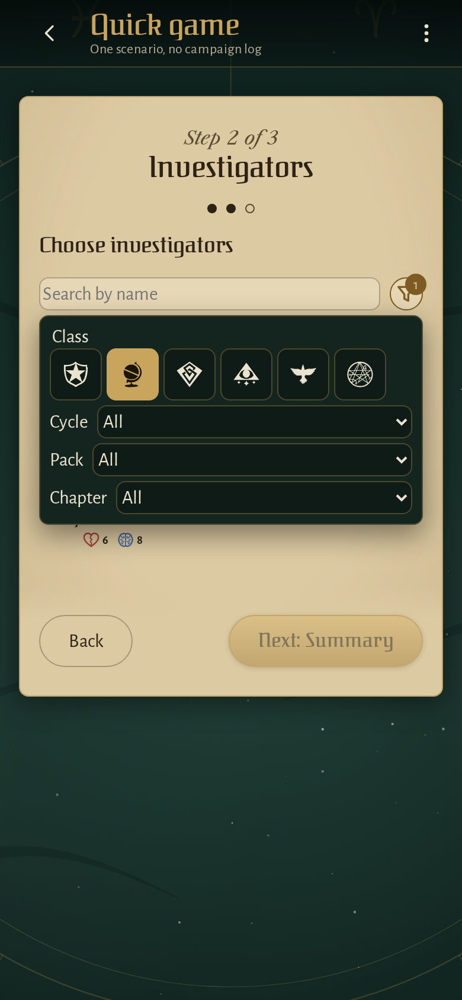
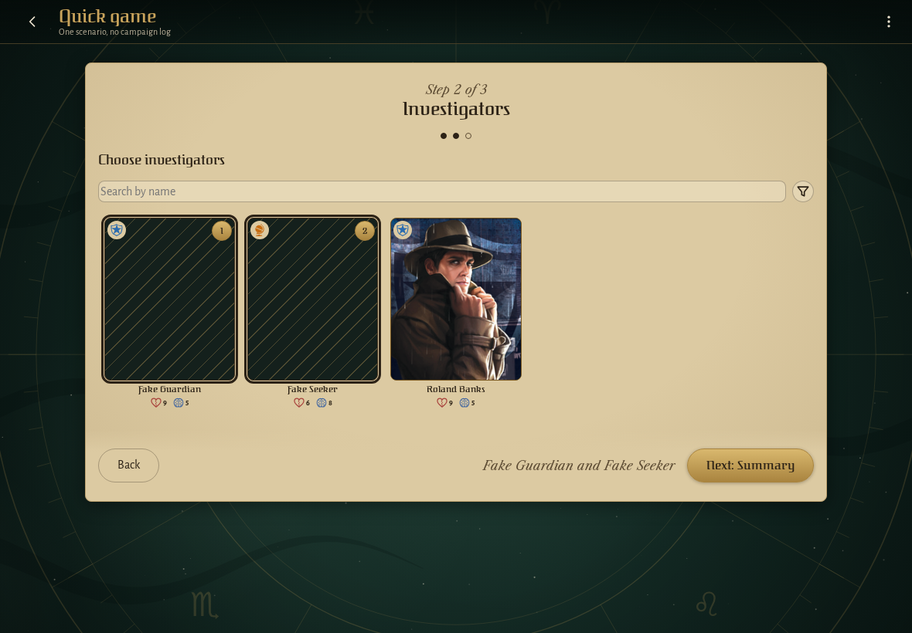
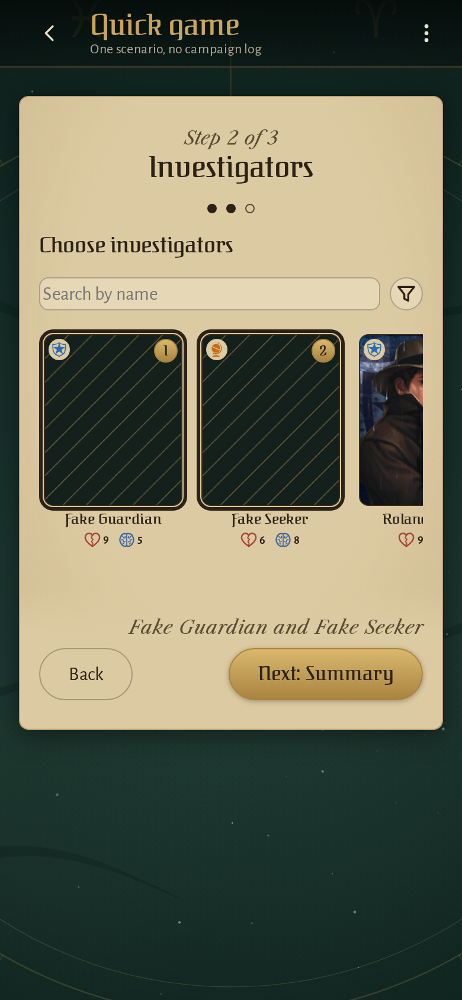
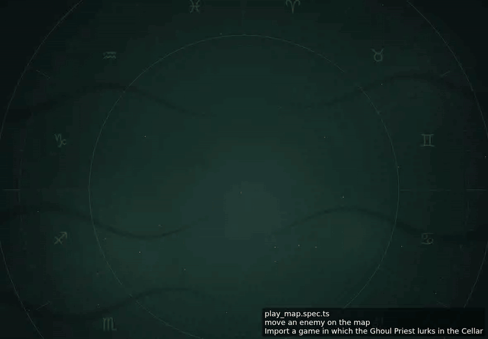

<!-- screencasts:start -->

_Recorded from fb8ffb3 by the PR preview workflow; updated on every push that changes `apps/web`._

## Screenshots

### the replacement picker for the killed Fake Seeker

<table>
<tr><th>Desktop</th><th>Phone</th></tr>
<tr><td></td><td></td></tr>
</table>

### the investigator picker with its filter menu open

<table>
<tr><th>Desktop</th><th>Phone</th></tr>
<tr><td></td><td></td></tr>
</table>

### the investigators step with two picked, their names pinned beside the next step

<table>
<tr><th>Desktop</th><th>Phone</th></tr>
<tr><td></td><td></td></tr>
</table>

## Screencasts

### start a new game

[Play with pause and speed controls](https://macandy13.github.io/arkham-companion/pr-preview/pr-1125/screencasts/player.html?flow=start-a-new-game&v=fb8ffb3&speed=0.25)

### move an enemy on the map

[Play with pause and speed controls](https://macandy13.github.io/arkham-companion/pr-preview/pr-1125/screencasts/player.html?flow=move-an-enemy-on-the-map&v=fb8ffb3&speed=0.25)

### move and take a clue from the location details

[Play with pause and speed controls](https://macandy13.github.io/arkham-companion/pr-preview/pr-1125/screencasts/player.html?flow=move-and-take-a-clue-from-the-location-details&v=fb8ffb3&speed=0.25)

<!-- screencasts:end -->