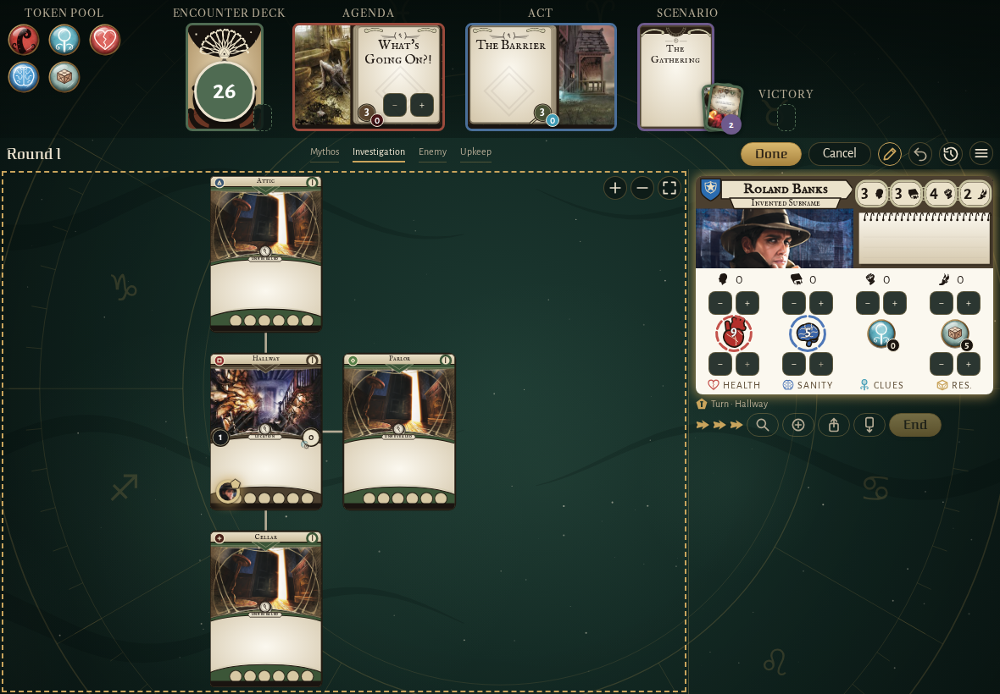
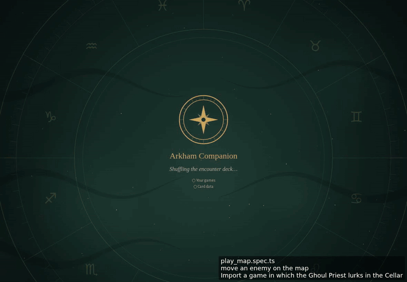
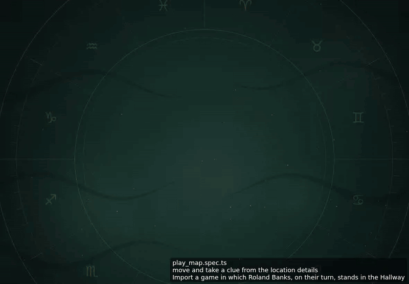

<!-- screencasts:start -->

_Recorded from d6f6de0 by the PR preview workflow; updated on every push that changes `apps/web`._

## Screenshots

### Roland Banks’ card while the players adjust the board, its steppers out

<table>
<tr><th>Desktop</th><th>Phone</th></tr>
<tr><td></td><td>Not taken: the spec failed, see the E2E check.</td></tr>
</table>

## Screencasts

### move an enemy on the map

[Play with pause and speed controls](https://macandy13.github.io/arkham-companion/pr-preview/pr-1128/screencasts/player.html?flow=move-an-enemy-on-the-map&v=d6f6de0&speed=0.25)

### move and take a clue from the location details

[Play with pause and speed controls](https://macandy13.github.io/arkham-companion/pr-preview/pr-1128/screencasts/player.html?flow=move-and-take-a-clue-from-the-location-details&v=d6f6de0&speed=0.25)

<!-- screencasts:end -->