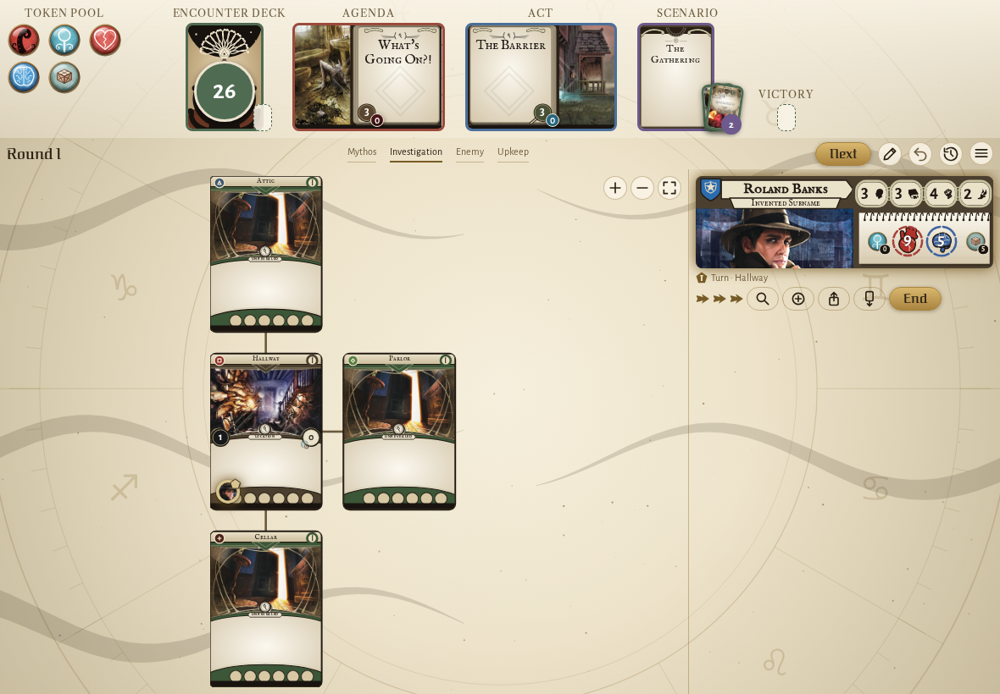
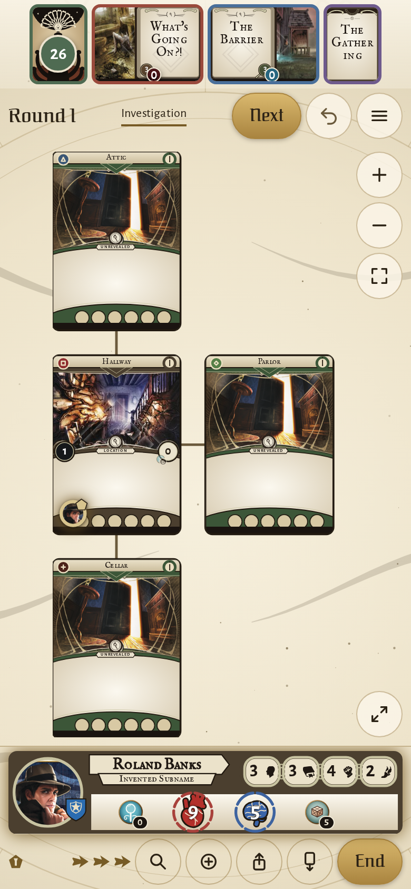
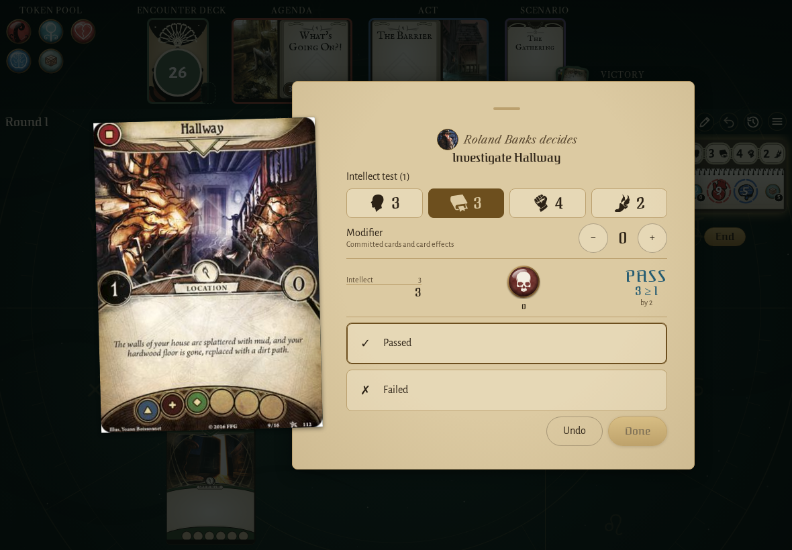
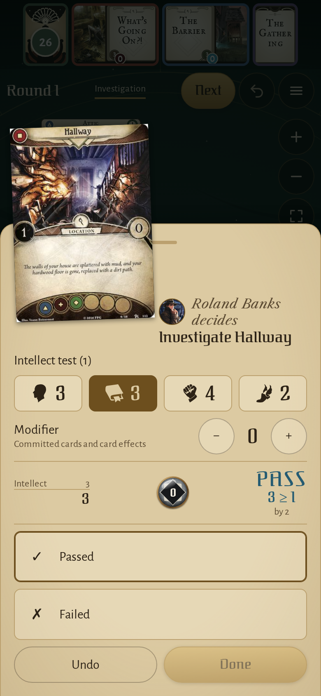
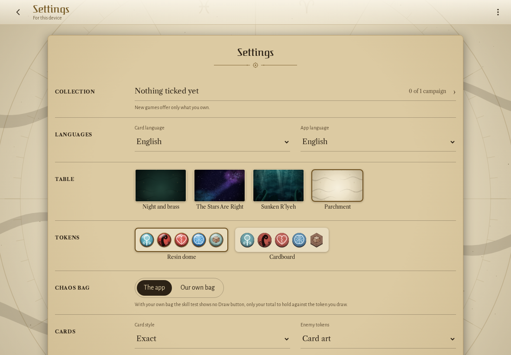
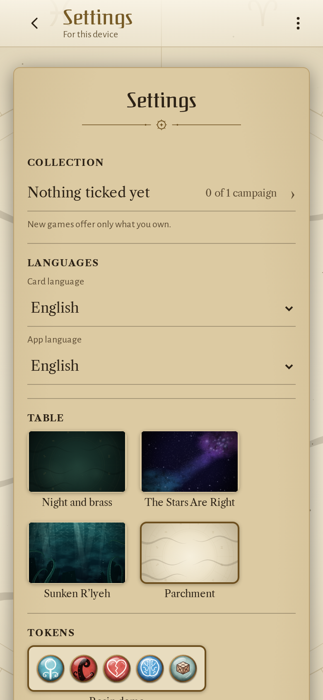

<!-- screencasts:start -->

_Recorded from cdfab5a by the PR preview workflow; updated on every push that changes `apps/web`._

## Screenshots

### the house map on the parchment table

<table>
<tr><th>Desktop</th><th>Phone</th></tr>
<tr><td></td><td></td></tr>
</table>

### the decision dialog asking for the result of an investigation, a token drawn

<table>
<tr><th>Desktop</th><th>Phone</th></tr>
<tr><td></td><td></td></tr>
</table>

### the settings on the parchment table

<table>
<tr><th>Desktop</th><th>Phone</th></tr>
<tr><td></td><td></td></tr>
</table>

<!-- screencasts:end -->