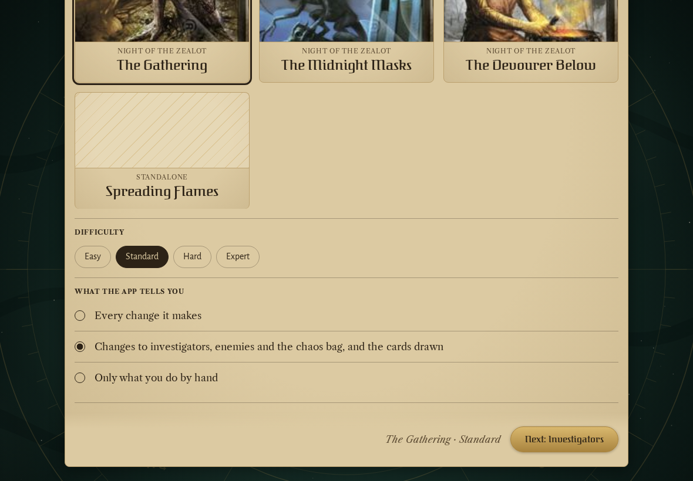
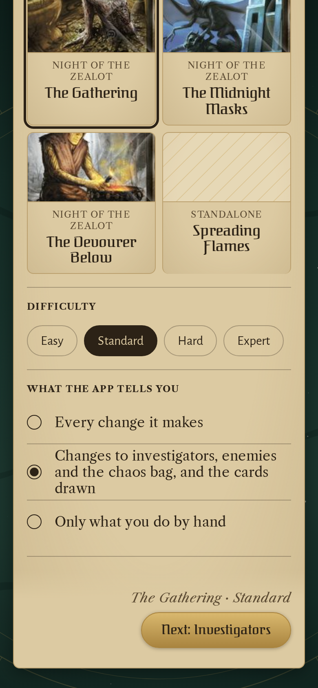
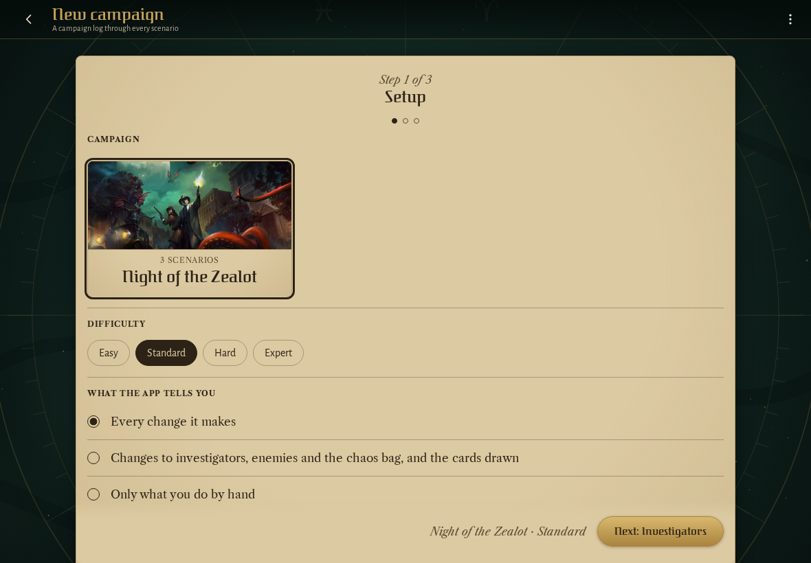
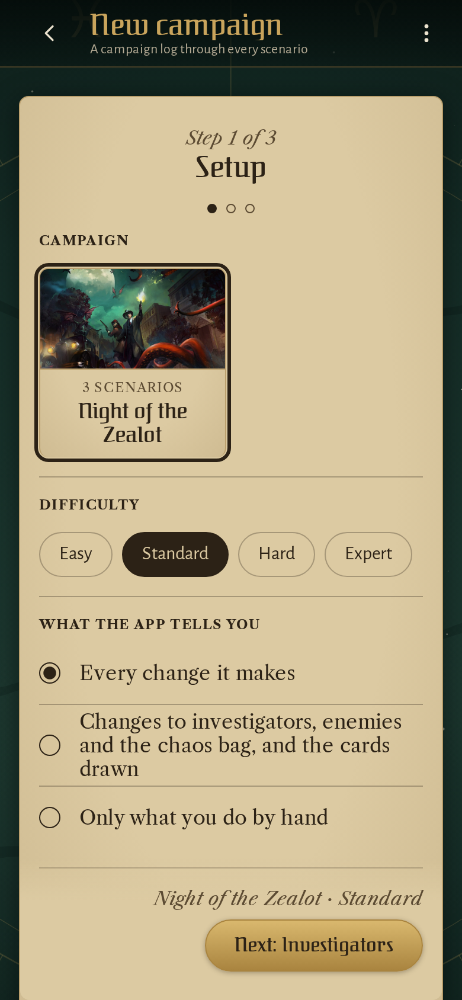

<!-- screencasts:start -->

_Recorded from 66e96be by the PR preview workflow; updated on every push that changes `apps/web`._

## Screenshots

### a quick game's setup step: the scenario, the difficulty and what the app tells the players

<table>
<tr><th>Desktop</th><th>Phone</th></tr>
<tr><td></td><td></td></tr>
</table>

### a new campaign's setup step: Night of the Zealot's cover with its key art

<table>
<tr><th>Desktop</th><th>Phone</th></tr>
<tr><td></td><td></td></tr>
</table>

<!-- screencasts:end -->