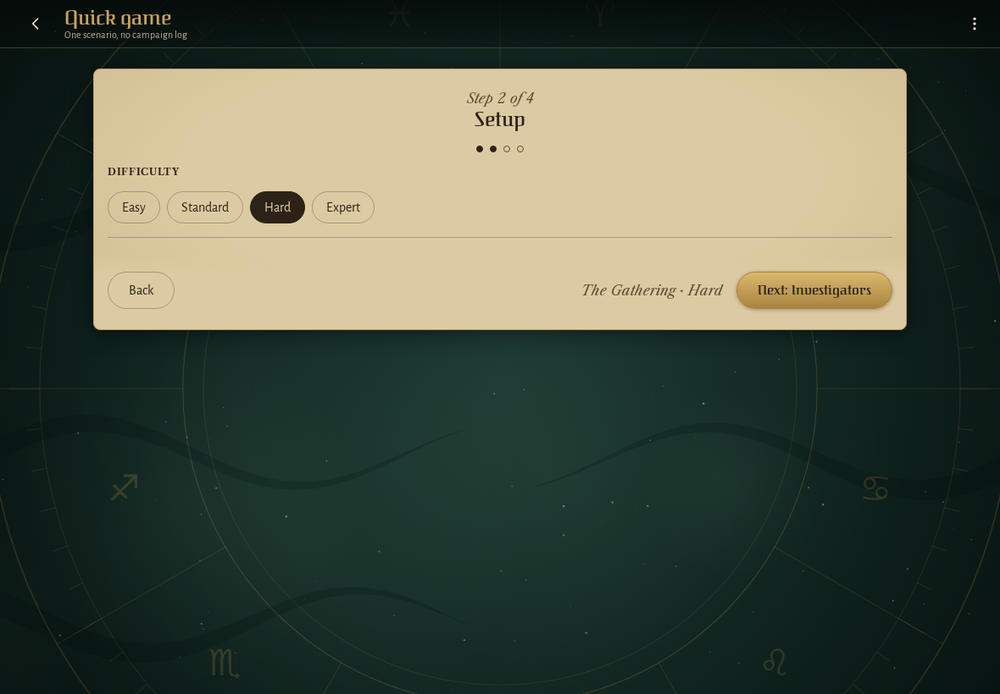
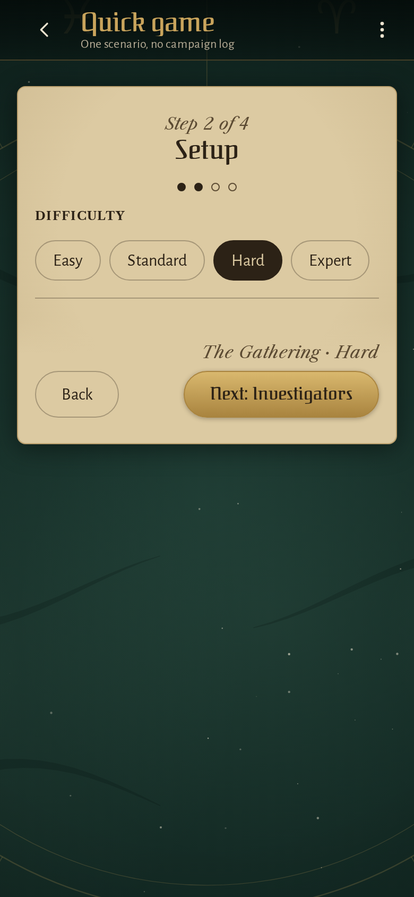
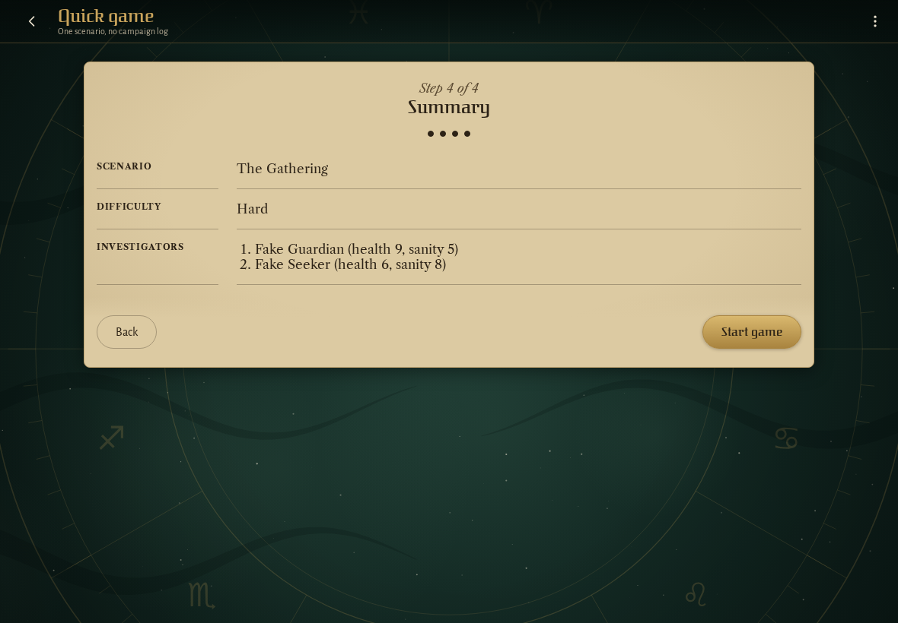
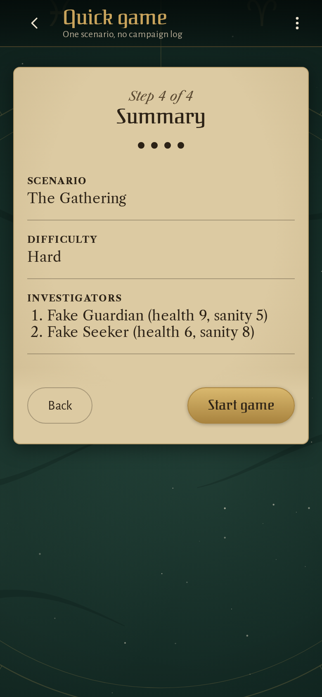
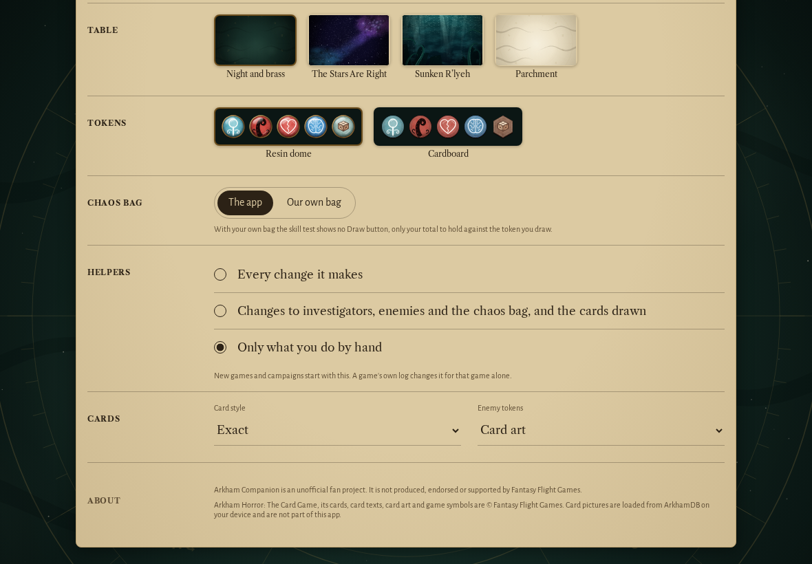
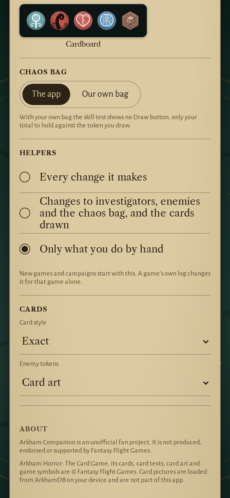

<!-- screencasts:start -->

_Recorded from 3322973 by the PR preview workflow; updated on every push that changes `apps/web`._

## Screenshots

### a quick game's setup step after the scenario: only the difficulty

<table>
<tr><th>Desktop</th><th>Phone</th></tr>
<tr><td></td><td></td></tr>
</table>

### the summary of a quick game with two investigators

<table>
<tr><th>Desktop</th><th>Phone</th></tr>
<tr><td></td><td></td></tr>
</table>

### the settings telling the players only what they do by hand

<table>
<tr><th>Desktop</th><th>Phone</th></tr>
<tr><td></td><td></td></tr>
</table>

## Screencasts

### start a new game

[Play with pause and speed controls](https://macandy13.github.io/arkham-companion/pr-preview/pr-1153/screencasts/player.html?flow=start-a-new-game&v=3322973&speed=0.25)

<!-- screencasts:end -->