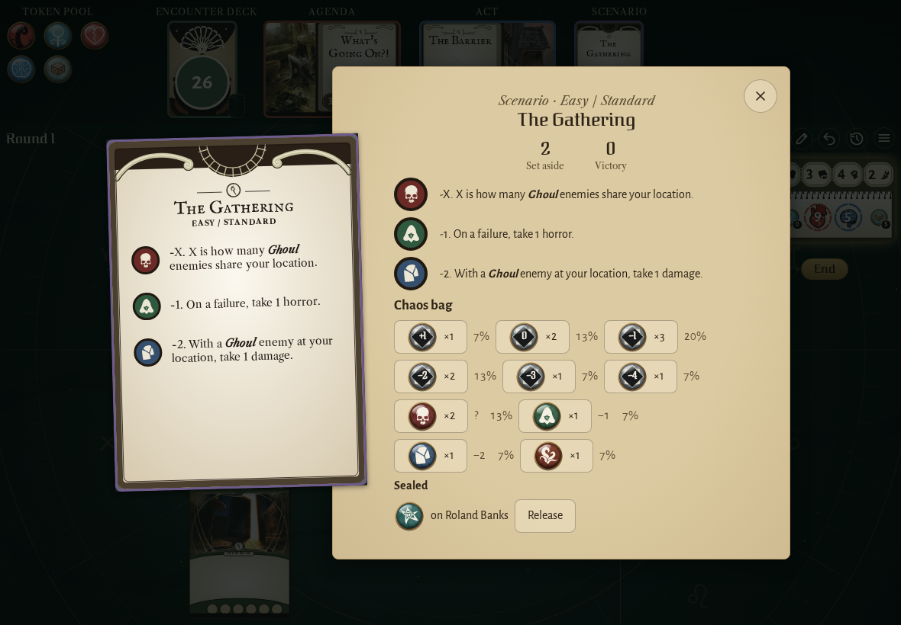
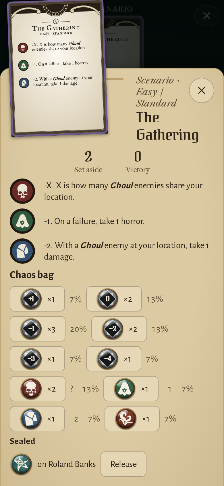
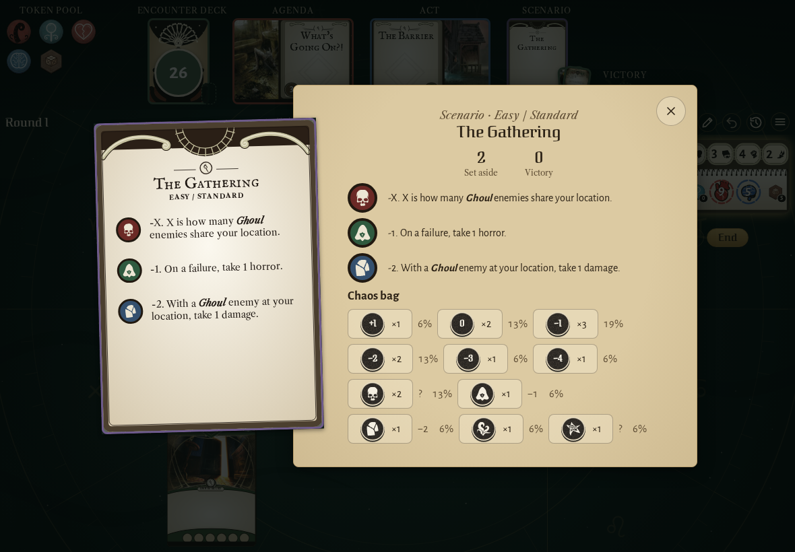
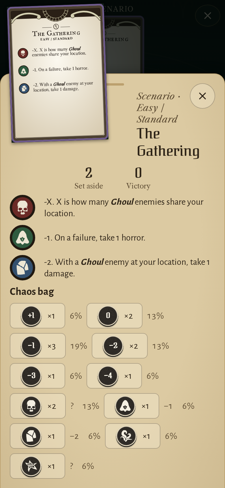

<!-- screencasts:start -->

_Recorded from 2dcb9ee by the PR preview workflow; updated on every push that changes `apps/web`._

## Screenshots

### the chaos bag on the reference card’s page, the elder sign sealed on Roland Banks

<table>
<tr><th>Desktop</th><th>Phone</th></tr>
<tr><td></td><td></td></tr>
</table>

### the chaos bag in the cardboard token set

<table>
<tr><th>Desktop</th><th>Phone</th></tr>
<tr><td></td><td></td></tr>
</table>

<!-- screencasts:end -->