<!-- screencasts:start -->

_Recorded from ee0916b by the PR preview workflow; updated on every push that changes `apps/web`._

## Screenshots

### Roland Banks’ willpower test before a token is drawn, the draw button in its place

<table>
<tr><th>Desktop</th><th>Phone</th></tr>
<tr><td>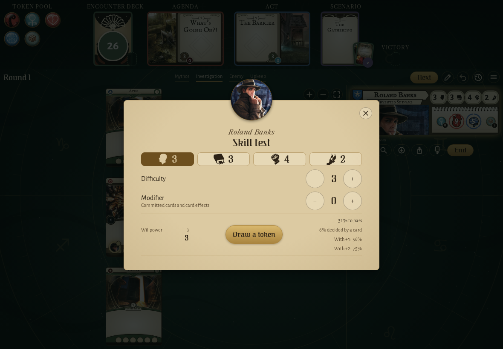</td><td>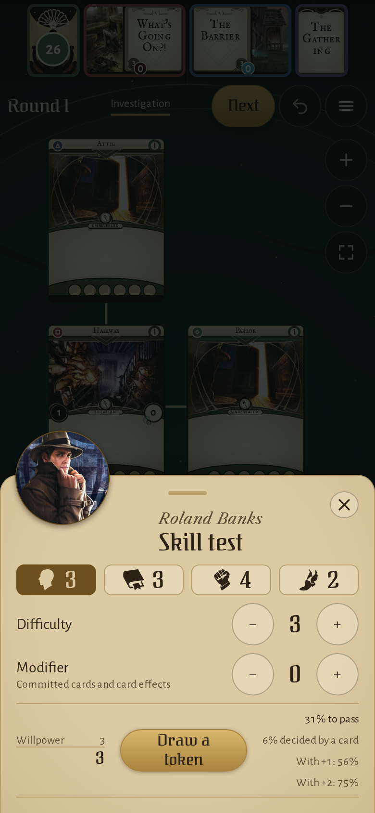</td></tr>
</table>

### Roland Banks’ willpower test with the group’s own chaos bag, no draw button

<table>
<tr><th>Desktop</th><th>Phone</th></tr>
<tr><td>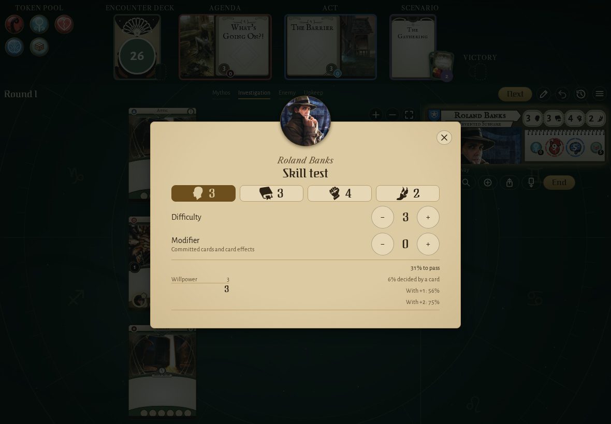</td><td>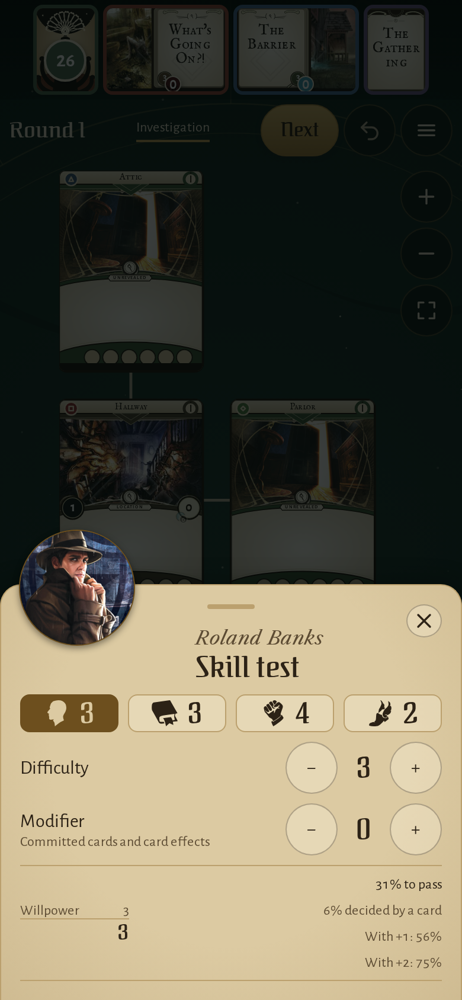</td></tr>
</table>

### Roland Banks' fight against the Ghoul Priest, the damage raised to 2

<table>
<tr><th>Desktop</th><th>Phone</th></tr>
<tr><td>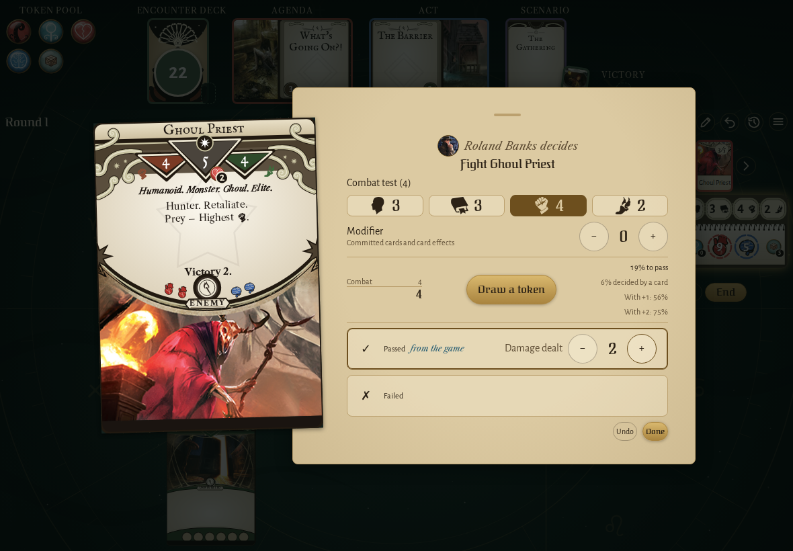</td><td>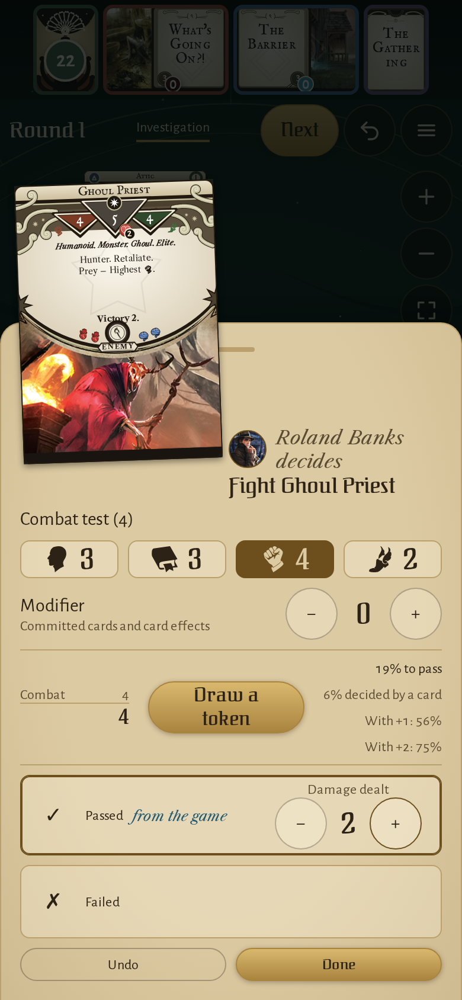</td></tr>
</table>

### Crypt Chill drawn for Roland Banks, its willpower test waiting

<table>
<tr><th>Desktop</th><th>Phone</th></tr>
<tr><td>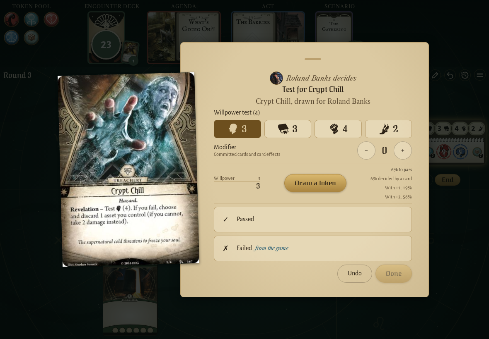</td><td>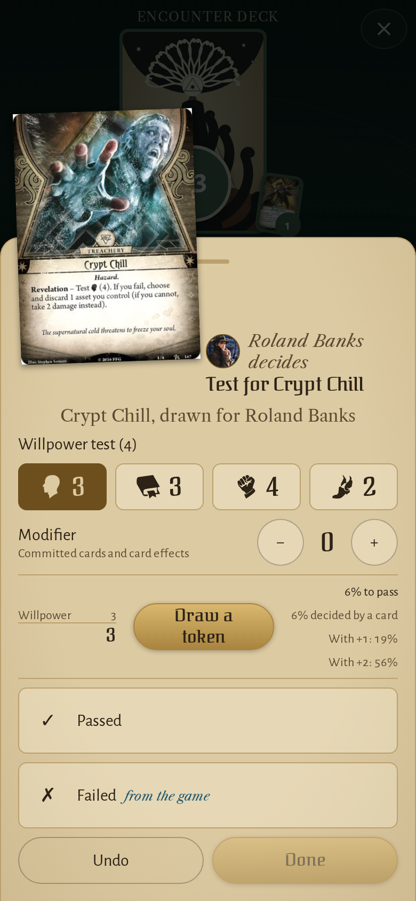</td></tr>
</table>

### Grasping Hands failed by 2 with no token drawn in the app, its margin of failure on the Failed row

<table>
<tr><th>Desktop</th><th>Phone</th></tr>
<tr><td>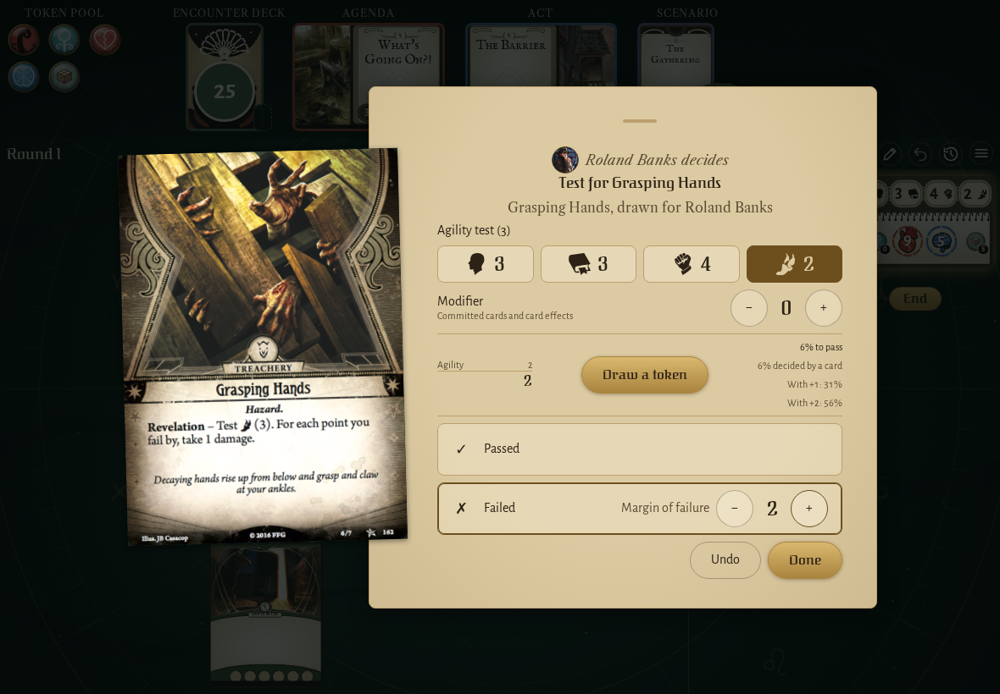</td><td>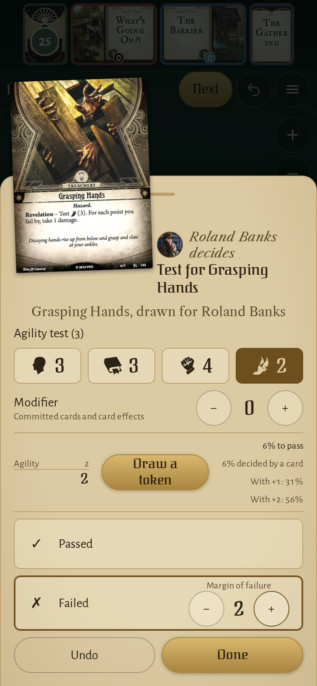</td></tr>
</table>

### the Graveyard’s failed willpower test, its choice under the Failed row

<table>
<tr><th>Desktop</th><th>Phone</th></tr>
<tr><td>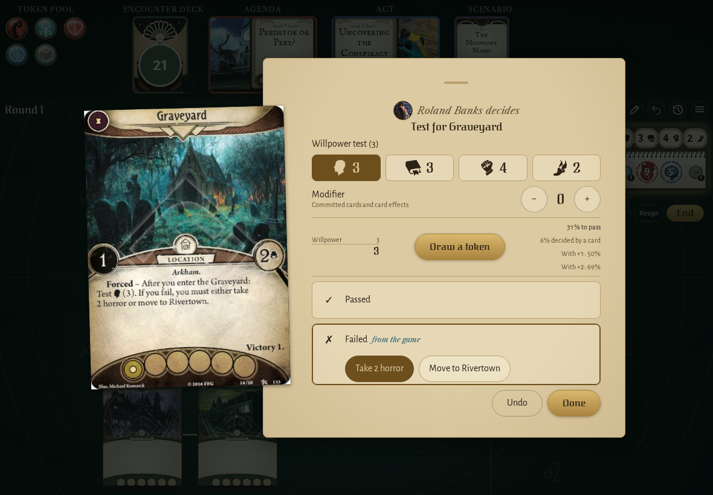</td><td>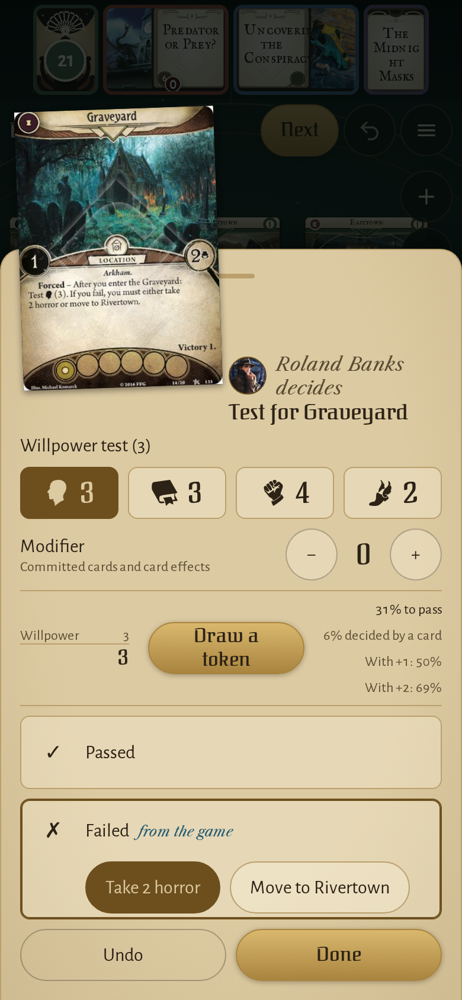</td></tr>
</table>

## Screencasts

### start a campaign and resume it from its log

[Play with pause and speed controls](https://macandy13.github.io/arkham-companion/pr-preview/pr-1159/screencasts/player.html?flow=start-a-campaign-and-resume-it-from-its-log&v=ee0916b&speed=0.25)

### lower a decision to adjust the board first

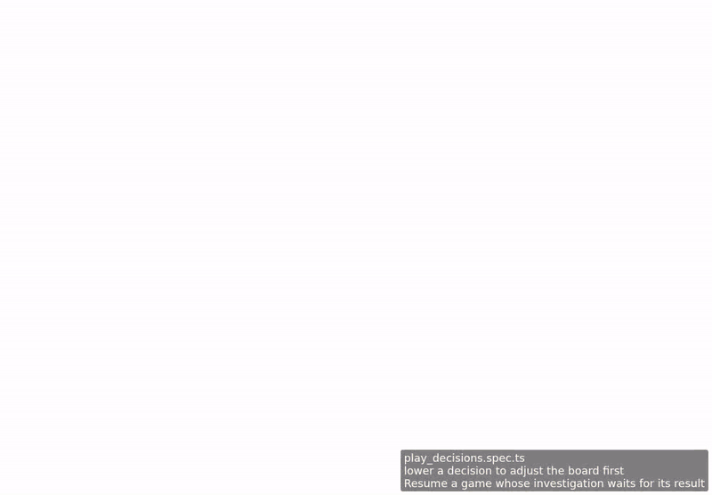

[Play with pause and speed controls](https://macandy13.github.io/arkham-companion/pr-preview/pr-1159/screencasts/player.html?flow=lower-a-decision-to-adjust-the-board-first&v=ee0916b&speed=0.25)

<!-- screencasts:end -->