<!-- screencasts:start -->

_Recorded from 05c73c9 by the PR preview workflow; updated on every push that changes `apps/web`._

## Screenshots

### the replacement picker for the killed Fake Seeker

<table>
<tr><th>Desktop</th><th>Phone</th></tr>
<tr><td>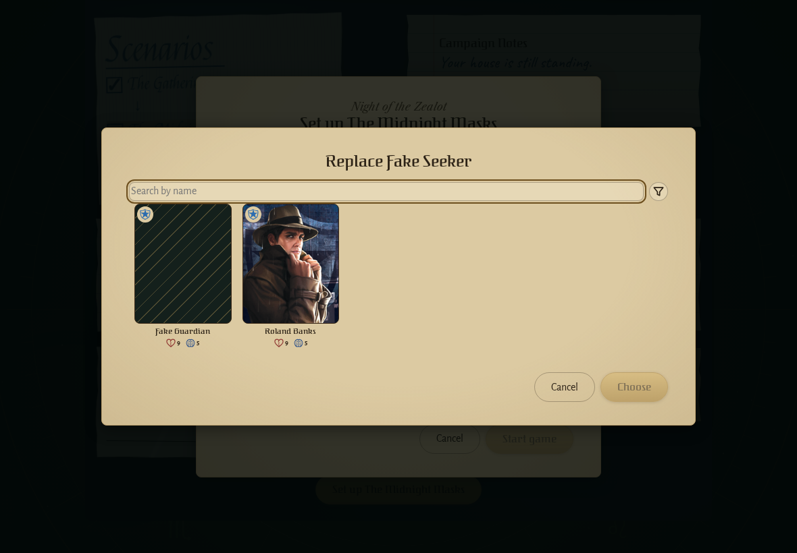</td><td>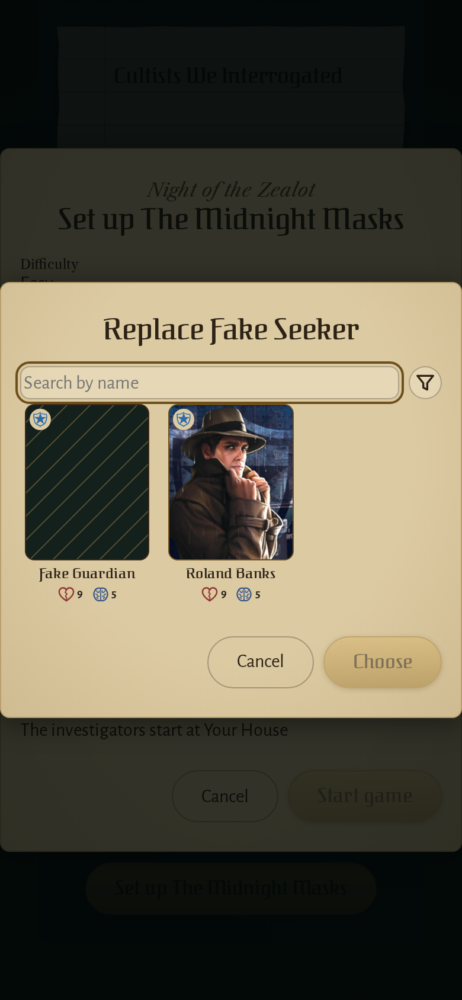</td></tr>
</table>

### the log of a campaign just started

<table>
<tr><th>Desktop</th><th>Phone</th></tr>
<tr><td>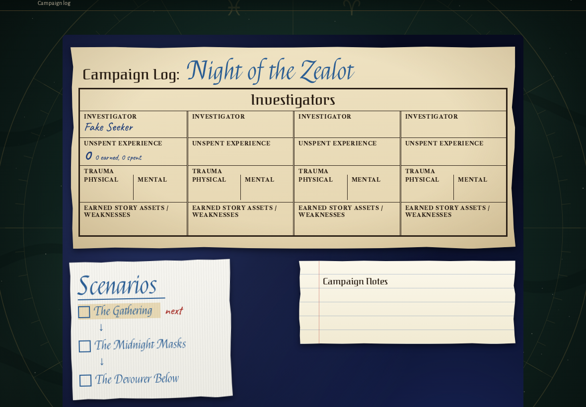</td><td>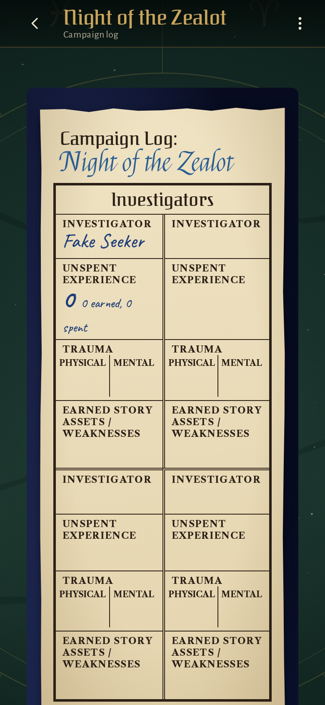</td></tr>
</table>

### the Graveyard’s failed willpower test, its choice under the Failed row

<table>
<tr><th>Desktop</th><th>Phone</th></tr>
<tr><td>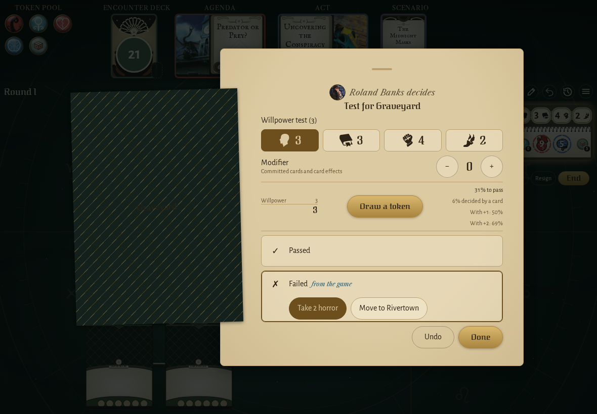</td><td>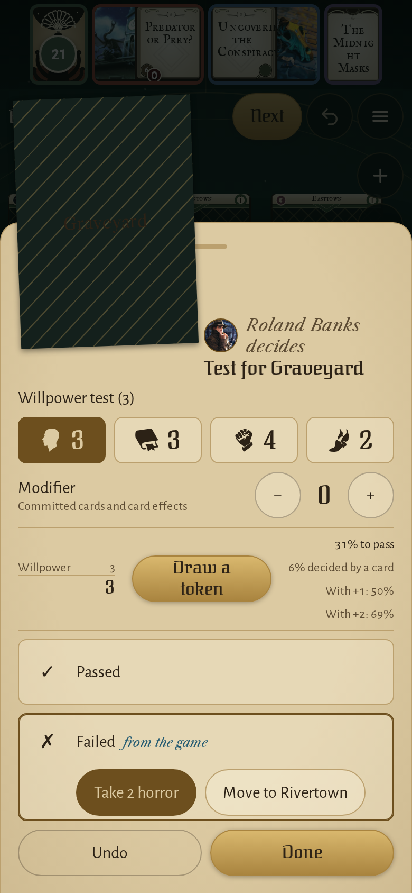</td></tr>
</table>

### Arkham in The Midnight Masks, Easttown, the Graveyard and Northside with their new symbols

<table>
<tr><th>Desktop</th><th>Phone</th></tr>
<tr><td>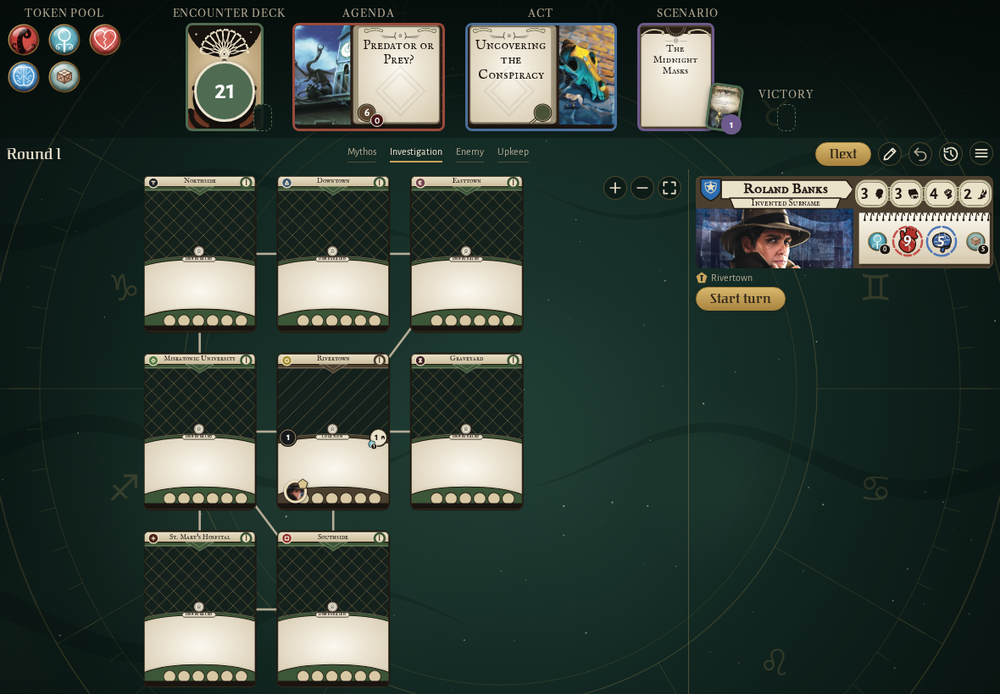</td><td>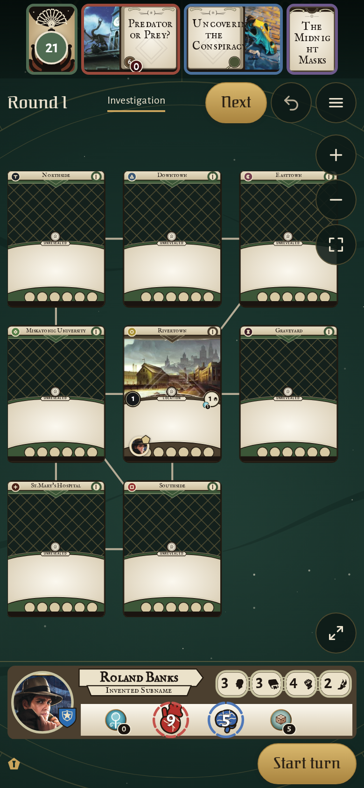</td></tr>
</table>

### the investigator picker with its filter menu open

<table>
<tr><th>Desktop</th><th>Phone</th></tr>
<tr><td>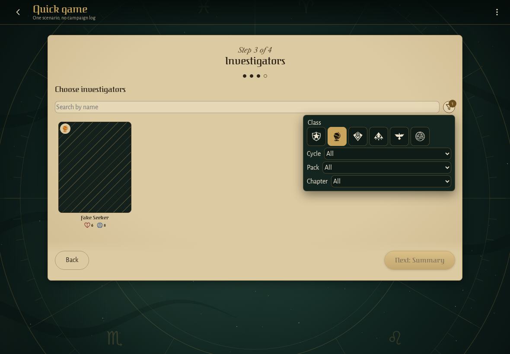</td><td>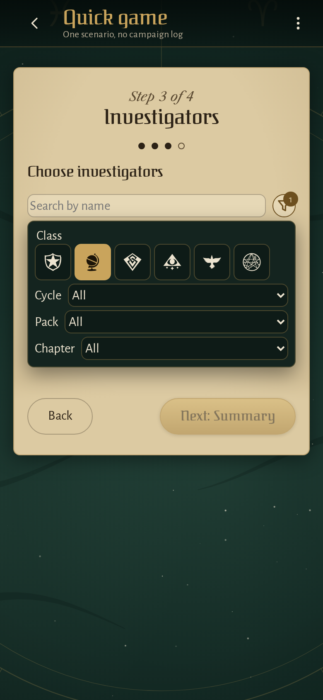</td></tr>
</table>

### the detail sheet of an investigator

<table>
<tr><th>Desktop</th><th>Phone</th></tr>
<tr><td>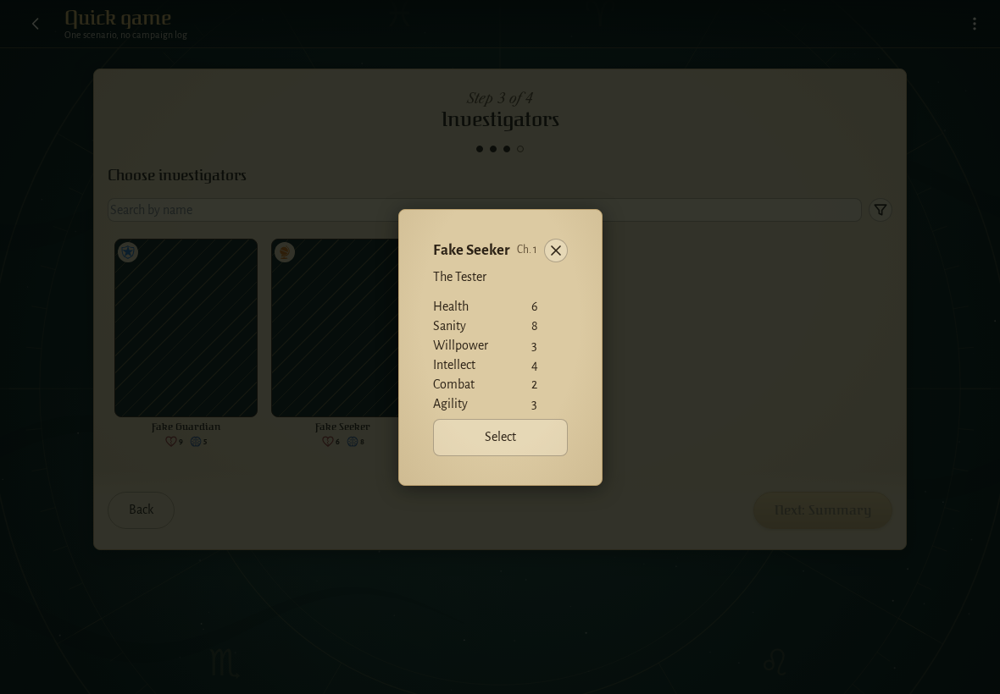</td><td>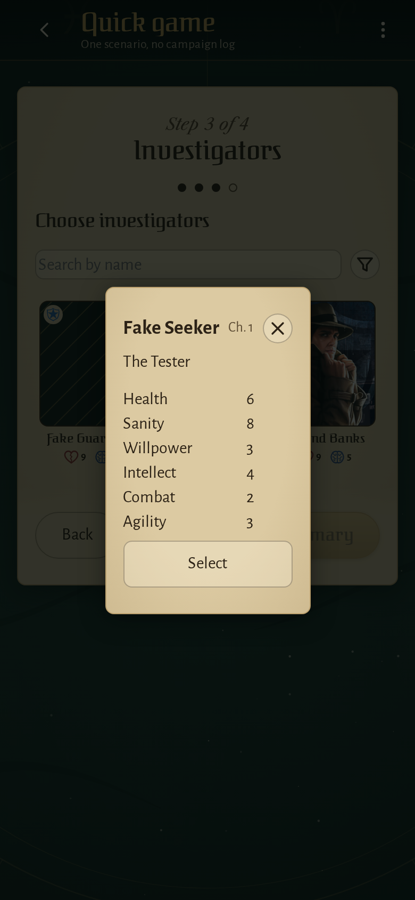</td></tr>
</table>

### the investigators step with two picked, their names pinned beside the next step

<table>
<tr><th>Desktop</th><th>Phone</th></tr>
<tr><td>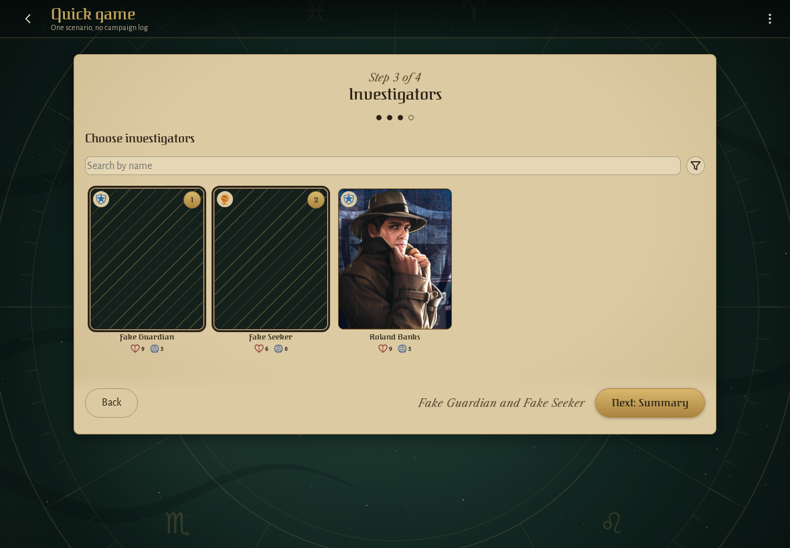</td><td>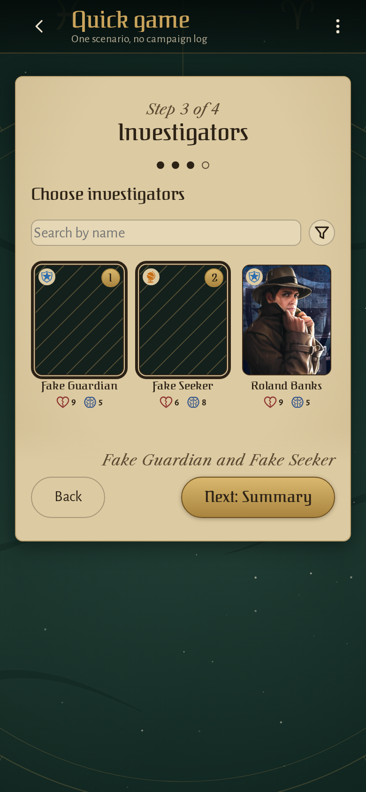</td></tr>
</table>

## Screencasts

### write a scenario resolution into the campaign log

[Play with pause and speed controls](https://macandy13.github.io/arkham-companion/pr-preview/pr-1174/screencasts/player.html?flow=write-a-scenario-resolution-into-the-campaign-log&v=05c73c9&speed=0.25)

<!-- screencasts:end -->