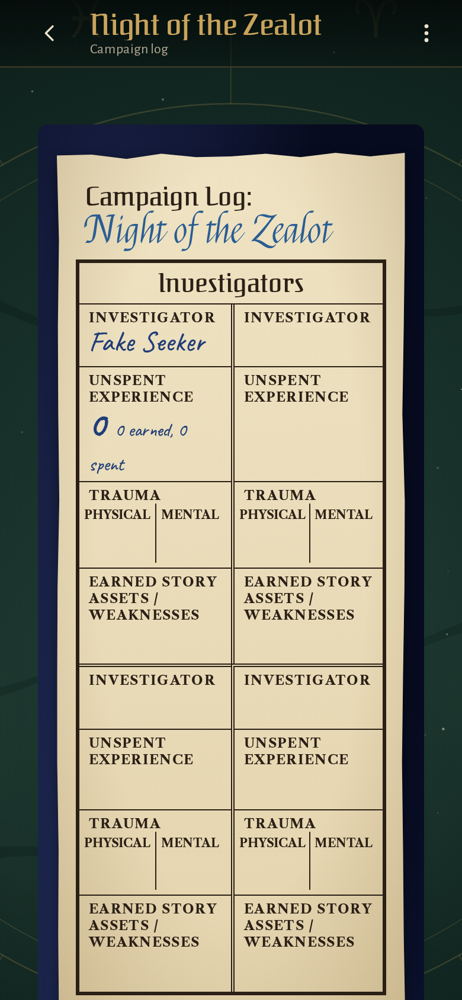
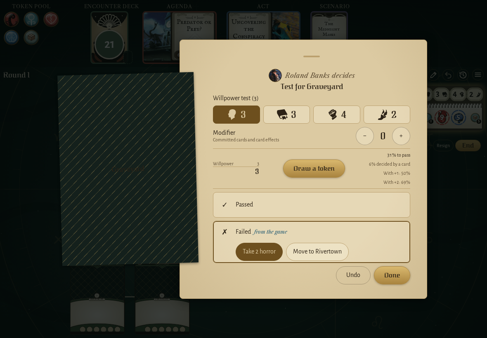
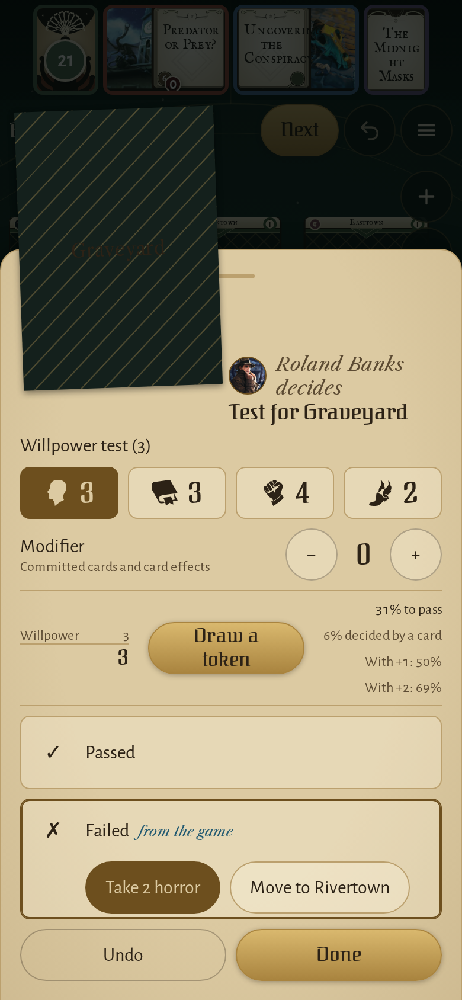

<!-- screencasts:start -->

_Recorded from fcfe8ea by the PR preview workflow; updated on every push that changes `apps/web`._

## Screenshots

### the log of a campaign just started

<table>
<tr><th>Desktop</th><th>Phone</th></tr>
<tr><td></td><td></td></tr>
</table>

### the Graveyard’s failed willpower test, its choice under the Failed row

<table>
<tr><th>Desktop</th><th>Phone</th></tr>
<tr><td></td><td></td></tr>
</table>

### Arkham in The Midnight Masks, Easttown, the Graveyard and Northside with their new symbols

<table>
<tr><th>Desktop</th><th>Phone</th></tr>
<tr><td></td><td></td></tr>
</table>

## Screencasts

### write a scenario resolution into the campaign log

[Play with pause and speed controls](https://macandy13.github.io/arkham-companion/pr-preview/pr-1177/screencasts/player.html?flow=write-a-scenario-resolution-into-the-campaign-log&v=fcfe8ea&speed=0.25)

### start a campaign and resume it from its log

[Play with pause and speed controls](https://macandy13.github.io/arkham-companion/pr-preview/pr-1177/screencasts/player.html?flow=start-a-campaign-and-resume-it-from-its-log&v=fcfe8ea&speed=0.25)

### play the phases from the header

[Play with pause and speed controls](https://macandy13.github.io/arkham-companion/pr-preview/pr-1177/screencasts/player.html?flow=play-the-phases-from-the-header&v=fcfe8ea&speed=0.25)

<!-- screencasts:end -->