<!-- screencasts:start -->

_Recorded from 5b24c4f by the PR preview workflow; updated on every push that changes `apps/web`._

## Screenshots

### the resolution of a game its only investigator lost to horror

<table>
<tr><th>Desktop</th><th>Phone</th></tr>
<tr><td>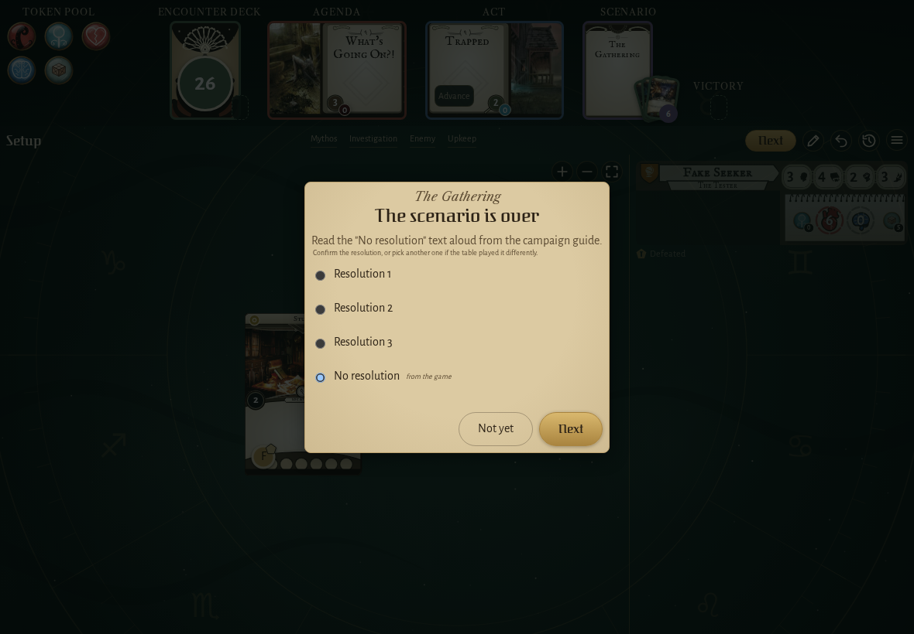</td><td>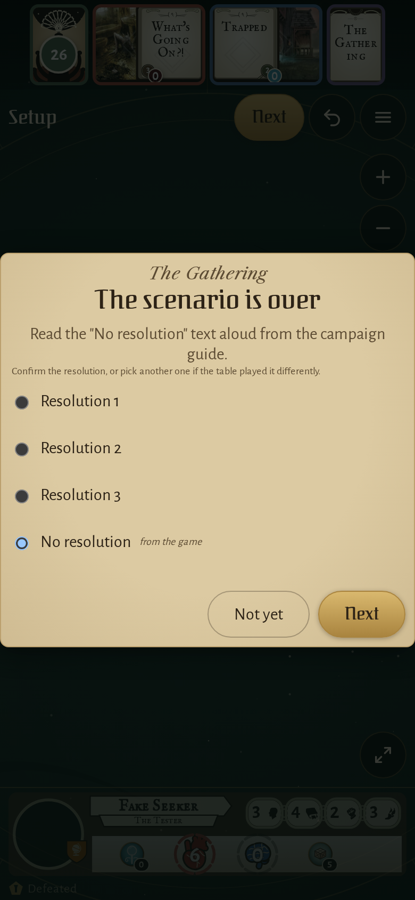</td></tr>
</table>

### the log right after that resolution was written

<table>
<tr><th>Desktop</th><th>Phone</th></tr>
<tr><td></td><td>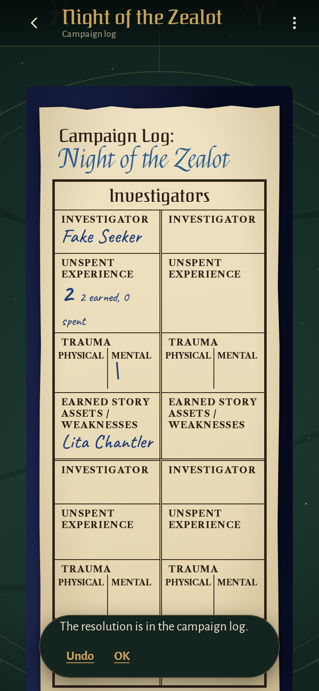</td></tr>
</table>

### the setup preview of The Midnight Masks

<table>
<tr><th>Desktop</th><th>Phone</th></tr>
<tr><td></td><td>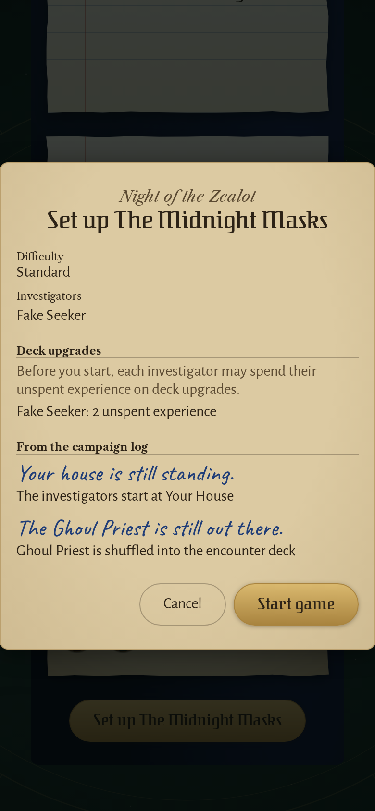</td></tr>
</table>

### Roland Banks’ combat boosted by 2, as an ally in play gives it

<table>
<tr><th>Desktop</th><th>Phone</th></tr>
<tr><td>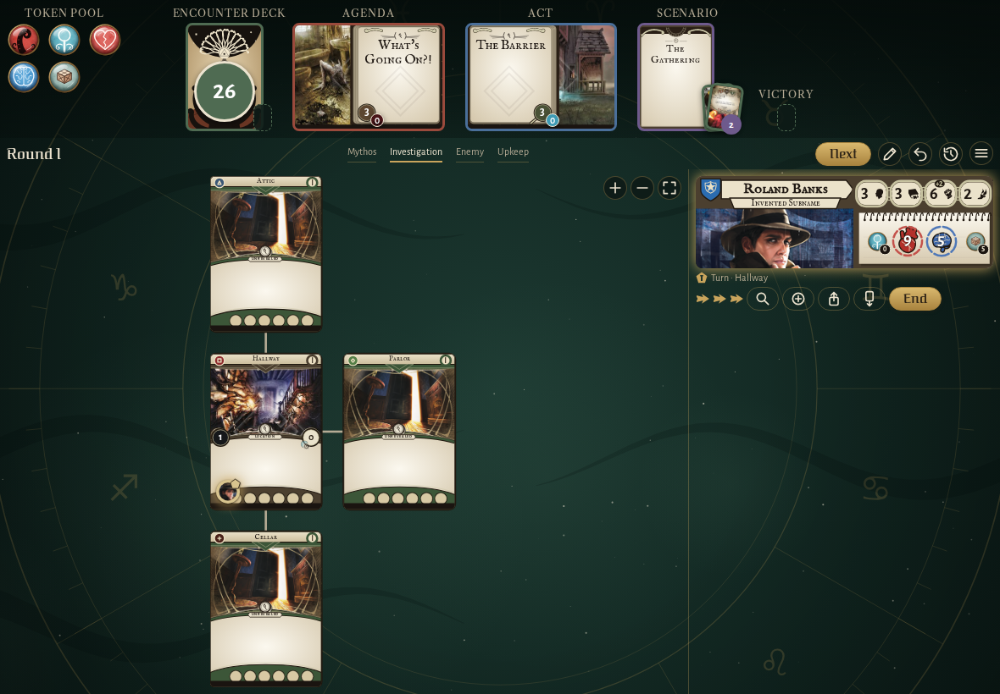</td><td>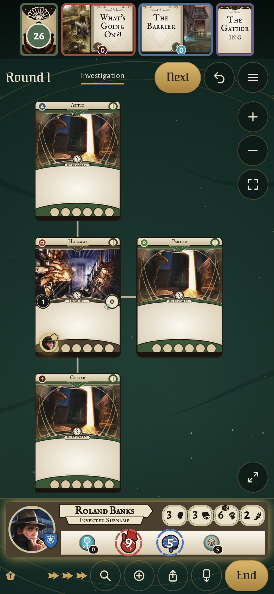</td></tr>
</table>

### Roland Banks’ card while the players adjust the board, its steppers out

<table>
<tr><th>Desktop</th><th>Phone</th></tr>
<tr><td>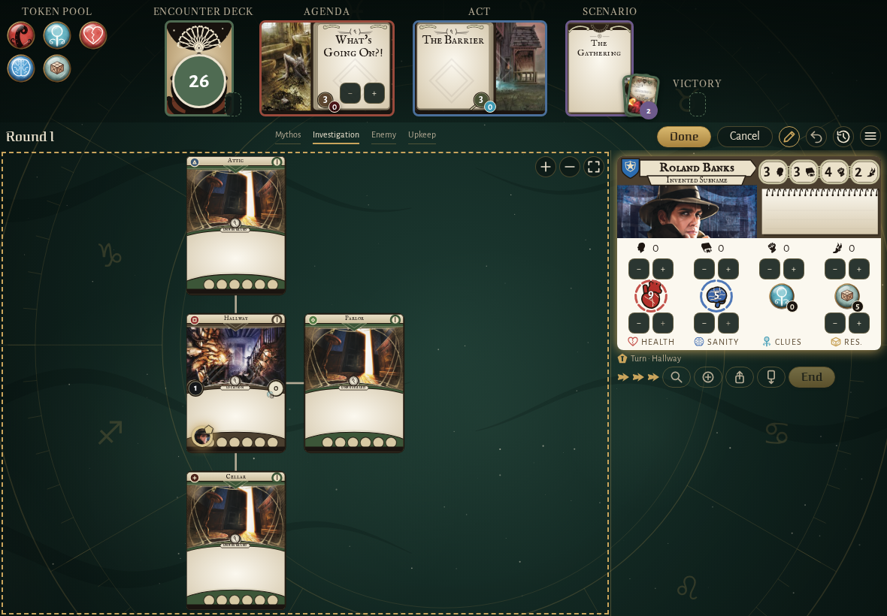</td><td>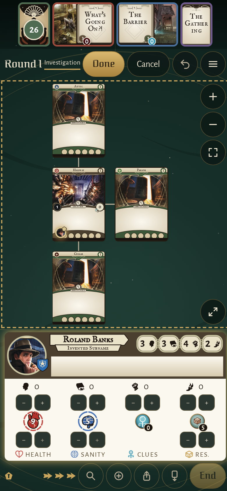</td></tr>
</table>

### the Graveyard’s failed willpower test, its choice under the Failed row

<table>
<tr><th>Desktop</th><th>Phone</th></tr>
<tr><td>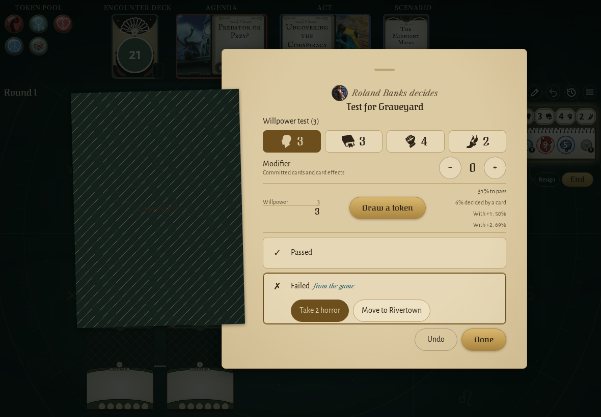</td><td>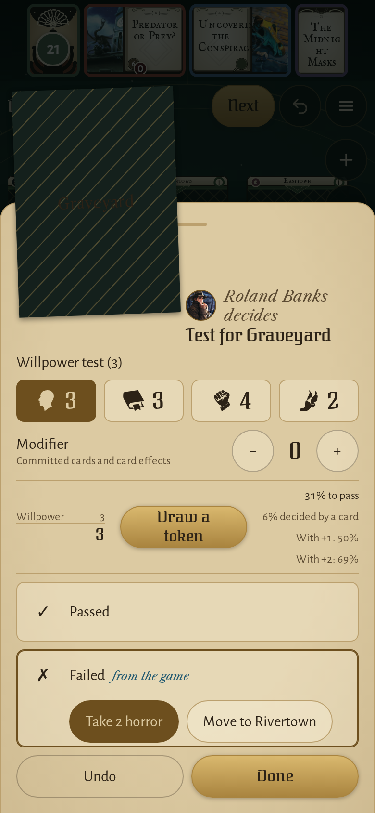</td></tr>
</table>

### Arkham in The Midnight Masks, Easttown, the Graveyard and Northside with their new symbols

<table>
<tr><th>Desktop</th><th>Phone</th></tr>
<tr><td>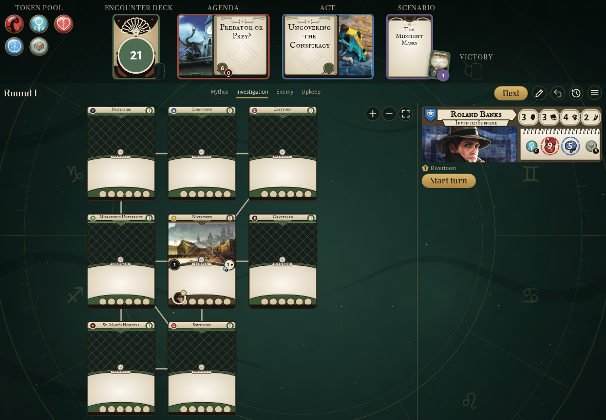</td><td>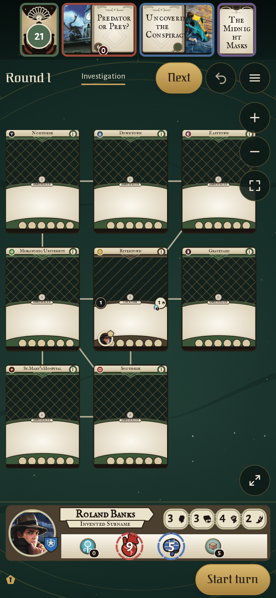</td></tr>
</table>

## Screencasts

### write a scenario resolution into the campaign log

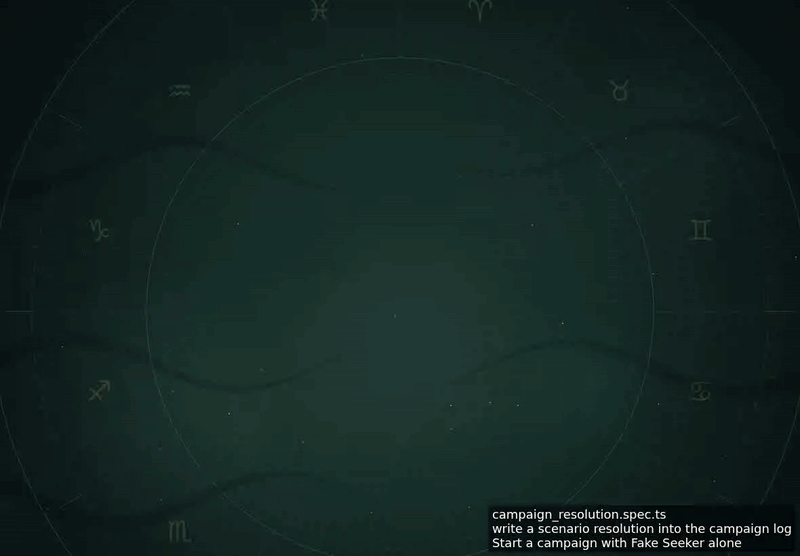

[Play with pause and speed controls](https://macandy13.github.io/arkham-companion/pr-preview/pr-1178/screencasts/player.html?flow=write-a-scenario-resolution-into-the-campaign-log&v=5b24c4f&speed=0.25)

<!-- screencasts:end -->