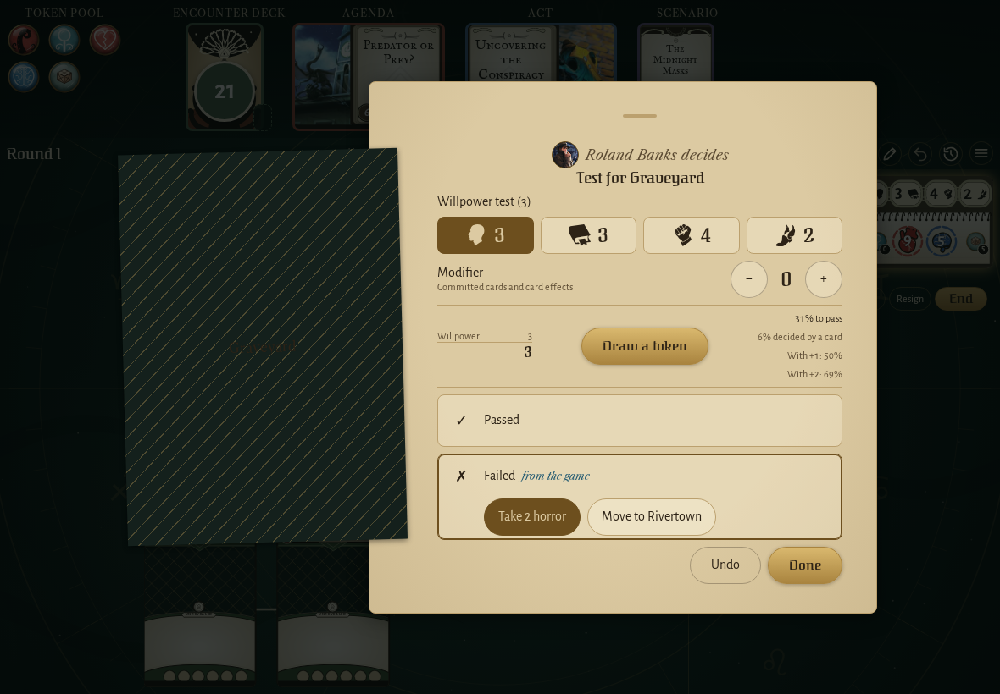
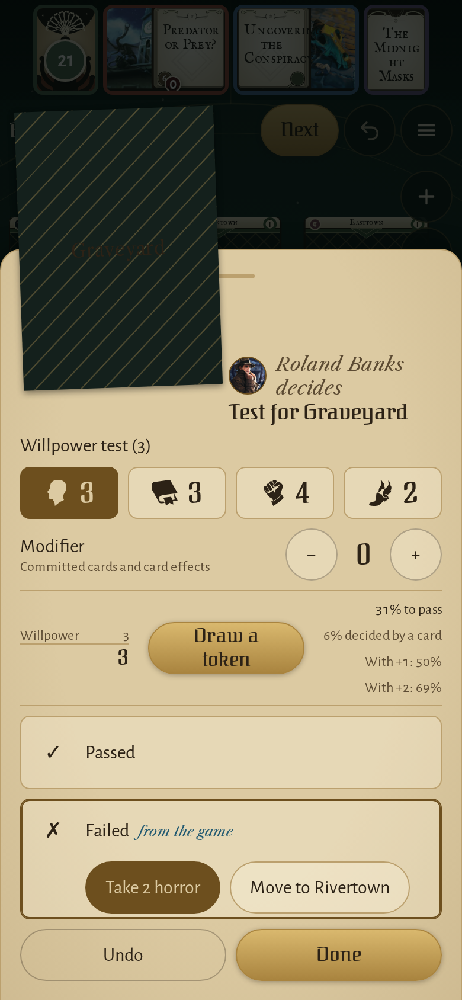
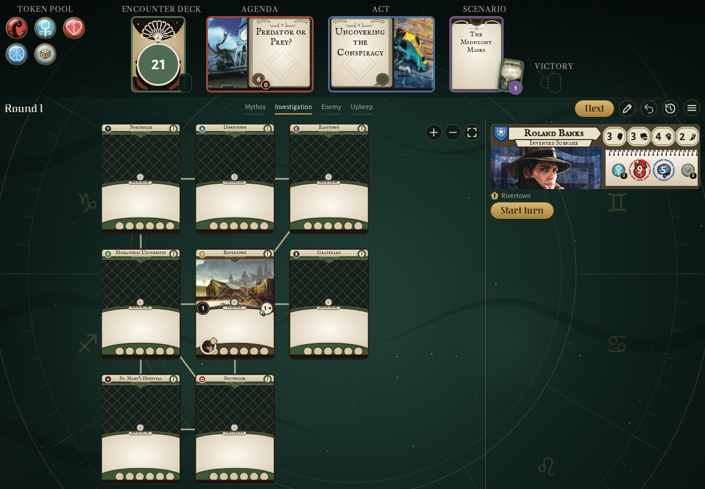
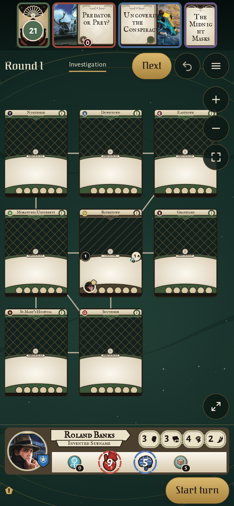

<!-- screencasts:start -->

_Recorded from cfe56e3 by the PR preview workflow; updated on every push that changes `apps/web`._

## Screenshots

### the Graveyard’s failed willpower test, its choice under the Failed row

<table>
<tr><th>Desktop</th><th>Phone</th></tr>
<tr><td></td><td></td></tr>
</table>

### Arkham in The Midnight Masks, Easttown, the Graveyard and Northside with their new symbols

<table>
<tr><th>Desktop</th><th>Phone</th></tr>
<tr><td></td><td></td></tr>
</table>

## Screencasts

### write a scenario resolution into the campaign log

[Play with pause and speed controls](https://macandy13.github.io/arkham-companion/pr-preview/pr-1179/screencasts/player.html?flow=write-a-scenario-resolution-into-the-campaign-log&v=cfe56e3&speed=0.25)

### start a new game

[Play with pause and speed controls](https://macandy13.github.io/arkham-companion/pr-preview/pr-1179/screencasts/player.html?flow=start-a-new-game&v=cfe56e3&speed=0.25)

<!-- screencasts:end -->