<!-- screencasts:start -->

_Recorded from e1e3c40 by the PR preview workflow; updated on every push that changes `apps/web`._

## Screenshots

### the house map in the card pictures style, the clues left on each card

<table>
<tr><th>Desktop</th><th>Phone</th></tr>
<tr><td>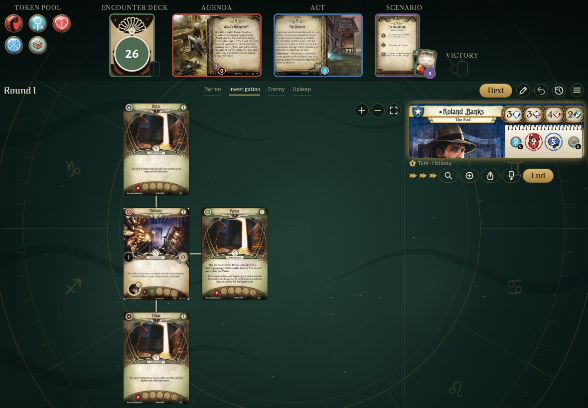</td><td>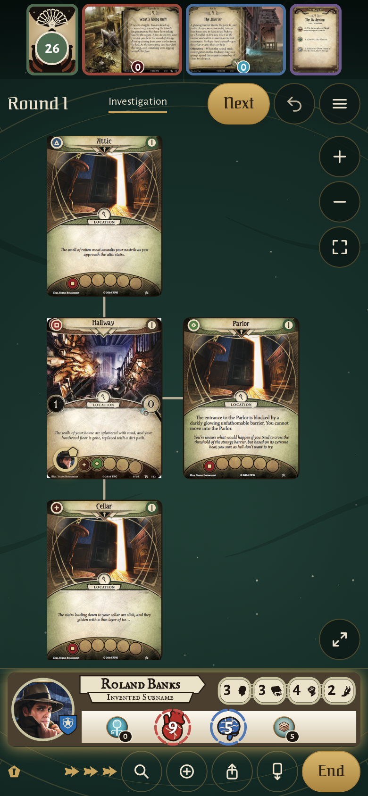</td></tr>
</table>

### the Graveyard’s failed willpower test, its choice under the Failed row

<table>
<tr><th>Desktop</th><th>Phone</th></tr>
<tr><td>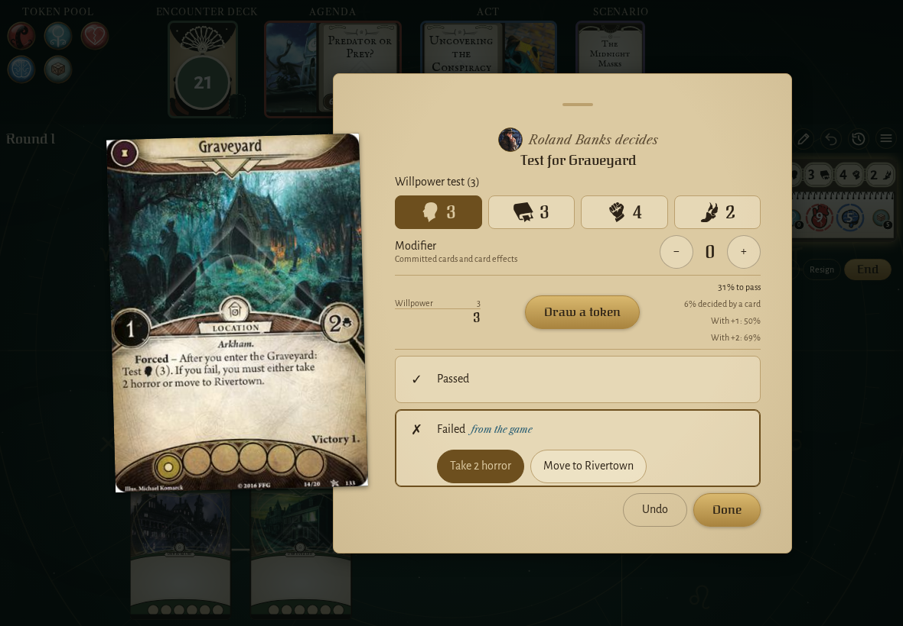</td><td>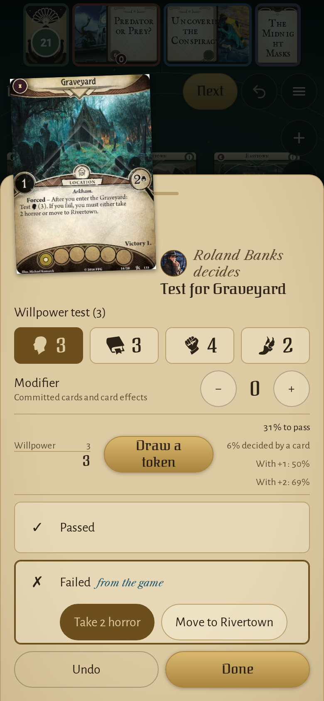</td></tr>
</table>

### Arkham in The Midnight Masks, Easttown, the Graveyard and Northside with their new symbols

<table>
<tr><th>Desktop</th><th>Phone</th></tr>
<tr><td>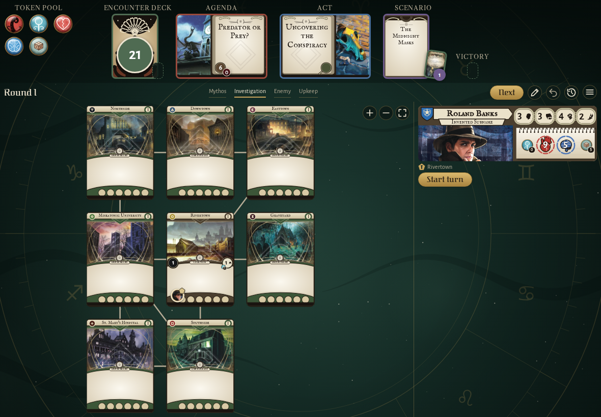</td><td>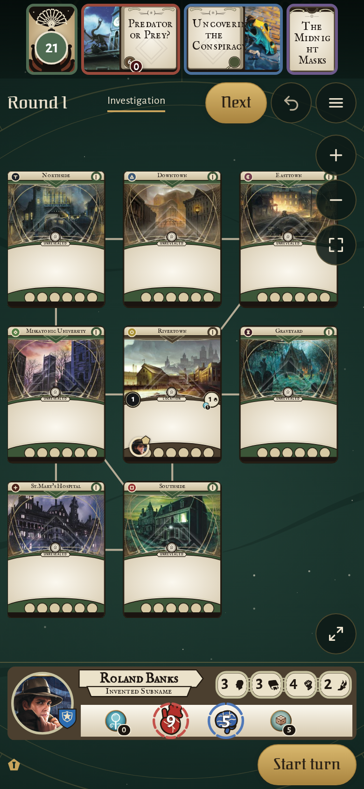</td></tr>
</table>

### the Tangled Thicket revealed with its double slash, the other Arkham Woods still showing their square

<table>
<tr><th>Desktop</th><th>Phone</th></tr>
<tr><td>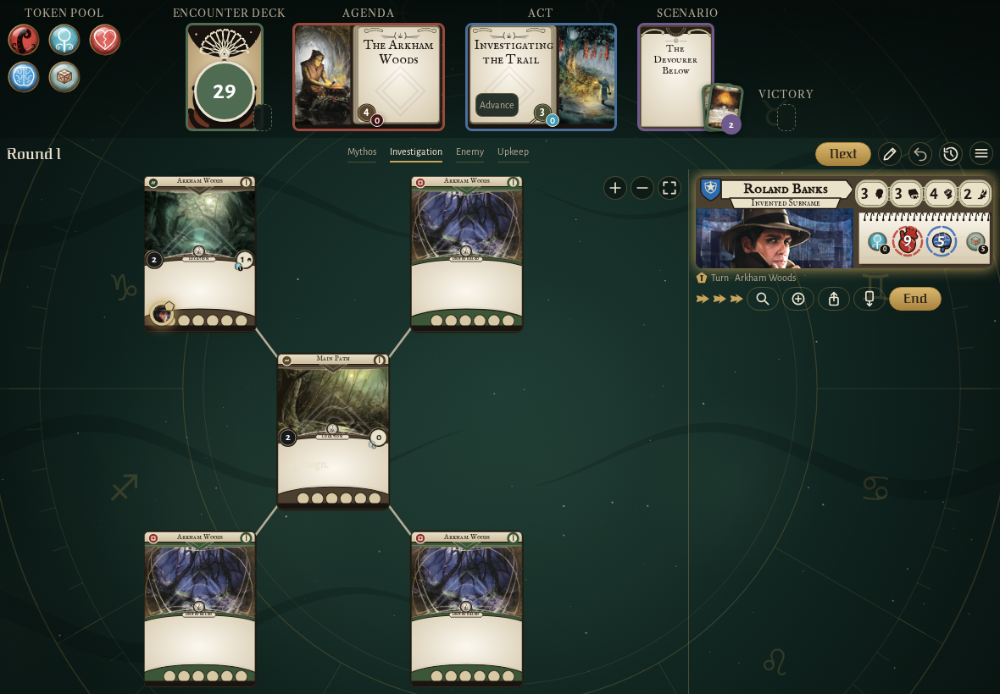</td><td>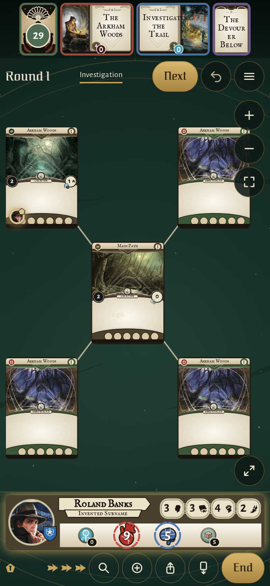</td></tr>
</table>

### the shelf with a campaign waiting for its second chapter beside a game of one scenario

<table>
<tr><th>Desktop</th><th>Phone</th></tr>
<tr><td>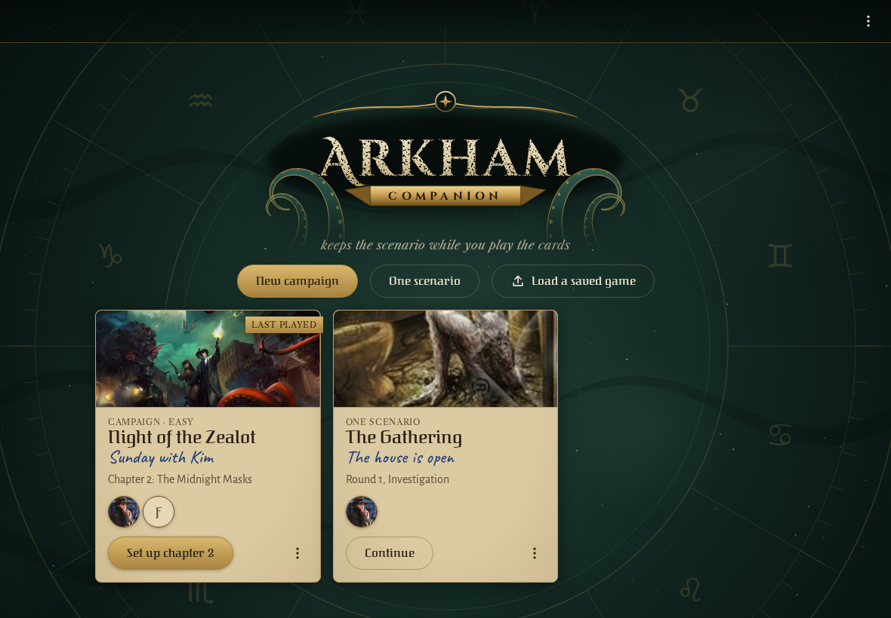</td><td>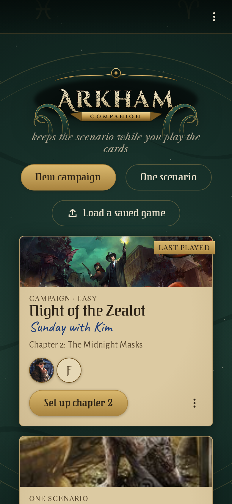</td></tr>
</table>

### a new campaign's first step: Night of the Zealot's cover with its key art, then Brethren of Ash's

<table>
<tr><th>Desktop</th><th>Phone</th></tr>
<tr><td>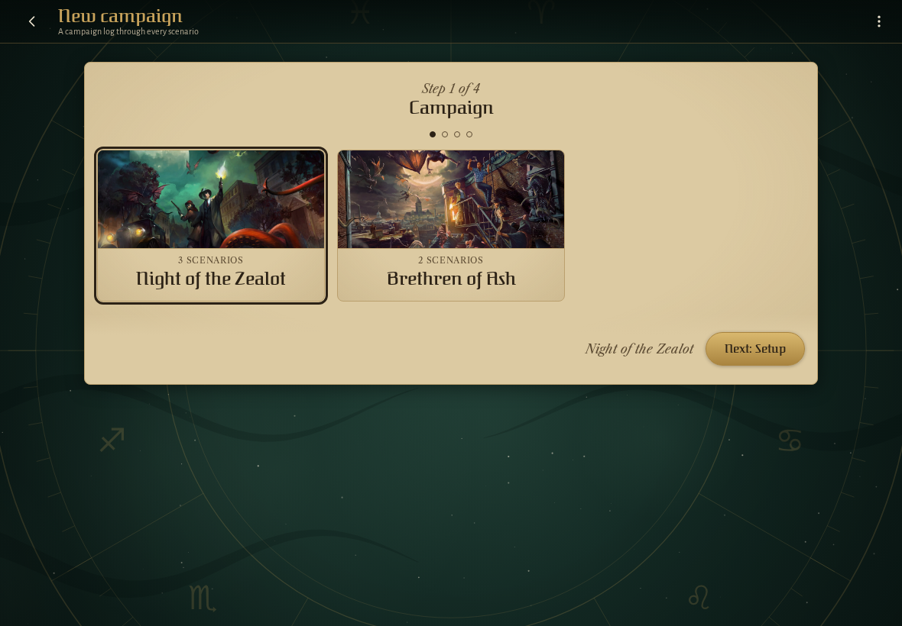</td><td>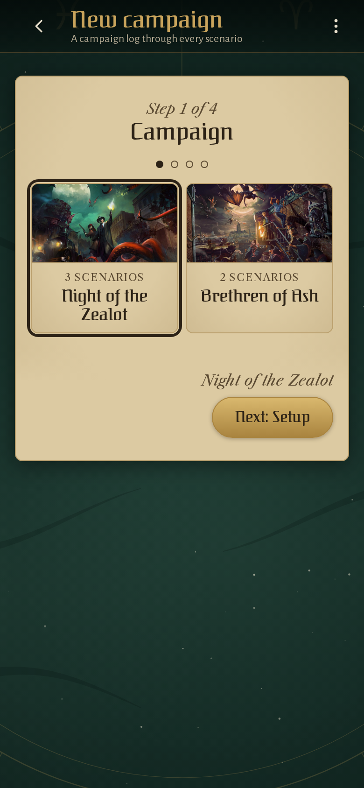</td></tr>
</table>

## Screencasts

### a campaign is exported, deleted and loaded back

_Not recorded: the flow failed, see the E2E check._

### write a scenario resolution into the campaign log

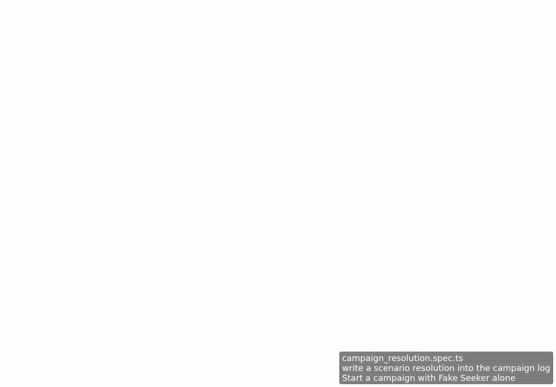

[Play with pause and speed controls](https://macandy13.github.io/arkham-companion/pr-preview/pr-1202/screencasts/player.html?flow=write-a-scenario-resolution-into-the-campaign-log&v=e1e3c40&speed=0.25)

<!-- screencasts:end -->