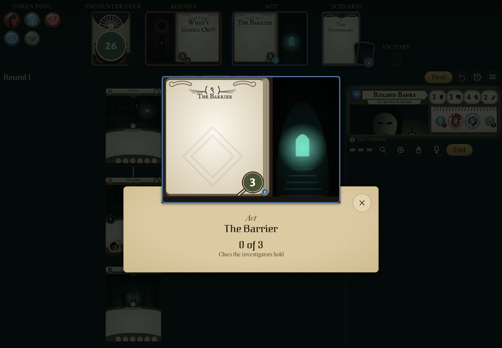
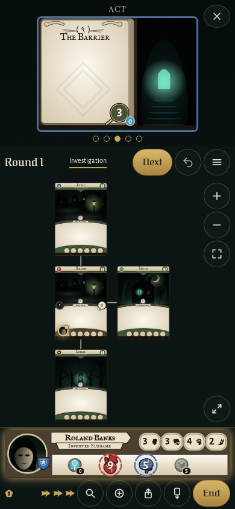
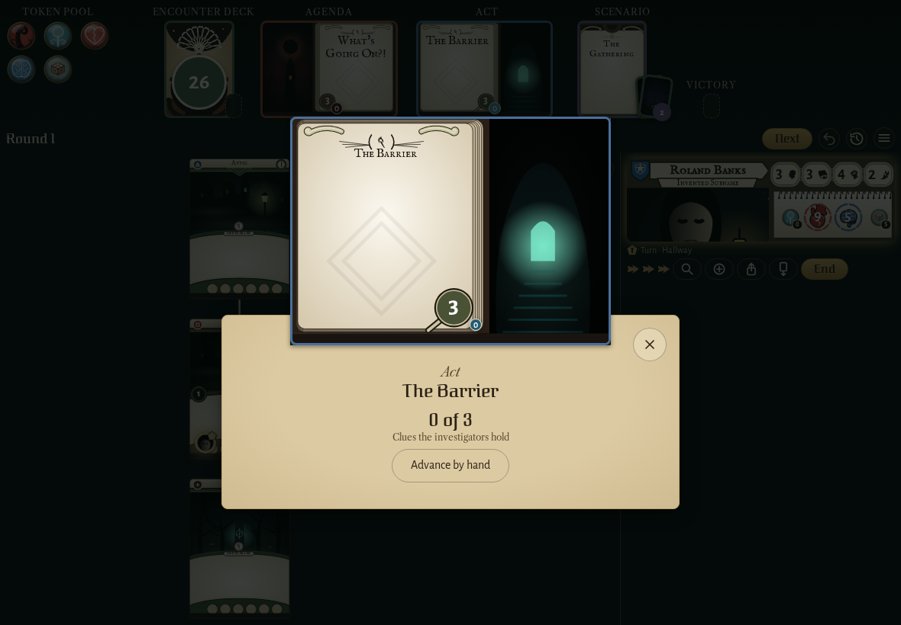
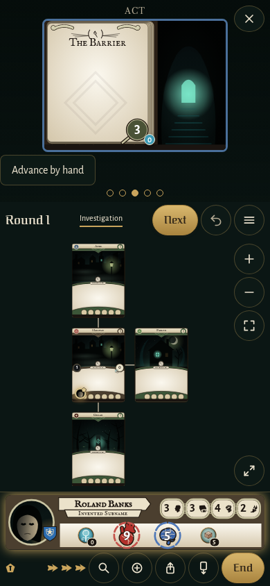
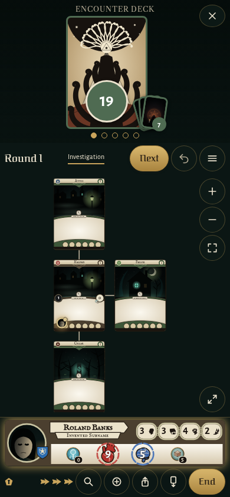
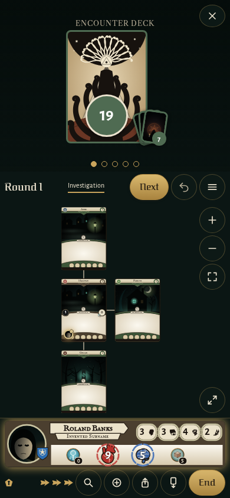
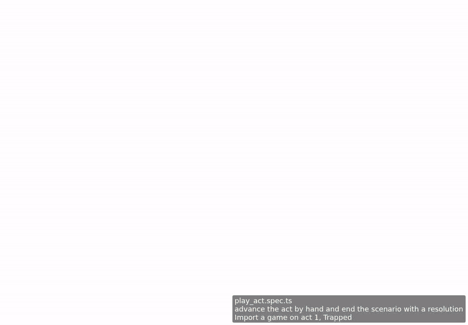

<!-- screencasts:start -->

_The goldens this PR changes, as of bb51c43, from the PR preview workflow; updated on every push that changes `apps/web`._

## Screenshots

### The Barrier opened as a full card

<table>
<tr><th></th><th>Desktop</th><th>Phone</th></tr>
<tr><th>Before</th><td></td><td></td></tr>
<tr><th>After</th><td></td><td></td></tr>
</table>

### the header with its piles fanned: seven cards discarded, the set-aside cards on the scenario card, the Ghoul Priest in the victory display, the token pool beside it

<table>
<tr><th></th><th>Desktop</th><th>Phone</th></tr>
<tr><th>Before</th><td>Unchanged</td><td></td></tr>
<tr><th>After</th><td>Unchanged</td><td></td></tr>
</table>

## Screencasts

### advance the act by hand and end the scenario with a resolution

[Play with pause and speed controls](https://macandy13.github.io/arkham-companion/pr-preview/pr-1264/screencasts/player.html?flow=advance-the-act-by-hand-and-end-the-scenario-with-a-resolution&v=bb51c43&speed=0.25)

### play the phases from the header

[Play with pause and speed controls](https://macandy13.github.io/arkham-companion/pr-preview/pr-1264/screencasts/player.html?flow=play-the-phases-from-the-header&v=bb51c43&speed=0.25)

### open the map on a phone and go on from its strips

[Play with pause and speed controls](https://macandy13.github.io/arkham-companion/pr-preview/pr-1264/screencasts/player.html?flow=open-the-map-on-a-phone-and-go-on-from-its-strips&v=bb51c43&speed=0.25)

<!-- screencasts:end -->