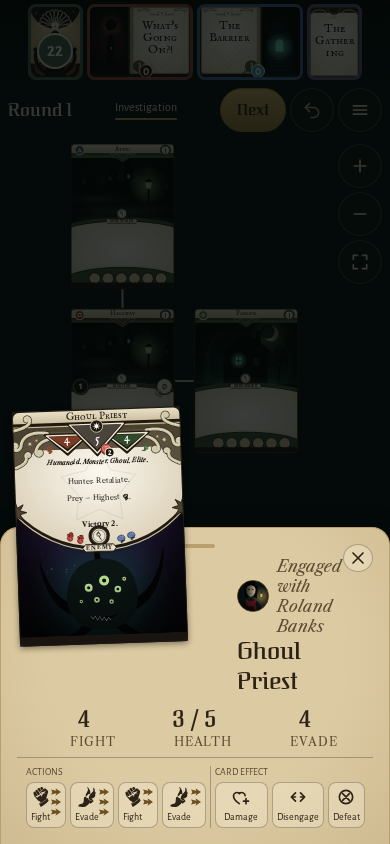
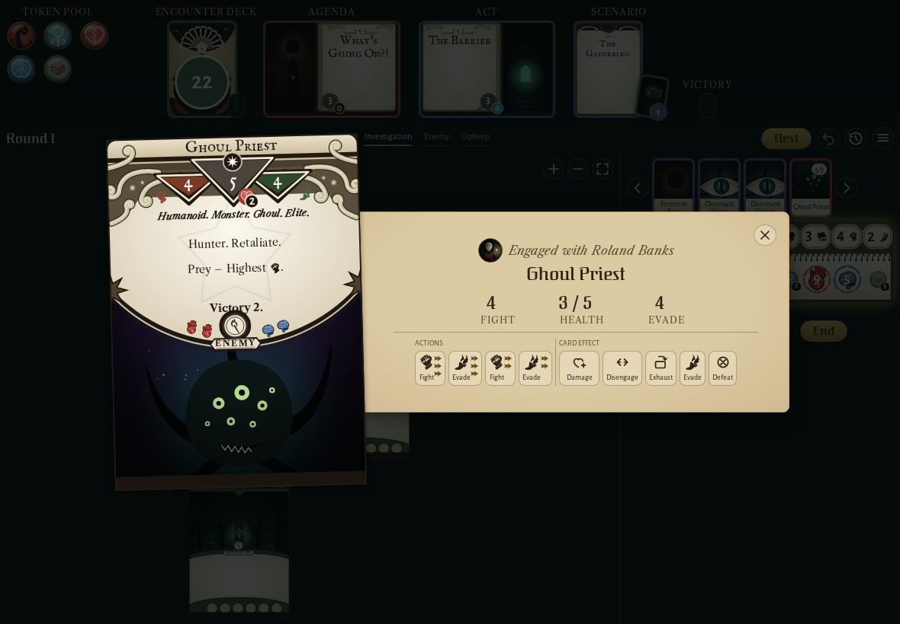
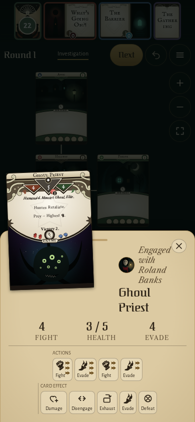
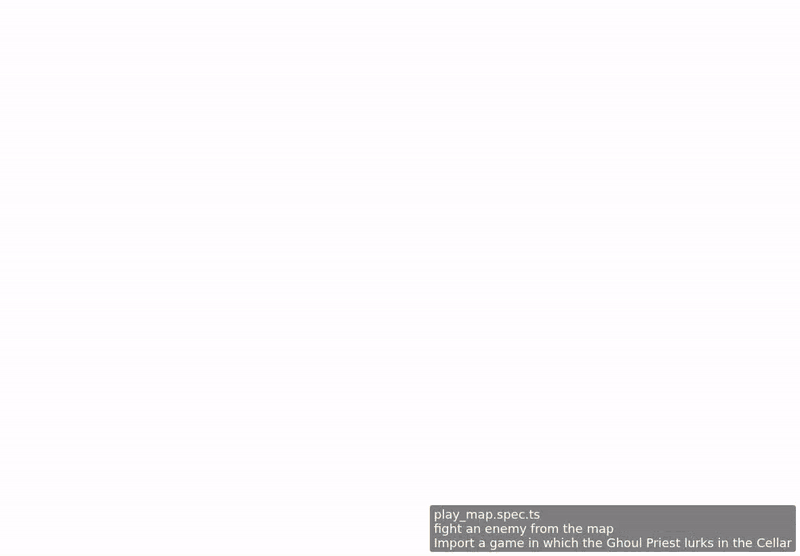

<!-- screencasts:start -->

_The goldens this PR changes, as of 490c248, from the PR preview workflow; updated on every push that changes `apps/web`._

## Screenshots

### the Ghoul Priest's details opened from its card on Roland Banks' turn, both Frozen in Fear raising the fight to 3 actions

<table>
<tr><th></th><th>Desktop</th><th>Phone</th></tr>
<tr><th>Before</th><td></td><td></td></tr>
<tr><th>After</th><td></td><td></td></tr>
</table>

## Screencasts

### fight an enemy from the map

[Play with pause and speed controls](https://macandy13.github.io/arkham-companion/pr-preview/pr-1276/screencasts/player.html?flow=fight-an-enemy-from-the-map&v=490c248&speed=0.25)

<!-- screencasts:end -->