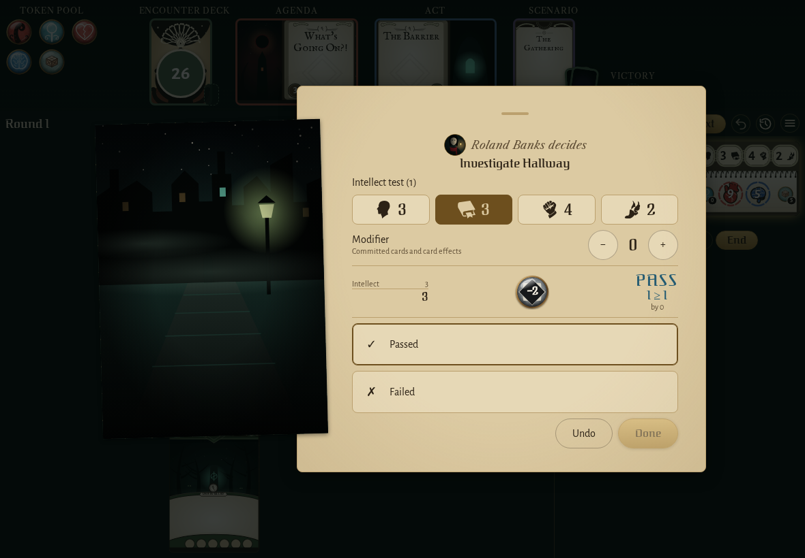
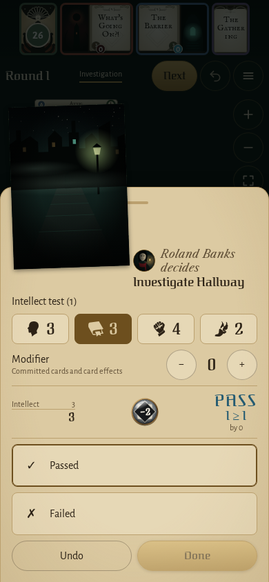
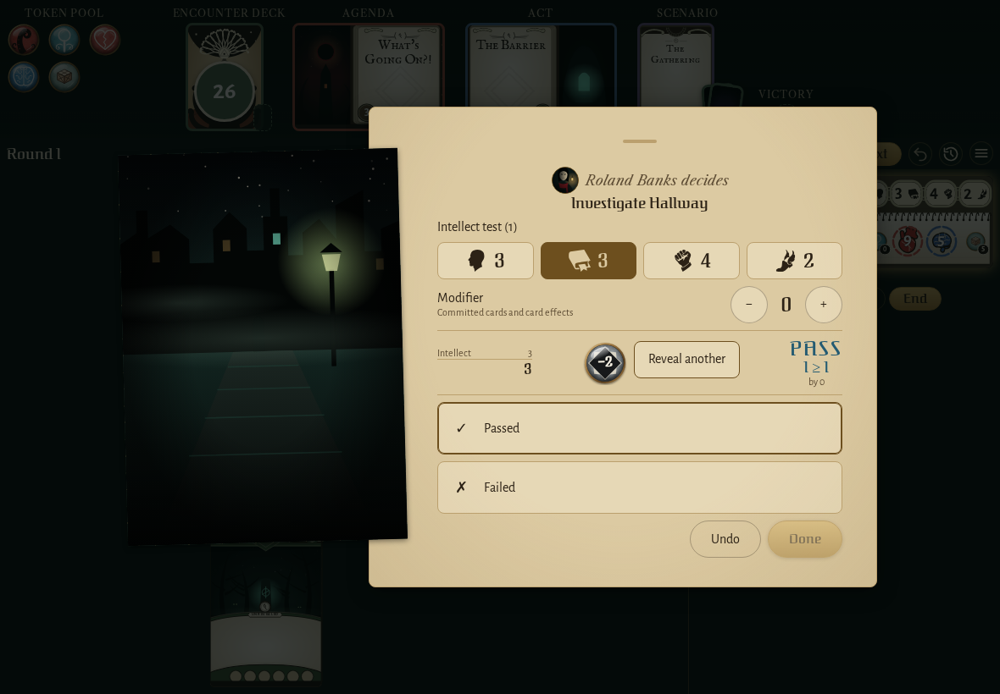
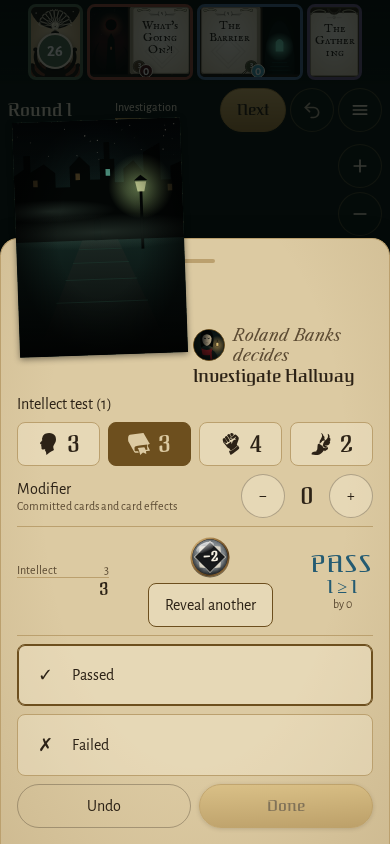
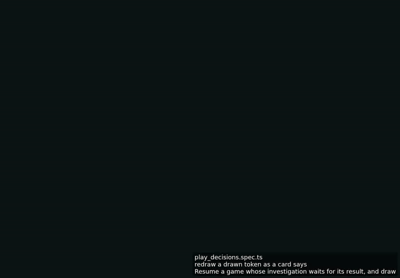

<!-- screencasts:start -->

_The goldens this PR changes, as of 34bf319, from the PR preview workflow; updated on every push that changes `apps/web`._

## Screenshots

### the decision dialog asking for the result of an investigation, a token drawn

<table>
<tr><th></th><th>Desktop</th><th>Phone</th></tr>
<tr><th>Before</th><td></td><td></td></tr>
<tr><th>After</th><td></td><td></td></tr>
</table>

## Screencasts

### redraw a drawn token as a card says

[Play with pause and speed controls](https://macandy13.github.io/arkham-companion/pr-preview/pr-1298/screencasts/player.html?flow=redraw-a-drawn-token-as-a-card-says&v=34bf319&speed=0.25)

<!-- screencasts:end -->